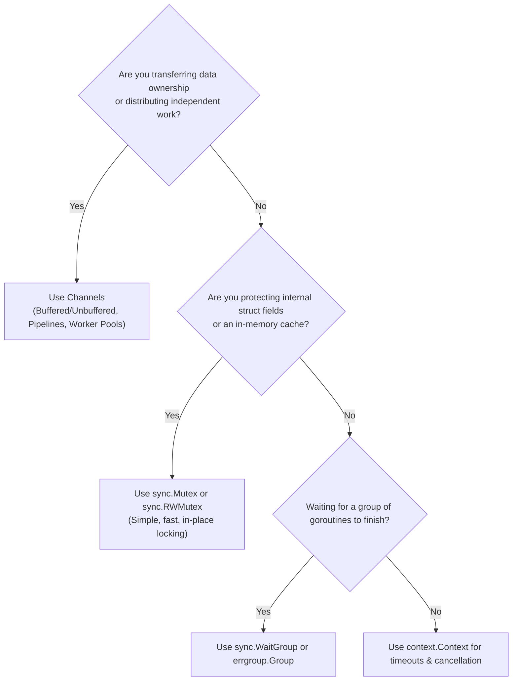

# Go Concurrency Architecture: Channels vs Mutexes 🚦

Go's concurrency model is based on **Goroutines** (user-space lightweight threads managed by the Go runtime scheduler) and two complementary synchronization primitives: **Channels** and the **`sync` package**.

Choosing the right primitive for the right problem is the key to writing performant, deadlock-free Go services.

---

## 1. Channels vs Mutexes: The Decision Matrix

Go developers frequently debate: _"Should I use a Channel or a Mutex for this?"_

The Go team provides this simple rule of thumb:

> - **Use Channels** when passing data ownership, coordinating pipelines, or waiting for events.
> - **Use Mutexes** when guarding shared in-memory state or caches.



| Use Case                                     | Recommended Primitive        | Why?                                               |
| :------------------------------------------- | :--------------------------- | :------------------------------------------------- |
| **Worker pools & job distribution**          | `chan Job`                   | Clean producer/consumer decoupled backpressure     |
| **Pipeline stream processing**               | `<-chan Data`                | Composable stages with graceful close propagation  |
| **In-memory cache (`map[string]User`)**      | `sync.RWMutex`               | Fastest performance; multiple concurrent readers   |
| **Rate limiting & token bucket**             | `chan struct{}`              | Channel buffer naturally represents token capacity |
| **Waiting for $N$ goroutines to finish**     | `sync.WaitGroup`             | Explicit counter with `Add()`, `Done()`, `Wait()`  |
| **Waiting for tasks that can return errors** | `golang.org/x/sync/errgroup` | Cancels group on first error and returns it        |
| **One-time initialization (Singletons)**     | `sync.Once`                  | Guarantees thread-safe single execution            |

---

## 2. Core Modules in This Section

- **[[Architecture/languages/golang/14-channels|Channels & Goroutines]]** — Unbuffered and buffered channels, directional channels, `select`, worker pools, and avoiding deadlocks.
- **[[Architecture/languages/golang/15-sync-and-atomic|The `sync` Package]]** — `sync.Mutex`, `sync.RWMutex`, `sync.WaitGroup`, `sync.Once`, `sync.Pool`, and the race detector (`go test -race`).
- **[[Architecture/languages/golang/17-context|Context Package]]** — Propagating cancellation, timeouts, and request-scoped metadata across goroutine trees.

---

## 3. Detecting Data Races with `-race`

Go includes a built-in hardware race detector. Always run your tests with `-race` in CI:

```bash
# Run tests with active race detection
go test -race ./...

# Build binary with race detector enabled for staging
go build -race -o app ./cmd/server
```

---

## Across the Wiki

- [[Architecture/programming-concepts/processes-threads-and-coroutines|Processes, Threads & Coroutines]] — How Go's M:N scheduler compares to OS threads.
- [[Architecture/solution-architecture-concepts/api-design/concurrency|Distributed Concurrency]] — Concurrency in distributed architectures.
- [[Architecture/solution-architecture-concepts/reliability/memory-leaks|Memory Leaks]] — Diagnosing goroutine leaks with pprof.
