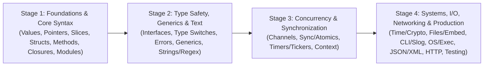

# Golang

Go is the lingua franca of cloud-native infrastructure engineering, powering Kubernetes, Docker, Terraform, Prometheus, Envoy, and etcd. Its simple memory model, lightweight goroutines, and strict standard library make it exceptionally suited for high-throughput, low-latency microservices and distributed systems.

This section provides a **4-stage progressive roadmap** comprising **26 comprehensive modules** packed with practical, runnable code snippets, expected outputs, common production gotchas, and architectural design patterns.

---

## The 4-Stage Go Roadmap

---

## Stage 1: Foundations & Core Data Structures (Simple)

Foundational syntax, control flow, functions, memory semantics, and collection layouts:

1. [[Architecture/languages/golang/01-variables-constants-and-control-flow|01: Variables, Constants, Control Flow & Enums]]  
   Values, short variable declarations (`:=`), constants, for loops (4 styles), if/else branching, multi-case switch statements, and idiomatic enums with `iota`.
2. [[Architecture/languages/golang/02-functions-pointers-and-strings|02: Functions, Pointers, Strings & Runes]]  
   Multiple return values, variadic functions, recursion, value vs pointer semantics, memory addresses (`&`/`*`), and UTF-8 strings vs 32-bit integer runes.
3. [[Architecture/languages/golang/03-modules-and-packages|03: Go Modules, Packages & Layout]]  
   `go.mod`, `go.sum`, dependency management, visibility rules (capitalization), idiomatic project layout (`cmd/`, `internal/`, `pkg/`), and the `init()` function lifecycle.
4. [[Architecture/languages/golang/04-slices-and-maps|04: Arrays, Slices & Maps in Go]]  
   Fixed arrays vs 24-byte dynamic slice headers, pre-allocating capacity with `make()`, sub-slicing memory leaks, hash map mechanics, and the comma-ok idiom.
5. [[Architecture/languages/golang/05-structs-and-embedding|05: Structs, Constructors & Embedding]]  
   Struct literals, constructor patterns (`NewServer`), functional options for configuration, and composition via struct embedding.
6. [[Architecture/languages/golang/06-methods|06: Methods: Value vs Pointer Receivers]]  
   Value vs pointer receivers decision matrix, mutating struct fields, and calling methods on nil receiver pointers.
7. [[Architecture/languages/golang/07-closures|07: Closures, Scope & Defer in Go]]  
   First-class functions, lexical closures, guaranteed resource cleanup with `defer` (LIFO execution), and the Go 1.22 loop variable scoping fix.

---

## Stage 2: Interfaces, Generics & Text Processing (Easy–Medium)

Writing decoupled, testable code, parameterized types, and text manipulation:

8. [[Architecture/languages/golang/08-interfaces|08: Interfaces in Go: Implicit Satisfaction & Composition]]  
   Implicit satisfaction, small single-method interfaces (`io.Reader`, `io.Writer`), interface composition, mock dependency injection, and the typed nil interface gotcha.
9. [[Architecture/languages/golang/09-type-assertion|09: Type Assertions, Type Switches & any]]  
   Comma-ok type assertions, multi-type switches (`switch v := x.(type)`), extracting JWT claims, and modern `any` vs legacy `interface{}`.
10. [[Architecture/languages/golang/10-error-handling|10: Idiomatic Error Handling: Wrapping, errors.Is & errors.As]]  
    Errors as values, sentinel errors, contextual wrapping (`fmt.Errorf %w`), inspecting errors with `errors.Is()` and `errors.As()`, and panic/recover.
11. [[Architecture/languages/golang/11-generics|11: Generics in Go: Type Parameters, Constraints, Sorting & Iterators]]  
    Type parameters `[T any]`, `comparable`, `cmp.Ordered`, generic collections (Thread-safe Set), generic sorting (`slices.Sort`, `slices.SortFunc`), and Go 1.23+ range over iterators (`iter.Seq`).
12. [[Architecture/languages/golang/12-strings-templates-and-regex|12: Strings, Formatting, Templates & Regular Expressions]]  
    The `strings` utility package, string formatting verbs (`fmt.Sprintf`), data-driven text generation with `text/template`, and regex pattern matching with `regexp`.

---

## Stage 3: Concurrency & Synchronization (Medium)

Mastering Go's CSP concurrency model, scheduling, and thread coordination:

13. [[Architecture/languages/golang/13-concurrency-architecture|13: Go Concurrency Architecture: Channels vs Mutexes]]  
    Architectural overview, the Go runtime scheduler (M:N work-stealing), and the decision matrix for choosing between channels and mutexes.
14. [[Architecture/languages/golang/14-channels|14: Channels & Goroutines: Concurrency Patterns & Non-Blocking Select]]  
    Unbuffered vs buffered channels, directional channels (`chan<-` / `<-chan`), `select`, non-blocking operations with `default`, worker pools, pipelines, and channel panic rules.
15. [[Architecture/languages/golang/15-sync-and-atomic|15: The sync Package: Mutex, RWMutex, WaitGroup, errgroup & Atomic Counters]]  
    Protecting shared state with `sync.Mutex` and `sync.RWMutex`, coordinating goroutines with `sync.WaitGroup`, singletons with `sync.Once`, concurrent error handling with `errgroup.Group`, and lock-free atomic counters with `sync/atomic`.
16. [[Architecture/languages/golang/16-timers-tickers-and-rate-limiting|16: Timers, Tickers, Rate Limiting & Stateful Goroutines]]  
    One-shot timers, recurring tickers, bursty token bucket rate limiting, and stateful actor-style goroutines managing private state via dedicated request/response channels.
17. [[Architecture/languages/golang/17-context|17: The context Package: Timeouts, Cancellation & Deadlines]]  
    Context trees, `context.Background()` vs `TODO()`, timeouts with `WithTimeout`, manual aborts with `WithCancel`, and request-scoped metadata with `WithValue`.

---

## Stage 4: Systems Programming, File I/O, Networking & Production Go (Medium)

Building robust, production-grade microservices and operating system utilities:

18. [[Architecture/languages/golang/18-time-numbers-urls-and-crypto|18: Time, Numbers, URLs, Hashes & Base64]]  
    Wall clock vs monotonic clock, Unix epoch timestamps, Go's reference time layout (`2006-01-02 15:04:05`), random numbers (`math/rand/v2` and `crypto/rand`), number parsing (`strconv`), URL parsing (`net/url`), SHA-256 digests, and Base64 encoding.
19. [[Architecture/languages/golang/19-files-directories-and-embed|19: Files, Directories, Line Filters & go:embed]]  
    One-shot and buffered file reading/writing, line scanners (`bufio.Scanner`), cross-platform path manipulation (`filepath`), directory traversal with `WalkDir`, temporary files, and compiling static assets directly into binaries via `//go:embed`.
20. [[Architecture/languages/golang/20-cli-env-and-logging|20: CLI Arguments, Environment Variables & Structured Logging]]  
    Command-line arguments (`os.Args`), flags (`flag`), multi-command tools (`flag.NewFlagSet`), environment variable configuration, and high-performance structured JSON logging with `log/slog`.
21. [[Architecture/languages/golang/21-os-processes-and-exec|21: OS Processes, Exec, Signals & Exit]]  
    Spawning external commands (`os/exec`) with timeouts and pipes, process image replacement (`syscall.Exec`), trapping OS signals (`signal.NotifyContext`), and program exit codes.
22. [[Architecture/languages/golang/22-json-and-struct-tags|22: JSON & XML Serialization with Struct Tags]]  
    JSON/XML marshaling, struct tags (`omitempty`), streaming decoders (`json.NewDecoder`), custom `MarshalJSON`, and XML parsing (`encoding/xml`).
23. [[Architecture/languages/golang/23-http-and-graceful-shutdown|23: HTTP Servers, HTTP Clients, TCP Sockets & Graceful Shutdown]]  
    Modern Go 1.22+ `http.ServeMux` routing, middleware chaining, production `http.Client` configurations, raw TCP socket listeners (`net.Listen`), and zero-downtime graceful shutdown with `os/signal`.
24. [[Architecture/languages/golang/24-validators|24: Struct & Request Payload Validation]]  
    Validating API input with `go-playground/validator`, validation tags, custom cross-field rules, and clean HTTP 400 error formatting.
25. [[Architecture/languages/golang/25-reflect|25: Reflection in Go: Runtime Introspection]]  
    `reflect.Type`, `reflect.Value`, dynamic struct tag inspection, settability with `Elem()`, and reflection performance trade-offs.
26. [[Architecture/languages/golang/26-testing-and-benchmarks|26: Testing, Table-Driven Tests & Benchmarks]]  
    Idiomatic table-driven unit tests (`t.Run`), testing HTTP handlers with `httptest.NewRecorder`, and CPU/memory allocation benchmarks with `b.N`.

---

## Go by Example Topic Coverage Matrix

All 85 topics from [Go by Example](https://gobyexample.com/) are mapped and fully covered across these 26 modules:

| Go by Example Topic                                                                                                                                                                          | Wiki Module Link                                                                                                   |
| :------------------------------------------------------------------------------------------------------------------------------------------------------------------------------------------- | :----------------------------------------------------------------------------------------------------------------- |
| Hello World, Values, Variables, Constants, For, If/Else, Switch, Enums                                                                                                                       | [[Architecture/languages/golang/01-variables-constants-and-control-flow\|01: Variables, Constants & Control Flow]] |
| Functions, Multiple Return Values, Variadic Functions, Recursion, Pointers, Strings and Runes                                                                                                | [[Architecture/languages/golang/02-functions-pointers-and-strings\|02: Functions, Pointers, Strings & Runes]]      |
| Modules, Packages, Imports                                                                                                                                                                   | [[Architecture/languages/golang/03-modules-and-packages\|03: Go Modules, Packages & Layout]]                       |
| Arrays, Slices, Maps                                                                                                                                                                         | [[Architecture/languages/golang/04-slices-and-maps\|04: Arrays, Slices & Maps]]                                    |
| Structs, Struct Embedding                                                                                                                                                                    | [[Architecture/languages/golang/05-structs-and-embedding\|05: Structs & Embedding]]                                |
| Methods                                                                                                                                                                                      | [[Architecture/languages/golang/06-methods\|06: Methods]]                                                          |
| Closures, Range over Built-in Types                                                                                                                                                          | [[Architecture/languages/golang/07-closures\|07: Closures & Defer]]                                                |
| Interfaces                                                                                                                                                                                   | [[Architecture/languages/golang/08-interfaces\|08: Interfaces]]                                                    |
| Type Assertions, Type Switches                                                                                                                                                               | [[Architecture/languages/golang/09-type-assertion\|09: Type Assertions & Switches]]                                |
| Errors, Custom Errors                                                                                                                                                                        | [[Architecture/languages/golang/10-error-handling\|10: Error Handling]]                                            |
| Generics, Sorting, Sorting by Functions, Range over Iterators                                                                                                                                | [[Architecture/languages/golang/11-generics\|11: Generics]]                                                        |
| String Functions, String Formatting, Text Templates, Regular Expressions                                                                                                                     | [[Architecture/languages/golang/12-strings-templates-and-regex\|12: Strings, Templates & Regex]]                   |
| Concurrency Philosophy, Scheduler                                                                                                                                                            | [[Architecture/languages/golang/13-concurrency-architecture\|13: Concurrency Architecture]]                        |
| Goroutines, Channels, Channel Buffering, Channel Synchronization, Channel Directions, Select, Timeouts, Non-Blocking Channel Operations, Closing Channels, Range over Channels, Worker Pools | [[Architecture/languages/golang/14-channels\|14: Channels & Goroutines]]                                           |
| Mutexes, WaitGroups, Atomic Counters                                                                                                                                                         | [[Architecture/languages/golang/15-sync-and-atomic\|15: Sync Package & Atomic]]                                    |
| Timers, Tickers, Rate Limiting, Stateful Goroutines                                                                                                                                          | [[Architecture/languages/golang/16-timers-tickers-and-rate-limiting\|16: Timers, Tickers & Rate Limiting]]         |
| Context, Cancellation, Deadlines                                                                                                                                                             | [[Architecture/languages/golang/17-context\|17: Context]]                                                          |
| Time, Epoch, Time Formatting / Parsing, Random Numbers, Number Parsing, URL Parsing, SHA256 Hashes, Base64 Encoding                                                                          | [[Architecture/languages/golang/18-time-numbers-urls-and-crypto\|18: Time, Numbers, URLs & Crypto]]                |
| Reading Files, Writing Files, Line Filters, File Paths, Directories, Temporary Files and Directories, Embed Directive                                                                        | [[Architecture/languages/golang/19-files-directories-and-embed\|19: Files, Directories & Embed]]                   |
| Command-Line Arguments, Command-Line Flags, Command-Line Subcommands, Environment Variables, Logging                                                                                         | [[Architecture/languages/golang/20-cli-env-and-logging\|20: CLI, Env & Logging]]                                   |
| Spawning Processes, Exec'ing Processes, Signals, Exit                                                                                                                                        | [[Architecture/languages/golang/21-os-processes-and-exec\|21: OS Processes & Exec]]                                |
| JSON, XML                                                                                                                                                                                    | [[Architecture/languages/golang/22-json-and-struct-tags\|22: JSON & XML]]                                          |
| HTTP Client, HTTP Server, TCP Socket Server, Graceful Shutdown                                                                                                                               | [[Architecture/languages/golang/23-http-and-graceful-shutdown\|23: HTTP & Graceful Shutdown]]                      |
| Struct & Request Payload Validation                                                                                                                                                          | [[Architecture/languages/golang/24-validators\|24: Validators]]                                                    |
| Reflection                                                                                                                                                                                   | [[Architecture/languages/golang/25-reflect\|25: Reflection]]                                                       |
| Testing and Benchmarking                                                                                                                                                                     | [[Architecture/languages/golang/26-testing-and-benchmarks\|26: Testing & Benchmarks]]                              |

---

## Related Notes Across the Wiki

- [[Architecture/programming-concepts/README|Programming Concepts]] — Language-agnostic runtime and memory fundamentals.
- [[Architecture/solution-architecture-concepts/reliability/memory-leaks|Memory Leaks]] — Profiling heap and goroutine leaks with `pprof`.
- [[Architecture/solution-architecture-concepts/api-design/concurrency|Distributed Concurrency]] — Concurrency in distributed architectures.
