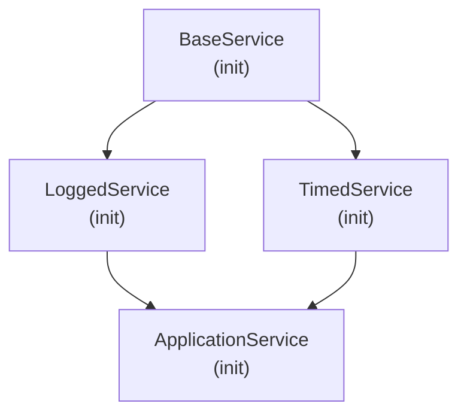

# Python Inheritance, Composition, and Dataclasses

Structuring maintainable software requires choosing the right mechanism for code reuse. In Python, this means mastering Method Resolution Order (MRO), knowing when to favor composition over deep inheritance hierarchies, and utilizing modern `@dataclass` records.

---

## 1. Multiple Inheritance and the Diamond Problem

When two parent classes share a common ancestor and a child inherits from both parents, you have the **Diamond Problem**:



If both `LoggedService` and `TimedService` implement `execute()`, which one does `ApplicationService` run? Does `BaseService.execute()` get executed twice?

### How Python Solves This: C3 Linearization and `super()`

Python resolves methods using the **C3 Linearization Algorithm** (viewable on any class via `Class.__mro__`).

> [!IMPORTANT]
> **The Core `super()` Insight:**  
> In Python, `super()` does **not** mean _"call my parent class"_. It means:  
> **"Call the next class in the MRO of the current instance (`self`)."**

```python
class BaseService:
    def execute(self):
        print("1. [BaseService] Executing core database logic")

class LoggedService(BaseService):
    def execute(self):
        print("2. [LoggedService] Logging execution start")
        super().execute()  # Calls NEXT class in MRO (TimedService!), NOT BaseService directly!
        print("3. [LoggedService] Logging execution finish")

class TimedService(BaseService):
    def execute(self):
        print("4. [TimedService] Starting timer")
        super().execute()  # Calls NEXT class in MRO (BaseService!)
        print("5. [TimedService] Stopping timer")

# Multiple inheritance diamond:
class ApplicationService(LoggedService, TimedService):
    def execute(self):
        print("6. [AppService] Received incoming request")
        super().execute()

app = ApplicationService()
app.execute()

# Inspecting the exact linearization order:
print("\nMRO Order:")
for idx, cls in enumerate(ApplicationService.__mro__, start=1):
    print(f"  {idx}. {cls.__name__}")
```

### Execution Output:

```text
6. [AppService] Received incoming request
2. [LoggedService] Logging execution start
4. [TimedService] Starting timer
1. [BaseService] Executing core database logic
5. [TimedService] Stopping timer
3. [LoggedService] Logging execution finish

MRO Order:
  1. ApplicationService
  2. LoggedService
  3. TimedService
  4. BaseService
  5. object
```

Notice how `BaseService` executed **exactly once**! Every class in the chain cooperated cleanly because all of them used `super().execute()`.

---

## 2. Abstract Base Classes (`abc.ABC`)

Abstract Base Classes define an interface contract. If a subclass fails to implement any `@abstractmethod`, Python raises a `TypeError` at instantiation time:

```python
from abc import ABC, abstractmethod

class CacheBackend(ABC):
    @abstractmethod
    def get(self, key: str) -> bytes | None:
        """Fetch item from cache. Return None if not found."""
        pass

    @abstractmethod
    def set(self, key: str, value: bytes, ttl_seconds: int = 300) -> None:
        """Store item in cache with TTL."""
        pass

# Incomplete subclass:
class RedisCache(CacheBackend):
    def get(self, key: str) -> bytes | None:
        return b"cached_data"
    # Forgot to implement set()!

try:
    # Fails immediately at instantiation, NOT later during a production request!
    cache = RedisCache()
except TypeError as err:
    print("Contract enforcement caught bug:", err)
    # Output: Can't instantiate abstract class RedisCache without an implementation for abstract method 'set'
```

---

## 3. Composition Over Inheritance

Deep inheritance hierarchies are brittle: changing a base class method breaks assumptions across 10 subclasses. **Composition** builds complex behavior by injecting smaller, focused collaborators:

```python
# Instead of class OrderProcessor(EmailSender, MetricsRecorder, DatabaseWriter):

class OrderProcessor:
    # Collaborators are injected via the constructor
    def __init__(self, notifier, metrics, db_repo):
        self.notifier = notifier
        self.metrics = metrics
        self.db_repo = db_repo

    def process(self, order_id: str):
        self.metrics.increment("orders.started")
        self.db_repo.save(order_id)
        self.notifier.send(f"Order {order_id} completed!")
        self.metrics.increment("orders.completed")
```

Benefits of Composition:

1. **Loose Coupling:** Swapping email notifications for Slack requires passing a `SlackNotifier` instance—zero changes to `OrderProcessor`.
2. **Easy Unit Testing:** Mocking collaborators during unit testing is trivial.

---

## 4. Record Types Comparison Matrix

Python offers multiple ways to represent structured data. Use this decision matrix:

| Feature / Type            | `tuple` / `namedtuple`       | `TypedDict`                 | `@dataclass`                   | `Pydantic BaseModel`              |
| :------------------------ | :--------------------------- | :-------------------------- | :----------------------------- | :-------------------------------- |
| **Primary Use Case**      | Lightweight immutable tuples | Typing plain JSON/dicts     | Domain models & internal state | API boundaries & input validation |
| **Validation at Runtime** | ❌ None                      | ❌ None (type-checker only) | ❌ None (by default)           | ✅ Full runtime schema validation |
| **Mutable?**              | ❌ Immutable                 | ✅ Mutable                  | ✅ Mutable (or `frozen=True`)  | ✅ Mutable (or `frozen=True`)     |
| **JSON Serialization**    | Built-in (as array)          | Built-in (`json.dumps`)     | Requires `asdict()` helper     | Built-in (`model_dump_json()`)    |
| **Performance Overhead**  | Lowest (C struct)            | Zero (plain dict)           | Very Low                       | Higher (Rust parsing core)        |

---

## 5. Modern `@dataclass` (Python 3.10+)

The `@dataclass` decorator generates `__init__`, `__repr__`, and `__eq__` methods based on type annotations:

```python
from dataclasses import dataclass, field
import uuid

@dataclass(frozen=True, slots=True, kw_only=True)
class DeploymentPod:
    """
    - frozen=True: Immutable instance (fields cannot be mutated, instances are hashable!)
    - slots=True: Cuts RAM usage by ~60% and eliminates __dict__
    - kw_only=True: Forces all constructor arguments to be keyword-only for readability
    """
    pod_name: str
    image_tag: str
    replicas: int = 3
    # Use default_factory for mutable defaults (lists, dicts, timestamps)
    labels: dict[str, str] = field(default_factory=dict)
    pod_id: str = field(default_factory=lambda: str(uuid.uuid4())[:8])

# Usage:
pod = DeploymentPod(pod_name="api-gateway", image_tag="v2.1.0", labels={"env": "prod"})
print(pod)
# Output: DeploymentPod(pod_name='api-gateway', image_tag='v2.1.0', replicas=3, labels={'env': 'prod'}, pod_id='a1b2c3d4')

# Immutability check:
# pod.replicas = 5 # Raises FrozenInstanceError!
```

---

## Next Steps

- [[Architecture/languages/python/10-type-annotations-and-generics|10: Type Annotations and Generics]] — Protocols, TypeVar, and static typing.
- [[Architecture/languages/python/16-pydantic-v2-validation-and-settings|16: Pydantic v2 Validation and Settings]] — Schema modeling with Pydantic.
