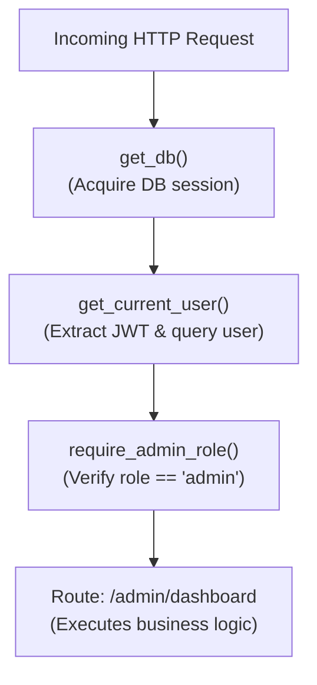

# FastAPI Foundations and Dependency Injection

**FastAPI** is a high-performance web framework built upon **Starlette** (for ASGI networking and routing) and **Pydantic** (for schema validation and serialization). A single Python type-annotated function signature automatically produces request validation, query/body parsing, response serialization, and interactive OpenAPI documentation.

---

## 1. Under the Hood: `async def` vs. Plain `def` Endpoints

This is the **#1 interview and production question** in modern Python web engineering:

> **Question:** When should you write `async def endpoint():` versus `def endpoint():` in FastAPI?

```python
# Model A: 'async def'
@app.get("/async-items")
async def get_items_async():
    # Runs directly on the single-threaded Event Loop!
    # MUST only perform non-blocking I/O using 'await' (e.g. httpx, asyncpg)
    data = await async_db_query()
    return data

# Model B: Plain 'def'
@app.get("/sync-items")
def get_items_sync():
    # FastAPI detects this is a synchronous function.
    # It AUTOMATICALLY offloads execution to an external threadpool (via AnyIO)!
    # Safe to call legacy blocking code (e.g. requests.get(), psycopg2, time.sleep())
    data = sync_db_query()
    return data
```

> [!WARNING]
> **The Critical Mistake:**  
> If you write `async def` and then execute a synchronous blocking call inside it (`time.sleep(2)` or `requests.get(...)`), you **freeze the main event loop**, blocking every single concurrent user on the entire server!  
> **Rule:** If your code contains blocking I/O, declare it as plain `def`, or wrap the blocking call in `await asyncio.to_thread(...)`.

---

## 2. Request Validation and `response_model` Filtering

FastAPI uses parameter types to determine how data is extracted:

- In the path (`/items/{item_id}`): `Path(...)`
- In the URL query string (`?skip=0&limit=10`): `Query(...)`
- In the HTTP headers: `Header(...)`
- In the JSON body: Pydantic `BaseModel`

```python
from fastapi import FastAPI, HTTPException, Path, Query, status
from pydantic import BaseModel, EmailStr, Field

app = FastAPI(title="User Management API")

class UserRegister(BaseModel):
    username: str = Field(min_length=3, max_length=20)
    email: EmailStr
    password: str  # Sensitive! Must never leak in API responses!

class UserPublicResponse(BaseModel):
    user_id: int
    username: str
    email: EmailStr
    is_active: bool = True

db_users = {}

@app.post(
    "/users",
    response_model=UserPublicResponse,  # Crucial: Filters out 'password' automatically!
    status_code=status.HTTP_201_CREATED
)
async def create_user(payload: UserRegister):
    user_id = len(db_users) + 1
    # Save user with raw password in internal store
    user_record = {"user_id": user_id, **payload.model_dump(), "is_active": True}
    db_users[user_id] = user_record

    # Even though user_record contains 'password', response_model strips it out
    # before emitting JSON to the client!
    return user_record
```

---

## 3. The Dependency Injection System (`Depends`)

FastAPI includes a Directed Acyclic Graph (DAG) dependency injection engine. Dependencies declare what a route needs (authentication, database sessions, query parameters, permissions), and FastAPI resolves the graph automatically.

### Dependency Resolution Graph (DAG)



### Request-Scoped Caching (`use_cache=True`)

If 3 different sub-dependencies require `get_db()`, FastAPI executes `get_db()` **only once per request**, caching the resulting value across the entire dependency tree.

### Yield Dependencies: Setup, Route Execution, and Guaranteed Teardown

Dependencies using `yield` manage resource lifecycles:

```python
from collections.abc import AsyncGenerator
from typing import Annotated
from fastapi import Depends

async def get_db_session() -> AsyncGenerator[dict, None]:
    # 1. SETUP: Runs before route handler
    print("[DB-DEP] 1. Opening transaction and acquiring session...")
    session = {"session_id": "session_active", "status": "open"}
    try:
        # 2. YIELD: Injects 'session' into route handler
        yield session
    finally:
        # 3. TEARDOWN: Runs after the response has been sent to client!
        print("[DB-DEP] 3. Closing transaction and returning session to pool.")
        session["status"] = "closed"

# Type alias with Annotated for clean route signatures:
DBSessionDep = Annotated[dict, Depends(get_db_session)]

@app.get("/system/status")
async def system_status(session: DBSessionDep):
    print(f"[ROUTE]  2. Executing route with active session: {session['session_id']}")
    return {"status": "operational", "session": session["status"]}
```

### Output Trace:

```text
[DB-DEP] 1. Opening transaction and acquiring session...
[ROUTE]  2. Executing route with active session: session_active
[DB-DEP] 3. Closing transaction and returning session to pool.
```

---

## 4. Modular Project Architecture with `APIRouter`

Large applications split routes into isolated domain modules:

```python
# src/api/v1/orders.py
from fastapi import APIRouter

router = APIRouter(prefix="/orders", tags=["Orders"])

@router.get("/")
async def list_orders():
    return [{"order_id": 101, "total": 99.0}]

# In main.py:
# from fastapi import FastAPI
# from src.api.v1.orders import router as orders_router
# app = FastAPI()
# app.include_router(orders_router)
```

---

## Next Steps

- [[Architecture/languages/python/18-fastapi-production-middleware-async-db-and-auth|18: FastAPI Production: Lifespan, Middleware, Async DB, and Auth]] — Production lifecycle, SQLAlchemy, and auth.
- [[Architecture/languages/python/21-testing-pytest-mocking-and-async-tests|21: Testing with Pytest, Mocking, and Async Tests]] — Testing FastAPI endpoints using TestClient and dependency overrides.
