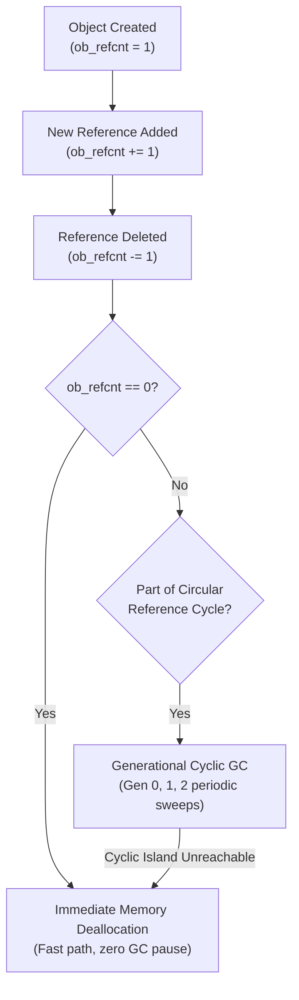
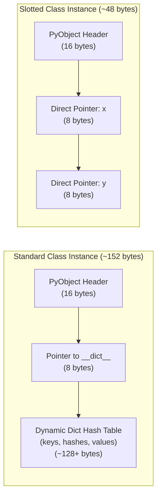

# Python Memory Management, GC, and Slots

Diagnosing high RAM utilization, debugging container Out-Of-Memory (OOM) kills, and scaling Python services requires understanding CPython's internal memory allocator, reference counting engine, and generational cyclic garbage collector.

---

## 1. Everything is a `PyObject`

In CPython, every integer, string, list, and custom class instance is allocated on the heap wrapped inside a C struct called `PyObject`:

```c
// Simplified CPython 3.12 PyObject definition:
typedef struct _object {
    _PyObject_HEAD_EXTRA
    Py_ssize_t ob_refcnt;          // Reference count (managed by primary allocator)
    struct _typeobject *ob_type;   // Pointer to type descriptor (int, str, CustomClass)
} PyObject;
```

Because of this C metadata, even primitive values carry substantial memory overhead:

```python
import sys

# An integer in Python is not a 4-byte or 8-byte primitive; it is a 28-byte PyObject!
print("Size of integer 0:", sys.getsizeof(0), "bytes")         # 28 bytes
print("Size of integer 2**30:", sys.getsizeof(2**30), "bytes") # 32 bytes
print("Size of empty dict:", sys.getsizeof({}), "bytes")        # 64 bytes
print("Size of empty list:", sys.getsizeof([]), "bytes")        # 56 bytes
```

### Small Integer and String Interning

To prevent allocating millions of duplicate 28-byte objects, CPython **interns** specific immutable objects:

- **Small Integers:** Integers between **`-5` and `256`** are pre-allocated at interpreter boot and shared globally.
- **String Interning:** Python automatically interns identifiers that look like valid Python variable names (ASCII alphanumeric + underscores). For dynamic strings, you can manually intern them using `sys.intern(s)` to speed up dictionary key comparisons from $O(n)$ string equality down to $O(1)$ pointer comparison!

---

## 2. Reference Counting vs. Generational Cyclic GC

CPython employs two complementary garbage collection systems:



### 1. Primary Engine: Reference Counting ($O(1)$ Immediate)

Every time a name binds to an object, `ob_refcnt` increases. When a variable goes out of scope or is deleted, `ob_refcnt` decreases. As soon as `ob_refcnt == 0`, the memory is **freed immediately**.

### 2. Secondary Engine: Generational Cyclic GC

Reference counting has one fatal flaw: **Circular Reference Cycles**.

```python
import gc

class Node:
    def __init__(self, name: str):
        self.name = name
        self.partner = None

node_a = Node("A")
node_b = Node("B")
node_a.partner = node_b  # A points to B (refcount = 2)
node_b.partner = node_a  # B points to A (refcount = 2)

# Sever root pointers:
del node_a  # refcount drops to 1
del node_b  # refcount drops to 1

# Neither object has refcount=0, but they are completely unreachable from the root!
# The cyclic garbage collector periodically sweeps 3 generations (Gen 0, Gen 1, Gen 2):
unreachable_count = gc.collect()
print("Cyclic garbage collected unreachable objects:", unreachable_count)
```

### How the Cyclic GC Finds Isolated Islands:

The cyclic GC does not track non-container types (like `int` or `str` which cannot create cycles). It only inspects container objects (`list`, `dict`, `tuple`, custom class instances). It performs a **trial decrement**: it copies reference counts, decrements references between container members, and any group of objects whose reachable reference count drops to zero is identified as an isolated cycle and freed.

---

## 3. Breaking Reference Cycles with `weakref`

To maintain caches or observer listeners without artificially keeping objects alive, use `weakref`:

```python
import weakref

class EphemeralPayload:
    def __init__(self, data: str):
        self.data = data

payload = EphemeralPayload("100MB_CACHE_DATA")

# Weak reference does NOT increment ob_refcnt:
weak_handle = weakref.ref(payload)

print("Is payload alive?", weak_handle() is not None)  # Output: True
print("Accessed data:", weak_handle().data)

del payload  # Immediate deallocation via reference counting!

print("Is payload alive after deletion?", weak_handle())  # Output: None
```

---

## 4. Slashing Instance Memory by 50%+ with `__slots__`

By default, every custom Python instance stores its attributes inside a dynamic hash table called `instance.__dict__`. While flexible, dictionary overhead consumes ~104 bytes per instance!

Defining `__slots__` eliminates `__dict__`, telling CPython to allocate a **compact C struct with direct pointer offsets**:



### Code Benchmark:

```python
import sys

class StandardPoint:
    def __init__(self, x: float, y: float):
        self.x = x
        self.y = y

class SlottedPoint:
    __slots__ = ("x", "y")  # Prevents creation of __dict__ and __weakref__!
    def __init__(self, x: float, y: float):
        self.x = x
        self.y = y

p_std = StandardPoint(1.0, 2.0)
p_slot = SlottedPoint(1.0, 2.0)

# Total memory calculation (instance + dict):
std_total = sys.getsizeof(p_std) + sys.getsizeof(p_std.__dict__)
slot_total = sys.getsizeof(p_slot)

print(f"Standard instance: {std_total} bytes")  # Output: ~152 bytes
print(f"Slotted instance:  {slot_total} bytes")  # Output: ~48 bytes (68% savings!)
```

> [!TIP]
> In microservices holding millions of records in memory (e.g., telemetry points, graph nodes, caches), `@dataclass(slots=True)` can reduce your Kubernetes container RAM footprint from 4 GB down to 1.5 GB.

---

## Next Steps

- [[Architecture/languages/python/20-descriptors-metaclasses-and-metaprogramming|20: Descriptors, Metaclasses, and Metaprogramming]] — How attribute access works internally.
- [[Architecture/languages/python/23-profiling-optimization-and-c-extensions|23: Profiling, Optimization, and C Extensions]] — Profiling memory with tracemalloc and memray.
