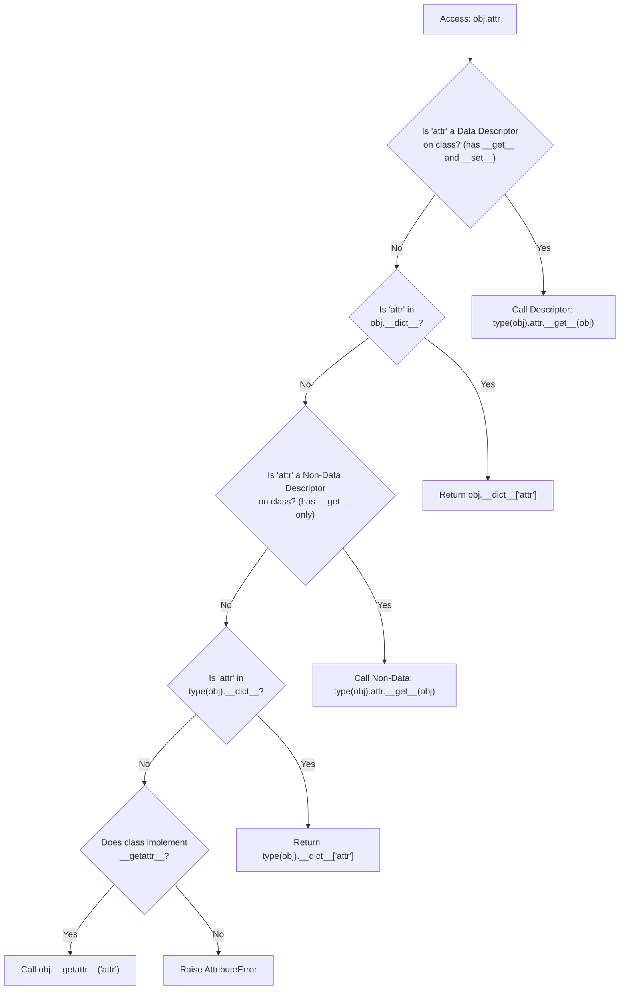

# Python Descriptors, Metaclasses, and Metaprogramming

Metaprogramming enables frameworks like SQLAlchemy, Pydantic, and Django to inspect class definitions, inject validation logic, and construct ORM schemas dynamically.

---

## 1. How Python Attribute Access Actually Works

When you evaluate `obj.attr`, Python does not simply look in a dictionary. It invokes `object.__getattribute__`, following this strict priority hierarchy:



> [!IMPORTANT]
> **Key Insight:**  
> A **Data Descriptor** (like `@property`) overrides `instance.__dict__`! Even if `obj.__dict__["x"] = 99` exists, Python still routes attribute access through the descriptor.  
> Conversely, `instance.__dict__` overrides a **Non-Data Descriptor** (like regular methods).

---

## 2. The Descriptor Protocol (`__get__`, `__set__`, `__set_name__`)

A descriptor is an object that controls attribute access on another class. Descriptors power `@property`, methods, and ORM column definitions under the hood:

```python
class BoundedPositiveInt:
    """A reusable data descriptor enforcing numeric validation."""
    def __init__(self, max_value: int = 100):
        self.max_value = max_value

    def __set_name__(self, owner, name):
        # Automatically captures the attribute name assigned on the owner class
        # (e.g. 'cpu_limit', 'replicas')
        self.field_name = name
        self.storage_key = f"_{name}"

    def __get__(self, instance, owner=None):
        if instance is None:
            # Accessed via the class itself (e.g. ClusterNode.cpu_limit)
            return self
        return getattr(instance, self.storage_key, 1)

    def __set__(self, instance, value):
        if not isinstance(value, int) or value <= 0:
            raise ValueError(f"Field '{self.field_name}' must be an integer > 0, got {value}")
        if value > self.max_value:
            raise ValueError(f"Field '{self.field_name}' exceeds maximum limit of {self.max_value}")
        setattr(instance, self.storage_key, value)

class ClusterNode:
    # Descriptors must be declared as class variables!
    cpu_limit = BoundedPositiveInt(max_value=64)
    replicas = BoundedPositiveInt(max_value=20)

    def __init__(self, cpu: int, replicas: int):
        self.cpu_limit = cpu      # Triggers BoundedPositiveInt.__set__
        self.replicas = replicas  # Triggers BoundedPositiveInt.__set__

node = ClusterNode(cpu=16, replicas=3)
print("Configured CPU:", node.cpu_limit)  # Output: 16

try:
    node.replicas = 50  # Exceeds max_value=20
except ValueError as err:
    print("Descriptor caught validation error:", err)
```

---

## 3. How Methods Become Bound Methods Under the Hood

Ever wondered why functions on a class automatically pass `self` as the first argument?

**Functions are Non-Data Descriptors!** Every standard Python function implements `__get__()`:

```python
def standalone_func(self):
    return f"Called on instance {self}"

class Container:
    func = standalone_func

c = Container()

# When you access 'c.func', Python executes: Container.__dict__['func'].__get__(c, Container)
# which returns a types.MethodType object binding 'c' to the function!
bound_method = Container.func.__get__(c, Container)
print("Type of bound method:", type(bound_method))  # Output: <class 'method'>
print("Result:", bound_method())
```

---

## 4. `__init_subclass__` (The Modern Metaclass Alternative)

Before Python 3.6, creating automatic plugin architectures or schema registries required complex metaclasses. Today, **`__init_subclass__`** provides the same capability with a clean, standard inheritance API:

```python
class ServicePlugin:
    registry: dict[str, type] = {}

    def __init_subclass__(cls, plugin_name: str, **kwargs):
        super().__init_subclass__(**kwargs)
        # Automatically registers any subclass at module import time!
        cls.registry[plugin_name] = cls
        print(f"[REGISTRY] Auto-registered plugin '{plugin_name}' -> {cls.__name__}")

# Subclasses register automatically as soon as their module loads:
class PostgresPlugin(ServicePlugin, plugin_name="postgresql"):
    def query(self): return "PG"

class KafkaPlugin(ServicePlugin, plugin_name="kafka"):
    def produce(self): return "Kafka"

print("Active plugins:", list(ServicePlugin.registry.keys()))
# Output: ['postgresql', 'kafka']
```

---

## 5. The "Rule of Least Power" Decision Matrix

When adding metaprogramming or dynamic behavior, always choose the simplest abstraction that solves the problem:

| Pattern                 | Best Used For                                               | Complexity | Example Use Case                            |
| :---------------------- | :---------------------------------------------------------- | :--------- | :------------------------------------------ |
| **Function Decorator**  | Wrapping or timing individual functions                     | Low        | `@timing_decorator`, `@retry`               |
| **Class Decorator**     | Mutating or adding methods to a complete class              | Low–Medium | `@dataclass`, `@runtime_checkable`          |
| **Descriptor**          | Reusable attribute management & validation                  | Medium     | Reusable field validation, ORM columns      |
| **`__init_subclass__`** | Automatic plugin discovery & subclass checks                | Medium     | Plugin registries, framework bases          |
| **Metaclass**           | Intercepting class creation (`__new__`) before class exists | High       | Pydantic/SQLAlchemy core schema compilation |

---

## Next Steps

- [[Architecture/languages/python/21-testing-pytest-mocking-and-async-tests|21: Testing with Pytest, Mocking, and Async Tests]] — Testing strategies, fixtures, and mocks.
- [[Architecture/languages/python/22-logging-cli-and-os-processes|22: Logging, CLI, and OS Processes]] — Production logging and CLI utilities.
