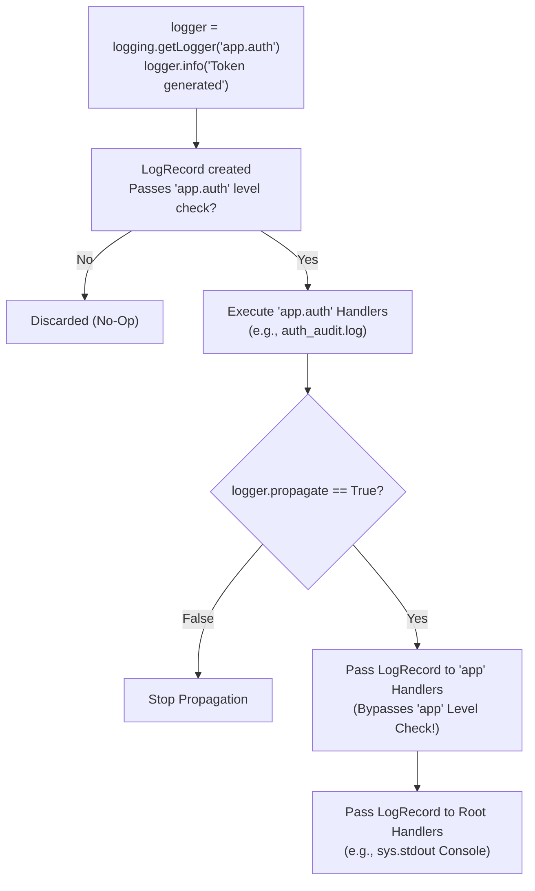
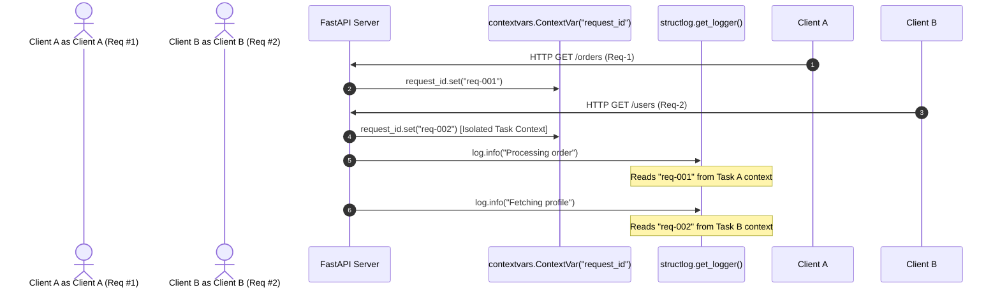
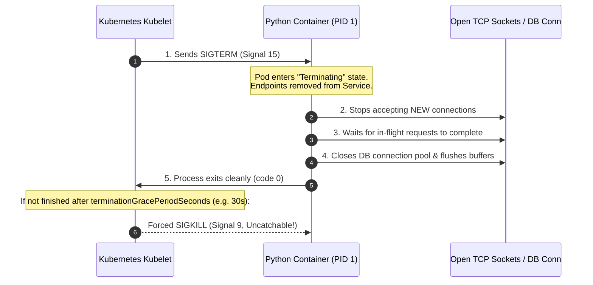

# Python Logging, CLI, and OS Processes

In production cloud environments, applications cannot rely on raw `print()` statements. Cloud orchestrators like Kubernetes, centralized aggregators (Fluentbit, Datadog, Vector), and automated incident monitors require machine-parsable structured logs, robust CLI entry points, and deterministic signal handling during container lifecycle events.

---

## 1. Standard Library `logging` Architecture & Propagation

Python's built-in `logging` module is organized around four core abstractions: **Loggers** (the application entry point), **Handlers** (where logs are written, e.g., `StreamHandler` for stdout, `FileHandler`), **Filters** (fine-grained control over which records pass through), and **Formatters** (the string layout of log messages).

### The Logger Tree and the Duplicate Logs Trap

Loggers exist in a dot-delimited hierarchy rooted at the anonymous root logger (`""`):

```
Root Logger ("")
   └── "app"
         ├── "app.auth"
         └── "app.billing"
```

When a message is logged to `"app.auth"`, it is handled by the handlers attached directly to `"app.auth"`. Then, if `logger.propagate == True` (the default), the `LogRecord` is passed to the parent logger's handlers (`"app"`), and upward to the root logger's handlers.



> [!WARNING]
> **The Duplicate Log Pitfall:** If both the root logger and a child logger attach a `StreamHandler(sys.stdout)`, and `propagate=True`, every message sent to the child logger will be printed **twice** to stdout! When attaching custom handlers to child loggers, either set `logger.propagate = False` or configure handlers exclusively on the root logger.

### Lazy Formatting vs. Eager F-Strings

One of the most common performance bugs in high-throughput Python services is using f-strings inside logging statements:

```python
import logging

logger = logging.getLogger("api")
logger.setLevel(logging.INFO)

# BAD: Eager f-string evaluation
# Even though DEBUG is disabled, heavy_user_dump() executes on EVERY request!
logger.debug(f"User snapshot: {heavy_user_dump(user)}")

# GOOD: Lazy %s evaluation
# CPython only formats the string if the logger is enabled for DEBUG!
logger.debug("User snapshot: %s", heavy_user_dump(user))

# BEST: Guard expensive serialization entirely
if logger.isEnabledFor(logging.DEBUG):
    logger.debug("User snapshot: %s", heavy_user_dump(user))
```

### Complete Standard Logging Configuration

```python
import logging
import sys

def setup_production_logging() -> logging.Logger:
    # 1. Obtain root logger
    root_logger = logging.getLogger()
    root_logger.setLevel(logging.INFO)

    # Clear existing handlers to prevent duplicate lines in reloaded environments
    root_logger.handlers.clear()

    # 2. Attach stdout stream handler (standard for 12-factor container apps)
    handler = logging.StreamHandler(sys.stdout)
    handler.setLevel(logging.INFO)

    # 3. Define human-readable console formatter
    formatter = logging.Formatter(
        fmt="%(asctime)s | %(levelname)-8s | %(name)s:%(lineno)d | %(message)s",
        datefmt="%Y-%m-%d %H:%M:%S",
    )
    handler.setFormatter(formatter)
    root_logger.addHandler(handler)

    # 4. Create namespaced child logger
    logger = logging.getLogger("payments.gateway")
    return logger

logger = setup_production_logging()
logger.info("Payment service listening on port %d", 8080)
# Output: 2026-10-19 14:00:00 | INFO     | payments.gateway:28 | Payment service listening on port 8080

try:
    1 / 0
except ZeroDivisionError:
    # logger.exception automatically captures sys.exc_info() and appends the traceback
    logger.exception("Failed to calculate checkout discount")
```

---

## 2. Structured JSON Logging with `structlog` & `contextvars`

Standard text logs (`2026-10-19 14:00:00 | INFO | ...`) require fragile regex parsing in log aggregation pipelines. Production Kubernetes workloads require **Structured JSON Logging**, where every event is an indexed key-value payload.

### The Problem: Context Across Async Coroutines

In an asynchronous web server (FastAPI, Starlette), dozens of concurrent HTTP requests share the exact same OS thread. If you store the current `request_id` in a global variable or thread-local storage (`threading.local`), concurrent requests will corrupt each other's IDs.

Python's **`contextvars`** solves this by providing asynchronous task-local storage that automatically copies context across coroutine frames.



### Modern `structlog` Pipeline with `contextvars`

```python
import contextvars
import structlog

# 1. Define context variable for distributed tracing
correlation_id_ctx: contextvars.ContextVar[str] = contextvars.ContextVar(
    "correlation_id", default="no-trace"
)

# 2. Custom structlog processor that injects the correlation ID
def inject_correlation_id(logger, method_name, event_dict):
    event_dict["trace_id"] = correlation_id_ctx.get()
    return event_dict

# 3. Configure the processor pipeline
structlog.configure(
    processors=[
        # Ingest contextvars
        structlog.contextvars.merge_contextvars,
        inject_correlation_id,
        # Enrich with log level and ISO 8601 UTC timestamp
        structlog.processors.add_log_level,
        structlog.processors.TimeStamper(fmt="iso", utc=True),
        # Automatically serialize exception tracebacks into JSON structures
        structlog.processors.format_exc_info,
        # Render dictionary as compact single-line JSON
        structlog.processors.JSONRenderer(),
    ],
    logger_factory=structlog.PrintLoggerFactory(),
    cache_logger_on_first_use=True,
)

log = structlog.get_logger()

# Simulating an incoming HTTP request middleware:
token = correlation_id_ctx.set("trace-8f92-bd14")
try:
    log.info(
        "payment_processed",
        customer_id=9821,
        amount_usd=149.99,
        status="success",
    )
finally:
    # Always reset context variable to prevent leakage
    correlation_id_ctx.reset(token)

# STDOUT Output:
# {"trace_id": "trace-8f92-bd14", "level": "info", "timestamp": "2026-10-19T14:15:30.123456Z", "customer_id": 9821, "amount_usd": 149.99, "status": "success", "event": "payment_processed"}
```

### Logging Framework Decision Matrix

| Dimension                 | Standard `logging`                               | `structlog`                           | `loguru`                                 |
| :------------------------ | :----------------------------------------------- | :------------------------------------ | :--------------------------------------- |
| **Primary Output**        | Unstructured Text (Formatted Strings)            | Structured Dictionary / JSON          | Colorized Console / Semi-Structured      |
| **Async Context Support** | Requires manual `logging.Filter` + `contextvars` | Native via `merge_contextvars`        | Global sink, limited context isolation   |
| **K8s Log Ingestion**     | Requires regex log parsers                       | Native JSON (`JSONRenderer`)          | Requires custom JSON serialization sinks |
| **Recommended Use Case**  | Python libraries (no opinions on sinks)          | Production Microservices & Cloud APIs | Quick CLI tools, scripts, local dev      |

---

## 3. Modern Type-Safe CLIs with `typer`

Traditional Python CLIs relied on `argparse` (verbose, repetitive boilerplate) or `click` (relies on untyped function decorators). **`typer`** harnesses modern Python type hints (`Annotated`, `typing.Optional`, `enum.Enum`) to generate self-documenting CLI interfaces with zero runtime ambiguity.

```python
from enum import Enum
from pathlib import Path
from typing import Annotated
import typer

app = typer.Typer(
    help="Cloud-Native Infrastructure Provisioning CLI",
    add_completion=False,
)

class Environment(str, Enum):
    DEV = "dev"
    STAGING = "staging"
    PROD = "prod"

@app.command()
def provision(
    cluster_name: Annotated[
        str,
        typer.Argument(help="Target Kubernetes cluster name to provision."),
    ],
    env: Annotated[
        Environment,
        typer.Option("--env", "-e", help="Target deployment environment."),
    ] = Environment.DEV,
    nodes: Annotated[
        int,
        typer.Option("--nodes", "-n", min=1, max=100, help="Node count."),
    ] = 3,
    config: Annotated[
        Path,
        typer.Option(
            "--config",
            "-c",
            exists=True,
            file_okay=True,
            dir_okay=False,
            readable=True,
            help="Path to manifest YAML file.",
        ),
    ] = Path("config.yaml"),
    dry_run: Annotated[
        bool,
        typer.Option("--dry-run", help="Simulate provisioning without cloud mutations."),
    ] = False,
) -> None:
    """Provisions a managed Kubernetes cluster with validated configuration."""
    typer.echo(f"Initiating provision for '{cluster_name}' in [{env.value.upper()}]")
    typer.echo(f"Allocating {nodes} nodes using config: {config.resolve()}")
    if dry_run:
        typer.secho("DRY RUN ACTIVE: No resources were allocated.", fg=typer.colors.YELLOW, bold=True)
    else:
        typer.secho("Provisioning completed successfully!", fg=typer.colors.GREEN)

if __name__ == "__main__":
    app()
```

### Built-in Shell Validation

Running `python cli.py provision staging-cluster --nodes 0` produces immediate, type-aware terminal feedback without writing any custom validation logic:

```text
Usage: cli.py provision [OPTIONS] CLUSTER_NAME
Try 'cli.py provision --help' for help.
Error: Invalid value for '--nodes' / '-n': 0 is smaller than the minimum permitted value of 1.
```

---

## 4. Operating System Signals & Graceful Draining

When a container orchestrator (Kubernetes, ECS) terminates a pod during a rolling update, scale-down, or node drainage, it does not immediately kill the process. It sends an operating system signal:



### Trapping `SIGTERM` in Synchronous vs. Asynchronous Applications

#### Synchronous Application Signal Handling

```python
import signal
import sys
import time

is_shutting_down = False

def handle_sigterm(signum: int, frame) -> None:
    global is_shutting_down
    print(f"\n[SIGNAL] Caught signal {signum} (SIGTERM). Initiating graceful drain...")
    is_shutting_down = True

# Register handler for OS SIGTERM (signal 15) and SIGINT (Ctrl+C, signal 2)
signal.signal(signal.SIGTERM, handle_sigterm)
signal.signal(signal.SIGINT, handle_sigterm)

print("Worker started. Simulating request loop...")
while not is_shutting_down:
    # Do work in small increments
    time.sleep(0.5)

print("Flushing state to disk...")
time.sleep(1.0)
print("Graceful shutdown complete. Exiting with code 0.")
sys.exit(0)
```

#### Asynchronous Event Loop Signal Handling

In `asyncio` applications, standard `signal.signal` can trigger race conditions because the signal handler executes outside the running coroutine task. Instead, register handlers directly on the event loop:

```python
import asyncio
import signal

async def worker(queue: asyncio.Queue) -> None:
    while True:
        item = await queue.get()
        await asyncio.sleep(0.2)
        print(f"Processed: {item}")
        queue.task_done()

async def shutdown(loop: asyncio.AbstractEventLoop, stop_event: asyncio.Event) -> None:
    print("\n[DRAIN] SIGTERM received! Notifying workers...")
    stop_event.set()
    # Cancel all running tasks except current shutdown handler
    tasks = [t for t in asyncio.all_tasks() if t is not asyncio.current_task()]
    print(f"Cancelling {len(tasks)} in-flight tasks...")
    for task in tasks:
        task.cancel()
    await asyncio.gather(*tasks, return_exceptions=True)
    loop.stop()

async def main() -> None:
    loop = asyncio.get_running_loop()
    stop_event = asyncio.Event()

    # Register OS signal directly with the asyncio event loop
    for sig in (signal.SIGTERM, signal.SIGINT):
        loop.add_signal_handler(
            sig,
            lambda: asyncio.create_task(shutdown(loop, stop_event)),
        )

    queue = asyncio.Queue()
    worker_task = asyncio.create_task(worker(queue))
    await stop_event.wait()

# asyncio.run(main())
```

---

## 5. Subprocess Execution & Security Hardening

Executing shell commands and system binaries from Python requires strict protection against command injection vulnerabilities and buffer deadlocks.

### Command Execution Decision Matrix

| Method                                 | Blocking?              | Security Default     | Deadlock Risk on Large Output                  | Use Case                                             |
| :------------------------------------- | :--------------------- | :------------------- | :--------------------------------------------- | :--------------------------------------------------- |
| **`subprocess.run(check=True)`**       | Yes                    | Safe (`shell=False`) | None (Buffers stored in memory safely)         | Standard external CLI tool calls                     |
| **`subprocess.Popen()`**               | No                     | Safe (`shell=False`) | **High** if accessing `stdout.read()` manually | Interactive streaming I/O or background PID tracking |
| **`asyncio.create_subprocess_exec()`** | Non-blocking (`await`) | Safe (`shell=False`) | None (Async stream readers drain buffers)      | High-concurrency async servers calling system tools  |

### The Shell Injection Vulnerability

```python
import subprocess
import shlex

user_input = "file.txt; rm -rf /"

# CRITICAL SECURITY VULNERABILITY: shell=True with unescaped input
# subprocess.run(f"ls -l {user_input}", shell=True)  # Executes "rm -rf /"!

# IDIOMATIC & SECURE: Tokenized argument list with shell=False (default)
clean_args = ["ls", "-l", user_input]
# The OS passes user_input directly to argv[2] without invoking /bin/sh!
result = subprocess.run(
    clean_args,
    capture_output=True,
    text=True,
    timeout=5.0,  # Mandatory in production to prevent zombie hangs
    check=False,  # Avoid unhandled CalledProcessError; inspect returncode explicitly
)

if result.returncode == 0:
    print("Command Output:\n", result.stdout)
else:
    print(f"Command failed (code {result.returncode}):\n", result.stderr)
```

---

## Common Production Pitfalls

| Pitfall                        | Root Cause                                                               | Production Symptom                                                                              | Idiomatic Fix                                                               |
| :----------------------------- | :----------------------------------------------------------------------- | :---------------------------------------------------------------------------------------------- | :-------------------------------------------------------------------------- |
| **Duplicate Log Messages**     | Child logger has handlers attached AND `logger.propagate = True`.        | Every log line appears twice in Datadog/CloudWatch.                                             | Attach handlers to the root logger only, or set `logger.propagate = False`. |
| **Eager Log Formatting**       | Using `logger.debug(f"{obj}")` instead of `logger.debug("%s", obj)`.     | Significant CPU overhead converting objects to strings for disabled log levels.                 | Pass arguments as parameters: `logger.debug("...", arg)`.                   |
| **Cross-Task Context Leakage** | Storing `request_id` in `threading.local` inside an async web server.    | Request A's logs show Request B's trace ID when tasks switch on the same OS thread.             | Use `contextvars.ContextVar` for all coroutine-scoped variables.            |
| **Subprocess Pipe Deadlock**   | Reading `proc.stdout` and `proc.stderr` sequentially with large outputs. | Python process hangs indefinitely because OS pipe buffer (64 KB) fills up and blocks the child. | Use `subprocess.run(capture_output=True)` or `proc.communicate()`.          |

---

## Next Steps

- [[Architecture/languages/python/23-profiling-optimization-and-c-extensions|23: Profiling, Optimization, and C Extensions]] — Benchmark CPU and memory bottlenecks with `cProfile`, `py-spy`, and zero-copy buffers.
- [[Architecture/languages/python/24-production-packaging-docker-and-deployment|24: Production Packaging, Docker, and Deployment]] — Package production applications with multi-stage `uv` Dockerfiles and Kubernetes lifecycle hooks.
