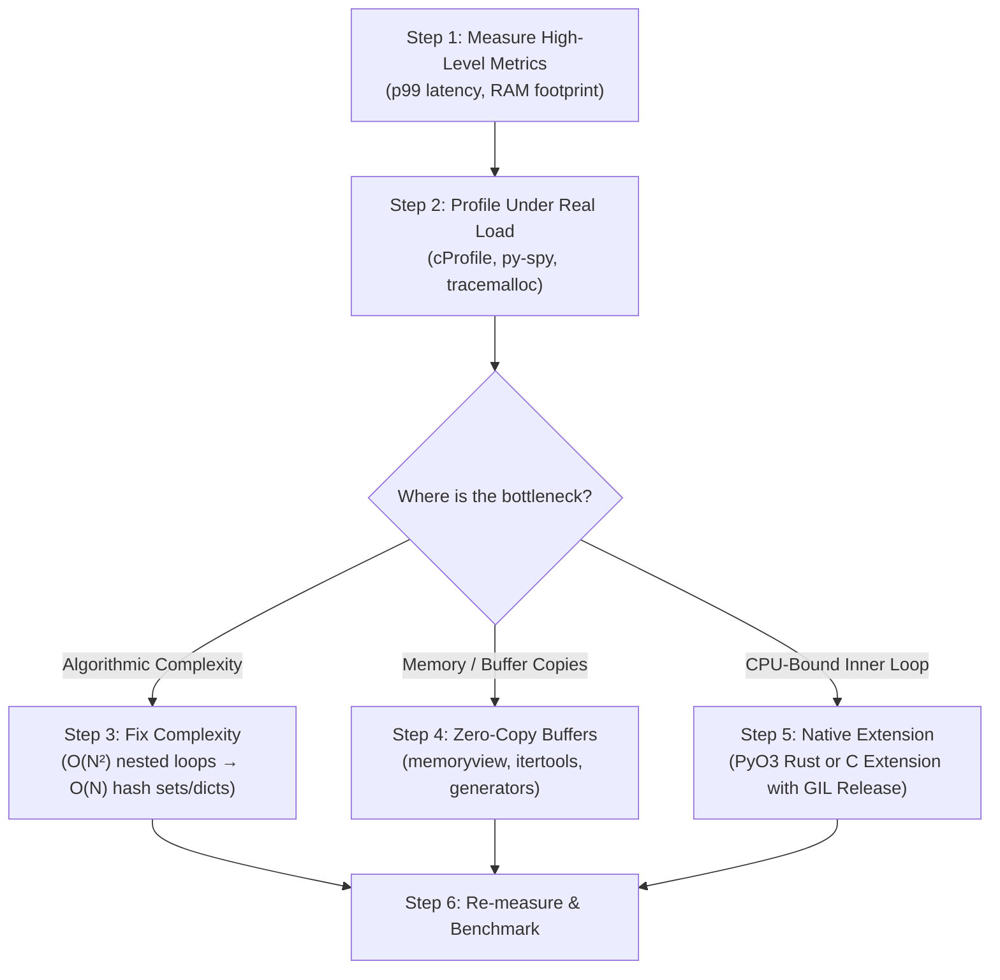
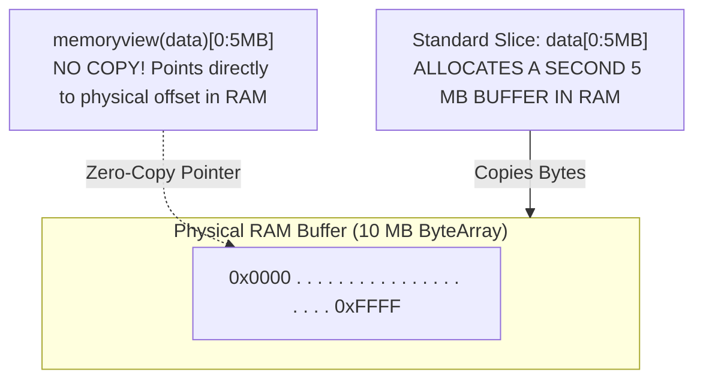

# Python Profiling, Optimization, and C Extensions

Python prioritizes developer ergonomics, dynamic expressiveness, and rapid iteration. However, in production microservices processing millions of records or handling thousands of concurrent network connections, performance optimization becomes an essential discipline.

True optimization follows a strict hierarchy: **Measure → Profile → Algorithmic Redesign → Data Structure Optimization → Low-Level Extensions**. Premature optimization without profiling wastes engineering hours and creates brittle, unmaintainable code.



---

## 1. Profiler Selection Matrix

Using the wrong profiler produces skewed telemetry. Deterministic profilers introduce significant overhead, while sampling profilers can safely run against live production workloads:

| Tool              | Type                        | Metric Tracked                            | Production Safe?            | Best Use Case                                                |
| :---------------- | :-------------------------- | :---------------------------------------- | :-------------------------- | :----------------------------------------------------------- |
| **`cProfile`**    | Deterministic (Event-based) | CPU execution time per function call      | **No** (20–40% slowdown)    | Local development, isolated function benchmarks              |
| **`py-spy`**      | Sampling (Statistical)      | Call stacks & CPU flame graphs            | **Yes** (< 1% overhead)     | Live production containers, attached via PID                 |
| **`tracemalloc`** | Deterministic Memory        | Exact file and line allocating Python RAM | Moderately (5–10% slowdown) | Local memory leak detection, snapshot diffing                |
| **`memray`**      | Deep Native Memory          | Python + C-extension memory allocations   | Moderately                  | Tracking leaks in NumPy, PyTorch, C libraries                |
| **`Scalene`**     | Sampling CPU & Memory       | Separates Python vs C vs GPU time         | **Yes** (< 3% overhead)     | Identifying if bottlenecks are in Python or native libraries |

---

## 2. CPU Profiling: `cProfile` and Flame Graphs with `py-spy`

### Deterministic Profiling with `cProfile`

`cProfile` hooks into the CPython interpreter to intercept every function entry and exit.

```python
import cProfile
import pstats
from typing import List

def naive_find_duplicates(numbers: List[int]) -> List[int]:
    duplicates = []
    # O(N^2) anti-pattern: 'x in duplicates' performs a linear scan!
    for i in range(len(numbers)):
        for j in range(i + 1, len(numbers)):
            if numbers[i] == numbers[j] and numbers[i] not in duplicates:
                duplicates.append(numbers[i])
    return duplicates

def main():
    test_data = list(range(2000)) + list(range(1000, 1500))

    # Instrument execution
    profiler = cProfile.Profile()
    profiler.enable()

    naive_find_duplicates(test_data)

    profiler.disable()

    # Format and sort profile metrics
    stats = pstats.Stats(profiler)
    stats.strip_dirs()
    # Sort by 'cumulative' (time spent in function + all child calls)
    # or 'tottime' (time spent strictly inside function body)
    stats.sort_stats("cumulative").print_stats(10)

if __name__ == "__main__":
    main()
```

### Interpreting `cProfile` Output Columns

When analyzing profile tables, focus on two metrics:

1. **`tottime`**: The total time spent in the given function, **excluding** time made in calls to sub-functions. High `tottime` means the function's own internal loops are slow.
2. **`cumtime`**: The cumulative time spent in this function and all sub-functions it called. A high `cumtime` with low `tottime` indicates an orchestrator function calling slow subroutines.

### Sampling Profiling in Production Containers with `py-spy`

In production, running `cProfile` ruins request latency. **`py-spy`** is a standalone Rust binary that reads CPython process memory from outside the interpreter via Linux `process_vm_readv`:

```bash
# Record a real-time SVG flamegraph from a running FastAPI PID
py-spy record --pid 4281 --duration 30 --rate 100 --output flamegraph.svg

# Interactive top-like terminal dashboard showing active thread execution
py-spy top --pid 4281
```

---

## 3. Memory Profiling & Leak Detection with `tracemalloc`

Python uses reference counting and a cyclic garbage collector. Memory "leaks" in Python typically occur when objects remain unintentionally referenced in global registries, caches without TTLs, or unclosed closures.

`tracemalloc` captures stack traces at the exact line of code that triggered the C `PyObject_Malloc` allocation:

```python
import tracemalloc

def simulate_memory_leak():
    # Start tracking allocations with a traceback depth of 10 frames
    tracemalloc.start(10)

    # Snapshot 1: Baseline
    snapshot_before = tracemalloc.take_snapshot()

    # Leaking operation: Accumulating data in an unbounded global list
    cache = []
    for i in range(100_000):
        cache.append({"user_id": i, "session_token": f"token_{i * 999}"})

    # Snapshot 2: Post-workload
    snapshot_after = tracemalloc.take_snapshot()

    # Compare differences grouped by file line number
    diff_stats = snapshot_after.compare_to(snapshot_before, "lineno")

    print("[TOP 3 MEMORY GROWTH ALLOCATIONS]")
    for stat in diff_stats[:3]:
        print(f"File: {stat.traceback[0].filename}:{stat.traceback[0].lineno}")
        print(f"Size Increase: {stat.size_diff / (1024 * 1024):.2f} MB ({stat.count_diff} blocks)\n")

    tracemalloc.stop()

if __name__ == "__main__":
    simulate_memory_leak()
```

---

## 4. Bytecode Disassembly & High-Performance Python Internals

To understand why idiomatic Python performs faster, inspect what CPython compiles using the built-in **`dis`** module.

### Why Local Variables are Faster than Global Variables

In Python, accessing a local variable uses the `LOAD_FAST` bytecode instruction (indexing directly into a fixed-size C array on the call stack). Accessing a global variable uses `LOAD_GLOBAL` (performing two dictionary hash lookups: first `globals()`, then `builtins()`):

```python
import dis

global_counter = 0

def increment_global():
    global global_counter
    global_counter += 1

def increment_local():
    local_counter = 0
    local_counter += 1

print("--- GLOBAL VARIABLE BYTECODE ---")
dis.dis(increment_global)
# 0 LOAD_GLOBAL    0 (global_counter)  <- Slow dict lookup!
# 2 LOAD_CONST     1 (1)
# 4 BINARY_OP      0 (+)
# 6 STORE_GLOBAL   0 (global_counter)

print("\n--- LOCAL VARIABLE BYTECODE ---")
dis.dis(increment_local)
# 0 LOAD_CONST     1 (0)
# 2 STORE_FAST     0 (local_counter)
# 4 LOAD_FAST      0 (local_counter)   <- Fast direct array indexing!
# 6 LOAD_CONST     2 (1)
# 8 BINARY_OP      0 (+)
# 10 STORE_FAST    0 (local_counter)
```

> [!TIP]
> In computationally intensive loops, caching a global function or method lookup into a local variable (`fast_append = my_list.append`) saves thousands of attribute resolution bytecode instructions!

---

## 5. Zero-Copy Processing with `memoryview`

When working with network packets, binary files, or raw audio/video buffers, slicing standard bytes (`payload[100:500]`) forces CPython to allocate a new `bytes` object and physically copy the data in RAM.

A **`memoryview`** creates a lightweight Python wrapper around a C-level buffer without duplicating a single byte:



```python
import socket

def send_large_payload_zero_copy(sock: socket.socket, data: bytearray):
    # Wrap bytearray in a memoryview
    view = memoryview(data)
    total_sent = 0
    total_bytes = len(data)

    # Slice the view repeatedly without allocating any new byte buffers
    while total_sent < total_bytes:
        bytes_sent = sock.send(view[total_sent:])
        if bytes_sent == 0:
            raise RuntimeError("Socket connection severed")
        total_sent += bytes_sent

    # Always release the memoryview to unpin underlying buffer
    view.release()
```

---

## 6. Modern Compiled Extensions with Rust (`PyO3` / `maturin`)

When algorithmic optimizations, vectorization, and zero-copy buffers hit the physical limits of Python's interpreter, native extensions allow writing performance-critical inner loops in **Rust**. Rust guarantees memory safety without garbage collection and integrates seamlessly with CPython via **`PyO3`**.

### The Rust Module (`src/lib.rs`)

```rust
use pyo3::prelude::*;
use rayon::prelude::*;

/// Computes the sum of squares across multiple OS threads by releasing the GIL
#[pyfunction]
fn parallel_sum_squares(py: Python<'_>, numbers: Vec<i64>) -> PyResult<i64> {
    // py.allow_threads temporarily releases Python's GIL!
    // Rayon can now saturate all physical CPU cores concurrently
    let result = py.allow_threads(move || {
        numbers.par_iter().map(|&n| n * n).sum()
    });
    Ok(result)
}

#[pymodule]
fn fast_engine(m: &Bound<'_, PyModule>) -> PyResult<()> {
    m.add_function(wrap_pyfunction!(parallel_sum_squares, m)?)?;
    Ok(())
}
```

### Packaging and Using with `maturin`

```bash
# Initialize and compile the Rust extension in the active virtual environment
uv pip install maturin
maturin develop --release
```

In Python:

```python
import fast_engine

data = list(range(10_000_000))
# Runs in parallel across all CPU cores with the GIL released!
total = fast_engine.parallel_sum_squares(data)
print(f"Calculated sum of squares: {total}")
```

---

## 7. Python 3.13+ Free-Threading (No-GIL) & Tier-2 JIT

Python 3.13 introduces two architectural milestones designed to transform Python's execution speed and multithreaded scaling:

### 1. Free-Threaded Mode (PEP 703 — Disabling the GIL)

In standard CPython, the Global Interpreter Lock protects reference counting against race conditions. Free-threaded Python (`python3.13t`) completely removes the GIL by introducing:

- **Biased Reference Counting (BRC):** Objects accessed by a single thread use standard, fast reference counts. When an object is shared across multiple threads, CPython switches to atomic reference counting.
- **Immortal Objects:** Common constants (like `None`, `True`, `False`, small integers, and interned strings) have their reference counts frozen, completely eliminating lock contention when threads inspect shared values.
- **Thread-Safe Memory Allocator (`mimalloc`):** Distributes memory arenas across threads to prevent allocation locks.

To run with free-threading:

```bash
# Verify Python build has free-threading enabled
python3.13t -c "import sys; print('Free-threading active:', not sys._is_gil_enabled())"
```

### 2. Tier-2 Copy-and-Patch JIT Compiler

CPython 3.13 includes an experimental **Tier-2 Just-In-Time (JIT) compiler**. Unlike heavy JIT engines (PyPy, V8) that require massive cold-start compilation times, Python's copy-and-patch JIT uses lightweight pre-compiled machine-code templates:

1. **Tier-1:** Standard bytecode interpreter tracks execution hot spots.
2. **Specializer:** Bytecode instructions are specialized to concrete types (e.g., `BINARY_OP` becomes `BINARY_OP_ADD_INT`).
3. **Tier-2 Superblocks:** Frequent paths are converted into a Linear Intermediate Representation (micro-ops or _uops_).
4. **Machine Code Emission:** The copy-and-patch engine copies pre-compiled assembly snippets and patches operands directly into executable memory.

---

## Common Production Pitfalls

| Pitfall                                 | Root Cause                                                    | Production Symptom                                                        | Idiomatic Fix                                                                  |
| :-------------------------------------- | :------------------------------------------------------------ | :------------------------------------------------------------------------ | :----------------------------------------------------------------------------- |
| **Running `cProfile` in Production**    | Hooking deterministic event profilers to live user requests.  | 30% drop in overall throughput and skewed p99 latency metrics.            | Use out-of-process sampling profilers like **`py-spy`**.                       |
| **Linear Search in Duplication Checks** | Using `item in list_obj` inside a loop.                       | Quadratic $O(N^2)$ algorithmic explosion as dataset scales.               | Convert lookup collections to `set()` or `dict()` for $O(1)$ search.           |
| **Unbounded In-Memory Caching**         | Storing items in a module-level dict without eviction or TTL. | Gradual memory leak triggering Kubernetes OOMKilled (Exit Code 137).      | Use `cachetools.TTLCache` or an external cache (Redis) with eviction policies. |
| **Excessive Byte Slicing**              | Slicing large binary streams with standard `data[a:b]`.       | Massive RAM allocation and CPU cache thrashing due to buffer duplication. | Wrap buffers in **`memoryview`** for zero-copy slicing.                        |

---

## Next Steps

- [[Architecture/languages/python/24-production-packaging-docker-and-deployment|24: Production Packaging, Docker, and Deployment]] — Build lean multi-stage Dockerfiles and configure production Kubernetes deployments.
- [[Architecture/languages/python/14-concurrency-threads-processes-and-gil|14: Concurrency: Threads, Processes, and the GIL]] — Review core concurrency models and thread synchronization.
