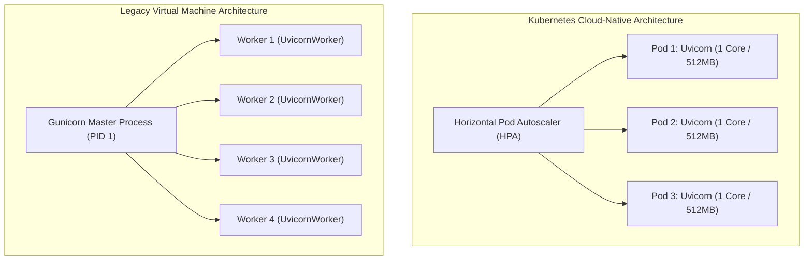
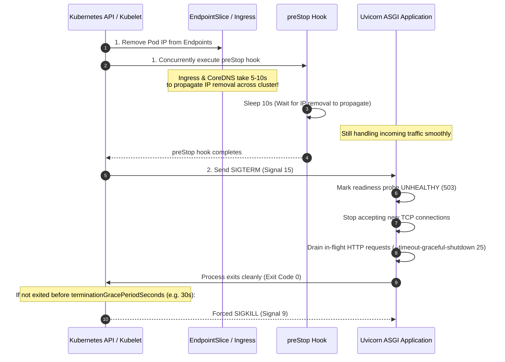

# Python Production Packaging, Docker, and Deployment

Writing high-performance Python code is only half the battle. Delivering reliable software in cloud-native environments requires hermetic dependency locking, lean multi-stage container images, secure non-root runtime environments, and deterministic graceful shutdown lifecycles under Kubernetes orchestration.

---

## 1. High-Speed Linting and Formatting with `ruff`

Modern Python projects standardize on **`ruff`**, a high-performance linter and code formatter written in Rust. It consolidates Flake8, Black, isort, pyupgrade, bandit, and pydocstyle into a single tool that executes in milliseconds.

Configure rules directly in `pyproject.toml`:

```toml
# pyproject.toml
[project]
name = "cloud-service"
version = "0.1.0"
requires-python = ">=3.12"
dependencies = [
    "fastapi>=0.115.0",
    "uvicorn[standard]>=0.30.0",
    "pydantic>=2.8.0",
]

[tool.ruff]
target-version = "py312"
line-length = 88
indent-width = 4

[tool.ruff.lint]
# E: pycodestyle errors, F: Pyflakes, I: isort, UP: pyupgrade
# B: flake8-bugbear, SIM: flake8-simplify, S: flake8-bandit (security)
select = ["E", "F", "I", "UP", "B", "SIM", "S"]
ignore = [
    "E501",  # Line length handled automatically by ruff formatter
    "B008",  # Do not perform function call in argument defaults (FastAPI Depends() pattern)
]

[tool.ruff.format]
quote-style = "double"
indent-style = "space"
```

```bash
# Check for lint violations and automatically fix auto-fixable errors
uv run ruff check --fix

# Format all files according to Black/PEP 8 standards
uv run ruff format
```

---

## 2. Hardened Multi-Stage Dockerfile with `uv`

Building production Docker containers with standard `pip` often yields massive images (800MB+), slow CI pipelines, and security vulnerabilities from residual compiler toolchains.

Using **`uv`** inside a **multi-stage build** achieves:

1. Sub-10-second container build times via BuildKit cache mounts.
2. Minimal attack surface by discarding build tools from the final runtime image.
3. Zero-privilege execution using an unprivileged non-root user.

```dockerfile
# ==============================================================================
# Stage 1: Build Environment (Compiles dependencies and virtualenv)
# ==============================================================================
FROM ghcr.io/astral-sh/uv:python3.12-bookworm-slim AS builder

# UV_COMPILE_BYTECODE=1 precompiles .py to .pyc, eliminating cold-start latency
# UV_LINK_MODE=copy ensures files are copied rather than hardlinked across mounts
ENV UV_COMPILE_BYTECODE=1 \
    UV_LINK_MODE=copy

WORKDIR /app

# 1. Install dependencies first to maximize Docker layer caching
COPY pyproject.toml uv.lock ./
RUN --mount=type=cache,target=/root/.cache/uv \
    uv sync --frozen --no-install-project --no-dev

# 2. Copy source code and build final virtualenv
COPY . .
RUN --mount=type=cache,target=/root/.cache/uv \
    uv sync --frozen --no-dev

# ==============================================================================
# Stage 2: Minimal Runtime Environment (Hardened Production Image)
# ==============================================================================
FROM python:3.12-slim-bookworm AS runtime

WORKDIR /app

# 1. Security Hardening: Run as an explicit non-root user (UID 1000)
# Prevents container breakout vulnerabilities from gaining host root privileges
RUN groupadd -g 1000 appgroup && \
    useradd -u 1000 -g appgroup -s /bin/sh -m appuser

# 2. Copy pre-built virtual environment and application code from builder
COPY --from=builder --chown=appuser:appgroup /app/.venv /app/.venv
COPY --from=builder --chown=appuser:appgroup /app/src /app/src

# 3. Configure runtime environment variables
# PYTHONUNBUFFERED=1 ensures logs flush immediately to stdout/stderr without buffering
ENV PATH="/app/.venv/bin:$PATH" \
    PYTHONUNBUFFERED=1 \
    PYTHONDONTWRITEBYTECODE=1

# Drop privileges
USER appuser

EXPOSE 8080

# Launch Uvicorn using the virtual environment's binary
CMD ["uvicorn", "src.main:app", "--host", "0.0.0.0", "--port", "8080", "--timeout-graceful-shutdown", "25"]
```

### Architectural Breakdown of Flags

- **`--frozen`**: Enforces strict adherence to `uv.lock`. If `pyproject.toml` was modified without updating the lockfile, the build fails immediately rather than silently installing unpinned dependencies.
- **`--mount=type=cache,target=/root/.cache/uv`**: Persists `uv` package downloads across repeated local or CI container builds, eliminating redundant network calls.
- **`PYTHONUNBUFFERED=1`**: Disables stdout stream buffering. Without this flag, log lines can remain trapped in Python's internal buffer during an unexpected pod crash or OOM termination.

---

## 3. ASGI Process Management: Kubernetes vs. VMs

How you run your ASGI server depends fundamentally on whether your infrastructure uses a container orchestrator.

### Process Management Decision Matrix

| Metric                        | Model A: Standalone Uvicorn in Kubernetes              | Model B: Gunicorn + Uvicorn Workers on VMs         |
| :---------------------------- | :----------------------------------------------------- | :------------------------------------------------- |
| **Process Model**             | **1 container = 1 Uvicorn process**                    | 1 master supervisor = $N$ worker processes         |
| **Horizontal Scaling**        | Managed by Kubernetes HPA (`cpu` / `requests_per_sec`) | Handled manually or via VM auto-scale groups       |
| **CPU/RAM Isolation**         | Guaranteed by Linux cgroups per container              | Shared across all worker processes on the host     |
| **Worker Restarts**           | Handled by Kubelet restarting the container            | Master Gunicorn process forks a replacement worker |
| **Zero-Downtime Deployments** | Kubernetes Rolling Updates with Pod drainage           | Gunicorn reload (`kill -HUP <master_pid>`)         |



> [!IMPORTANT]
> **Why Multi-Worker Gunicorn is an Anti-Pattern in Kubernetes:** Running multiple worker processes inside a single Kubernetes container breaks CPU limits. If a pod with 4 workers is allocated `1000m` (1 CPU core), all 4 workers compete for the same core, causing severe CPU throttling and latency spikes. Always run **one single-process Uvicorn instance per container** in Kubernetes, and let the orchestrator scale pods horizontally.

---

## 4. Kubernetes Zero-Downtime Pod Termination & Draining

When Kubernetes initiates a deployment rollout or scales down, terminating a pod abruptly drops active HTTP connections and causes `502 Bad Gateway` errors at the ingress controller.

Achieving zero-downtime requires understanding the asynchronous sequence of events during pod deletion:



### The Critical Role of the `preStop` Hook

When a pod is deleted, the Kubelet removes the pod's IP from the `EndpointSlice` **at the exact same time** it sends the termination signal. Because `kube-proxy`, cloud load balancers, and Ingress controllers propagate iptables/IPVS updates asynchronously across nodes, traffic continues routing to the pod for several seconds _after_ it begins shutting down!

The `preStop` hook sleep forces the container to delay handling `SIGTERM` until all cluster routers have stopped forwarding new traffic:

```yaml
# deployment.yaml
apiVersion: apps/v1
kind: Deployment
metadata:
  name: cloud-service
spec:
  replicas: 3
  template:
    spec:
      terminationGracePeriodSeconds: 45
      containers:
        - name: api
          image: cloud-service:0.1.0
          lifecycle:
            preStop:
              exec:
                command: ["/bin/sh", "-c", "sleep 10"]
```

---

## 5. Kubernetes Health Probes Implementation

FastAPI services should expose dedicated, lightweight probe endpoints rather than querying heavy database transactions on every health check:

```python
from contextlib import asynccontextmanager
import asyncio
from fastapi import FastAPI, Response, status

is_ready = False
is_draining = False

@asynccontextmanager
async def lifespan(app: FastAPI):
    global is_ready
    # Startup phase: Initialize database pools, load models
    await asyncio.sleep(0.5)
    is_ready = True
    yield
    # Shutdown phase: Mark draining
    global is_draining
    is_draining = True
    await asyncio.sleep(1.0)

app = FastAPI(lifespan=lifespan)

@app.get("/healthz/startup")
def startup_probe(response: Response):
    """Verifies the container has finished cold-start initialization."""
    if not is_ready:
        response.status_code = status.HTTP_503_SERVICE_UNAVAILABLE
        return {"status": "initializing"}
    return {"status": "initialized"}

@app.get("/healthz/liveness")
def liveness_probe():
    """Verifies the Python event loop is unblocked and responsive."""
    return {"status": "alive"}

@app.get("/healthz/readiness")
def readiness_probe(response: Response):
    """Verifies the service can accept incoming client traffic."""
    if is_draining or not is_ready:
        response.status_code = status.HTTP_503_SERVICE_UNAVAILABLE
        return {"status": "draining" if is_draining else "not_ready"}
    return {"status": "ready"}
```

### Complete Kubernetes Probes Manifest

```yaml
livenessProbe:
  httpGet:
    path: /healthz/liveness
    port: 8080
  initialDelaySeconds: 5
  periodSeconds: 10
  timeoutSeconds: 2
  failureThreshold: 3

readinessProbe:
  httpGet:
    path: /healthz/readiness
    port: 8080
  initialDelaySeconds: 5
  periodSeconds: 5
  timeoutSeconds: 2
  failureThreshold: 2

startupProbe:
  httpGet:
    path: /healthz/startup
    port: 8080
  initialDelaySeconds: 2
  periodSeconds: 3
  failureThreshold: 10
```

---

## Common Production Pitfalls

| Pitfall                                   | Root Cause                                                                  | Production Symptom                                                                         | Idiomatic Fix                                                       |
| :---------------------------------------- | :-------------------------------------------------------------------------- | :----------------------------------------------------------------------------------------- | :------------------------------------------------------------------ |
| **502 Bad Gateway on Deployments**        | Pod terminates immediately upon `SIGTERM` before Ingress updates endpoints. | Dropped user requests during routine rolling releases.                                     | Add a `preStop: exec: command: ["sleep", "10"]` hook.               |
| **Multiple Workers per Container in K8s** | Running Gunicorn `--workers 4` inside a container limited to 1 CPU core.    | High p99 latency spikes and aggressive CPU throttling by cgroups.                          | Run 1 Uvicorn worker per container; scale pods with Kubernetes HPA. |
| **Lost Logs on Container Crash**          | Python's standard stdout stream buffering (`PYTHONUNBUFFERED=0`).           | Diagnostic logs immediately preceding an OOM or crash are missing from Datadog/CloudWatch. | Always export `ENV PYTHONUNBUFFERED=1` in Dockerfiles.              |
| **Container Root Escalation**             | Running Docker containers under default root UID 0.                         | Potential host system takeover if a remote code execution vulnerability is discovered.     | Create and enforce an unprivileged user (`USER appuser`, UID 1000). |

---

## Next Steps

- [[Architecture/languages/python/index|Python Roadmap]] — Review the complete 24-module curriculum.
- [[Architecture/languages/python/18-fastapi-production-middleware-async-db-and-auth|18: FastAPI Production: Middleware, Async DB, and Auth]] — Review lifespan database pooling and async sessions.
