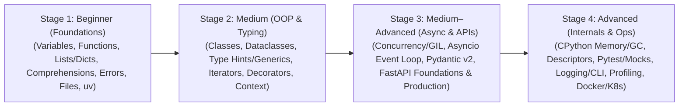

# Python

Python is the preeminent programming language for modern web microservices, artificial intelligence, machine learning, data engineering, and automation. In cloud-native production environments, modern Python powers high-throughput asynchronous APIs (FastAPI, Starlette) and orchestration platforms.

This section provides a **4-stage progressive roadmap** comprising **24 numbered modules** spanning **Beginner**, **Medium**, and **Advanced** engineering practices with runnable, copy-pasteable Python 3.12+ code snippets.

---

## The 4-Stage Python Roadmap

---

## Stage 1: Beginner — Language Foundations & Core Data Structures

Foundational syntax, parameter semantics, collections, file operations, and modern environment tooling:

1. [[Architecture/languages/python/01-variables-types-and-control-flow|01: Variables, Types, and Control Flow]]  
   Object references (names vs values), primitive types, truthiness evaluation, f-strings, loops (`for...else`), and structural pattern matching (`match` / `case`).
2. [[Architecture/languages/python/02-functions-arguments-and-scope|02: Functions, Arguments, and Scope]]  
   Default arguments (and the mutable default argument trap), `*args`/`**kwargs`, positional-only (`/`) and keyword-only (`*`) parameters, LEGB scoping rules, and lambdas.
3. [[Architecture/languages/python/03-lists-tuples-sets-and-dicts|03: Lists, Tuples, Sets, and Dictionaries]]  
   Time complexity ($O(1)$ vs $O(n)$), dynamic array slicing, immutable tuples & `namedtuple`, set algebra, hash table mechanics, `defaultdict`, and `Counter`.
4. [[Architecture/languages/python/04-comprehensions-iterables-and-builtin-funcs|04: Comprehensions, Iterables, and Built-in Functions]]  
   List, dict, and set comprehensions, generator expressions, `enumerate`, `zip(strict=True)`, `any`, `all`, and multi-key custom sorting with `sorted()`.
5. [[Architecture/languages/python/05-exceptions-and-error-handling|05: Exceptions and Error Handling]]  
   `try / except / else / finally`, EAFP vs LBYL philosophy, exception chaining (`raise ... from e`), custom exception hierarchies, and `ExceptionGroup` (`except*`).
6. [[Architecture/languages/python/06-files-pathlib-and-serialization|06: Files, Pathlib, and Serialization]]  
   Modern cross-platform path handling with `pathlib.Path`, buffered UTF-8 file I/O, CSV, `json` serialization with custom encoders, and `tempfile`.
7. [[Architecture/languages/python/07-modules-packages-and-uv|07: Modules, Packages, and uv]]  
   Import system (`sys.path`, `__init__.py`, `__all__`), virtual environments (`venv`), standard `pyproject.toml`, and lightning-fast package management with Astral's **`uv`**.

---

## Stage 2: Medium — OOP, Modern Typing, Functional Python & Context Managers

Writing modular, decoupled, object-oriented code with static type safety:

8. [[Architecture/languages/python/08-classes-oop-and-dunder-methods|08: Classes, OOP, and Dunder Methods]]  
   Classes, instances, `@classmethod` vs `@staticmethod`, `@property` encapsulation, and dunder methods (`__repr__`, `__eq__`, `__hash__`, `__len__`, `__getitem__`).
9. [[Architecture/languages/python/09-inheritance-composition-and-dataclasses|09: Inheritance, Composition, and Dataclasses]]  
   Inheritance, `super()` & Method Resolution Order (MRO), Abstract Base Classes (`abc.ABC`), composition over inheritance, `@dataclass` (`frozen`, `slots`), and `StrEnum`.
10. [[Architecture/languages/python/10-type-annotations-and-generics|10: Type Annotations and Generics]]  
    Python 3.12+ type parameters (`[T]`, `type` statement), `Union` (`|`), `Optional`, `TypedDict`, structural duck typing with `Protocol`, and `Annotated` metadata.
11. [[Architecture/languages/python/11-iterators-generators-and-itertools|11: Iterators, Generators, and Itertools]]  
    The Iterator Protocol (`__iter__`, `__next__`), lazy generators (`yield`, `yield from`), streaming log pipelines, `itertools` recipes, and `functools.lru_cache`.
12. [[Architecture/languages/python/12-closures-and-decorators|12: Closures and Decorators]]  
    Lexical closures (`nonlocal`), `@decorator` syntax desugaring, `@functools.wraps`, parameterized retry and rate-limiting decorator factories, class decorators, and async decorators.
13. [[Architecture/languages/python/13-context-managers-and-contextlib|13: Context Managers and contextlib]]  
    Deterministic resource management with `with`, `__enter__` and `__exit__`, `@contextlib.contextmanager`, dynamic resource tracking with `ExitStack`, and async context managers (`async with`).

---

## Stage 3: Medium–Advanced — Concurrency, Asyncio, Pydantic v2 & FastAPI

High-throughput, asynchronous networking and production API architectures:

14. [[Architecture/languages/python/14-concurrency-threads-processes-and-gil|14: Concurrency: Threads, Processes, and the GIL]]  
    CPU-bound vs I/O-bound workloads, why the Global Interpreter Lock (GIL) exists, `threading`, `multiprocessing`, and `concurrent.futures` executors.
15. [[Architecture/languages/python/15-asyncio-and-event-loop|15: Asyncio and the Event Loop]]  
    Cooperative multitasking, the event loop, coroutines (`async`/`await`), structured concurrency with `asyncio.TaskGroup`, timeouts (`asyncio.timeout`), semaphores, and `asyncio.to_thread`.
16. [[Architecture/languages/python/16-pydantic-v2-validation-and-settings|16: Pydantic v2 Validation and Settings]]  
    Rust-backed `pydantic-core`, `BaseModel`, `Field` constraints, `@field_validator`, `@model_validator`, `@computed_field`, `TypeAdapter`, and environment configuration with `pydantic-settings`.
17. [[Architecture/languages/python/17-fastapi-foundations-and-dependency-injection|17: FastAPI Foundations and Dependency Injection]]  
    Starlette ASGI + Pydantic architecture, path/query validation, `response_model` sensitive data filtering, the **`Depends()` Dependency Injection** system, and `APIRouter` modular layout.
18. [[Architecture/languages/python/18-fastapi-production-middleware-async-db-and-auth|18: FastAPI Production: Lifespan, Middleware, Async DB, and Auth]]  
    Application lifecycle management (`@asynccontextmanager` lifespan), custom ASGI middleware (Request ID, latency headers), `BackgroundTasks`, async SQLAlchemy 2.0 (`AsyncSession`), and OAuth2/JWT authentication.

---

## Stage 4: Advanced — CPython Internals, Metaprogramming, Testing & Production Ops

Deep systems internals, test architecture, and containerized deployment:

19. [[Architecture/languages/python/19-memory-management-gc-and-slots|19: Memory Management, GC, and Slots]]  
    CPython `PyObject` structure, reference counting mechanics, the generational cyclic garbage collector (`gc`), breaking reference cycles with `weakref`, and reducing RAM usage by 50%+ with `__slots__`.
20. [[Architecture/languages/python/20-descriptors-metaclasses-and-metaprogramming|20: Descriptors, Metaclasses, and Metaprogramming]]  
    Python attribute resolution order (`__getattribute__`), the Descriptor Protocol (`__get__`, `__set__`), subclass registration with `__init_subclass__`, and metaclasses (`type`).
21. [[Architecture/languages/python/21-testing-pytest-mocking-and-async-tests|21: Testing with Pytest, Mocking, and Async Tests]]  
    `pytest` architecture, fixture scopes (`session`, `module`, `function`), table-driven `@pytest.mark.parametrize`, mocking with `AsyncMock`, and testing FastAPI with `httpx.AsyncClient` + `dependency_overrides`.
22. [[Architecture/languages/python/22-logging-cli-and-os-processes|22: Logging, CLI, and OS Processes]]  
    Standard `logging` tree, structured JSON logging with `structlog` and `contextvars`, type-safe CLIs with `typer`, OS signal handling (`SIGTERM`), and child process management with `subprocess`.
23. [[Architecture/languages/python/23-profiling-optimization-and-c-extensions|23: Profiling, Optimization, and C Extensions]]  
    CPU profiling (`cProfile`, `py-spy`), memory profiling (`tracemalloc`), zero-copy `memoryview`, compiled Rust extensions with `PyO3`, and Python 3.13+ Free-Threaded Mode (No-GIL) & JIT.
24. [[Architecture/languages/python/24-production-packaging-docker-and-deployment|24: Production Packaging, Docker, and Deployment]]  
    Modern `pyproject.toml`, linting/formatting with `ruff`, multi-stage `uv` Dockerfiles, standalone Uvicorn in Kubernetes vs Gunicorn on VMs, and graceful shutdown draining.

---

## Related Notes Across the Wiki

- [[Architecture/languages/golang/index|Golang Roadmap]] — Parallel 4-stage curriculum for Go systems programming.
- [[Architecture/programming-concepts/README|Programming Concepts]] — Language-agnostic execution, memory, and paradigm fundamentals.
- [[Observability/opentelemetry/index|OpenTelemetry (OTel)]] — Instrumenting Python backend services with OpenTelemetry.
