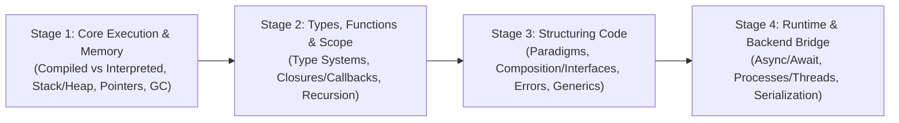

# Programming Concepts 💡

Language-independent ideas and mental models that come up when writing, reading, and reasoning about how code executes and how computers manage memory.

This section provides a **4-stage progressive roadmap** from foundational execution and memory basics up to everyday backend design paradigms and runtime concurrency.

---

## The 4-Stage Learning Roadmap

---

## Stage 1: Core Execution & Memory Basics (Simple)

Foundational concepts about how source code runs on physical hardware and where variables live in memory:

- [[Architecture/programming-concepts/compiled-vs-interpreted|Compiled vs Interpreted Languages]] — How source code turns into machine instructions, Ahead-of-Time (AOT) vs bytecode interpretation, JIT compilation, and container/serverless trade-offs.
- [[Architecture/programming-concepts/stack-heap-and-stack-overflow|Stack vs Heap Memory & Stack Overflow]] — The cafeteria tray stack vs hotel storage heap mental model, local variables, dynamic data, and the anatomy of stack overflow crashes.
- [[Architecture/programming-concepts/value-vs-reference-and-pointers|Value vs Reference, Pointers & Mutability]] — Photocopiers vs shared Google Docs, pointers in plain English (`*` and `&`), mutable vs immutable data, and Python default argument traps.
- [[Architecture/programming-concepts/garbage-collection-basics|Garbage Collection Basics]] — Manual memory management (`malloc`/`free`) vs automatic GC, Reference Counting vs Mark-and-Sweep, and how memory leaks still happen in managed languages.

---

## Stage 2: Data Types, Functions & Scope (Easy–Medium)

How programming languages check data types, organize variable visibility, and pass logic around:

- [[Architecture/programming-concepts/type-systems-static-vs-dynamic|Type Systems: Static vs Dynamic & Strong vs Weak]] — Compile-time vs runtime type checking, strong vs weak coercion traps, and tackling the "billion-dollar mistake" of null/nil safely.
- [[Architecture/programming-concepts/scope-closures-and-callbacks|Variable Scope, Closures & Callbacks]] — Local vs global scope, first-class functions, callbacks, and closures explained as "functions with a backpack" for configurable middleware.
- [[Architecture/programming-concepts/recursion-vs-iteration|Recursion vs Iteration: When to Use Loops vs Recursive Calls]] — Russian nesting dolls analogy, base cases, and when recursion makes nested trees/directories simpler vs when loops are safer.

---

## Stage 3: Structuring Code & Design Paradigms (Medium)

How to organize programs cleanly without getting trapped in deep inheritance hierarchies:

- [[Architecture/programming-concepts/programming-paradigms|Programming Paradigms: Procedural, OOP & Functional]] — A shopping cart example implemented in all three styles, their core principles, and how modern languages blend them.
- [[Architecture/programming-concepts/composition-vs-inheritance-and-interfaces|Composition vs Inheritance & Interfaces as Contracts]] — "Has-a" vs "is-a", why modern architecture avoids deep class trees, and using interfaces as testable contracts.
- [[Architecture/programming-concepts/error-handling-patterns|Error Handling: Exceptions vs Errors as Values]] — `try/catch` exceptions vs Go-style errors as values (`err != nil`), failing fast, adding context, and resilient design.
- [[Architecture/programming-concepts/generics-basics|Generics Explained: Reusable, Type-Safe Code]] — Eliminating code duplication across multiple types without losing compile-time type safety, type parameters (`T`), and constraints.

---

## Stage 4: Everyday Runtime & Backend Bridge (Medium)

Connecting core programming concepts to cloud-native microservices and distributed systems:

- [[Architecture/programming-concepts/sync-vs-async-programming|Synchronous vs Asynchronous Programming (async/await)]] — The coffee shop buzzer analogy, blocking vs non-blocking I/O, I/O-bound vs CPU-bound tasks, and how Go takes a different approach with goroutines.
- [[Architecture/programming-concepts/processes-threads-and-coroutines|Processes, Threads & Coroutines (Goroutines)]] — Separate houses (processes) vs roommates (threads) vs cooperative chore-swapping (goroutines/fibers), memory overhead, and context switching.
- [[Architecture/programming-concepts/serialization-and-encoding-basics|Serialization & Data Formats: JSON, YAML & Protobuf]] — Converting in-memory objects to text or bytes, flat-pack furniture analogy, and choosing between JSON, YAML, and Protocol Buffers.

---

## Related Language Guides & Deep Dives

- [[Architecture/languages/golang/README|Go (Golang) Systems Architecture & Concurrency]] — Language-specific implementation of goroutines, channels, interfaces, and memory.
- [[Architecture/languages/python/README|Python Architecture & Production Engineering]] — Decorators, virtual environments, and async web APIs.
- [[Architecture/solution-architecture-concepts/api-design/concurrency|Distributed Concurrency]] — Scaling concurrency patterns across distributed systems.
