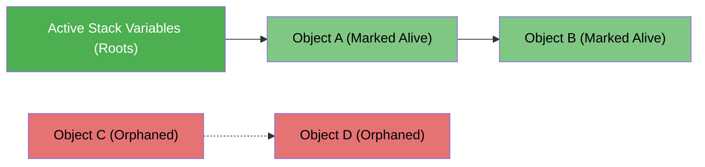

# Garbage Collection Basics: How Runtimes Manage Memory ♻️

When software creates variables, loads files, or builds data structures, it allocates memory on the [[Architecture/programming-concepts/stack-heap-and-stack-overflow|Heap]]. But RAM is finite. Once the program is done using that data, how does the memory get freed so the system doesn't run out?

There are two primary approaches: **Manual Memory Management** and **Automatic Garbage Collection (GC)**.

---

## 1. Manual vs Automatic Memory Management

```
MANUAL (C, C++, Zig):
  Developer: "Hey OS, give me 100 bytes (malloc)."
  ... program runs ...
  Developer: "I'm done, here are the 100 bytes back (free)."
  ⚠️ If you forget -> Memory Leak!
  ⚠️ If you free too early -> Crash or Security Vulnerability (Use-After-Free)!

AUTOMATIC GARBAGE COLLECTION (Go, Python, Java, JS, C#):
  Developer: "Create this user list."
  ... program runs ...
  Developer drops all variables pointing to the list.
  Runtime GC: "Nobody can reach this list anymore. I'll automatically reclaim it."
```

### Quick Comparison

| Feature                 | Manual Memory (C, C++)             | Automatic GC (Go, Java, Python, JS) | Ownership (Rust)                 |
| :---------------------- | :--------------------------------- | :---------------------------------- | :------------------------------- |
| **Who frees memory?**   | The developer                      | The language runtime (GC)           | The compiler at compile time     |
| **Ease of Development** | Hard (requires extreme discipline) | High (focus on business logic)      | Medium (compiler enforces rules) |
| **Memory Leaks**        | Frequent if `free()` is missed     | Possible if references stay alive   | Rare                             |
| **Runtime Overhead**    | None (instant deallocation)        | Small CPU & pause overhead          | Zero runtime overhead            |

---

## 2. How Garbage Collectors Know What to Free

How does a garbage collector know an object is safe to delete? Two main techniques are used:

### Method 1: Reference Counting (Python, Swift)

Every object has a hidden counter tracking how many variables point to it:

- A new variable points to it $\rightarrow$ Counter $+1$.
- A variable goes out of scope or is reassigned $\rightarrow$ Counter $-1$.
- **When counter reaches $0$:** The object is deleted immediately.

```
user = {"name": "Alice"}   # Ref Count = 1
admin = user               # Ref Count = 2
admin = None               # Ref Count = 1
user = None                # Ref Count = 0 -> 💥 Instantly freed!
```

> **The Gotcha (Circular References):** If Object A points to Object B, and Object B points back to Object A, both have a count of 1 even if the rest of the program stopped using them. Python includes a periodic cycle-detector to find and clean these up.

### Method 2: Tracing / Mark-and-Sweep (Go, Java, JavaScript)

Instead of updating counters on every assignment, the runtime runs a periodic sweep:

1. **Root Set:** Starts from variables you are actively using (local variables on the active stack, global variables).
2. **Mark Phase:** Follows every pointer from those roots and marks all reachable objects as "Alive".
3. **Sweep Phase:** Scans the entire heap. Anything not marked is considered unreachable "garbage" and wiped clean.



_(Objects C and D cannot be reached from any active variable $\rightarrow$ Swept away!)_

---

## 3. What Causes Memory Leaks in Garbage-Collected Languages?

A common myth is that _"Garbage-collected languages cannot have memory leaks."_

In reality, a garbage collector can only free memory that is **unreachable**. If your code accidentally keeps a reference to data you no longer need, the GC cannot touch it!

### Common Culprits

1. **Unbounded In-Memory Caches:** Adding items to a global dictionary or map without an expiration (TTL) or max size limit.
2. **Forgotten Event Listeners / Callbacks:** Registering an observer or listener without unsubscribing when done.
3. **Unclosed Goroutines or Background Tasks:** A goroutine that waits forever on an unbuffered channel keeps all its captured variables alive indefinitely.

---

## 4. Practical Best Practices for Developers

- **Keep variable scopes small:** Let local variables fall out of scope as soon as a function finishes.
- **Use bounded caches:** Use an LRU (Least Recently Used) cache with a maximum capacity instead of a bare dictionary.
- **Close resources:** Always close database connections, file handles, and HTTP response bodies (e.g., `defer resp.Body.Close()` in Go, `with open(...)` in Python).

---

## Across the Wiki

- [[Architecture/programming-concepts/stack-heap-and-stack-overflow|Stack vs Heap Memory]] — Why stack memory doesn't need garbage collection.
- [[Architecture/solution-architecture-concepts/reliability/memory-leaks|Memory Leaks]] — Real-world production memory leak detection with pprof and objgraph.
- [[Architecture/languages/golang/README|Go Systems Architecture]] — How Go's concurrent garbage collector keeps pause times under 1 millisecond.
