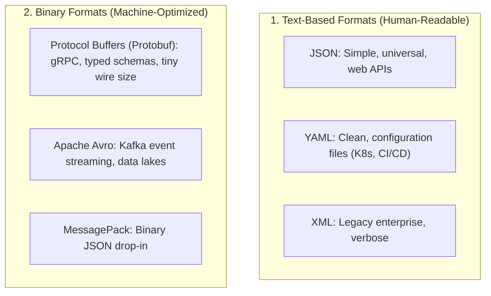

# Serialization & Data Formats: JSON, YAML & Protobuf 📦

In your running application, a User object is stored as a web of memory pointers, struct fields, and heap blocks. But when you want to send that User over an HTTP connection or save it to a disk file, **you cannot send raw memory pointers**.

**Serialization** (also called _marshaling_ or _encoding_) is the process of converting an in-memory data structure into a standardized stream of text or binary bytes that can be transmitted or stored. **Deserialization** is the reverse process.

---

## 1. The Real-World Analogy: Flat-Pack Furniture

Think of buying a dining table from IKEA:

- In the showroom, the table is fully assembled (an **in-memory object** in RAM).
- To fit it in your car and ship it home, IKEA disassembles the table into flat wooden boards and packs it into a flat cardboard box (**Serialization**).
- When you get home, you open the box and reassemble the boards into a working table (**Deserialization**).

```
In-Memory Struct (RAM) ──(Serialize)──▶ Wire Bytes / Text ──(Deserialize)──▶ In-Memory Struct (RAM)
{ Name: "Alice", Age: 30 }             {"name":"Alice","age":30}             { Name: "Alice", Age: 30 }
```

---

## 2. Text Formats vs Binary Formats

Serialization formats fall into two broad categories:



### Trade-Off Comparison

| Dimension            | JSON                                    | YAML                                 | Protocol Buffers (Protobuf)                 |
| :------------------- | :-------------------------------------- | :----------------------------------- | :------------------------------------------ |
| **Readability**      | High (Human-readable text)              | Very High (Clean indentation)        | Low (Raw binary bytes, needs tooling)       |
| **Wire Size**        | Medium (Repeats field names every time) | Large (Text with indentation)        | **Small (3x–10x smaller than JSON)**        |
| **Parsing Speed**    | Medium (String parsing)                 | Slow                                 | **⚡ Very Fast (Direct binary decoding)**   |
| **Schema Required?** | No (Self-describing)                    | No                                   | **Yes (Defined in `.proto` file)**          |
| **Primary Use Case** | Public REST APIs, browser apps          | Kubernetes manifests, GitHub Actions | Microservice-to-microservice RPC (**gRPC**) |

---

## 3. JSON: The Lingua Franca of the Web

JSON (JavaScript Object Notation) is supported natively by virtually every programming language on Earth.

```json
{
  "user_id": 1042,
  "username": "alex",
  "is_active": true,
  "roles": ["developer", "admin"]
}
```

### The Inefficiency of JSON at Scale

In JSON, **every single message repeats the field names**:

- If you stream 1,000,000 telemetry messages per second containing `"user_id"`, `"timestamp"`, `"temperature_celsius"`, you spend massive bandwidth sending those exact same English strings over and over again!

---

## 4. Protocol Buffers (Protobuf): Microservice Efficiency

Google created **Protocol Buffers** for internal high-throughput communication.

Instead of transmitting field names as text, you define a **Schema Contract** once in a `.proto` file:

```protobuf
syntax = "proto3";

message UserProfile {
  int32 user_id = 1;     // Tag 1
  string username = 2;   // Tag 2
  bool is_active = 3;    // Tag 3
}
```

- When serialized, Protobuf emits **only numeric field tags (`1`, `2`, `3`) and compact binary values**.
- The field names `"user_id"` and `"username"` are **never sent over the wire**.
- The binary payload is tiny, parses 5x–10x faster than JSON, and the compiler automatically generates strongly typed client and server code in Go, Python, Java, or Rust.

---

## 5. Summary: How to Choose a Format

- Use **JSON** when you need maximum interoperability with web browsers, public API consumers, and humans reading logs.
- Use **YAML** for configuration files that humans read and edit directly (Kubernetes manifests, CI/CD pipelines, Docker Compose).
- Use **Protobuf / gRPC** for high-volume internal communication between microservices, high-throughput streaming, and strict typed API contracts.

---

## Across the Wiki

- [[Architecture/solution-architecture-concepts/protocols/README|Protocols: HTTP vs gRPC]] — How serialization formats travel over network protocols.
- [[Architecture/solution-architecture-concepts/event-driven-architecture/kafka/README|Apache Kafka]] — Streaming events with Avro and Protobuf schemas.
- [[Architecture/solution-architecture-concepts/data-architecture/bson|BSON (Binary JSON)]] — How MongoDB extends JSON with binary types.
