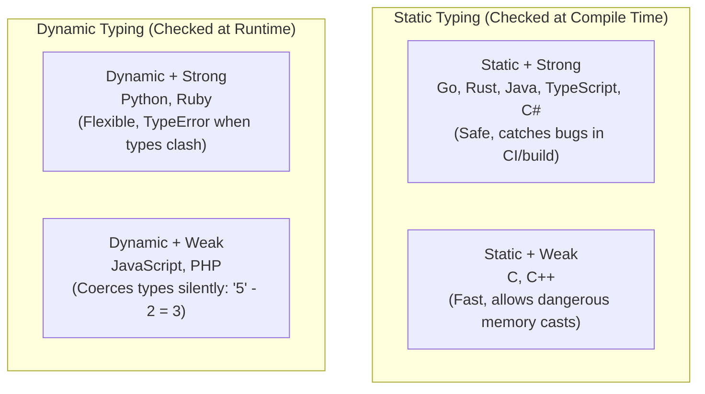

# Type Systems: Static vs Dynamic & Strong vs Weak 🏷️

Every piece of data processed by a computer has a **type**—an integer, a floating-point number, a string, a boolean, or a composite structure. A **Type System** is the set of rules a language uses to verify that you aren't doing nonsensical things (like trying to multiply a word by a date).

Understanding type systems helps you choose the right tool for a project and catch bugs before they reach production.

---

## 1. The Two Big Questions

Type systems are defined by two independent questions:

1. **When are types checked?** $\rightarrow$ **Static vs Dynamic**
2. **How strictly are types enforced?** $\rightarrow$ **Strong vs Weak**



---

## 2. Static vs Dynamic: _When_ Are Types Checked?

### Static Typing (Go, TypeScript, Rust, Java)

Types are checked **before the code runs**, during compilation or IDE analysis:

```go
var age int = 25
age = "twenty-five" // ❌ Compile Error: cannot use string as int
```

- **Advantages:** Catches typos and bugs before code ever deploys. Autocomplete and refactoring in IDEs work reliably.
- **Trade-off:** Writing type declarations can feel more verbose (though modern languages use **type inference** like `age := 25` to deduce the type automatically).

### Dynamic Typing (Python, JavaScript, Ruby)

Types belong to the **value**, not the variable name. Variables can hold any type and are checked **as lines execute**:

```python
age = 25            # age is an integer
age = "twenty-five" # Totally fine! Now age holds a string
```

- **Advantages:** Fast prototyping, concise scripts, fewer lines of code.
- **Trade-off:** A typo or unexpected `None` value can hide in a rarely called `if` branch until a customer triggers it in production.

---

## 3. Strong vs Weak: _How_ Strict Are Conversions?

### Strong Typing (Python, Go, Rust, Java)

The language **refuses** to silently convert incompatible types. You must explicitly cast them:

```python
# In Python (Strong):
result = "Order count: " + 5
# ❌ TypeError: can only concatenate str (not "int") to str
# You must write: "Order count: " + str(5)
```

### Weak Typing (JavaScript, PHP)

The language **guesses** what you meant and silently converts types behind your back:

```javascript
// In JavaScript (Weak):
"5" - 2  // Result: 3 (Converts "5" to a number!)
"5" + 2  // Result: "52" (Converts 2 to a string!)
[] + {}  // Result: "[object Object]"
```

While this can feel forgiving in quick scripts, it causes bizarre production bugs that are difficult to track down.

---

## 4. The `null` / `nil` / `None` Problem

In 1965, British computer scientist Tony Hoare invented the `null` pointer, which he later called his _"billion-dollar mistake"_.

In many languages, any variable can silently hold `null`, `nil`, or `None`:

- **Python:** `AttributeError: 'NoneType' object has no attribute 'name'`
- **Java:** `NullPointerException`
- **Go:** `panic: runtime error: nil pointer dereference`

### Modern Solutions to Null Safety

1. **Explicit Guard Checks:**
   ```go
   if user == nil {
       return errors.New("user not found")
   }
   ```
2. **Nullable Types in TypeScript / Kotlin:**
   ```typescript
   function getEmail(user?: User): string | null {
     return user?.email ?? "no-email@example.com"; // Optional chaining & null coalescing
   }
   ```
3. **Option / Result Enums in Rust:**
   Rust does not have `null` at all. A value that might be missing must be wrapped in `Option<T>` (`Some(value)` or `None`), forcing the developer to handle both cases before the code will compile!

---

## Across the Wiki

- [[Architecture/programming-concepts/generics-basics|Generics Basics]] — Writing reusable code while preserving type safety.
- [[Architecture/languages/golang/type-assertion|Go Type Assertions]] — Inspecting dynamic types safely in Go.
- [[Architecture/programming-concepts/value-vs-reference-and-pointers|Value vs Reference]] — How types are represented in memory.
