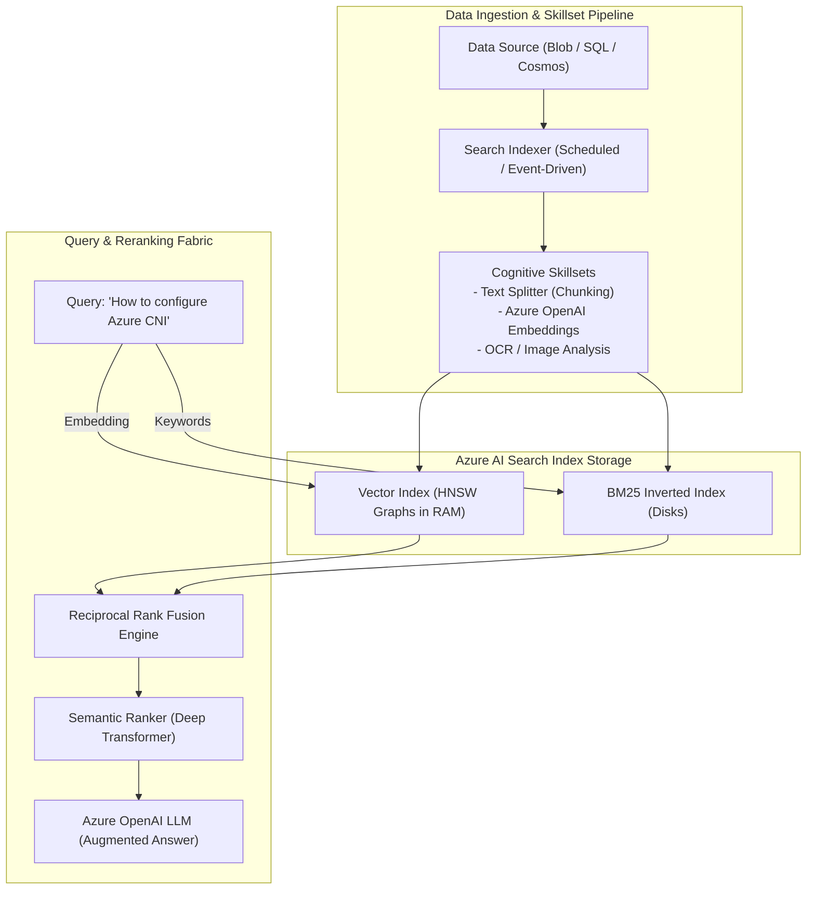

# Azure AI Search Architecture & Enterprise Vector Retrieval 🔍🧠

**Azure AI Search** (formerly Azure Cognitive Search) is Microsoft's production-grade information retrieval platform designed for enterprise search and modern **Retrieval-Augmented Generation (RAG)** systems. It uniquely combines traditional BM25 inverted text indexes, high-dimensional vector similarity search via Hierarchical Navigable Small World (HNSW), and a multi-lingual transformer-based **Semantic Ranker**.

---

## Architecture & Mental Model

### 1. The Multi-Stage Retrieval Engine

Modern enterprise RAG architectures cannot rely on vector search alone (which struggles with exact part numbers, GUIDs, and domain-specific acronyms) or keyword search alone (which misses synonyms and semantic meaning). Azure AI Search executes a **three-stage hybrid retrieval pipeline**:

```
                              User Search Query
                                      │
            ┌─────────────────────────┴─────────────────────────┐
            ▼                                                   ▼
    Dense Vector Path                                   Sparse Keyword Path
  (Embedding Generation)                               (Tokenization & Stemming)
            │                                                   │
    HNSW Vector Search                                  BM25 Inverted Index
  (Cosine / Dot Product)                               (Full-Text Exact Match)
            │                                                   │
            └─────────────────────────┬─────────────────────────┘
                                      │
                        Reciprocal Rank Fusion (RRF)
                         (Score Merging & Deduplication)
                                      │
                               Top 50 Candidates
                                      │
                         Semantic Ranker (Deep Model)
                        (Cross-Encoder Context Reranking)
                                      │
                                      ▼
                          Top K Precision Results
                          (Supplied to LLM Context)
```



### 2. Sizing Dimensions: Partitions vs. Replicas

Azure AI Search capacity is calculated in **Search Units (SUs)**, where:
$$\text{Search Units (SU)} = \text{Partitions} \times \text{Replicas}$$

| Scaling Vector | Primary Function                                                                                     | Failure Mode When Underprovisioned                                        |
| :------------- | :--------------------------------------------------------------------------------------------------- | :------------------------------------------------------------------------ |
| **Partitions** | **Storage & Vector Index Capacity**. Slices and shards the index data across storage nodes.          | Vector memory exhaustion, index insertion rejections, indexing slowdowns. |
| **Replicas**   | **Query Throughput (QPS) & High Availability**. Replicates partitions for concurrent read execution. | Query throttling (HTTP 503 / 429), high latency under load, SLA breach.   |

> [!IMPORTANT]
> **High Availability SLA Requirements**: Azure AI Search requires at least **2 Replicas** for a 99.9% Read SLA, and at least **3 Replicas** for a 99.9% Read-Write SLA. Single-replica deployments carry zero SLA.

---

## Core Concepts & Operations

### 1. Vector Search: HNSW vs. Exhaustive KNN

- **HNSW (Hierarchical Navigable Small World)**: Default approximate nearest neighbor (ANN) algorithm. Organizes embeddings into multi-layer graph structures for sub-millisecond retrieval even over tens of millions of vectors. Configurable via `m` (bi-directional links) and `efSearch` (search beam width).
- **Exhaustive KNN**: Brute-force mathematical comparison evaluating query vectors against every document in the index. Provides 100% recall at the cost of linear latency scaling. Only suitable for small catalogs ($< 50,000$ documents).

### 2. Reciprocal Rank Fusion (RRF) & Semantic Ranker

- **RRF**: Standardizes scores from keyword and vector searches by calculating score based on rank positions:
  $$RRF\_Score = \sum_{m \in M} \frac{1}{k + r_m(d)}$$
  _(where $k=60$ is a constant dampening factor, and $r_m(d)$ is the rank in modality $m$)_.
- **Semantic Ranker**: Runs a specialized cross-encoder neural model trained by Bing on the top 50 RRF candidates to extract **Semantic Captions** and **Semantic Answers**, highlighting the precise sentence answering the query.

---

## Production `az` CLI Commands

### 1. Provisioning a Search Service with Private Networking

```bash
# 1. Create a Standard S1 Search Service with 1 partition and 2 replicas
az search service create \
  --resource-group rg-ai-prod \
  --name srch-core-prod-eastus \
  --location eastus \
  --sku Standard \
  --partition-count 1 \
  --replica-count 2 \
  --semantic-search standard \
  --public-network-access Disabled

# 2. Add an Azure Private Endpoint to the search service
SEARCH_ID=$(az search service show -g rg-ai-prod -n srch-core-prod-eastus --query id -o tsv)

az network private-endpoint create \
  --name pe-search-prod \
  --resource-group rg-ai-prod \
  --vnet-name vnet-ai-prod \
  --subnet snet-private-endpoints \
  --private-connection-resource-id $SEARCH_ID \
  --group-id searchService \
  --connection-name conn-search-pe
```

### 2. Scaling Partitions and Replicas for Traffic Surges

```bash
# Dynamically scale search service to 2 Partitions and 3 Replicas (Total 6 Search Units)
az search service update \
  --resource-group rg-ai-prod \
  --name srch-core-prod-eastus \
  --partition-count 2 \
  --replica-count 3
```

---

## Quotas & Limits

| Constraint                         | Limit                                           | Architectural Workaround / Rule                                                  |
| :--------------------------------- | :---------------------------------------------- | :------------------------------------------------------------------------------- |
| **Max Search Units per Service**   | **36 SUs** (Standard S1/S2/S3)                  | Scale up to S3 High Density or contact Azure support for dedicated capacity.     |
| **Semantic Ranker Max Docs**       | **Top 50 documents**                            | Only the top 50 items from initial retrieval are analyzed by the semantic model. |
| **Max Index Size (per Partition)** | 25 GB (S1), 100 GB (S2), 200 GB (S3), 1 TB (L1) | Add partitions when document volume or vector embedding space exhausts storage.  |
| **Vector Dimensions**              | **Up to 3,072 dimensions**                      | Compatible with OpenAI `text-embedding-3-large` (3,072d) and `small` (1,536d).   |
| **Max Documents per Batch**        | **1,000 documents** or 16 MB                    | Batch index updates to optimize ingestion throughput.                            |

---

## References & Documentation

- [Azure AI Search Overview](https://learn.microsoft.com/en-us/azure/search/search-what-is-azure-search)
- [Vector Search in Azure AI Search](https://learn.microsoft.com/en-us/azure/search/vector-search-overview)
- [Hybrid Search Using Reciprocal Rank Fusion (RRF)](https://learn.microsoft.com/en-us/azure/search/hybrid-search-overview)
- [Semantic Ranking Concepts](https://learn.microsoft.com/en-us/azure/search/semantic-search-overview)
- [Service Quotas and Limits in Azure AI Search](https://learn.microsoft.com/en-us/azure/search/search-limits-quotas-capacity)

---

## Realistic Pricing Scenarios

### Scenario A: Production Enterprise Knowledge Base (Standard S1)

- **Deployment**: Standard S1 Service with 1 Partition and 2 Replicas (2 SUs for 99.9% High Availability) hosting 500,000 corporate documents.
- **Search Units**: 2 SUs × $0.34/SU/hour × 730 hrs = **$496.40/month**.
- **Semantic Ranker Plan**: Standard Plan (up to 250,000 semantic queries/month) = **$500.00/month**.
- **Storage & Ingestion**: Document indexing via Blob storage = ~$15.00/month.
- **Total Monthly Cost**: **~$1,011.40/month** (Enterprise-grade hybrid RAG engine supporting millions of queries).

### Scenario B: Massive Document Archive (Storage Optimized L1)

- **Workload**: 5 TB of compliance PDFs requiring text indexing with infrequent search traffic.
- **Capacity**: Storage Optimized L1 SKU (1 Partition, 1 Replica = 1 SU with 1 TB included storage).
- **Search Units**: 5 Partitions × 1 Replica = 5 SUs at $1.90/SU/hour = **$6,935.00/month**.
- **Total Monthly Cost**: **$6,935.00/month** (Dedicated high-density storage nodes for multi-terabyte search corpora).

---

## Battle-Tested Nuggets & Gotchas

1. **HNSW Vectors Must Reside in Memory**: While raw text index documents can be paged to disk, HNSW vector graphs must be loaded into physical RAM for acceptable performance. If vector count and dimensionality cause the index to exceed available node RAM, query latencies degrade from 10 ms to 3,000+ ms as pages thrash from disk. Monitor the `Vector Memory Consumption Percentage` metric and add partitions before memory hits 80%.
2. **Document Key Restrictions (Base64 Encoding)**: The document key field in Azure AI Search only supports letters, numbers, dashes, and underscores. If using a Blob URL or file path as the key, slashes (`/`), colons (`:`), and periods (`.`) will cause indexing errors. The indexer must apply a Base64 encoding field mapping (`base64Encode`) on the metadata path.
3. **Partition Resizing Triggers Index Re-sharding**: When you increase partition count (e.g., from 1 to 2), Azure AI Search must redistribute all documents across the new partitions. While query traffic remains active, indexing throughput drops significantly during the resharding window. Perform capacity scaling during off-peak windows.
4. **Semantic Ranker Payload Sizing**: The Semantic Ranker truncates document text chunks passed to it to approximately 2,000 tokens. If your document chunks are 5,000 tokens long, only the first 2,000 tokens are evaluated for reranking. Optimize your ingestion chunking strategy to 300–500 tokens with 10% overlap for optimal semantic precision.
5. **Private Search Indexer Execution**: If Azure AI Search is locked behind Private Endpoints with public access disabled, indexers attempting to crawl an Azure Storage Account will fail unless you configure a **Shared Private Link Resource** within the Search Service pointing to the Storage Account.
