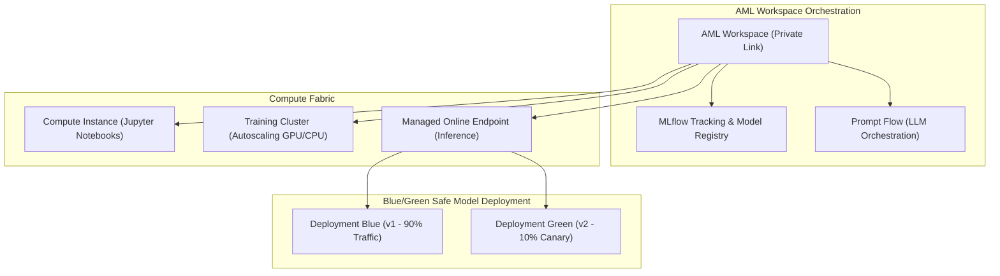

# Azure Machine Learning (AML) Architecture & MLOps Platform 🧪🤖

**Azure Machine Learning (AML)** is Microsoft's enterprise cloud platform for operationalizing the complete machine learning and generative AI lifecycle (MLOps & LLMOps). It provides infrastructure abstraction, distributed model training, MLflow tracking, automated model packaging, and real-time inference via Managed Online Endpoints.

---

## Architecture & Mental Model

### 1. The Workspace Hub & Companion Fabric

An Azure Machine Learning Workspace is not a standalone silo; it orchestrates a tightly coupled fabric of four foundational Azure services:

```
┌────────────────────────────────────────────────────────┐
│             Azure Machine Learning Workspace           │
│         Central Orchestrator, MLOps, Model Catalog     │
└───────┬──────────────┬──────────────────┬──────────────┘
        │              │                  │
        ▼              ▼                  ▼
┌──────────────┐┌──────────────┐   ┌──────────────┐┌──────────────┐
│Azure Storage ││Key Vault     │   │Container Reg.││App Insights  │
│(Artifacts,   ││(Secrets, Keys│   │(Custom Docker││(Logs, Latency│
│ Datastores)  ││ Credentials) │   │ Environments)││ Metrics)     │
└──────────────┘└──────────────┘   └──────────────┘└──────────────┘
```



### 2. Compute Options Decision Matrix

| Compute Type                | Scaling Nature                    | Statefulness                         | Primary Use Case                                                                   |
| :-------------------------- | :-------------------------------- | :----------------------------------- | :--------------------------------------------------------------------------------- |
| **Compute Instance**        | Single dedicated VM               | Stateful (Persistent home directory) | Interactive development, exploratory data analysis, JupyterLab.                    |
| **Compute Cluster**         | Autoscaling pool (0 to $N$ nodes) | Stateless (Ephemeral nodes)          | Distributed model training, hyperparameter sweep jobs, batch scoring.              |
| **Serverless Compute**      | Managed dynamic execution         | Stateless (Containerized)            | Fast ad-hoc training scripts without waiting for cluster provisioning.             |
| **Managed Online Endpoint** | Auto-scaled container instances   | Stateless (Real-time HTTP serving)   | Low-latency REST API model inference with blue/green deployment traffic splitting. |
| **Kubernetes (AKS / Arc)**  | Self-managed AKS cluster          | Managed via Azure ML extension       | Hybrid on-premises inference, specialized network policies, multi-tenant GPUs.     |

---

## Core Concepts & Operations

### 1. Managed Online Endpoints & Safe Rollouts

Managed Online Endpoints eliminate the operational burden of managing Kubernetes ingress, TLS termination, and pod autoscaling for real-time model serving:

- **Native Blue/Green Traffic Splitting**: Allows routing 90% of production traffic to `deployment-v1` and 10% to `deployment-v2` (canary testing) with a single CLI command.
- **Auto-Healing**: If a new model deployment throws health check failures, traffic routing remains pinned to the healthy deployment.

### 2. Prompt Flow for LLMOps

AML integrates **Prompt Flow**, an LLMOps engine for designing, evaluating, and monitoring generative AI workflows:

- Visual DAG (Directed Acyclic Graph) chaining LLM calls, Python tools, and vector database lookups.
- Automated evaluation metrics measuring Groundedness, Relevance, and Toxicity before production release.

---

## Production `az` CLI Commands (Azure CLI v2 ML Extension)

### 1. Provisioning a Production Workspace

```bash
# Ensure the Azure ML CLI extension is installed
az extension add -n ml -y

# Provision an enterprise AML Workspace with private networking
az ml workspace create \
  --name aml-core-prod-eastus \
  --resource-group rg-ai-prod \
  --location eastus \
  --storage-account stamlprod01 \
  --key-vault kv-aml-prod \
  --container-registry acramlprod \
  --application-insights appi-aml-prod
```

### 2. Creating an Autoscaling GPU Training Cluster

```bash
# Provision a training cluster scaling from 0 to 4 NCas_T4_v3 GPU instances
az ml compute create \
  --workspace-name aml-core-prod-eastus \
  --resource-group rg-ai-prod \
  --name cluster-gpu-t4 \
  --type amlcompute \
  --size Standard_NC4as_T4_v3 \
  --min-instances 0 \
  --max-instances 4 \
  --idle-time-before-scale-down 120
```

### 3. Deploying a Managed Online Endpoint with Traffic Splitting

```bash
# 1. Create the endpoint front-door
az ml online-endpoint create \
  --workspace-name aml-core-prod-eastus \
  --resource-group rg-ai-prod \
  --name ep-fraud-detection \
  --auth-mode key

# 2. Deploy v1 model
az ml online-deployment create \
  --workspace-name aml-core-prod-eastus \
  --resource-group rg-ai-prod \
  --endpoint-name ep-fraud-detection \
  --name blue \
  --model azureml:fraud-model:1 \
  --instance-type Standard_D4s_v4 \
  --instance-count 2

# 3. Update traffic split (100% to blue)
az ml online-endpoint update \
  --workspace-name aml-core-prod-eastus \
  --resource-group rg-ai-prod \
  --name ep-fraud-detection \
  --traffic "blue=100"
```

---

## Quotas & Limits

| Constraint                         | Limit                                        | Architectural Workaround / Rule                                                                |
| :--------------------------------- | :------------------------------------------- | :--------------------------------------------------------------------------------------------- |
| **Online Endpoints per Workspace** | **100** endpoints                            | Sufficient for dozens of model families.                                                       |
| **Deployments per Endpoint**       | **10** deployments                           | Enables multi-variant canary testing (e.g., 80% Blue, 10% Green, 10% Shadow).                  |
| **Regional GPU vCPU Quota**        | Often **0 by default** for new subscriptions | **Must request quota increase** in Azure Portal for NC/ND/NV GPU series weeks before training. |
| **Inference Request Timeout**      | **90 seconds** (Hard cap)                    | For executions longer than 90 seconds, use Managed Batch Endpoints or asynchronous queues.     |
| **Max Payload Size (Inference)**   | **10 MB** (Online Endpoints)                 | For large images or multi-megabyte audio files, pass a SAS URI to Blob Storage.                |

---

## References & Documentation

- [Azure Machine Learning Overview](https://learn.microsoft.com/en-us/azure/machine-learning/overview-what-is-azure-machine-learning)
- [What Are Managed Online Endpoints?](https://learn.microsoft.com/en-us/azure/machine-learning/concept-endpoints-online)
- [Prompt Flow Documentation](https://learn.microsoft.com/en-us/azure/machine-learning/prompt-flow/overview-what-is-prompt-flow)
- [Secure Azure ML Workspaces with Virtual Networks](https://learn.microsoft.com/en-us/azure/machine-learning/how-to-secure-workspace-vnet)
- [Azure ML CLI (v2) Reference](https://learn.microsoft.com/en-us/cli/azure/ml)

---

## Realistic Pricing Scenarios

### Scenario A: Production Real-Time Fraud Detection (Managed Online Endpoint)

- **Deployment**: 2 instances of `Standard_D4ds_v4` (4 vCPUs, 16 GB RAM) active 24/7 with auto-scaling to 4 instances during peak hours.
- **Base Compute**: 2 instances × 730 hrs × $0.27/hour = **$394.20/month**.
- **Peak Scaling Spikes**: Additional 2 instances for 100 hours/month = **$54.00/month**.
- **Egress & Ingestion**: 10 million inference requests logged to Application Insights = **$35.00/month**.
- **Total Monthly Cost**: **~$483.20/month** (Fully managed real-time inference API with automated health checking and zero Kubernetes overhead).

### Scenario B: Periodic Deep Learning Training Cluster (Spot VMs)

- **Workload**: Bi-weekly model retraining running for 10 hours on 4 GPU nodes (`Standard_NC4as_T4_v3`).
- **Standard Price**: $0.526/hour per VM ($21.04 for 10 hours).
- **Spot VM Discount (80% off)**: $0.105/hour × 4 nodes × 20 hours/month = **$8.40/month**.
- **Cluster Idle Cost**: **$0.00** (Cluster scales to 0 nodes when no training jobs are queued).
- **Total Monthly Cost**: **~$8.40/month** (High-throughput GPU training on ephemeral spot capacity).

---

## Battle-Tested Nuggets & Gotchas

1. **The 4 Companion Resource Deletion Trap**: If someone deletes the Key Vault, Container Registry, Storage Account, or Application Insights resource linked to an Azure ML Workspace, the workspace will immediately enter a corrupted, unrecoverable state. You cannot "re-link" a new storage account to an existing workspace. Apply `CanNotDelete` resource locks across all 4 companion resources immediately upon workspace creation.
2. **GPU Quota Approval Lead Times**: By default, enterprise Azure subscriptions are provisioned with **0 vCPUs for GPU families** (NCv3, NCasT4, NDv5). Filing a quota increase request with Microsoft Support can take 3 to 10 business days for high-demand AI chips (NVIDIA A100/H100). Never plan an AI sprint assuming GPU compute is available on-demand without verified regional quota allocations.
3. **Compute Instance Idle Drain**: Data scientists frequently start a GPU Compute Instance for Jupyter notebook exploration and leave it running over weekends and holidays, accruing thousands of dollars in idle fees. Enable **Idle Shutdown** policies (`--idle-time-before-shutdown`) and schedule automated evening shutdown rules via Azure Policy.
4. **Model Environment Dependency Locking**: When registering custom Python environments in AML, always pin exact package versions in your `conda.yaml` or Dockerfile. Using floating dependencies (`pandas>=2.0`) will result in broken builds when upstream libraries publish breaking updates months later.
5. **Private Workspace Outbound Internet Rule**: When securing an AML Workspace inside a private VNet with public internet egress blocked, the workspace requires User Defined Routes (UDRs) or Azure Firewall rules permitting access to Microsoft-managed artifact repositories and package repositories (PyPI, Conda). Without this, custom environment builds in Azure Container Registry will fail.
