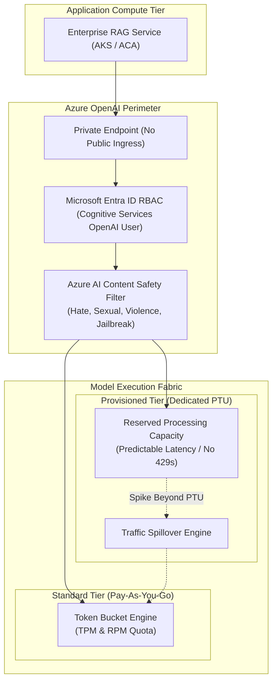

# Azure OpenAI Service Architecture & Enterprise GenAI 🧠⚡

**Azure OpenAI Service** provides enterprise-grade access to OpenAI's frontier language and multimodal models (GPT-4o, GPT-4o mini, o1, text-embedding-3) co-engineered with Microsoft. Unlike public consumer endpoints, Azure OpenAI runs entirely within Microsoft Azure's security perimeter, providing private networking, data encryption at rest with customer-managed keys (CMK), strict enterprise compliance (SOC 2, HIPAA, ISO 27001), and a contractual guarantee that **customer data is never used to train or refine models**.

---

## Architecture & Mental Model

### 1. Enterprise Private Networking & Deployment Modes

```
┌────────────────────────────────────────────────────────┐
│             Private Corporate VNet / On-Prem           │
└──────────────────────────┬─────────────────────────────┘
                           │ Private Link / RFC 1918 (No Internet)
┌──────────────────────────▼─────────────────────────────┐
│                 Azure Private Endpoint                 │
│              (10.100.4.15 - NIC inside VNet)           │
└──────────────────────────┬─────────────────────────────┘
                           │ Private Azure Backbone
┌──────────────────────────▼─────────────────────────────┐
│            Azure OpenAI Cognitive Resource             │
│  ┌───────────────────────┐   ┌──────────────────────┐  │
│  │ Azure AI Content      │   │ Model Deployment     │  │
│  │ Safety (Async/Sync)   ├──►│ Engine               │  │
│  │ - Hate, Violence, Self│   │ - Pay-As-You-Go (TPM)│  │
│  │ - Prompt Shields / Jail│   │ - Provisioned (PTU)  │  │
│  └───────────────────────┘   └──────────┬───────────┘  │
└─────────────────────────────────────────┼──────────────┘
                                          │
                         Zero Customer Data Retention
                         No Model Retraining Boundary
```



### 2. Standard (Pay-As-You-Go) vs. Provisioned (PTU)

| Dimension                 | **Standard (Pay-As-You-Go)**                                                | **Provisioned Throughput Units (PTU)**                                      |
| :------------------------ | :-------------------------------------------------------------------------- | :-------------------------------------------------------------------------- |
| **Billing Model**         | Pay per 1,000 prompt & completion tokens.                                   | **Fixed hourly rate per allocated PTU block.**                              |
| **Throughput Guarantees** | Multi-tenant shared pool. Subject to noisy neighbor variations.             | **Guaranteed, dedicated model processing capacity.**                        |
| **Rate Limits**           | Enforced via **TPM (Tokens Per Minute)** and **RPM (Requests Per Minute)**. | Bounded only by allocated PTU capacity; no artificial TPM caps.             |
| **Latency Consistency**   | Variable (P99 spikes during global usage peaks).                            | **Highly deterministic, ultra-low P99 response latencies.**                 |
| **Spillover Routing**     | Returns HTTP `429 Too Many Requests`.                                       | **Supports automatic spillover** to Standard PAYG during unexpected surges. |
| **Best Fit**              | Development, testing, low-to-medium variable volume workloads.              | Production enterprise customer-facing apps, SLA-critical voice/RAG agents.  |

---

## Core Concepts & Operations

### 1. Rate-Limit Mechanics: TPM and RPM

In the Standard tier, Azure OpenAI throttles requests using two concurrent token bucket algorithms:

1. **Tokens Per Minute (TPM)**: Evaluates the total token volume (input prompt tokens + estimated max output tokens).
2. **Requests Per Minute (RPM)**: Limits raw HTTP request frequency to prevent micro-bursting.

- **Micro-Window Evaluation**: Azure OpenAI samples usage across short rolling windows (e.g., 10-second intervals). Sending 60 requests in the first second will trigger an HTTP `429` even if your total for the minute is within budget.

### 2. Azure AI Content Safety & Prompt Shields

All requests and completions pass through integrated safety classifiers:

- **Severity Categories**: Evaluates Hate, Sexual, Violence, and Self-Harm on a 4-level scale (Safe, Low, Medium, High).
- **Prompt Shields**: Detects indirect prompt injection attacks (e.g., malicious instructions embedded inside crawled web pages or PDFs) and user jailbreak attempts.
- **Custom Blocklists**: Allows enterprises to define proprietary profanity or competitor term lists that trigger immediate content filtering.

---

## Production `az` CLI Commands

### 1. Provisioning Azure OpenAI Account with Private Networking

```bash
# 1. Create Azure OpenAI Cognitive Services account (Public access disabled)
az cognitiveservices account create \
  --name oai-core-prod-eastus \
  --resource-group rg-ai-prod \
  --location eastus \
  --kind OpenAI \
  --sku S0 \
  --custom-domain oai-contoso-prod \
  --public-network-access Disabled

# 2. Deploy GPT-4o with 50,000 Tokens-Per-Minute (TPM) capacity
az cognitiveservices account deployment create \
  --resource-group rg-ai-prod \
  --name oai-core-prod-eastus \
  --deployment-name gpt-4o-production \
  --model-name gpt-4o \
  --model-version "2024-08-06" \
  --model-format OpenAI \
  --sku-capacity 50 \
  --sku-name Standard
```

### 2. Securing Access with Managed Identity (Keyless)

```bash
# Assign Cognitive Services OpenAI User role to an AKS Workload Identity
SP_CLIENT_ID=$(az identity show -g rg-compute-prod -n id-aks-ai-worker --query clientId -o tsv)
OAI_SCOPE=$(az cognitiveservices account show -g rg-ai-prod -n oai-core-prod-eastus --query id -o tsv)

az role assignment create \
  --assignee $SP_CLIENT_ID \
  --role "Cognitive Services OpenAI User" \
  --scope $OAI_SCOPE
```

---

## Quotas & Limits

| Constraint                   | Limit                                         | Architectural Workaround / Rule                                               |
| :--------------------------- | :-------------------------------------------- | :---------------------------------------------------------------------------- |
| **Max PTU per Deployment**   | Up to **100,000 PTUs**                        | Request quota increase via Azure Support for massive deployments.             |
| **Max Prompt Payload Size**  | **30 MB** (HTTP Body)                         | For multi-document ingestion, split documents into chunks before sending.     |
| **Regional Quota Isolation** | Scoped per Region & Subscription              | Quota in East US does not pool with West Europe. Deploy multi-region routing. |
| **GPT-4o Context Window**    | **128,000 tokens** (16,384 max output tokens) | Leverage compact system prompts and structured outputs.                       |
| **Default TPM per Model**    | 20,000 to 150,000 TPM                         | Varies by region and tier. Use Azure OpenAI Studio to adjust capacity.        |

---

## References & Documentation

- [Azure OpenAI Service Overview](https://learn.microsoft.com/en-us/azure/ai-services/openai/overview)
- [Provisioned Throughput Units (PTU) Concepts](https://learn.microsoft.com/en-us/azure/ai-services/openai/concepts/provisioned-throughput)
- [Understand Azure OpenAI Quotas and Limits](https://learn.microsoft.com/en-us/azure/ai-services/openai/quotas-limits)
- [Azure AI Content Safety Integration](https://learn.microsoft.com/en-us/azure/ai-services/openai/concepts/content-filter)
- [Role-Based Access Control for Azure OpenAI](https://learn.microsoft.com/en-us/azure/ai-services/openai/how-to/role-based-access-control)

---

## Realistic Pricing Scenarios

### Scenario A: Pay-As-You-Go Enterprise Internal Assistant (Standard PAYG)

- **Workload**: 5,000 corporate employees executing RAG search queries.
- **Volume**: 20 million input prompt tokens + 5 million output completion tokens per month on **GPT-4o**.
- **Input Token Cost**: 20,000,000 tokens × $0.0025 per 1,000 = **$50.00/month**.
- **Output Token Cost**: 5,000,000 tokens × $0.0100 per 1,000 = **$50.00/month**.
- **Embeddings**: 50 million tokens processed via `text-embedding-3-small` at $0.00002 per 1,000 = **$1.00/month**.
- **Total Monthly Cost**: **$101.00/month** (Enterprise AI assistant operating for ~2 cents per employee).

### Scenario B: 24/7 Global Customer Service Agent (Provisioned Throughput - PTU)

- **Workload**: Mission-critical banking customer support bot requiring sub-800ms P95 latency and zero 429 throttles.
- **Capacity**: 100 PTUs provisioned in East US on a 1-month commitment.
- **Hourly Cost**: 100 PTUs × $1.70/PTU/hour = $170.00/hour.
- **Monthly Cost**: 730 hours × $170.00/hour = **$124,100.00/month**.
- **Throughput Delivered**: Supports ~5,000 concurrent conversations continuously with dedicated GPU inference reservations.

---

## Battle-Tested Nuggets & Gotchas

1. **The 429 Header Parsing Trap**: When Azure OpenAI throttles a client, the HTTP 429 response includes two critical headers: `x-ratelimit-remaining-tokens` and `Retry-After-Ms`. Naive client libraries that implement blind fixed retries will worsen throttling storms. Production clients must parse `Retry-After-Ms` and back off asynchronously with exponential jitter.
2. **False Positives in Technical Code Review**: Azure AI Content Safety default filters can flag legitimate technical code containing SQL injection examples, ethical hacking terms, or vulnerability definitions as "Violence" or "Hate". If using Azure OpenAI for automated code review or DevSecOps pipelines, configure custom Content Filter profiles to tune threshold sensitivity.
3. **PTU Hourly Commitment Billing**: Provisioned Throughput Units are billed hourly from the moment of allocation regardless of whether your application sends a single request. If an engineer provisions 100 PTUs in a staging environment for testing and forgets to delete the deployment, the subscription will accrue over $4,000 per day in idle reservation fees.
4. **Keyless Authentication Over Master Keys**: Never distribute Cognitive Services master API keys (`Ocp-Apim-Subscription-Key`) in application settings or CI/CD pipelines. Azure OpenAI natively supports Entra ID OAuth 2.0 tokens using DefaultAzureCredential. Master keys bypass RBAC audit trails and cannot be tied to specific microservice identities.
5. **Cross-Region Latency in Global Deployments**: In regions with extreme GPU constraints, Microsoft offers **Global Standard** deployments that automatically route requests to whichever global Azure datacenter has spare capacity. While Global Standard provides massive TPM limits, request round-trip latency can fluctuate between 40ms and 600ms depending on whether the call executes in US or Europe.
