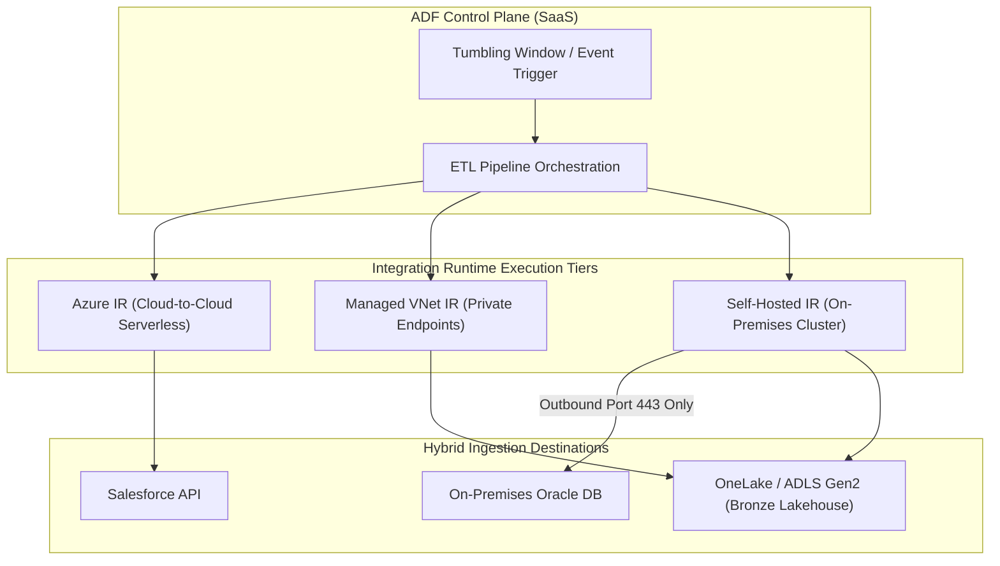

# Azure Data Factory (ADF) Architecture & Hybrid ETL 🔄🗄️

**Azure Data Factory (ADF)** is Microsoft's fully managed, serverless data integration and orchestration platform (ETL/ELT). It connects over 100 native data sources across on-premises environments, multi-cloud platforms, and SaaS applications to construct scalable, automated data pipelines.

---

## Architecture & Mental Model

### 1. Control Plane vs. The Integration Runtime (Data Plane)

A foundational architectural principle of Azure Data Factory is the strict separation between the **Control Plane** (workflow scheduling, monitoring, parameterization) and the **Integration Runtime (IR)** (the compute infrastructure executing data movement and code):

```
┌────────────────────────────────────────────────────────┐
│             Azure Data Factory (Control Plane)         │
│     Pipelines, Triggers, Linked Services, Datasets     │
└──────────────┬──────────────────────────┬──────────────┘
               │ Dispatches Instructions  │
               ▼                          ▼
┌──────────────────────────────┐ ┌──────────────────────────────┐
│  Azure Integration Runtime   │ │ Self-Hosted IR (On-Premises) │
│  - Fully managed serverless  │ │ - Installed on Corporate VM  │
│  - Cloud-to-cloud copy       │ │ - Outbound TLS 443 only      │
│  - Managed VNet & Private PE │ │ - Crosses corporate firewalls│
└──────────────┬───────────────┘ └──────────────┬───────────────┘
               │                                │
               ▼                                ▼
       Azure Data Lake / Synapse        On-Premises SQL / SAP
```



### 2. Integration Runtime (IR) Decision Matrix

| Dimension             | **Azure IR (Default)**       | **Azure Managed VNet IR**                    | **Self-Hosted IR (SHIR)**                        |
| :-------------------- | :--------------------------- | :------------------------------------------- | :----------------------------------------------- |
| **Compute Location**  | Public Microsoft shared pool | Managed private virtual network              | On-premises IaaS VM or private cloud VM          |
| **Data Flow Support** | Yes (External Spark)         | **Yes (Secure Private Spark)**               | No (Orchestration only; delegates copy)          |
| **Network Security**  | Public IP routing            | **Managed Private Endpoints (No Public IP)** | **Outbound TLS 443 (No inbound firewall ports)** |
| **High Availability** | Built-in high availability   | Built-in high availability                   | **Clustered active-active (Up to 4 nodes)**      |
| **Best Fit**          | Cloud SaaS to cloud storage  | Private PaaS (SQL/Blob) without public IPs   | On-premises SQL, Oracle, DB2, SAP, local NFS     |

---

## Core Concepts & Operations

### 1. Mapping Data Flows (Spark-Powered Transformations)

While the **Copy Activity** performs high-throughput raw byte movement, **Mapping Data Flows** execute visually designed code-free data transformations at scale:

- Under the hood, ADF translates visual transformation graphs into optimized **Apache Spark** code executed on managed Azure Databricks/Spark clusters.
- **TTL (Time to Live)**: Pre-warms the Spark cluster so consecutive data flow runs execute immediately without a 3- to 5-minute cluster spin-up penalty.

### 2. Copy Activity & Data Integration Units (DIUs)

The performance of cloud copy tasks is measured in **Data Integration Units (DIUs)**, representing a combination of CPU, memory, and network resource allocation:

- Default is **Auto**, dynamically sizing between 4 and 256 DIUs based on file sizes and network throughput.

---

## Production `az` CLI Commands

### 1. Provisioning a Data Factory with Git Integration

```bash
# 1. Create Azure Data Factory resource
az datafactory create \
  --resource-group rg-analytics-prod \
  --factory-name adf-core-prod-eastus \
  --location eastus \
  --public-network-access Enabled

# 2. Configure GitHub repository integration for enterprise CI/CD
az datafactory configure-factory-repo \
  --resource-group rg-analytics-prod \
  --factory-name adf-core-prod-eastus \
  --repo-type GitHub \
  --account-name "contoso" \
  --repository-name "data-platform-pipelines" \
  --collaboration-branch "main" \
  --root-folder "/adf"
```

### 2. Registering a Self-Hosted Integration Runtime (SHIR)

```bash
# 1. Create a Self-Hosted IR definition in ADF
az datafactory integration-runtime self-hosted create \
  --resource-group rg-analytics-prod \
  --factory-name adf-core-prod-eastus \
  --name shir-onprem-gateway

# 2. Retrieve authorization registration key for on-premises installer
az datafactory integration-runtime get-monitoring-data \
  --resource-group rg-analytics-prod \
  --factory-name adf-core-prod-eastus \
  --name shir-onprem-gateway
```

---

## Quotas & Limits

| Constraint                       | Limit               | Architectural Workaround / Rule                                         |
| :------------------------------- | :------------------ | :---------------------------------------------------------------------- |
| **Pipelines per Factory**        | **5,000** pipelines | Organize large enterprise pipelines into multiple factories or modules. |
| **Activities per Pipeline**      | **40** activities   | Modularize workflows using `Execute Pipeline` child activities.         |
| **Max Concurrent Pipeline Runs** | **10,000** runs     | Managed queue automatically buffers surplus executions.                 |
| **Max DIUs per Copy Activity**   | **256 DIUs**        | Tune concurrency and file chunking for multi-terabyte datasets.         |
| **SHIR Nodes per Cluster**       | **4 nodes**         | Clustered active-active for high availability and load distribution.    |

---

## References & Documentation

- [Azure Data Factory Documentation](https://learn.microsoft.com/en-us/azure/data-factory/)
- [Integration Runtime in Azure Data Factory](https://learn.microsoft.com/en-us/azure/data-factory/concepts-integration-runtime)
- [Create and Configure a Self-Hosted Integration Runtime](https://learn.microsoft.com/en-us/azure/data-factory/create-self-hosted-integration-runtime)
- [Copy Activity Performance and Scalability Guide](https://learn.microsoft.com/en-us/azure/data-factory/copy-activity-performance)
- [Mapping Data Flows Overview](https://learn.microsoft.com/en-us/azure/data-factory/concepts-data-flow-overview)

---

## Realistic Pricing Scenarios

### Scenario A: Hybrid On-Premises Ingestion (Copy Activity via SHIR)

- **Workload**: Daily ingestion of 500 GB from on-premises Oracle databases into ADLS Gen2.
- **Pipeline Orchestration**: 30 daily runs × 10 activities = 300 activity runs/month = **$0.30/month**.
- **Copy Execution**: 4 DIUs allocated, running for 1 hour daily (30 hours/month):
  - 30 hours × 4 DIUs × $0.25/DIU-hour = **$30.00/month**.
- **Self-Hosted IR Compute**: 2 on-premises VMs running the gateway software (Customer infrastructure).
- **Total Monthly Cost**: **~$30.30/month** (Enterprise hybrid ETL pipeline moving 15 TB/month).

### Scenario B: High-Volume Spark Data Flow Transformations

- **Workload**: Hourly data transformation running a Mapping Data Flow on a 16-core General Purpose Spark cluster.
- **Cluster Hours**: 16 vCores × 0.5 hours/run × 730 runs/month = 5,840 vCore-hours.
- **Data Flow Pricing**: 5,840 vCore-hours × $0.268/vCore-hour = **$1,565.12/month**.
- **Total Monthly Cost**: **$1,565.12/month** (Serverless Spark cluster scaling to zero between hourly runs).

---

## Battle-Tested Nuggets & Gotchas

1. **The ForEach Variable Overwrite Trap**: In ADF, pipeline variables have global pipeline scope. If you place a `Set Variable` activity inside a `ForEach` loop executing concurrently, parallel iterations will overwrite each other's variable values, leading to silent data corruption. **Rule**: Enable `Sequential` execution on the loop, or pass dynamic data through activity outputs rather than variables.
2. **SHIR Clustered High Availability**: A single-node Self-Hosted IR is a single point of failure. If the underlying on-premises host OS reboots for patching, running copy pipelines fail immediately. Always register at least **two SHIR nodes** under the same gateway key to create an active-active, self-healing cluster.
3. **Data Flow Cold-Start Cluster Overhead**: Without tuning, triggering a Mapping Data Flow incurs a 3- to 5-minute initialization delay while Azure provisions the backend Spark cluster. In time-sensitive micro-batch pipelines, configure a **Time to Live (TTL)** of 10–30 minutes on the Azure IR to keep Spark nodes pre-warmed.
4. **DIU Overprovisioning Cost Spike**: Setting Copy Activity DIUs to `Auto` on thousands of tiny 5 KB files will cause ADF to provision 32 or 64 DIUs per file, charging the minimum billing duration on mostly idle compute. For small files, explicitly pin DIUs to `2` or `4` or compress files into archives prior to ingestion.
5. **Managed Private Endpoint Approval Blackout**: When configuring an ADF Managed VNet IR with a Managed Private Endpoint to an Azure SQL Database or Storage Account, ADF creates the endpoint in a `Pending` state. The pipeline will fail with a connection timeout until an administrator explicitly navigates to the target resource in Azure and clicks **Approve**.
