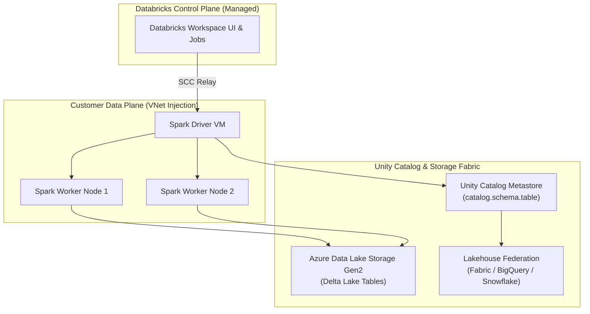

# Azure Databricks Architecture & Lakehouse Analytics 🧱⚡

**Azure Databricks** is a jointly developed, first-party Apache Spark-based analytics and AI platform. Built around the **Lakehouse architecture**, it combines the enterprise reliability, ACID transactions, and governance of data warehouses with the openness, scale, and flexibility of data lakes.

---

## Architecture & Mental Model

### 1. Dual-Plane VNet Injection Architecture

Azure Databricks physically separates administrative management from the compute nodes that touch customer data:

1. **Control Plane (Microsoft / Databricks Managed)**: Houses the web application workspace, notebook management, cluster manager, and job scheduler running in a secure, isolated Microsoft subscription.
2. **Data Plane (Customer Subscription)**: Virtual machines and storage clusters are provisioned **directly inside your Azure Subscription** in a private Virtual Network via **VNet Injection**, ensuring raw data never leaves your enterprise network perimeter.

```
┌────────────────────────────────────────────────────────────────────────┐
│             Control Plane (Databricks / Microsoft Subscription)        │
│          Web UI, Notebook Storage, Cluster Orchestrator, Jobs          │
└───────────────────────────────────┬────────────────────────────────────┘
                                    │ Secure Cluster Connectivity (No Public IP)
                                    ▼
┌────────────────────────────────────────────────────────────────────────┐
│                   Data Plane (Customer Azure Subscription)             │
│   ┌────────────────────────────────────────────────────────────────┐   │
│   │                 Customer Virtual Network (VNet)                │   │
│   │  ┌───────────────────────────┐   ┌──────────────────────────┐  │   │
│   │  │  Public Subnet (Workers)  │   │ Private Subnet (Workers) │  │   │
│   │  │  - Driver Node            │   │ - Worker Node 1          │  │   │
│   │  │  - NAT Gateway Egress     │   │ - Worker Node N          │  │   │
│   │  └─────────────┬─────────────┘   └─────────────┬────────────┘  │   │
│   └────────────────┼───────────────────────────────┼───────────────┘   │
└────────────────────┼───────────────────────────────┼───────────────────┘
                     │ Azure Private Link            │ ABFS Native Driver
                     ▼                               ▼
       ┌───────────────────────────┐   ┌───────────────────────────┐
       │   Unity Catalog Metastore │   │ Azure Data Lake Gen2 /    │
       │   (Cross-Workspace RBAC)  │   │ OneLake (Parquet Data)    │
       └───────────────────────────┘   └───────────────────────────┘
```



### 2. Unity Catalog: Three-Level Namespace & Governance

Unity Catalog centralizes identity, access control, audit logging, and data discovery across multiple workspaces:

- **Three-Level Namespace**: Objects are addressed hierarchically:
  $$\text{catalog} \boldsymbol{.} \text{schema} \boldsymbol{.} \text{table\_or\_volume}$$
- **Data Lineage**: Automatically tracks column-level and table-level lineage from raw ingestion to final ML model deployments.
- **Lakehouse Federation**: Allows Databricks to query external data warehouses (OneLake, Snowflake, PostgreSQL, BigQuery) in-place without moving data.

---

## Core Concepts & Operations

### 1. The Photon Query Engine

**Photon** is Databricks' ultra-high-performance vectorized query engine written from scratch in **C++**:

- Bypasses JVM memory and garbage collection overhead.
- Leverages modern CPU instruction pipelining and SIMD (Single Instruction, Multiple Data) parallelism.
- Delivers 2x to 5x faster query execution for SQL workloads and aggregations on Delta Lake tables.

### 2. Cluster Types Decision Matrix

| Cluster Type                 | Scaling Model                        | Compute Ownership                   | Primary Workload Fit                                                       |
| :--------------------------- | :----------------------------------- | :---------------------------------- | :------------------------------------------------------------------------- |
| **All-Purpose Interactive**  | Manual / Autoscaling nodes           | Customer VM quota                   | Collaborative data science, exploratory data analysis, notebook debugging. |
| **Job (Automated) Cluster**  | Ephemeral (terminates on job exit)   | Customer VM quota (Lowest DBU rate) | Production ETL workflows, scheduled nightly batch pipelines.               |
| **Serverless SQL Warehouse** | Instant start (seconds), autoscaling | Managed Databricks pool             | High-concurrency BI dashboards, Power BI, ad-hoc analyst SQL queries.      |

---

## Production `az` CLI Commands

### 1. Provisioning Azure Databricks with Custom VNet Injection

```bash
# 1. Create a Premium workspace injected into private subnets
az databricks workspace create \
  --resource-group rg-analytics-prod \
  --name dbw-core-prod-eastus \
  --location eastus \
  --sku premium \
  --vnet /subscriptions/{subId}/resourceGroups/rg-network-prod/providers/Microsoft.Network/virtualNetworks/vnet-eastus-prod \
  --public-subnet snet-dbw-public \
  --private-subnet snet-dbw-private \
  --enable-no-public-ip true
```

### 2. Granting Unity Catalog Access via Managed Identity

```bash
# Create an Azure Access Connector for Unity Catalog storage credentials
az databricks access-connector create \
  --resource-group rg-analytics-prod \
  --name ac-unity-catalog-prod \
  --location eastus \
  --identity-type SystemAssigned
```

---

## Quotas & Limits

| Constraint                        | Limit                                 | Architectural Workaround / Rule                                                        |
| :-------------------------------- | :------------------------------------ | :------------------------------------------------------------------------------------- |
| **Max Workspaces per Region**     | **50** workspaces                     | Consolidate projects into unified workspaces governed by Unity Catalog.                |
| **Subnet CIDR Size for VNet**     | Minimum **/26** (Recommended **/24**) | Each Databricks worker VM consumes IP addresses; small subnets halt cluster autoscale. |
| **Max Clusters per Workspace**    | **1,000** active clusters             | Use Job clusters to automatically decommission idle nodes.                             |
| **Photon Supported Runtimes**     | Databricks Runtime 9.1+ LTS           | Must enable Photon toggle explicitly during cluster creation.                          |
| **Concurrent Jobs per Workspace** | **1,000** jobs                        | Stagger job scheduling or federate runs.                                               |

---

## References & Documentation

- [Azure Databricks Documentation](https://learn.microsoft.com/en-us/azure/databricks/)
- [What is Unity Catalog?](https://learn.microsoft.com/en-us/azure/databricks/data-governance/unity-catalog/)
- [Deploy Azure Databricks in your Virtual Network (VNet Injection)](https://learn.microsoft.com/en-us/azure/databricks/administration-guide/cloud-configurations/azure/vnet-inject)
- [Photon Engine Overview](https://learn.microsoft.com/en-us/azure/databricks/runtime/photon)
- [Azure Databricks Pricing & DBUs](https://azure.microsoft.com/en-us/pricing/details/databricks/)

---

## Realistic Pricing Scenarios

### Scenario A: High-Concurrency Enterprise BI (Serverless SQL Warehouses)

- **Deployment**: Serverless SQL Warehouse scaling between 2 and 6 clusters during business hours (8 hours/day, 22 days/month).
- **Compute Consumption**: 4 clusters average × 176 hours = 704 cluster-hours.
- **DBU Pricing**: 704 hours × 4 DBUs/hour = 2,816 DBUs at $0.55/DBU = **$1,548.80/month**.
- **Total Monthly Cost**: **$1,548.80/month** (Instant sub-second query performance with zero infrastructure provisioning delay).

### Scenario B: Nightly Production ETL Pipeline (Automated Job Cluster with Spot VMs)

- **Workload**: 4-hour nightly Spark pipeline processing 2 TB of data across 8 worker nodes (`Standard_D8s_v5`).
- **VM Compute (Spot - 70% discount)**: 8 nodes × 4 hrs/day × 30 days × $0.115/hour = **$110.40/month**.
- **Databricks Units (DBU)**: Job compute tier ($0.15/DBU):
  - 8 nodes × 2 DBUs/node/hr × 120 hrs = 1,920 DBUs × $0.15 = **$288.00/month**.
- **Total Monthly Cost**: **~$398.40/month** (Heavy distributed Spark compute executing at spot discount rates).

---

## Battle-Tested Nuggets & Gotchas

1. **The VNet Subnet IP Exhaustion Trap**: When deploying Azure Databricks via VNet injection, both the public and private subnets must be sized with sufficient IP addresses. If you allocate a small `/28` subnet (only 11 usable IPs), a 10-node cluster cannot spin up, and cluster creation will fail with an obscure `SubnetIsFull` error. Always allocate at least a **/24** subnet (251 usable IPs) for Databricks.
2. **Auto-Termination Idle Bleed**: A primary cause of surprise cloud bills is developers starting an interactive 8-node GPU or high-memory cluster and closing their laptop lid. The cluster remains running 24/7 in Azure. Always enforce an **Auto-Termination policy** (e.g., 20 minutes of inactivity) via Global Cluster Policies.
3. **Unity Catalog Single Metastore per Region Rule**: An enterprise should only create **one Unity Catalog metastore per Azure region**. Multiple workspaces within that region link to the same metastore. Creating separate metastores per workspace fragments data governance and defeats the purpose of cross-workspace data sharing.
4. **Photon Cost vs. Speed Tradeoff**: While the Photon engine executes SQL queries up to 3x faster, Databricks charges a higher DBU rate for Photon-enabled clusters. For lightweight I/O-bound pipelines, Photon may not decrease execution time enough to offset the higher DBU price. Always benchmark workloads with and without Photon before production standardization.
5. **Keyless Storage Authentication via Access Connector**: Never mount storage accounts using static account keys (`fs.azure.account.key`) inside notebooks. Unity Catalog uses the **Azure Databricks Access Connector** (a system-assigned managed identity) to access ADLS Gen2 containers natively without exposing credentials to notebook developers.
