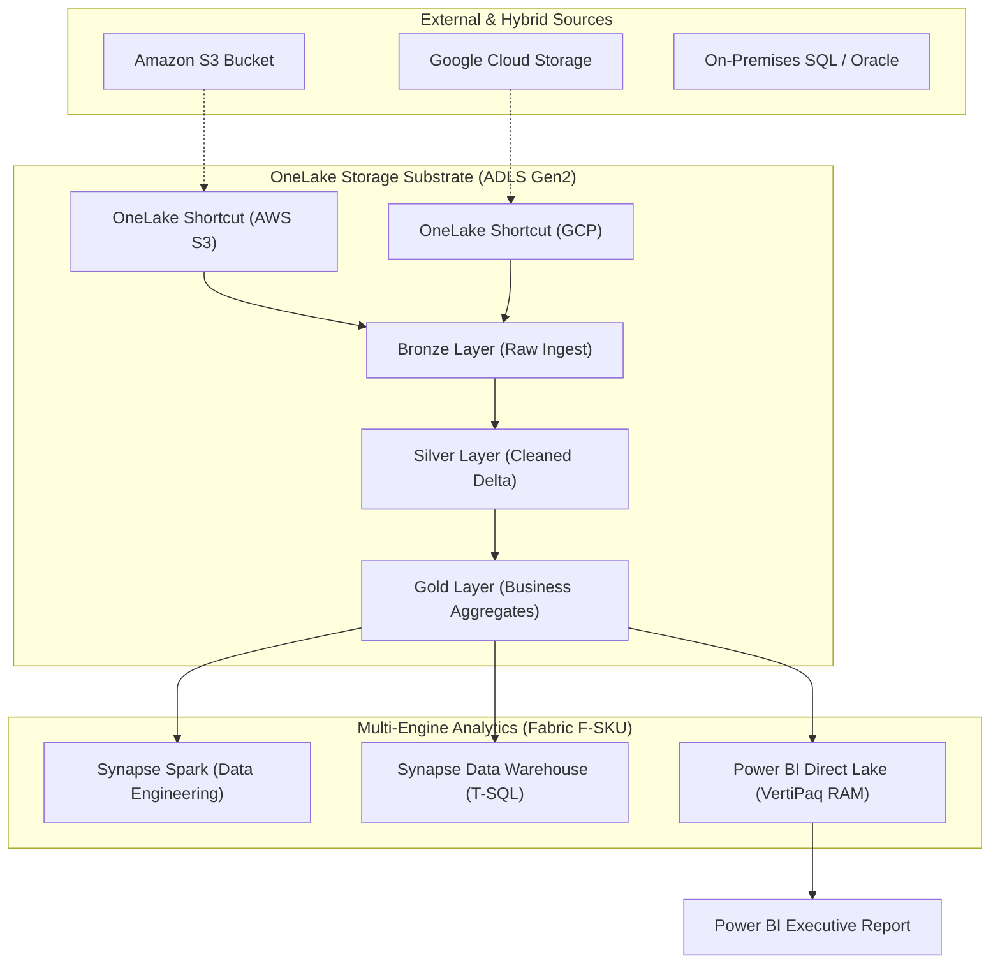

# Microsoft Fabric & Azure Synapse Analytics Architecture 📊🏛️

**Microsoft Fabric** represents the evolution and convergence of Azure Synapse Analytics, Azure Data Factory, and Power BI into a single, unified enterprise software-as-a-service (SaaS) lakehouse platform. Centered around **OneLake** (the "OneDrive for data") and standardized natively on the open **Delta Parquet** format, Fabric enables multi-engine analytics without data duplication or ETL fragmentation.

---

## Architecture & Mental Model

### 1. OneLake: The Unified Multi-Engine Data Substrate

Under traditional architectures, data warehouses, Spark engines, and BI tools maintained duplicated copies of data in proprietary formats. In Microsoft Fabric, all compute engines operate directly against a single logical data store:

```
┌────────────────────────────────────────────────────────────────────────┐
│                        Microsoft Fabric SaaS Platform                  │
│                                                                        │
│   ┌────────────────────────────────────────────────────────────────┐   │
│   │                    Compute Engines (F Capacity)                │   │
│   │  ┌──────────────┐ ┌──────────────┐ ┌──────────────┐ ┌────────┐ │   │
│   │  │ Synapse Data │ │ Synapse Data │ │ Synapse Real-│ │Power BI│ │   │
│   │  │ Engineering  │ │ Warehouse    │ │ Time Intel.  │ │ Direct │ │   │
│   │  │ (Spark/Delta)│ │ (T-SQL Engine│ │ (KQL Stream) │ │ Lake   │ │   │
│   │  └──────┬───────┘ └──────┬───────┘ └──────┬───────┘ └───┬────┘ │   │
│   └─────────┼────────────────┼────────────────┼─────────────┼──────┘   │
│             │                │                │             │          │
│             ▼                ▼                ▼             ▼          │
│   ┌────────────────────────────────────────────────────────────────┐   │
│   │                  OneLake Storage (Delta Parquet)               │   │
│   │  - Open Table Format (Delta Lake v3 / Parquet)                 │   │
│   │  - V-Order Write Optimization                                  │   │
│   │  - OneLake Shortcuts (Virtual links to AWS S3 & Google Cloud)  │   │
│   └────────────────────────────────────────────────────────────────┘   │
└────────────────────────────────────────────────────────────────────────┘
```



### 2. Direct Lake Mode: Zero-ETL Power BI Analytics

Historically, Power BI reports operated in one of two modes:

1. **Import Mode**: Extremely fast in-memory VertiPaq queries, but requires duplicating gigabytes of data and scheduling long daily batch refreshes.
2. **DirectQuery Mode**: Real-time queries passed directly to SQL databases, but plagued by high latency and database query bottlenecks.

**Direct Lake Mode** bridges this divide:

- Power BI’s VertiPaq memory engine loads Delta Parquet column chunks **directly from OneLake into RAM on-demand**.
- Delivers the sub-second query speed of Import mode with zero data movement, zero duplicate storage, and zero refresh latency.

---

## Core Concepts & Operations

### 1. The Medallion Architecture on OneLake

Fabric standardizes on the Databricks Medallion pattern:

- **Bronze**: Raw ingested files (JSON, CSV, Parquet) with schema preservation and append-only history.
- **Silver**: Enriched, deduplicated, and cleansed Delta tables conforming to enterprise schemas.
- **Gold**: Aggregated star-schema dimensional models optimized for BI reporting and analytics.

### 2. OneLake Shortcuts (Zero-Copy Multi-Cloud)

OneLake Shortcuts create virtual symbolic links to internal or external storage:

- An analyst can create a Shortcut pointing to an Amazon S3 bucket (`s3://my-bucket/orders`) or Google Cloud Storage bucket.
- Fabric compute engines query the external data using standard T-SQL or Spark without moving, copying, or duplicating the bytes into Azure.

---

## Production `az` CLI Commands

### 1. Provisioning a Microsoft Fabric Capacity

```bash
# 1. Provision a Microsoft Fabric F64 capacity in East US
az fabric capacity create \
  --resource-group rg-analytics-prod \
  --capacity-name capfabricprodeastus \
  --location eastus \
  --sku-name F64 \
  --administration-members "admin@contoso.com" "platform-engineers@contoso.com"

# 2. Pause capacity during weekend maintenance to eliminate compute charges
az fabric capacity suspend \
  --resource-group rg-analytics-prod \
  --capacity-name capfabricprodeastus

# 3. Resume capacity before Monday morning business hours
az fabric capacity resume \
  --resource-group rg-analytics-prod \
  --capacity-name capfabricprodeastus
```

### 2. Interacting with OneLake via Azure CLI / ABFS

```bash
# Upload a dataset directly into a Fabric Lakehouse Files directory via Azure Storage CLI
az storage blob upload \
  --account-name onelake \
  --container-name "workspace-guid-here" \
  --name "lakehouse-guid-here/Files/raw/transactions.csv" \
  --file ./transactions.csv \
  --auth-mode login
```

---

## Quotas & Limits

| Constraint                         | Limit                            | Architectural Workaround / Rule                                                                |
| :--------------------------------- | :------------------------------- | :--------------------------------------------------------------------------------------------- |
| **Capacity Units (CU)**            | F2 (2 CUs) to F2048 (2048 CUs)   | Smoothly scale SKU up or down in Azure Portal without rebuilding workspaces.                   |
| **Capacity Throttling Boundary**   | Evaluated on 10-minute smoothing | Burst operations consume future capacity units; excessive bursts trigger temporary throttling. |
| **Max OneLake Storage**            | Up to **5 PiB** per tenant       | Boundless elastic scale built on ADLS Gen2 infrastructure.                                     |
| **Direct Lake Fallback**           | Falls back to DirectQuery        | Occurs if complex DAX expressions, row-level security (RLS), or memory caps are exceeded.      |
| **Synapse Serverless SQL Timeout** | **30 minutes** per query         | For massive multi-hour joins, materialize data into Delta tables via Spark.                    |

---

## References & Documentation

- [Microsoft Fabric Overview (Microsoft Learn)](https://learn.microsoft.com/en-us/fabric/get-started/microsoft-fabric-overview)
- [What is OneLake?](https://learn.microsoft.com/en-us/fabric/onelake/onelake-overview)
- [Direct Lake in Power BI and Fabric](https://learn.microsoft.com/en-us/fabric/get-started/direct-lake-overview)
- [Azure Synapse Analytics Documentation](https://learn.microsoft.com/en-us/azure/synapse-analytics/)
- [Microsoft Fabric Capacity and Pricing](https://learn.microsoft.com/en-us/fabric/enterprise/licenses)

---

## Realistic Pricing Scenarios

### Scenario A: Enterprise Modern Data Lakehouse (Fabric F64 Capacity)

- **Workload**: 500 business analysts and Power BI users operating an enterprise data platform.
- **Compute**: F64 Capacity (equivalent to 64 Capacity Units, eligible for Power BI free viewer licensing).
- **Hourly Cost**: $0.18 per CU-hour × 64 CUs = $11.52/hour.
- **Monthly Compute**: 730 hours × $11.52 = **$8,409.60/month** (Pay-as-you-go, or ~$5,000/month with 1-year reservation).
- **OneLake Storage**: 20 TB Delta Parquet storage at $0.023/GB = **$460.00/month**.
- **Total Monthly Cost**: **~$8,869.60/month** (All-in SaaS lakehouse replacing separate costs for Synapse, Data Factory, and Power BI Premium).

### Scenario B: Lightweight Ad-Hoc Analytics (Synapse Serverless SQL)

- **Workload**: Ad-hoc query exploration across 5 TB of raw JSON/Parquet files stored in ADLS Gen2.
- **Query Volume**: 5 TB scanned per month.
- **Serverless SQL Cost**: 5 TB scanned × $5.00/TB = **$25.00/month**.
- **ADLS Gen2 Storage**: 5 TB at $0.0184/GB = **$92.00/month**.
- **Total Monthly Cost**: **$117.00/month** (Zero compute infrastructure idling when queries are inactive).

---

## Battle-Tested Nuggets & Gotchas

1. **Direct Lake Fallback Penalty**: If a Power BI report built on a Direct Lake model uses advanced calculations unsupported by Direct Lake (such as complex calculated columns, specific XMLA endpoint writes, or complex Row-Level Security), Power BI silently **falls back to DirectQuery mode**. This introduces unexpected multi-second query delays for end users. Test models with the Fabric Performance Analyzer.
2. **V-Order Write Optimization**: Microsoft Fabric applies a proprietary write algorithm called **V-Order** when writing Delta Parquet files. V-Order sorts, encodes, and compresses data to maximize the query read speed of the Power BI VertiPaq engine and Synapse SQL. While V-Order slightly increases write/ingestion times, it speeds up reads by 3x–10x.
3. **OneLake Shortcut Security Inheritance**: Creating a OneLake Shortcut to an external AWS S3 bucket or internal ADLS container uses the credentials (IAM role or SAS token) configured on the Shortcut definition. **The underlying storage ACLs do not automatically translate to the consumer**. You must configure granular workspace and item-level permissions in Fabric to prevent unauthorized access.
4. **Capacity Smoothing & Throttling Surges**: Fabric utilizes a 24-hour moving average to smooth out compute consumption spikes. If a data engineer runs a massive Spark job that consumes 100x baseline capacity, the tenant will not fail immediately; instead, it borrows from future capacity. However, if burst usage remains elevated over 24 hours, the capacity enters a throttled state, rejecting interactive Power BI queries.
5. **Dedicated SQL Pool Hash Distribution Skew**: In legacy Azure Synapse Dedicated SQL Pools (formerly Azure SQL DW), choosing the wrong distribution key for a hash-distributed table causes data skew: 90% of data lands on 1 of the 60 distributions. The single overworked node bottlenecks the entire query. Always select high-cardinality columns without nulls as distribution keys.
