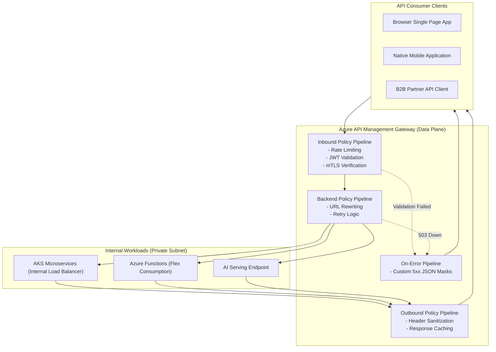

# Azure API Management (APIM) Architecture & Enterprise Gateway 🚪⚡

**Azure API Management (APIM)** is Microsoft Azure's turnkey API gateway and full lifecycle management platform. It acts as a secure front door for internal microservices, serverless functions, legacy enterprise monoliths, and third-party SaaS, providing traffic mediation, policy enforcement, rate limiting, and developer onboarding.

---

## Architecture & Mental Model

### 1. The Three Operational Planes

APIM decouples administration, routing, and developer interaction into three dedicated subsystems:

1. **Gateway (Data Plane)**: High-performance reverse proxy that intercepts HTTP requests, enforces TLS/mTLS, executes policies, and proxies calls to backend services.
2. **Management Plane (Control Plane)**: The ARM control plane used by DevOps and SREs to configure APIs, import OpenAPI/Swagger specifications, and define policies.
3. **Developer Portal (Consumer Plane)**: Customizable self-service web portal where external and internal developers discover API documentation, test endpoints, and generate subscription keys.

```
┌────────────────────────────────────────────────────────┐
│             External Developers & API Clients          │
└──────────────┬──────────────────────────┬──────────────┘
               │ HTTPS Requests           │ Documentation & Keys
┌──────────────▼──────────────────────────▼──────────────┐
│                  Azure API Management                  │
│  ┌─────────────────────────┐  ┌─────────────────────┐  │
│  │     API Gateway         │  │   Developer Portal  │  │
│  │ (Data Plane / Policies) │  │  (Self-Service CMS) │  │
│  └───────────┬─────────────┘  └─────────────────────┘  │
└──────────────┼─────────────────────────────────────────┘
               │ Policy Evaluated & Transformed
┌──────────────▼─────────────────────────────────────────┐
│              Private Backend Infrastructure            │
│  - Azure Kubernetes Service (AKS Ingress)              │
│  - Azure Container Apps / Functions                    │
│  - On-Premises Core Banking Systems                    │
└────────────────────────────────────────────────────────┘
```



---

## Tier Comparison: Modern v2 vs. Classic

Azure introduced the **v2 Tiers (Basic v2, Standard v2, Premium v2)** to replace the slow provisioning times and complex networking of legacy tiers:

| Dimension               | **Consumption** | **Basic v2**     | **Standard v2**                 | **Premium v2**                                     |
| :---------------------- | :-------------- | :--------------- | :------------------------------ | :------------------------------------------------- |
| **SLA**                 | 99.95%          | 99.9%            | 99.95%                          | **99.99% (Zone-Redundant)**                        |
| **Max Scale Units**     | Serverless Auto | Up to 10 units   | Up to 10 units                  | **Up to 30 units**                                 |
| **Provisioning Time**   | ~1 minute       | **~3–5 minutes** | **~3–5 minutes**                | **~5 minutes (vs 45m legacy)**                     |
| **Virtual Network**     | None            | None             | **VNet Integration (Outbound)** | **Internal VNet Mode & Inbound Private Endpoints** |
| **Built-in Cache**      | None            | 250 MB           | 1 GB                            | **5 GB**                                           |
| **Self-Hosted Gateway** | ❌ No           | ❌ No            | ❌ No                           | **✅ Yes (Kubernetes / Arc)**                      |

---

## Core Concepts: The XML Policy Engine

APIM policies are executed sequentially inside an XML pipeline divided into four distinct execution scopes: `inbound`, `backend`, `outbound`, and `on-error`.

### Example: Production Zero-Trust API Policy

```xml
<policies>
    <inbound>
        <base />
        <!-- 1. Enforce strict rate limiting by client IP -->
        <rate-limit-by-key calls="100" renewal-period="60" counter-key="@(context.Request.IpAddress)" />

        <!-- 2. Validate Microsoft Entra ID OAuth 2.0 JWT Bearer Token -->
        <validate-jwt header-name="Authorization" failed-validation-httpcode="401" failed-validation-error-message="Unauthorized">
            <openid-config url="https://login.microsoftonline.com/{tenantId}/v2.0/.well-known/openid-configuration" />
            <required-claims>
                <claim name="aud" match="all">
                    <value>api://ecommerce-backend</value>
                </claim>
                <claim name="roles" match="any">
                    <value>Orders.ReadWrite</value>
                </claim>
            </required-claims>
        </validate-jwt>

        <!-- 3. Strip internal routing headers -->
        <set-header name="X-Internal-Secret" exists-action="delete" />
    </inbound>
    <backend>
        <base />
    </backend>
    <outbound>
        <base />
        <!-- 4. Prevent Information Disclosure in HTTP Headers -->
        <set-header name="Server" exists-action="delete" />
        <set-header name="X-Powered-By" exists-action="delete" />
    </outbound>
    <on-error>
        <base />
    </on-error>
</policies>
```

---

## Production `az` CLI Commands

### 1. Provisioning APIM Standard v2 Instance

```bash
# 1. Provision an APIM Standard v2 instance (provisions in minutes)
az apim create \
  --resource-group rg-integration-prod \
  --name apim-core-prod-eastus \
  --location eastus \
  --sku-name StandardV2 \
  --sku-capacity 2 \
  --publisher-name "Contoso Enterprise" \
  --publisher-email "api-ops@contoso.com"

# 2. Add an API from OpenAPI specification
az apim api import \
  --resource-group rg-integration-prod \
  --service-name apim-core-prod-eastus \
  --path "/orders" \
  --api-id "orders-api-v1" \
  --specification-format "OpenApi" \
  --specification-url "https://api.contoso.com/swagger/v1/swagger.json"
```

### 2. Attaching Global Security Policies

```bash
# Apply a centralized security policy XML file across all APIs
az apim policy create \
  --resource-group rg-integration-prod \
  --service-name apim-core-prod-eastus \
  --policy-file ./policies/global-security.xml
```

---

## Quotas & Limits

| Constraint                       | Limit                                             | Architectural Workaround / Rule                                          |
| :------------------------------- | :------------------------------------------------ | :----------------------------------------------------------------------- |
| **Max Scale Units (Premium v2)** | **30 units**                                      | For global scale, deploy multi-region instances or Front Door.           |
| **API Operations per Instance**  | **75,000** (Premium v2), **50,000** (Standard v2) | Sufficient for thousands of microservices.                               |
| **Request Payload Size**         | **100 MB** (Default)                              | For gigabyte uploads, bypass APIM using SAS tokens to Blob Storage.      |
| **Policy Expression Timeout**    | **3 seconds**                                     | C# expressions in policies must execute quickly to avoid latency spikes. |
| **Named Values per Instance**    | **18,000**                                        | Integrate Named Values with Azure Key Vault secrets.                     |

---

## References & Documentation

- [Azure API Management Overview](https://learn.microsoft.com/en-us/azure/api-management/api-management-key-concepts)
- [API Management v2 Tiers Overview](https://learn.microsoft.com/en-us/azure/api-management/v2-service-tiers-overview)
- [API Management Policy Reference](https://learn.microsoft.com/en-us/azure/api-management/api-management-policies)
- [Virtual Network Integration with API Management](https://learn.microsoft.com/en-us/azure/api-management/virtual-network-concepts)
- [Self-Hosted Gateway Overview](https://learn.microsoft.com/en-us/azure/api-management/self-hosted-gateway-overview)

---

## Realistic Pricing Scenarios

### Scenario A: Growing SaaS Platform (Standard v2 Tier)

- **Deployment**: Standard v2 instance running 2 scale units for high availability.
- **Base Cost**: $0.45/unit/hour:
  - 2 units × 730 hrs × $0.45 = **$657.00/month**.
- **Data Transfer**: 10 TB egress data transfer = **$870.00/month**.
- **API Requests**: 30 million requests included at no additional per-call surcharge.
- **Total Monthly Cost**: **~$1,527.00/month** (Enterprise-grade managed API gateway with < 5 minute auto-scaling).

### Scenario B: Global Mission-Critical Enterprise (Premium Tier Multi-Region)

- **Deployment**: Premium tier instance in East US (Primary) + West Europe (Secondary) for zero-downtime geo-routing.
- **Primary Region**: 2 scale units at $2,795.00/month/unit = **$5,590.00/month**.
- **Secondary Region**: 1 scale unit = **$2,795.00/month**.
- **Total Monthly Cost**: **~$8,385.00/month** (Sub-second global API edge routing with 99.99% multi-region SLA).

---

## Battle-Tested Nuggets & Gotchas

1. **Policy Inheritance Cascading (`<base />`)**: The placement of the `<base />` tag inside a policy XML block dictates whether parent policies execute before or after local policies. If you omit `<base />` inside an API-level policy, **none of the global or product-level policies (such as global authentication or CORS)** will execute for that API, leaving it exposed to unauthenticated callers.
2. **The 45-Minute Deployment Curse in Legacy Tiers**: Creating, scaling, or updating an APIM instance on legacy tiers (Developer, Basic, Standard, Premium v1) takes between 30 and 50 minutes because Azure provisions dedicated compute VMs under the hood. The new **v2 Tiers (Standard v2, Premium v2)** resolve this, provisioning and scaling in under 5 minutes.
3. **Internal VNet Mode DNS Blackout**: When configuring APIM in `Internal` VNet mode, APIM ceases to be reachable from the internet. More critically, Azure does not automatically publish APIM's private IP to Azure Private DNS. You must manually create A records in an Azure Private DNS Zone for the gateway hostname, developer portal, and SCM endpoints, or internal clients will receive `NXDOMAIN` errors.
4. **C# Expressions Must Be Thread-Safe**: When using inline C# expressions in policy attributes (e.g., `@(context.Variables["token"])`), code runs concurrently inside the Gateway request pipeline. Attempting to modify shared state or execute blocking I/O calls inside policy expressions can deadlock the gateway worker threads, causing latency spikes.
5. **Client Certificate Renegotiation on HTTP/2**: If you configure mutual TLS (mTLS) certificate validation inside policy blocks rather than at the APIM custom domain transport layer, HTTP/2 clients will fail because the HTTP/2 specification strictly forbids post-handshake TLS renegotiation. Always terminate mTLS at the APIM custom domain gateway listener.
