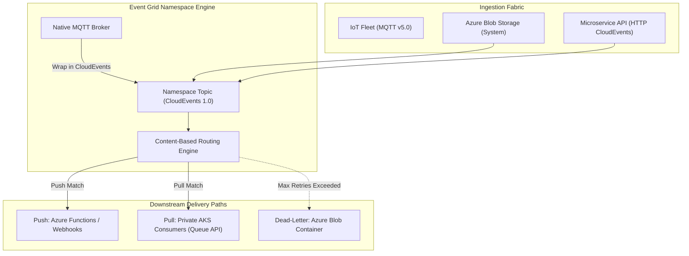

# Azure Event Grid Architecture & CloudEvents Broker ⚡📨

**Azure Event Grid** is a fully managed, highly scalable event routing service operating on a reactive publish-subscribe model. Acting as the central nervous system for cloud architectures, it natively connects Azure system events (e.g., Blob created, VM provisioned), custom application events, and IoT devices communicating over **MQTT v3.1.1 / v5.0** via the **CloudEvents v1.0** open standard.

---

## Architecture & Mental Model

### 1. Dual Paradigm: Traditional Topics vs. Modern Namespaces

Event Grid supports two distinct architectural deployment models:

1. **Classic Custom & System Topics**: Pure HTTP **push-push** model. When an event fires, Event Grid immediately pushes it to downstream subscribers (Azure Functions, Webhooks, Event Hubs, Logic Apps).
2. **Event Grid Namespaces (Modern)**: Next-generation enterprise event broker supporting **native MQTT brokers** for IoT fleets and **HTTP Pull delivery** (queue semantics), allowing private backend microservices to consume events at their own pace over Private Endpoints without exposing public HTTP listeners.

```
┌────────────────────────────────────────────────────────┐
│                   Publishers / Sources                 │
│  - Azure Services (Blob, Resource Groups, Subscriptions)│
│  - Custom Applications (Microservice REST APIs)        │
│  - IoT Devices (MQTT v3.1.1 / v5.0)                    │
└──────────────────────────┬─────────────────────────────┘
                           │ CloudEvents v1.0 Schema
┌──────────────────────────▼─────────────────────────────┐
│                 Azure Event Grid Fabric                │
│  ┌───────────────────────┐   ┌──────────────────────┐  │
│  │   MQTT Broker Engine  │   │ Filtering & Routing  │  │
│  │  (Bi-directional Pub) │   │ (Prefix, Suffix, Adv)│  │
│  └───────────┬───────────┘   └──────────┬───────────┘  │
└──────────────┼──────────────────────────┼──────────────┘
               │                          │
        ┌──────┴──────┐            ┌──────┴──────┐
        ▼             ▼            ▼             ▼
   Push Delivery  Pull Delivery  Storage     Dead-Letter
   (Functions,    (Namespace     (Blob Data  (Failed Deliveries
    Webhooks)      Queues)        Lake)       Storage Container)
```



### 2. Push vs. Pull Delivery Matrix

| Dimension                 | **Push Delivery (Webhooks & Handlers)**                                         | **Pull Delivery (Namespace Topics)**                            |
| :------------------------ | :------------------------------------------------------------------------------ | :-------------------------------------------------------------- |
| **Protocol**              | Outbound HTTP POST from Event Grid                                              | Inbound HTTP GET / Receiver Loop from Client                    |
| **Consumer Exposure**     | Requires public endpoint (or VNet injection via Private Endpoint reverse proxy) | **100% Private (No public listener needed)**                    |
| **Pacing / Backpressure** | Sender-driven. Can overwhelm slow consumers.                                    | **Consumer-driven. Consumer controls batch size and rate.**     |
| **Acknowledgment**        | HTTP 200/204 response from receiver                                             | Explicit `Acknowledge`, `Release`, or `Reject` actions          |
| **Best Fit**              | Real-time webhooks, serverless function triggers                                | Background worker queues, private AKS pods, high-load consumers |

---

## Core Concepts & Operations

### 1. The CloudEvents v1.0 Schema

Event Grid natively standardizes on the CNCF CloudEvents v1.0 JSON format:

```json
{
  "specversion": "1.0",
  "type": "com.contoso.orders.created",
  "source": "/orders/checkout",
  "id": "ord-98234-a1",
  "time": "2026-10-15T12:00:00Z",
  "datacontenttype": "application/json",
  "data": {
    "orderId": "ORD-98234",
    "customerId": "CUST-4412",
    "totalAmount": 249.99
  }
}
```

### 2. Advanced Filtering & Content Routing

Event Grid evaluates filters directly against the JSON payload without executing code:

- **String Filtering**: `StringIn`, `StringNotIn`, `StringBeginsWith`, `StringEndsWith`.
- **Numeric & Boolean Filtering**: `NumberIn`, `NumberGreaterThan`, `BoolEquals`.
- **Array Contains**: Matches if an array property contains a specific key or value.

---

## Production `az` CLI Commands

### 1. Provisioning an Event Grid Namespace with MQTT Support

```bash
# 1. Create an Event Grid Namespace with 5 capacity units (CU)
az eventgrid namespace create \
  --resource-group rg-integration-prod \
  --name eg-core-prod-eastus \
  --location eastus \
  --capacity 5 \
  --sku-name Standard \
  --topic-spaces-configuration state=Enabled

# 2. Create a Namespace Topic for order events
az eventgrid namespace topic create \
  --resource-group rg-integration-prod \
  --namespace-name eg-core-prod-eastus \
  --name topic-orders-created \
  --publisher-type Custom \
  --input-schema CloudEventSchemaV1_0
```

### 2. Creating an Event Subscription with Dead-Lettering

```bash
# Create a storage container for dead-letter payloads
STORAGE_ID=$(az storage account show -g rg-storage-prod -n stdeadletterprod --query id -o tsv)

# Subscribe to Blob creation events with prefix filter and dead-letter protection
az eventgrid event-subscription create \
  --name sub-process-images \
  --source-resource-id /subscriptions/{subId}/resourceGroups/rg-storage-prod/providers/Microsoft.Storage/storageAccounts/stblobprod \
  --endpoint https://func-imageproc-prod.azurewebsites.net/api/process \
  --endpoint-type webhook \
  --subject-begins-with "/blobServices/default/containers/uploads/" \
  --deadletter-endpoint $STORAGE_ID/blobServices/default/containers/eg-deadletter \
  --max-delivery-attempts 10 \
  --event-ttl 1440
```

---

## Quotas & Limits

| Constraint                            | Limit                                                   | Architectural Workaround / Rule                                                                          |
| :------------------------------------ | :------------------------------------------------------ | :------------------------------------------------------------------------------------------------------- |
| **Event Size**                        | **1 MB** (Namespaces), **64 KB** (Classic custom)       | Events larger than 64 KB in classic are billed in 64 KB increments. Store raw data in Blob and pass URI. |
| **MQTT Clients per Namespace**        | Up to **100,000** concurrent connections                | Massive scale for IoT telemetry fleets.                                                                  |
| **Namespace Topics per Namespace**    | **40** topics                                           | Consolidate event schemas or deploy additional namespaces.                                               |
| **Throughput Units (Capacity Units)** | Up to **40 CUs** (1 CU = 1 MB/s ingress, 2 MB/s egress) | Request quota increase via Azure Support for higher aggregate throughput.                                |
| **Webhook Delivery Timeout**          | **30 seconds**                                          | Consumers must return HTTP 200 within 30s or Event Grid flags delivery as failed and retries.            |

---

## References & Documentation

- [Azure Event Grid Documentation](https://learn.microsoft.com/en-us/azure/event-grid/)
- [Event Grid Namespaces Overview](https://learn.microsoft.com/en-us/azure/event-grid/namespace-overview)
- [MQTT Broker in Event Grid](https://learn.microsoft.com/en-us/azure/event-grid/mqtt-overview)
- [Push vs Pull Delivery Concepts](https://learn.microsoft.com/en-us/azure/event-grid/pull-delivery-overview)
- [CloudEvents 1.0 Schema Reference](https://learn.microsoft.com/en-us/azure/event-grid/cloudevents-schema)

---

## Realistic Pricing Scenarios

### Scenario A: Enterprise Event-Driven Microservices (Push Model)

- **Workload**: 50 million custom business events published and routed per month to Azure Functions.
- **Monthly Ingestion**:
  - First 100,000 operations free.
  - 50,000,000 operations × $0.60 per million operations = **$30.00/month**.
- **Dead-Letter Storage**: 10,000 failed events stored in Blob Storage = **$0.02/month**.
- **Total Monthly Cost**: **$30.02/month** (Ultra-low cost serverless event fabric).

### Scenario B: High-Throughput Connected Fleet (Event Grid Namespaces + MQTT)

- **Workload**: 20,000 connected commercial vehicles streaming telemetry over MQTT v5.0.
- **Capacity Units (CU)**: 5 CUs provisioned continuously (5 MB/s ingress, 10 MB/s egress).
- **CU Cost**: 5 CUs × 730 hrs × $0.28/hour = **$1,022.00/month**.
- **MQTT Connectivity**: 20,000 active devices per month = ~$200.00/month.
- **Total Monthly Cost**: **~$1,222.00/month** (Enterprise MQTT broker ingesting gigabytes of vehicular telemetry directly into cloud pipelines).

---

## Battle-Tested Nuggets & Gotchas

1. **The Webhook Validation Handshake**: When registering a new HTTP Webhook endpoint in Event Grid, Event Grid immediately fires an HTTP `POST` containing a `validationCode`. Your endpoint must return an HTTP 200 with `{ "validationResponse": "<validationCode>" }` within 30 seconds. If your endpoint does not handle this initial handshake, subscription creation will abort with a `SubscriptionValidation` error.
2. **Exponential Backoff Retry Schedule**: In push delivery, if a subscriber endpoint throws an HTTP 500 error or times out, Event Grid retries on an exponential schedule: 10s, 30s, 1m, 5m, 10m, 30m, 1h, up to 24 hours. If your consumer is down for 25 hours, events will be dropped unless a **Dead-Letter Storage Container** is explicitly configured.
3. **Dead-Lettering Requires Managed Identity Authorization**: When configuring a dead-letter destination, Event Grid must be granted the `Storage Blob Data Contributor` RBAC role on the target storage account using Event Grid's system-assigned managed identity. Providing storage access keys in connection strings is deprecated and causes security audit failures.
4. **CloudEvents Header Case Sensitivity**: The CNCF CloudEvents specification mandates lowercase attribute keys (e.g., `id`, `source`, `specversion`, `type`). If custom publishers attempt to send camelCase or PascalCase keys (e.g., `SpecVersion` or `eventType`), Event Grid will reject the payload with an HTTP 400 Bad Request error.
5. **Pull Delivery Lock Duration**: When an application consumes an event using pull delivery, Event Grid locks the event for a configurable duration (default 60 seconds). If your application takes 75 seconds to process the event, the lock expires, and another concurrent worker will receive and process the exact same event, creating duplicate transactions. Always assert idempotency or renew the lock using the `RenewLock` API.
