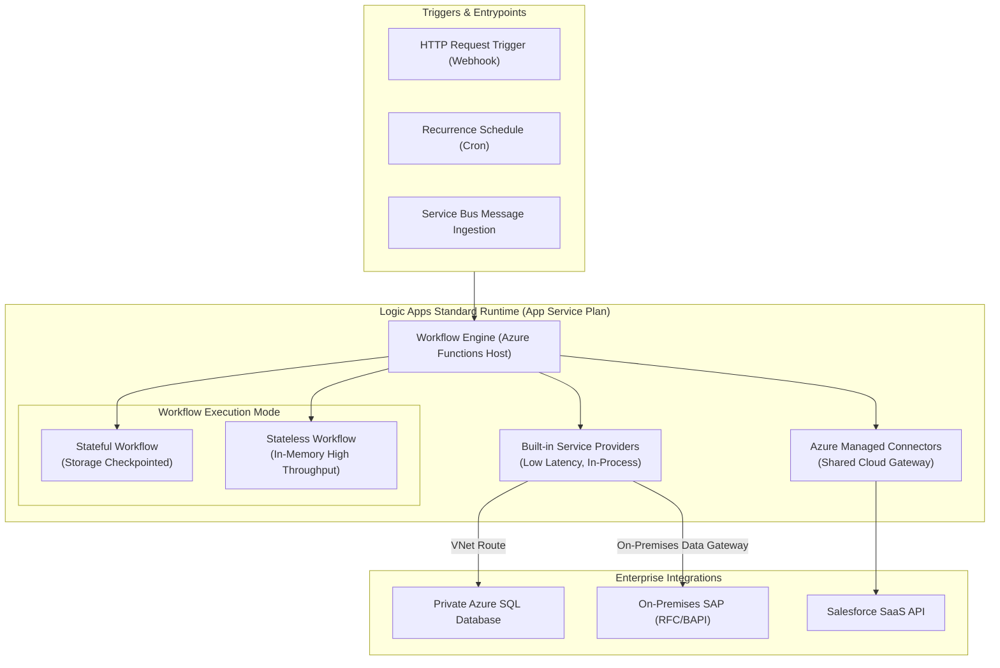

# Azure Logic Apps Architecture & Enterprise Integration 🔄🏢

**Azure Logic Apps** is Microsoft's cloud-native integration platform as a service (iPaaS). It allows enterprise developers to build automated workflows that orchestrate data, services, and systems across multi-cloud environments, on-premises datacenters, and SaaS applications with low-code visual abstractions and code-first JSON definitions.

---

## Architecture & Mental Model

### 1. The Dual Hosting Architecture: Standard vs. Consumption

The modern Logic Apps landscape is divided into two radically different runtime architectures:

1. **Consumption (Multi-Tenant Serverless)**: The legacy model. Workflows run on shared infrastructure and bill per individual action execution. Networking is public by default.
2. **Standard (Single-Tenant Containerized)**: Built directly on the **Azure Functions isolated runtime**. Workflows run inside dedicated compute plans, natively support local development in VS Code, execute stateful or stateless workflows, and connect directly to private VNets.

```
┌────────────────────────────────────────────────────────┐
│             Logic Apps Standard (Single-Tenant)        │
│   - Built on Azure Functions Extension Engine          │
│   - Hosted on Dedicated / Elastic Premium Compute      │
│   - Runs locally in Docker or on AKS via Azure Arc     │
│   - Native VNet Integration & Private Endpoints        │
│   - Stateful & Stateless Workflows                     │
└────────────────────────────────────────────────────────┘

┌────────────────────────────────────────────────────────┐
│            Logic Apps Consumption (Multi-Tenant)       │
│   - Shared multi-tenant cloud worker pool              │
│   - Pay-per-action execution billing                   │
│   - Stateful only                                      │
│   - Public ingress by default (No native VNet)         │
└────────────────────────────────────────────────────────┘
```



### 2. Standard Workflow Modes: Stateful vs. Stateless

Logic Apps Standard introduces stateless execution for high-throughput, low-latency requirements:

| Dimension               | **Stateful Workflows**                                           | **Stateless Workflows**                                             |
| :---------------------- | :--------------------------------------------------------------- | :------------------------------------------------------------------ |
| **State Persistence**   | Every action input/output is committed to Azure Storage.         | **Runs entirely in-memory.** No external state commits.             |
| **Throughput & Speed**  | Moderate (~100–300 actions/sec). Higher latency.                 | **Extreme (~5,000+ actions/sec). Sub-50ms execution.**              |
| **Run History**         | Full visual run history and debugging in Azure Portal (90 days). | Limited / No run history by default (logs emitted to App Insights). |
| **Resilience & Replay** | Can resume after interruptions or outages.                       | If the host crashes during execution, the run is lost.              |
| **Best Fit**            | Long-running transactions, human approval workflows, EDI.        | High-frequency IoT ingestion, proxying, request/response APIs.      |

---

## Core Concepts & Connectors

### 1. Built-in vs. Managed Connectors

- **Built-in Connectors**: Run directly inside the Logic Apps Standard host process (e.g., Azure SQL, Service Bus, Blob, HTTP, SFTP). They provide maximum throughput, zero network latency hops, native VNet routing, and **incur no per-action execution fees**.
- **Azure Managed Connectors**: 400+ pre-built SaaS connectors (Salesforce, ServiceNow, Office 365, Workday) running in Microsoft's shared connector cloud infrastructure.

### 2. Workflow Definition Language (WDL)

Logic Apps definitions are declarative JSON documents evaluated by the WDL parser. Expression functions handle transformations, string manipulation, and conditionals without external code:

```json
{
  "inputs": {
    "host": { "connection": { "referenceName": "serviceBus" } },
    "method": "post",
    "path": "/messages",
    "body": {
      "orderId": "@triggerBody()?['id']",
      "status": "@coalesce(triggerBody()?['status'], 'Pending')",
      "total": "@mul(triggerBody()?['quantity'], triggerBody()?['price'])"
    }
  }
}
```

---

## Production `az` CLI Commands

### 1. Provisioning a Logic Apps Standard Resource

```bash
# 1. Create a dedicated App Service Plan (Workflow Standard WS1 SKU)
az appservice plan create \
  --resource-group rg-integration-prod \
  --name plan-logicapp-prod \
  --location eastus \
  --sku WS1 \
  --is-linux false

# 2. Deploy Logic Apps Standard instance
az logicapp create \
  --resource-group rg-integration-prod \
  --name logic-orders-prod-eastus \
  --plan plan-logicapp-prod \
  --storage-account stlogicappsprod

# 3. Configure Regional VNet integration for private backend access
az logicapp vnet-integration add \
  --resource-group rg-integration-prod \
  --name logic-orders-prod-eastus \
  --vnet /subscriptions/{subId}/resourceGroups/rg-network-prod/providers/Microsoft.Network/virtualNetworks/vnet-eastus-prod \
  --subnet snet-logicapps-backend
```

### 2. Deploying Workflows from Local Git / ZIP

```bash
# Deploy zipped workflows (containing workflow.json and host.json) via Kudu zipdeploy
az logicapp deployment source config-zip \
  --resource-group rg-integration-prod \
  --name logic-orders-prod-eastus \
  --src ./build/logicapp-bundle.zip
```

---

## Quotas & Limits

| Constraint                             | Limit                               | Architectural Workaround / Rule                                               |
| :------------------------------------- | :---------------------------------- | :---------------------------------------------------------------------------- |
| **Max Execution Duration (Stateful)**  | Up to **90 days**                   | Workflows can wait months for human approvals or external webhook callbacks.  |
| **Max Execution Duration (Stateless)** | **5 minutes**                       | For long-running operations, use Stateful mode or Durable Functions.          |
| **Message / Payload Size**             | Up to **100 MB** (Chunking enabled) | Standard HTTP action limit without chunking is 30 MB.                         |
| **Run History Retention**              | **90 days** (Stateful)              | Export execution telemetry to Log Analytics for multi-year compliance audits. |
| **App Service Plan Scale (Standard)**  | Up to **30 instances** (WS1–WS3)    | Automatically scales out based on CPU, memory, or storage queue backlog.      |

---

## References & Documentation

- [Azure Logic Apps Overview](https://learn.microsoft.com/en-us/azure/logic-apps/logic-apps-overview)
- [Single-tenant vs Multi-tenant in Logic Apps](https://learn.microsoft.com/en-us/azure/logic-apps/single-tenant-overview-compare)
- [Workflow Definition Language Schema Reference](https://learn.microsoft.com/en-us/azure/logic-apps/logic-apps-workflow-definition-language)
- [Connectors Overview for Logic Apps](https://learn.microsoft.com/en-us/azure/connectors/introduction)
- [Create Stateful and Stateless Workflows](https://learn.microsoft.com/en-us/azure/logic-apps/create-stateful-stateless-workflows-visual-studio-code)

---

## Realistic Pricing Scenarios

### Scenario A: High-Throughput Order Ingestion (Logic Apps Standard WS1)

- **Deployment**: Standard WS1 Plan (1 vCPU, 3.5 GB RAM) hosting 15 microservice workflows.
- **Compute Cost**: 1 dedicated instance × 730 hrs × $0.235/hour = **$171.55/month**.
- **Autoscale Spikes**: Scales to 2 instances during peak shopping hours (~100 hrs/month) = **$23.50/month**.
- **Storage Account**: 200 GB state storage and logs = **$24.00/month**.
- **Execution Cost**: **$0.00** (Standard plan includes unlimited action executions on built-in connectors).
- **Total Monthly Cost**: **~$219.05/month** (Processing tens of millions of stateful actions without per-action billing surprises).

### Scenario B: Lightweight Enterprise Alerting (Logic Apps Consumption)

- **Workload**: 200,000 automated system alert notifications and email dispatches per month.
- **Base Actions**: 200,000 runs × 5 actions = 1,000,000 action executions.
- **Action Billing**: 1,000,000 actions × $0.000025/action = **$25.00/month**.
- **Standard Connectors**: 200,000 Office 365 calls at $0.000125/call = **$25.00/month**.
- **Total Monthly Cost**: **$50.00/month**.

---

## Battle-Tested Nuggets & Gotchas

1. **Stateful Storage Bottleneck**: In Logic Apps Standard, stateful workflows commit every step to Azure Table and Blob Storage. If a workflow runs a loop over 5,000 items, it will execute 5,000 individual storage transactions, causing execution duration to explode. **Remediation**: Use Stateless workflows for batch loops or process arrays inside inline JavaScript/C# code tasks.
2. **Built-in Connectors Bypass Egress Gateway Costs**: Using a managed connector (e.g., the cloud Azure SQL connector) routes traffic out of your VNet through Microsoft's shared connector infrastructure, incurring outbound data egress and latency. Using the **Built-in Azure SQL Connector** keeps traffic strictly inside your VNet over private IPs.
3. **The Expression Evaluator Null Trap**: In WDL, evaluating `@triggerBody()['optionalField']['subField']` when `optionalField` is missing throws an unhandled `InvalidTemplate` error and crashes the run. Always use null-coalescing and safe navigation: `@triggerBody()?['optionalField']?['subField']` or `@coalesce(triggerBody()?['field'], 'default')`.
4. **Managed Connector Throttling Limits**: Managed SaaS connectors (such as SharePoint or Salesforce) enforce hard rate limits per connection (e.g., 100 requests per minute). If 20 concurrent workflow runs hammer the same connection, downstream APIs will return HTTP 429 errors. Configure concurrency control on the action or implement exponential backoff retry policies.
5. **Local Development Parity**: Unlike Consumption workflows which had to be edited directly in the Azure Portal, Logic Apps Standard can be developed, executed, debugged with breakpoints, and unit-tested locally inside **VS Code** using the Azure Logic Apps extension and Azurite local storage emulator.
