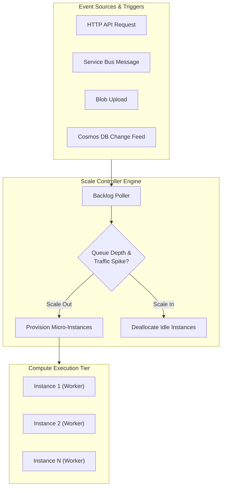
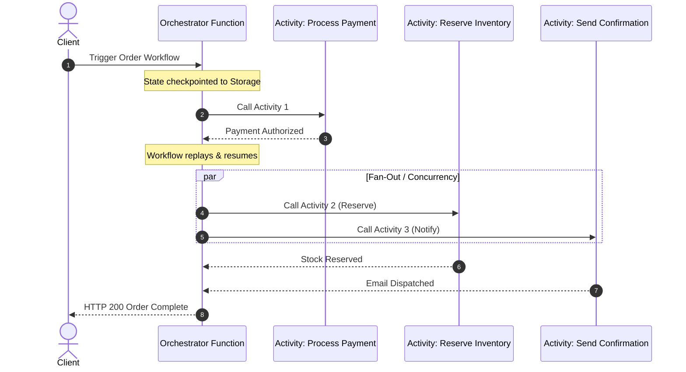

# Azure Functions Architecture & Serverless Computing ⚡☁️

**Azure Functions** is Microsoft Azure's event-driven serverless compute platform (Function-as-a-Service / FaaS). It allows developers to run stateless or stateful units of code in response to system events without managing virtual machine infrastructure, scaling horizontally from zero to thousands of instances in seconds.

---

## Architecture & Mental Model

### 1. The Trigger, Binding, and Scaling Engine

The foundational architecture of Azure Functions centers on three interacting components:

1. **Triggers**: Define how a function is invoked (e.g., HTTP request, Azure Service Bus message, Blob Storage upload, Cosmos DB change feed). Exactly one trigger is allowed per function.
2. **Bindings**: Declaratively connect input data (e.g., read a SQL row or Blob) and output destinations (e.g., write to Event Hubs or SendGrid) without writing SDK client boilerplate.
3. **Scale Controller**: An external orchestrator continuously polling event sources (queue lengths, event backlogs) to dynamically add or remove compute instances before queue depth causes latency spikes.

```
                  ┌──────────────────────────────────────────────┐
                  │            Event Source / Backlog            │
                  │   (Service Bus Queue, Kafka, Blob, Cosmos)    │
                  └──────┬────────────────────────────────┬──────┘
                         │                                │
        Metric Backlog   │                                │ Event Payload
       (Queue Depth)     ▼                                ▼
┌──────────────────────────────┐                ┌──────────────────────────────┐
│       Scale Controller       │                │      Function App Host       │
│  - Polls event queue metrics │                │  ┌────────────────────────┐  │
│  - Adds/removes instances    ├───────────────►│  │ Isolated Worker Process│  │
│  - Prevents scale thrashing  │ Scale Command  │  │ (Your .NET/Python/Node)│  │
└──────────────────────────────┘                │  └────────────────────────┘  │
                                                └──────────────────────────────┘
```



### 2. Hosting Plan Decision Matrix

Azure Functions offers four distinct hosting models tailored to latency, networking, and predictable budget requirements:

| Dimension             | **Consumption (Classic)**            | **Flex Consumption (Modern)**               | **Premium (Elastic EP)**          | **App Service / Dedicated**   |
| :-------------------- | :----------------------------------- | :------------------------------------------ | :-------------------------------- | :---------------------------- |
| **Scale Limits**      | 200 instances (Windows), 100 (Linux) | **Up to 1,000 instances**                   | Up to 100 instances               | Up to 30 instances (per plan) |
| **Instance Memory**   | Fixed (1.5 GB)                       | **Configurable (512 MB, 2048 MB, 4096 MB)** | 3.5 GB (EP1) to 14 GB (EP3)       | Sized by VM SKU               |
| **Cold Starts**       | Yes (scales to zero)                 | **Mitigated via Always-Ready instances**    | Eliminated (pre-warmed instances) | Eliminated (always running)   |
| **Execution Timeout** | Default 5 min, Max 10 min            | Default 30 min, Max unbounded               | Default 30 min, Max unbounded     | Default 30 min, Max unbounded |
| **VNet Integration**  | No                                   | **Yes (Native Regional VNet)**              | Yes (Native Regional VNet)        | Yes                           |
| **Billing Model**     | Pay-per-execution + GB-s             | Pay-per-execution + GB-s (1s minimum)       | Per vCPU/GB hour allocated        | Fixed hourly VM price         |

---

## Core Concepts & Execution Models

### 1. The Isolated Worker Process Model

Modern Azure Functions runs in the **Isolated Worker Model**, completely separating the function runtime host from your application code:

- **Language Decoupling**: You run full control over package dependencies, middleware injection, and custom startup classes without version conflicts with the Azure Functions host runtime.
- **Support**: Native to .NET 8/9, Python 3.10/3.11/3.12, Node.js v4 model, and Java 17/21.

### 2. Stateful Serverless: Durable Functions

**Durable Functions** is an extension of Azure Functions that enables writing stateful serverless orchestrations in code rather than YAML or JSON:

- **Orchestrator Functions**: Code that defines workflows using code-first patterns (sequential chains, fan-out/fan-in, human-in-the-loop approvals, asynchronous HTTP polling).
- **Activity Functions**: The basic units of work that perform I/O, database writes, or computational tasks.
- **Storage Backends**: Backed by **Azure Storage Tables/Blobs**, **Netherite** (high-throughput in-memory Event Hubs backend), or **Microsoft SQL Server**.



---

## Production `az` CLI Commands

### 1. Provisioning a Modern Flex Consumption Function App

```bash
# 1. Create a dedicated storage account for Functions metadata
az storage account create \
  --name stfunceastusprod \
  --resource-group rg-compute-prod \
  --location eastus \
  --sku Standard_LRS \
  --kind StorageV2

# 2. Provision Flex Consumption Function App with 2048 MB memory profile
az functionapp create \
  --resource-group rg-compute-prod \
  --name func-orders-prod-eastus \
  --storage-account stfunceastusprod \
  --flexconsumption-location eastus \
  --runtime dotnet-isolated \
  --runtime-version 8.0 \
  --instance-memory 2048

# 3. Configure maximum scale-out boundary (up to 1,000 instances)
az functionapp scale config set \
  --resource-group rg-compute-prod \
  --name func-orders-prod-eastus \
  --maximum-instance-count 250
```

### 2. Configuring Cold-Start Mitigation & VNet Integration

```bash
# 1. Configure 2 Always-Ready instances to eliminate cold starts on critical HTTP paths
az functionapp update \
  --resource-group rg-compute-prod \
  --name func-orders-prod-eastus \
  --set siteConfig.minimumElasticInstanceCount=2

# 2. Integrate Function App into private VNet subnet for database access
az functionapp vnet-integration add \
  --resource-group rg-compute-prod \
  --name func-orders-prod-eastus \
  --vnet /subscriptions/{subId}/resourceGroups/rg-network-prod/providers/Microsoft.Network/virtualNetworks/vnet-eastus-prod \
  --subnet snet-functions-backend
```

---

## Quotas & Limits

| Constraint                           | Limit                        | Architectural Workaround / Rule                                                                                        |
| :----------------------------------- | :--------------------------- | :--------------------------------------------------------------------------------------------------------------------- |
| **Max Instances (Flex Consumption)** | **1,000 instances**          | Governed by regional compute quota. Hard ceiling per app.                                                              |
| **Regional Compute Quota (Flex)**    | **250 cores** (default)      | Equivalent to ~512,000 MB shared memory pool. Request quota increases via Azure Support before peak load.              |
| **Max Execution Duration (Classic)** | **10 minutes** (Hard cap)    | For executions longer than 10 minutes, migrate to Flex Consumption, Premium, or ACA.                                   |
| **Instance Memory Tiers (Flex)**     | **512 MB, 2048 MB, 4096 MB** | Select 512 MB for I/O-bound webhooks; 4096 MB for heavy in-memory data parsing.                                        |
| **Storage Account Throughput**       | **20,000 ops/sec**           | High-concurrency queues sharing `AzureWebJobsStorage` can throttle. Use dedicated storage accounts for function state. |

---

## References & Documentation

- [Azure Functions Documentation (Microsoft Learn)](https://learn.microsoft.com/en-us/azure/azure-functions/)
- [Azure Functions Flex Consumption Plan](https://learn.microsoft.com/en-us/azure/azure-functions/flex-consumption-plan)
- [Durable Functions Overview & Patterns](https://learn.microsoft.com/en-us/azure/azure-functions/durable/durable-functions-overview)
- [Azure Functions Networking Options](https://learn.microsoft.com/en-us/azure/azure-functions/functions-networking-options)
- [Azure Functions Pricing](https://azure.microsoft.com/en-us/pricing/details/functions/)

---

## Realistic Pricing Scenarios

### Scenario A: High-Throughput E-Commerce API (Flex Consumption)

- **Workload**: 20 million HTTP API invocations per month.
- **Execution Profile**: Average duration = 400 ms (billed as 1-second minimum billable granularity), 2,048 MB (2 GB) instance memory profile.
- **Resource Consumption**:
  - 20,000,000 executions × 1s × 2 GB = 40,000,000 GB-seconds.
  - Less monthly free grant: 100,000 GB-s = 39,900,000 billable GB-s.
  - 39,900,000 GB-s × $0.000026/GB-s = **$1,037.40**.
- **Execution Cost**:
  - 20 million executions. Less 250,000 free grant = 19.75M billable executions.
  - 19.75 × $0.20 per million = **$3.95**.
- **Always-Ready Warm Pool**: 2 warm instances active 24/7 (2 × 2 GB × 730 hrs × 3,600s = 10,512,000 GB-s × $0.000026) = **$273.31**.
- **Total Monthly Cost**: **~$1,314.66/month** (Sub-second enterprise API serving millions of users with zero infrastructure maintenance).

### Scenario B: Lightweight Webhook Ingestion (Classic Consumption)

- **Workload**: 2 million invocations per month, average duration = 200 ms, 1.5 GB memory.
- **Resource Consumption**:
  - 2,000,000 × 0.2s × 1.5 GB = 600,000 GB-s.
  - Less 400,000 GB-s free grant = 200,000 billable GB-s × $0.000016 = **$3.20**.
- **Execution Cost**:
  - 2 million executions. Less 1 million free grant = 1M billable executions = **$0.20**.
- **Total Monthly Cost**: **~$3.40/month**.

---

## Battle-Tested Nuggets & Gotchas

1. **The Orchestrator Replay Determinism Trap**: In Durable Functions, orchestrator functions replay execution from the beginning each time an `await` yields. **Never invoke non-deterministic code** inside an orchestrator (such as `DateTime.UtcNow`, `Guid.NewGuid()`, random number generation, or direct database queries). Use `context.CurrentUtcDateTime` and delegate non-deterministic actions to Activity Functions, or the orchestration will crash with an unrecoverable `NonDeterministicOrchestrationException`.
2. **`AzureWebJobsStorage` Throttling During Spikes**: All Consumption and Flex apps use an underlying Azure Storage Account for trigger leases, timer synchronizations, and execution logging. If 500 function instances spin up simultaneously and hammer the same storage account, you can exceed Azure Storage's 20,000 ops/sec limit, causing function triggers to fail silently. Always deploy a dedicated StorageV2 account exclusively for the function app.
3. **Outbound SNAT Port Exhaustion**: Functions running on Consumption plans share outbound IP pools with default limits of 128 SNAT ports per instance. If your code instantiates a new `HttpClient` inside every invocation rather than utilizing a static or dependency-injected singleton client, you will exhaust SNAT ports under moderate load, resulting in socket timeout exceptions (`System.Net.Sockets.SocketException`). Use `IHttpClientFactory` or route outbound calls through a dedicated Azure NAT Gateway via VNet Integration.
4. **The Flex 1-Second Billing Granularity**: While classic Consumption plans bill execution time in millisecond increments (rounded to 1 ms), the Flex Consumption plan enforces a **1-second minimum billable execution time** per execution. If your function executes in 20 ms, you are still billed for a full 1,000 ms. For sub-50 ms micro-tasks, batch incoming records into single invocations or use the classic Consumption tier.
5. **Cold-Start Latency in Java and Python**: While C# and Node cold starts on Linux average 400–900 ms, Python packages with large C-extensions (Pandas, PyTorch) or heavy Spring Boot Java applications can experience cold-start latencies exceeding 15–25 seconds on classic Consumption. For ML inference or low-latency enterprise APIs, either maintain Always-Ready instances on Flex Consumption or host on Azure Container Apps.
6. **VNet Subnet Delegation Requirement**: When configuring Regional VNet integration for an Azure Function App, the target subnet must be delegated specifically to `Microsoft.App/environments` (for Flex) or `Microsoft.Web/serverFarms` (for Premium). You cannot share this subnet with regular virtual machines, Application Gateways, or Private Endpoints.
