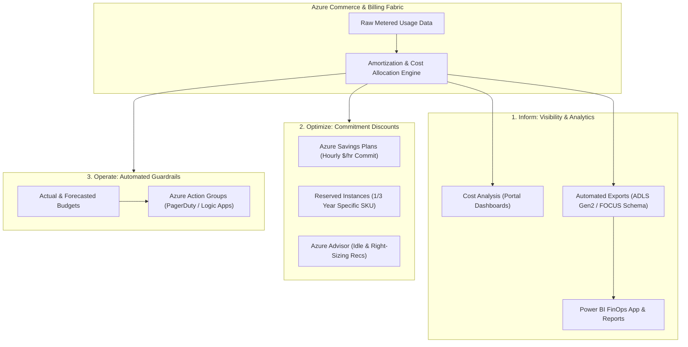

# Microsoft Cost Management & Enterprise FinOps Architecture 💰📊

**Microsoft Cost Management** is Azure's native financial governance and cloud economics suite. Aligned with the **FinOps Foundation** framework (**Inform, Optimize, Operate**), it enables organizations to drive financial accountability, establish automated spend guardrails, allocate costs across multi-tenant workloads, and maximize return on cloud investments through commitment discounts and continuous right-sizing.

---

## Architecture & Mental Model

### 1. The FinOps Lifecycle on Azure

Enterprise cloud financial management operates across three iterative phases:

```
┌────────────────────────────────────────────────────────────────────────┐
│                        FinOps Operating Model                          │
└───────────────────────────────────┬────────────────────────────────────┘
                                    │
    1. INFORM                       2. OPTIMIZE                     3. OPERATE
┌────────────────────────┐      ┌────────────────────────┐      ┌────────────────────────┐
│ Visibility & Allocation│      │ Rate & Usage Reduction │      │ Continuous Governance  │
│ - Tagging Inheritance  ├─────►│ - Azure Savings Plans  ├─────►│ - Automated Budgets    │
│ - Daily FOCUS Exports  │      │ - Reserved Instances   │      │ - Action Group Alerts  │
│ - Amortized Reporting  │      │ - Azure Advisor Rules  │      │ - Anomaly Detection    │
└────────────────────────┘      └────────────────────────┘      └────────────────────────┘
```



### 2. Commitment Discounts: Savings Plans vs. Reserved Instances (RIs)

Selecting the right commitment instrument is the cornerstone of cloud rate optimization:

| Dimension             | **Azure Reserved Instances (RIs)**                                     | **Azure Savings Plans for Compute**                                                                       |
| :-------------------- | :--------------------------------------------------------------------- | :-------------------------------------------------------------------------------------------------------- |
| **Commitment Type**   | Specific VM series, size, and region (e.g., $D4s\_v5$ in East US).     | **Hourly monetary spend commitment** (e.g., $50/hour across all compute).                                 |
| **Flexibility**       | Rigid. Bound to instance family and region.                            | **Extreme. Automatically applies across VM series, regions, App Service, Functions, and Container Apps.** |
| **Discount Depth**    | Highest discount (Up to **72%** off Pay-As-You-Go).                    | High discount (Up to **65%** off Pay-As-You-Go).                                                          |
| **Application Scope** | Specific subscriptions, resource groups, or entire billing account.    | Shared across entire billing account or scoped management groups.                                         |
| **Workload Fit**      | Predictable, static 24/7 baseline servers (e.g., core database nodes). | Dynamic, containerized, evolving architectures, microservices.                                            |

---

## Core Concepts & Operations

### 1. Amortized Cost vs. Actual Cost

- **Actual Cost**: Displays costs exactly as billed on an invoice. If you purchase a 1-year Reserved Instance upfront for $12,000 on January 1st, January's actual cost shows $12,000, while subsequent months show $0.00.
- **Amortized Cost**: Breaks down prepaid commitment purchases into daily increments ($32.87/day) and attributes the cost directly to the specific virtual machines and containers that consumed the reservation. **Always use Amortized Cost for internal team chargeback and showback**.

### 2. Open-Source FOCUS Data Exports

Microsoft Cost Management natively supports the **FinOps Open Cost and Usage Specification (FOCUS)**:

- Automatically exports daily normalized cost datasets into Azure Data Lake Storage Gen2 (ADLS Gen2).
- Standardizes billing column definitions across AWS, GCP, and Azure, allowing enterprise FinOps teams to ingest multi-cloud spend into a unified Power BI dashboard.

---

## Production `az` CLI Commands

### 1. Creating an Automated Spend Budget with Forecast Alerts

```bash
# Create an Azure budget alerting at 80% actual spend and 100% forecasted spend
az consumption budget create \
  --budget-name "budget-prod-workloads" \
  --amount 10000 \
  --time-grain monthly \
  --start-date "2026-10-01" \
  --end-date "2027-10-01" \
  --resource-group rg-compute-prod \
  --notifications '[
    {
      "enabled": true,
      "operator": "GreaterThan",
      "threshold": 80,
      "contactEmails": ["finops@contoso.com", "platform-lead@contoso.com"],
      "thresholdType": "Actual"
    },
    {
      "enabled": true,
      "operator": "GreaterThan",
      "threshold": 100,
      "contactEmails": ["finops-exec@contoso.com"],
      "thresholdType": "Forecasted"
    }
  ]'
```

### 2. Exporting Daily Cost Datasets to ADLS Gen2

```bash
# Automate daily exports of amortized usage datasets in FOCUS format to Azure Storage
az costmanagement export create \
  --name "export-daily-amortized-focus" \
  --scope "/subscriptions/{subId}" \
  --storage-account-id "/subscriptions/{subId}/resourceGroups/rg-storage-prod/providers/Microsoft.Storage/storageAccounts/stfinopsprod" \
  --storage-container "cost-exports" \
  --timeframe "MonthToDate" \
  --type "Amortized" \
  --schedule-status "Active" \
  --recurrence "Daily"
```

### 3. Reviewing Automated Cost Optimization Recommendations

```bash
# Query active Azure Advisor cost recommendations (idle VMs, unattached disks)
az advisor recommendation list \
  --category Cost \
  --query "[].[impact, shortDescription.problem, extendedProperties.savingsAmount]" \
  --output table
```

---

## Quotas & Limits

| Constraint                       | Limit                       | Architectural Workaround / Rule                                                    |
| :------------------------------- | :-------------------------- | :--------------------------------------------------------------------------------- |
| **Budgets per Subscription**     | Up to **100** budgets       | Apply budgets at Management Group or Resource Group scopes.                        |
| **Historic Cost Retention**      | **2 years (24 months)**     | Export raw datasets to ADLS Gen2 / Snowflake for multi-year historic analytics.    |
| **Cost Data Latency**            | **8 to 24 hours**           | Cloud usage data is processed asynchronously; real-time meter latency is ~8 hours. |
| **Max Export File Size**         | Chunked into **2 GB** files | Ingest chunked parquet/CSV files directly into Microsoft Fabric or Synapse.        |
| **Advisor Evaluation Frequency** | Evaluated daily             | Minimum 7 days of continuous monitoring required for VM right-sizing triggers.     |

---

## References & Documentation

- [Microsoft Cost Management Overview](https://learn.microsoft.com/en-us/azure/cost-management-billing/cost-management-billing-overview)
- [Understand Azure Reservations](https://learn.microsoft.com/en-us/azure/cost-management-billing/reservations/save-compute-costs-reservations)
- [Azure Savings Plans for Compute Overview](https://learn.microsoft.com/en-us/azure/cost-management-billing/savings-plan/savings-plan-compute-overview)
- [FinOps Open Cost and Usage Specification (FOCUS) in Azure](https://learn.microsoft.com/en-us/azure/cost-management-billing/costs/understand-cost-mgt-data)
- [Manage Costs with Azure Budgets](https://learn.microsoft.com/en-us/azure/cost-management-billing/costs/tutorial-acm-create-budgets)

---

## Realistic Pricing Scenarios

### Scenario A: Enterprise FinOps Optimization ($50k/month Baseline)

- **Baseline Spend**: $50,000/month unreserved Pay-As-You-Go compute and databases.
- **Optimization Strategy**:
  - Reserved Instances on 20 static core databases (3-year RI with 55% discount) = **Saves $11,000/month**.
  - 1-Year Azure Savings Plan on dynamic AKS node pools and Container Apps ($20/hour commit with 35% discount) = **Saves $6,500/month**.
  - Right-sizing overprovisioned VMs and purging orphaned disks identified by Azure Advisor = **Saves $3,500/month**.
- **Net Monthly Spend**: Reduced from $50,000/month to **$29,000/month** (**42% net cost reduction**).

### Scenario B: Automated Budget Breach Containment

- **Workload**: Staging subscription allocated a monthly development cap of $2,000.
- **Governance Automation**:
  - At 90% actual spend, an alert fires to Slack and PagerDuty.
  - At 100% actual spend, an automated Azure Logic App triggers, shutting down all non-essential burstable VMs and scaling AKS dev node pools to zero.
- **Cost Impact**: Eliminates surprise month-end overruns entirely.

---

## Battle-Tested Nuggets & Gotchas

1. **Savings Plans "Use-It-Or-Lose-It" Hourly Expiration**: An Azure Savings Plan commits to a fixed dollar spend per hour (e.g., $10/hour). If your workloads scale to zero overnight or over the weekend and only consume $2 worth of compute in an hour, **you still pay the full $10 for that hour**. The unused $8 does not roll over to the next hour. Size Savings Plans against your absolute 24/7 minimum floor, not your daytime peak.
2. **Reservation Cancellation Penalty**: While Azure allows exchanging or canceling Reserved Instances, Microsoft enforces a cancellation limit of **$50,000 USD per 12-month rolling window** per billing profile, and reserves the right to apply a 12% cancellation fee. Always evaluate workload longevity before purchasing 3-year RIs.
3. **The Tagging Inheritance Fallacy**: In Azure, resources do not automatically inherit tags applied to parent Resource Groups or Subscriptions. Cost Analysis reports grouping spend by resource-level tags will display unallocated "Untagged" costs. Enforce tag inheritance policies via Azure Policy (`modify` effect) to ensure all child resources inherit `CostCenter` and `Environment` tags.
4. **Actual vs. Amortized Invoicing Misunderstandings**: Financial controllers looking at the monthly invoice will see the full cash outlay for upfront Reserved Instances, while engineering team leaders looking at Cost Analysis dashboards will see amortized costs. Align finance and engineering on the difference early to prevent conflicting budget variance reports.
5. **Azure Advisor Sizing Lags Behind Kubernetes**: Azure Advisor analyzes VM-level CPU and memory counters from the Azure hypervisor. If you run an AKS node pool where pods are packing and unpacking dynamically, Advisor may flag the VM as "Underutilized" simply because pods were scaled down during off-peak hours. Always use **AKS Cost Allocation** (powered by OpenCost/Kubecost) for containerized workload rightsizing rather than raw VM Advisor metrics.
