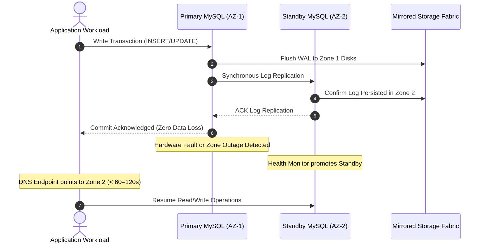

# Azure Database for MySQL Flexible Server Architecture 🐬🧱

**Azure Database for MySQL Flexible Server** is Microsoft's fully managed, production-grade MySQL community edition service. Built on an architecture that decouples compute and storage, it delivers granular maintenance control, zone-redundant high availability, automatic storage expansion, and dynamic IOPS scaling.

---

## Architecture & Mental Model

### 1. Zone-Redundant High Availability (HA)

Azure Database for MySQL Flexible Server separates database compute virtual machines from the underlying managed storage fabric:

```
┌────────────────────────────────────────────────────────┐
│             Virtual Network / Application Tier         │
│             Single Client Connection Endpoint          │
└──────────────────────────┬─────────────────────────────┘
                           │ (DNS flips automatically on failover)
            ┌──────────────┴──────────────┐
            ▼                             ▼
┌──────────────────────┐      ┌──────────────────────┐
│  Primary Compute VM  │      │ Standby Compute VM   │
│  Availability Zone 1 │      │ Availability Zone 2  │
│  (Active R/W Node)   │      │ (Warm Standby Node)  │
└──────────┬───────────┘      └──────────┬───────────┘
           │                             │
           │ Synchronous Log Block Repl. │
           ▼                             ▼
┌──────────────────────┐      ┌──────────────────────┐
│  Data & Log Storage  │◄────►│  Mirrored Storage    │
│  Zone 1 Managed Disk │      │  Zone 2 Managed Disk │
└──────────────────────┘      └──────────────────────┘
```



### 2. Compute Tiers Decision Matrix

| Metric                | **Burstable (B-Series)**       | **General Purpose (D-Series)**             | **Memory Optimized (E-Series)**                                  |
| :-------------------- | :----------------------------- | :----------------------------------------- | :--------------------------------------------------------------- |
| **vCPU Scaling**      | 1 to 2 vCPUs                   | 2 to 64 vCPUs                              | 2 to 64 vCPUs                                                    |
| **RAM per vCPU**      | Variable (1 to 8 GB total)     | 4 GiB per vCPU                             | **8 GiB per vCPU**                                               |
| **High Availability** | ❌ None (Local restart only)   | **✅ Zone-Redundant HA**                   | **✅ Zone-Redundant HA**                                         |
| **Max Storage**       | Up to 16 TiB                   | Up to 16 TiB                               | **Up to 32 TiB**                                                 |
| **Best Fit**          | Dev/test, low-traffic websites | General enterprise web apps, microservices | Large OLTP workloads, heavy caching, high-concurrency e-commerce |

---

## Core Concepts & Operations

### 1. Storage Autogrow & The One-Way Ratchet

Storage autogrow prevents the database from running out of disk space and entering a `Read-Only` status:

- **Thresholds**: If provisioned storage is $< 100$ GB, autogrow adds 5 GB when free space drops below 10%. If provisioned storage is $> 100$ GB, autogrow adds 5% when free space drops below 10 GB.
- **The Ratchet Rule**: Once storage scales up automatically, **it can never be scaled down**. You are permanently billed for the expanded capacity.

### 2. Autoscale IOPS vs. Pre-Provisioned IOPS

- **Pre-provisioned IOPS**: You allocate a static IOPS ceiling (e.g., 5,000 IOPS) billed at a fixed monthly rate. Ideal for predictable baseline workloads.
- **Autoscale IOPS**: Dynamically scales disk IOPS up or down based on real-time query demands, protecting against unexpected bursts without requiring 24/7 overprovisioning.

---

## Production `az` CLI Commands

### 1. Provisioning a Production Zone-Redundant MySQL Instance

```bash
# 1. Provision MySQL Flexible Server with Zone-Redundant HA in private VNet
az mysql flexible-server create \
  --resource-group rg-database-prod \
  --name mysql-core-prod-eastus \
  --location eastus \
  --sku-name Standard_D4ds_v4 \
  --tier GeneralPurpose \
  --storage-size 256 \
  --storage-auto-grow Enabled \
  --iops 3000 \
  --high-availability ZoneRedundant \
  --zone 1 \
  --standby-zone 2 \
  --version 8.0.36 \
  --vnet /subscriptions/{subId}/resourceGroups/rg-network-prod/providers/Microsoft.Network/virtualNetworks/vnet-eastus-prod \
  --subnet snet-mysql-database
```

### 2. Tuning Server Parameters for Production

```bash
# 1. Configure wait_timeout to terminate stale connections
az mysql flexible-server parameter set \
  --resource-group rg-database-prod \
  --server-name mysql-core-prod-eastus \
  --name wait_timeout \
  --value 300

# 2. Increase max_connections for high-concurrency microservices
az mysql flexible-server parameter set \
  --resource-group rg-database-prod \
  --server-name mysql-core-prod-eastus \
  --name max_connections \
  --value 2000
```

### 3. Creating a Cross-Region Read Replica

```bash
# Create a read replica in West US 2 for read offloading and DR
az mysql flexible-server replica create \
  --resource-group rg-database-prod \
  --replica-name mysql-replica-westus2 \
  --source-server mysql-core-prod-eastus \
  --location westus2
```

---

## Quotas & Limits

| Constraint                   | Limit                                                       | Architectural Workaround / Rule                                               |
| :--------------------------- | :---------------------------------------------------------- | :---------------------------------------------------------------------------- |
| **Max Storage Capacity**     | **32 TiB** (Memory-Optimized), **16 TiB** (General Purpose) | Storage scales in 1 GB increments; cannot be scaled down.                     |
| **Max Compute Capacity**     | **64 vCPUs / 512 GB RAM** (`Standard_E64ds_v4`)             | For petabyte scale, shard horizontally across multiple servers.               |
| **Read Replicas per Server** | Up to **10** replicas                                       | Replicas use asynchronous binlog replication; monitor replication lag metric. |
| **Minimum Base IOPS**        | **360 IOPS**                                                | Baseline minimum across all instance sizes.                                   |
| **Backup Retention**         | **1 to 35 days**                                            | Automated point-in-time recovery (PITR) with transaction logs.                |

---

## References & Documentation

- [Azure Database for MySQL Flexible Server Overview](https://learn.microsoft.com/en-us/azure/mysql/flexible-server/overview)
- [High Availability Concepts in MySQL Flexible Server](https://learn.microsoft.com/en-us/azure/mysql/flexible-server/concepts-high-availability)
- [Storage Autogrow and Performance in MySQL](https://learn.microsoft.com/en-us/azure/mysql/flexible-server/concepts-compute-storage)
- [Server Parameters in MySQL Flexible Server](https://learn.microsoft.com/en-us/azure/mysql/flexible-server/concepts-server-parameters)
- [Manage MySQL Flexible Server with Azure CLI](https://learn.microsoft.com/en-us/azure/mysql/flexible-server/how-to-manage-server-cli)

---

## Realistic Pricing Scenarios

### Scenario A: High-Availability Production Database (Zone-Redundant)

- **Workload**: Mission-critical e-commerce transactional database with zero data loss requirement.
- **Compute**: `Standard_D4ds_v4` (4 vCPUs, 16 GiB RAM) in General Purpose tier = $0.27/hour.
- **High Availability (HA)**: Doubles compute and storage for secondary node:
  - Compute: 2 nodes × 730 hrs × $0.27 = **$394.20/month**.
- **Storage**: 500 GiB provisioned storage across 2 nodes (1,000 GiB total) at $0.115/GiB = **$115.00/month**.
- **Autoscale IOPS**: Baseline 3,000 IOPS included; 10M burst IOPS at $0.005/10k = **$5.00/month**.
- **Backup Storage**: 500 GiB additional retention = **$47.50/month**.
- **Total Monthly Cost**: **~$561.70/month** (Fully managed active-standby database across two availability zones).

### Scenario B: Development / QA Environment (Burstable Tier)

- **Workload**: Developer testing environment active during business hours.
- **Compute**: `Standard_B2s` (2 vCPUs, 4 GiB RAM) at $0.051/hour = **$37.23/month**.
- **Storage**: 64 GiB Locally Redundant Storage = **$7.36/month**.
- **Total Monthly Cost**: **~$44.59/month**.

---

## Battle-Tested Nuggets & Gotchas

1. **Zone-Redundancy Must Be Enabled at Creation**: You **cannot enable Zone-Redundant High Availability on an existing server** after it has been provisioned with Local Redundancy. To upgrade, you must restore a backup snapshot to a newly created zone-redundant instance, resulting in scheduled downtime and connection string updates.
2. **The Autogrow Disk Ratchet**: If an unoptimized query writes a massive temporary table or runaway binary logs that inflate disk usage to 8 TB, storage autogrow will instantly trigger and provision 8 TB of managed disks. Because Azure Storage cannot shrink disks without recreating them, you will pay for 8 TB indefinitely. Always monitor disk free space alerts and configure `binlog_expire_logs_seconds`.
3. **`lower_case_table_names` Immutability**: The MySQL system variable `lower_case_table_names` determines whether table names are case-sensitive. In Azure Database for MySQL Flexible Server, this parameter **can only be set at initial server provisioning time**. It is permanently locked and read-only afterward. If migrating an on-premises database with uppercase table names, set this explicitly during `az mysql flexible-server create`.
4. **The 7-Day Auto-Restart Trap**: Azure allows you to "Stop" a Flexible Server to save compute costs during development downtime. However, to maintain security patching and certificate updates, **Azure automatically restarts any stopped server after 7 consecutive days**. Automation scripts must re-assert stop states if long-term dormancy is required.
5. **Private Subnet Delegation Exclusivity**: When deploying MySQL Flexible Server with Private VNet Access, the target subnet must be delegated exclusively to `Microsoft.DBforMySQL/flexibleServers`. You cannot deploy virtual machines, Application Gateways, or PostgreSQL instances into the same subnet.
