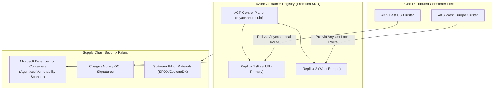

# Azure Container Registry (ACR) Architecture & Supply Chain Security 📦🔒

**Azure Container Registry (ACR)** is a managed, OCI-compliant enterprise private container registry. It serves as the authoritative supply chain backbone for containerized workloads deployed across Azure Kubernetes Service (AKS), Azure Container Apps (ACA), Azure App Service, and Azure Batch.

---

## Architecture & Mental Model

### 1. Global Geo-Replication Architecture

In global enterprise deployments, pulling container images across trans-oceanic WAN links introduces deployment latency and incurs egress data transfer fees. ACR **Premium SKU** solves this via native **Geo-Replication**:

```
                              Docker Push / CI Pipeline
                                          │
                                          ▼
┌────────────────────────────────────────────────────────────────────────┐
│                   Azure Container Registry (Primary: East US)          │
│                      myregistry.azurecr.io (Global FQDN)               │
└───────────────────────────────────┬────────────────────────────────────┘
                                    │ Asynchronous Replicated Layers
            ┌───────────────────────┴───────────────────────┐
            ▼                                               ▼
┌───────────────────────────────┐               ┌───────────────────────────────┐
│     Replica: West Europe      │               │     Replica: Southeast Asia   │
│  - Regional Data Store        │               │  - Regional Data Store        │
│  - Dedicated Regional Data Ep │               │  - Dedicated Regional Data Ep │
└──────────────┬────────────────┘               └──────────────┬────────────────┘
               │ Local Pull (<10ms)                            │ Local Pull (<10ms)
┌──────────────▼────────────────┐               ┌──────────────▼────────────────┐
│   AKS Cluster (West Europe)   │               │   AKS Cluster (Southeast Asia)│
└───────────────────────────────┘               └───────────────────────────────┘
```



### 2. Tier Comparison Matrix

| Dimension                            | **Basic** | **Standard** | **Premium**                              |
| :----------------------------------- | :-------- | :----------- | :--------------------------------------- |
| **Included Storage**                 | 10 GiB    | 100 GiB      | **500 GiB (Scalable to 100 TiB)**        |
| **Read Operations / min**            | 1,000     | 3,000        | **40,000 (Burstable to 100,000)**        |
| **Write Operations / min**           | 100       | 500          | **2,000 (Burstable to 5,000)**           |
| **Geo-Replication**                  | ❌ No     | ❌ No        | **✅ Yes (Multi-region replication)**    |
| **Private Link (Private Endpoints)** | ❌ No     | ❌ No        | **✅ Yes (Zero public internet access)** |
| **Customer-Managed Keys (CMK)**      | ❌ No     | ❌ No        | **✅ Yes (Azure Key Vault integration)** |
| **Content Trust & Scoped Tokens**    | ❌ No     | ❌ No        | **✅ Yes (Repository-level RBAC)**       |

---

## Core Concepts & Operations

### 1. Keyless Authentication via Microsoft Entra ID

Never use the legacy **Admin User** toggle (username and password). Production AKS clusters authenticate using managed identities:

- **`AcrPull` Built-in Role**: Granted to the AKS Kubelet Managed Identity (`--attach-acr`). Kubelet acquires short-lived Entra OAuth 2.0 tokens automatically, eliminating credential rotation overhead.
- **Repository-Scoped Tokens**: Fine-grained access tokens scoped to specific repositories (e.g., allow `push` on `frontend/*` but read-only on `core/*`).

### 2. ACR Tasks: Automated Base Image Patching

ACR Tasks provides automated container building and patching directly inside Azure:

- **Git Commit Triggers**: Automatically compiles Dockerfiles when code lands on GitHub or Azure Repos.
- **Base Image Update Triggers**: When upstream Linux OS images (e.g., `alpine:latest` or `mcr.microsoft.com/cbl-mariner`) publish a critical CVE patch, ACR Tasks detects the upstream digest change and automatically rebuilds dependent application images.

---

## Production `az` CLI Commands

### 1. Provisioning a Premium Registry with Geo-Replication

```bash
# 1. Create a Premium registry with public network access disabled
az acr create \
  --resource-group rg-developer-prod \
  --name acrcoreprodeastus \
  --sku Premium \
  --location eastus \
  --admin-enabled false \
  --zone-redundancy Enabled

# 2. Add a Geo-Replication in West Europe for multi-region AKS deployment
az acr replication create \
  --resource-group rg-developer-prod \
  --registry acrcoreprodeastus \
  --location westeurope \
  --zone-redundancy Enabled
```

### 2. Binding to AKS via Keyless Workload Identity

```bash
# Attach the registry to an existing AKS cluster (auto-configures AcrPull role)
az aks update \
  --resource-group rg-compute-prod \
  --name aks-core-prod \
  --attach-acr acrcoreprodeastus
```

### 3. Creating an Automated Base Image Patch Task

```bash
# Create an ACR Task that triggers on base image updates and git commits
az acr task create \
  --registry acrcoreprodeastus \
  --name task-build-api \
  --image "api-service:{{.Run.ID}}" \
  --context "https://github.com/contoso/api-service.git#main" \
  --file Dockerfile \
  --git-token $GITHUB_PAT \
  --base-image-trigger-enabled true
```

---

## Quotas & Limits

| Constraint                   | Limit                     | Architectural Workaround / Rule                                                |
| :--------------------------- | :------------------------ | :----------------------------------------------------------------------------- |
| **Max Storage per Registry** | **100 TiB** (Premium)     | Scale storage limits automatically; pay for additional storage beyond 500 GiB. |
| **Max Image Layer Size**     | **195 GiB**               | Single blob layer limit.                                                       |
| **Webhooks per Registry**    | **500** webhooks          | Integrate webhooks with Event Grid for unlimited fan-out routing.              |
| **Replication Regions**      | Up to **50+ regions**     | Deploy replicas only to regions hosting active compute clusters.               |
| **Concurrent ACR Tasks**     | **10** parallel task runs | For massive enterprise CI builds, use Azure Pipelines or GitHub Actions.       |

---

## References & Documentation

- [Azure Container Registry Documentation](https://learn.microsoft.com/en-us/azure/container-registry/)
- [ACR Service Tiers and Quotas](https://learn.microsoft.com/en-us/azure/container-registry/container-registry-skus)
- [Geo-Replication in Azure Container Registry](https://learn.microsoft.com/en-us/azure/container-registry/container-registry-geo-replication)
- [Automate OS and Framework Patching with ACR Tasks](https://learn.microsoft.com/en-us/azure/container-registry/container-registry-tasks-base-images)
- [Microsoft Defender for Containers Registry Scanning](https://learn.microsoft.com/en-us/azure/defender-for-cloud/defender-for-containers-introduction)

---

## Realistic Pricing Scenarios

### Scenario A: Multi-Region Enterprise Kubernetes Pipeline (Premium SKU)

- **Deployment**: Primary registry in East US + 1 Geo-Replica in West Europe.
- **Base Registry Fee**: $1.667/day (East US) = **$50.00/month**.
- **Geo-Replica Fee**: 1 replica at $1.667/day = **$50.00/month**.
- **Storage Consumption**: 800 GiB total image storage:
  - 500 GiB included in base tier.
  - 300 GiB excess storage billed in both regions: 300 GiB × $0.003/GiB/day × 2 regions × 30 days = **$54.00/month**.
- **Vulnerability Scanning**: Defender for Containers image scans (~$30.00/month).
- **Total Monthly Cost**: **~$184.00/month** (Global high-availability registry serving dual-region AKS clusters).

### Scenario B: Single-Region Startup Web Application (Standard SKU)

- **Deployment**: Standard SKU in East US.
- **Base Registry Fee**: $0.667/day = **$20.00/month**.
- **Storage**: 80 GiB (100 GiB included free).
- **Total Monthly Cost**: **$20.00/month**.

---

## Battle-Tested Nuggets & Gotchas

1. **The Admin User Security Hazard**: When creating an ACR instance, the Azure Portal prompts an "Admin user" checkbox. Enabling this generates a permanent master root password that bypasses Microsoft Entra ID conditional access, MFA, and RBAC logs. **Always keep Admin User disabled**; use Managed Identities and Azure RBAC exclusively.
2. **Dedicated Data Endpoints for Firewalls**: In restrictive enterprise networks where egress firewalls block wildcard URLs, pulling images from `myregistry.azurecr.io` will fail because image layers are actually streamed from Azure Blob Storage data endpoints. Enable **Dedicated Data Endpoints** (`--data-endpoint-enabled true`), which exposes a regional predictable FQDN (e.g., `myregistry.eastus.data.azurecr.io`) for firewall whitelisting.
3. **Dangling Untagged Manifest Storage Leak**: When you build and push an image with a reused tag (e.g., `myapp:latest`), the previous image manifest is not deleted; it becomes an "untagged manifest". Over months, thousands of untagged orphaned layers accumulate, quietly inflating storage costs into hundreds of dollars. Configure an **ACR Retention Policy** or run automated purges: `az acr run --registry myacr --cmd "acr purge --filter 'myapp:.*' --untagged --ago 30d" /dev/null`.
4. **Geo-Replication Storage Billing Multiplier**: While geo-replication provides seamless local pull performance, storage is billed **per replica**. If you maintain 5 TiB of container images and replicate across 3 regions, you are billed for 15 TiB of storage every month.
5. **ACR Tasks on Private Registries**: If your ACR has public network access disabled and is secured via Private Endpoints, standard ACR Tasks will fail to push built images unless the Task is configured to run inside a dedicated **ACR Agent Pool** injected directly into your private VNet.
