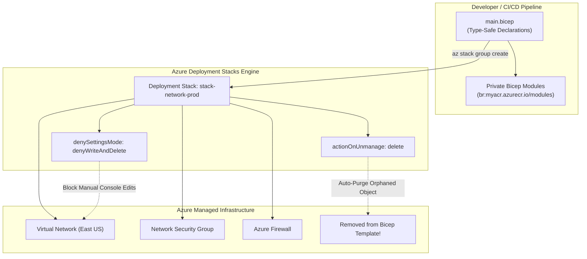

# Azure Bicep & Deployment Stacks Architecture 📜🏗️

**Azure Bicep** is Microsoft's domain-specific language (DSL) for declaratively provisioning Azure infrastructure. Combined with **Azure Deployment Stacks**, it provides next-generation Infrastructure-as-Code (IaC) that brings true state-managed lifecycle control, orphan resource cleanup, and configuration drift prevention natively to the Azure Resource Manager (ARM) engine.

---

## Architecture & Mental Model

### 1. Bicep vs. Classic ARM Templates & Terraform

```
┌────────────────────────────────────────────────────────┐
│                   Azure Bicep Code                     │
│          - Clean, concise, readable syntax             │
│          - Zero-day support for all Azure resources    │
│          - Native modularization & private registries  │
└──────────────────────────┬─────────────────────────────┘
                           │ Transparent Build / Transpile
┌──────────────────────────▼─────────────────────────────┐
│                 ARM Template Engine (JSON)             │
│          (Underlying declarative control plane)        │
└──────────────────────────┬─────────────────────────────┘
                           │ Evaluated & Orchestrated by
┌──────────────────────────▼─────────────────────────────┐
│                 Azure Deployment Stacks                │
│  - Tracks active resources in a unified "Stack"        │
│  - Cleans up deleted resources (actionOnUnmanage)      │
│  - Locks resources against drift (denySettingsMode)    │
└────────────────────────────────────────────────────────┘
```



### 2. Solving the Orphan Resource & Drift Problems

Traditional ARM deployments had two critical architectural deficiencies that often pushed engineers toward Terraform:

1. **The Orphaned Resource Problem**: If you removed a subnet, storage account, or disk from an ARM template, the resource remained running and billing in Azure indefinitely.
2. **Configuration Drift & Tampering**: Engineers with Owner permissions could manually reconfigure or delete critical production resources through the Azure Portal.

**Azure Deployment Stacks** resolves both problems natively:

- **`actionOnUnmanage`**: Dictates what happens when a resource is removed from the Bicep template:
  - `delete`: Automatically purges the resource from Azure.
  - `detach`: Leaves the resource intact in Azure but removes it from stack management.
- **`denySettingsMode`**: Applies native deny-assignments that prevent manual tampering:
  - `denyWriteAndDelete`: Blocks all out-of-band updates and deletions, even by Subscription Owners.
  - `denyDelete`: Permits manual edits but blocks accidental deletions.

---

## Core Concepts & Operations

### 1. Bicep Syntax & Zero-Day Resource Support

Because Bicep is maintained directly by the Azure Resource Manager engineering team, it provides **zero-day support**: the moment any Azure resource provider releases a new feature or API version, it is immediately configurable in Bicep without waiting for community provider plugins.

```bicep
// main.bicep
param location string = resourceGroup().location
param environment string = 'prod'

resource vnet 'Microsoft.Network/virtualNetworks@2023-11-01' = {
  name: 'vnet-${environment}-${location}'
  location: location
  properties: {
    addressSpace: {
      addressPrefixes: ['10.0.0.0/16']
    }
  }
}

// Module invocation from private ACR registry
module nsgModule 'br:myregistry.azurecr.io/bicep/modules/nsg:v1.2' = {
  name: 'nsgDeployment'
  params: {
    nsgName: 'nsg-${environment}-${location}'
    location: location
  }
}
```

---

## Production `az` CLI Commands

### 1. Deploying a Managed Deployment Stack

```bash
# 1. Deploy a Deployment Stack with auto-cleanup of unmanaged resources and drift protection
az stack group create \
  --name stack-ecommerce-prod \
  --resource-group rg-compute-prod \
  --template-file ./main.bicep \
  --parameters environment=prod \
  --action-on-unmanage delete \
  --deny-settings-mode denyWriteAndDelete \
  --deny-settings-excluded-principals $EMERGENCY_DEVOPS_SPN_ID
```

### 2. Running Pre-Flight What-If Analysis

```bash
# Preview exact changes (creations, modifications, deletions) before deployment
az deployment group what-if \
  --resource-group rg-compute-prod \
  --template-file ./main.bicep \
  --parameters environment=prod
```

### 3. Publishing a Reusable Module to Azure Container Registry

```bash
# Publish versioned Bicep module directly to private ACR as an OCI artifact
az bicep publish \
  --file ./modules/aks.bicep \
  --target "br:myregistry.azurecr.io/bicep/modules/aks:v2.1"
```

---

## Quotas & Limits

| Constraint                          | Limit                      | Architectural Workaround / Rule                                         |
| :---------------------------------- | :------------------------- | :---------------------------------------------------------------------- |
| **Max Deployment Stacks per Scope** | **800** stacks             | Per subscription, management group, or resource group scope.            |
| **Deny-Assignments per Scope**      | **2,000** deny-assignments | Group resources under common stack parent scopes.                       |
| **ARM Template Size Limit**         | **4 MB**                   | Expanded JSON limit. Split monolithic architectures into Bicep modules. |
| **Bicep Resource Parameters**       | **256** parameters         | Group parameters into complex object schemas or parameter files.        |
| **Deployment History Retention**    | **800** deployments        | Automatically pruned once limit is reached.                             |

---

## References & Documentation

- [Azure Bicep Documentation](https://learn.microsoft.com/en-us/azure/azure-resource-manager/bicep/)
- [Azure Deployment Stacks Overview](https://learn.microsoft.com/en-us/azure/azure-resource-manager/deployment-stacks/)
- [Protect Managed Resources with Deny Settings](https://learn.microsoft.com/en-us/azure/azure-resource-manager/deployment-stacks/deployment-stacks-deny-settings)
- [Bicep Modules in Private Registries](https://learn.microsoft.com/en-us/azure/azure-resource-manager/bicep/modules)
- [ARM Template What-If Operation](https://learn.microsoft.com/en-us/azure/azure-resource-manager/bicep/deploy-what-if)

---

## Realistic Pricing Scenarios

### Scenario A: Enterprise Platform Engineering (Deployment Stacks)

- **Direct Bicep / Stack Cost**: **$0.00** (Azure Bicep and Deployment Stacks are free platform control plane capabilities).
- **Associated Incurred Costs**:
  - Private ACR storage hosting 50 versioned Bicep modules: ~$5.00/month.
  - Azure Key Vault storing deployment secrets: ~$2.00/month.
- **Cost Savings Realized**:
  - Automatically deleting orphaned 500 GB staging disks and unattached load balancers via `action-on-unmanage delete` saves ~$450.00/month in abandoned cloud spend.
- **Total Monthly Cost**: **$7.00/month** (Net savings of ~$443/month).

### Scenario B: Ephemeral Preview Environments

- **Workload**: Pull-request validation stacks deployed and destroyed dynamically in CI/CD.
- **Deployment**: `az stack group create ... --action-on-unmanage delete` on branch creation; `az stack group delete --action-on-unmanage delete` on PR merge.
- **Direct Tooling Cost**: **$0.00**.

---

## Battle-Tested Nuggets & Gotchas

1. **Key Vault Secrets Cannot Be Deleted by Stacks**: Due to cryptographic protection boundaries, Azure Deployment Stacks **cannot delete Azure Key Vault secrets**. If you remove a Key Vault secret declaration from a Bicep template, stack deletion will fail unless configured with `action-on-unmanage detach` for secrets.
2. **Deny-Assignments Override Subscription Owners**: When `denySettingsMode` is set to `denyWriteAndDelete`, even an Entra Global Administrator or Subscription `Owner` cannot manually modify the resource in the Azure Portal. The operation will fail with an HTTP 403 `DenyAssignment` error. You must explicitly configure `excludedPrincipals` with an emergency break-glass identity.
3. **Moving Resources Strips Stack Protection**: If an administrator moves a stack-managed resource to a different resource group, its stack protection and deny-settings are immediately severed because deny-assignments are bound to the original resource group scope.
4. **Bicep Decompilation Formatting Gotcha**: Running `az bicep decompile --file template.json` to convert legacy ARM templates into Bicep produces valid code, but frequently generates verbose, unoptimized syntax without modularization. Always refactor decompiled output into clean Bicep modules.
5. **Private Registry Credentials in CI/CD**: When invoking Bicep modules hosted in a private Azure Container Registry (`br:myregistry.azurecr.io/...`), the build agent or developer workstation must have an active Azure CLI session with `AcrPull` permissions on the registry. In local development, run `az login` and `az acr login -n myregistry` before running `bicep build`.
