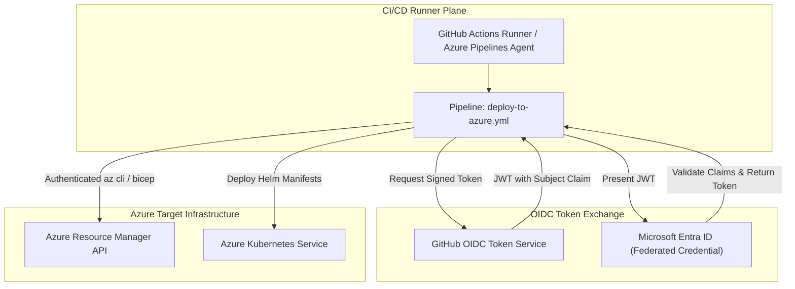

# Azure DevOps & GitHub Actions on Azure Architecture 🚀🔧

Modern software delivery on Microsoft Azure is orchestrated through two primary enterprise CI/CD platforms: **Azure DevOps** (Azure Pipelines, Repos, Artifacts, Boards) and **GitHub Actions on Azure**. Both platforms integrate natively with Microsoft Entra ID via **Workload Identity Federation (OIDC)**, completely eliminating static service principal secrets from build pipelines.

---

## Architecture & Mental Model

### 1. Keyless CI/CD: Workload Identity Federation (OIDC)

Hardcoded service principal client secrets stored in pipeline variables expire unexpectedly, break deployments, or leak into build logs. **OpenID Connect (OIDC) Federation** eliminates secrets:

```
┌────────────────────────────────────────────────────────┐
│             GitHub Actions / Azure Pipelines Runner    │
│            Workflow requests short-lived JWT           │
└──────────────────────────┬─────────────────────────────┘
                           │ 1. Request OIDC Token (IdToken)
┌──────────────────────────▼─────────────────────────────┐
│           GitHub / Azure DevOps Token Authority        │
│       Issues cryptographic JWT with Claims:            │
│       - sub: repo:contoso/api:ref:refs/heads/main      │
│       - aud: api://AzureADTokenExchange                │
└──────────────────────────┬─────────────────────────────┘
                           │ 2. Exchange JWT for Entra Token
┌──────────────────────────▼─────────────────────────────┐
│                 Microsoft Entra ID                     │
│  - Validates Issuer Signature & Subject (sub) Claim    │
│  - Issues short-lived Azure RBAC Access Token (1 hour) │
└──────────────────────────┬─────────────────────────────┘
                           │ 3. Execute ARM Deployment
┌──────────────────────────▼─────────────────────────────┐
│             Azure Resource Manager (ARM) / AKS         │
│          Deploys Infrastructure without Stored Secrets │
└────────────────────────────────────────────────────────┘
```



### 2. Platform Comparison: Azure DevOps vs. GitHub Actions

| Dimension               | **Azure DevOps**                                                   | **GitHub Actions**                                          |
| :---------------------- | :----------------------------------------------------------------- | :---------------------------------------------------------- |
| **Primary Focus**       | Traditional enterprise ALM (Boards, Test Plans, Repos, Pipelines). | Developer-first Git workflow, rich open-source marketplace. |
| **Pipeline Syntax**     | YAML Pipelines (`azure-pipelines.yml`)                             | YAML Workflows (`.github/workflows/*.yml`)                  |
| **Keyless Azure Auth**  | Service Connection via Workload Identity Federation                | `azure/login@v2` with Federated Credentials                 |
| **Self-Hosted Runners** | Azure Virtual Machine Scale Sets (VMSS) Agent Pools                | **Actions Runner Controller (ARC)** on AKS (Ephemeral Pods) |
| **Artifact Repository** | **Azure Artifacts** (NuGet, npm, Maven, Python, Universal)         | **GitHub Packages** (Container, npm, Maven, NuGet)          |

---

## Actions Runner Controller (ARC) on AKS

Running self-hosted CI/CD runners on dedicated static virtual machines wastes compute budget when idle and presents security risks from runner state poisoning.
**Actions Runner Controller (ARC)** is a Kubernetes operator running inside AKS that provides auto-scaling, ephemeral runner pods:

- **Ephemeral Isolation**: Every single CI job runs inside a clean, isolated Kubernetes pod that is destroyed immediately upon job completion.
- **VNet Native**: Runners sit directly inside your private Azure VNet, allowing private deployments to AKS internal load balancers, Azure SQL private endpoints, and internal APIM gateways without public IP hops.

---

## Production `az` CLI Commands

### 1. Configuring OIDC Federated Credentials for GitHub Actions

```bash
# 1. Create a Microsoft Entra ID App Registration for CI/CD
APP_ID=$(az ad app create --display-name "app-github-actions-deploy" --query appId -o tsv)
SP_ID=$(az ad sp create --id $APP_ID --query id -o tsv)

# 2. Assign Contributor role to the Service Principal on the target resource group
az role assignment create \
  --assignee $SP_ID \
  --role "Contributor" \
  --scope /subscriptions/{subId}/resourceGroups/rg-compute-prod

# 3. Create the Federated Identity Credential binding to GitHub repository and main branch
cat <<EOF > credential-params.json
{
  "name": "gh-actions-main-branch",
  "issuer": "https://token.actions.githubusercontent.com",
  "subject": "repo:contoso/ecommerce-platform:ref:refs/heads/main",
  "description": "Keyless deployment from GitHub Actions main branch",
  "audiences": ["api://AzureADTokenExchange"]
}
EOF

az ad app federated-credential create \
  --id $APP_ID \
  --parameters @credential-params.json
```

### 2. GitHub Actions Workflow Configuration (`deploy.yml`)

```yaml
name: Deploy Production Workload to Azure
on:
  push:
    branches: [main]

permissions:
  id-token: write # Mandatory for requesting the OIDC JWT
  contents: read

jobs:
  deploy:
    runs-on: ubuntu-latest
    steps:
      - name: Checkout Code
        uses: actions/checkout@v4

      - name: Authenticate to Azure via Keyless OIDC
        uses: azure/login@v2
        with:
          client-id: ${{ secrets.AZURE_CLIENT_ID }}
          tenant-id: ${{ secrets.AZURE_TENANT_ID }}
          subscription-id: ${{ secrets.AZURE_SUBSCRIPTION_ID }}

      - name: Deploy Bicep Template
        uses: azure/arm-deploy@v2
        with:
          resourceGroupName: rg-compute-prod
          template: ./infra/main.bicep
```

---

## Quotas & Limits

| Constraint                        | Azure DevOps Limit                     | GitHub Actions Limit                     |
| :-------------------------------- | :------------------------------------- | :--------------------------------------- |
| **Max Job Execution Duration**    | **360 minutes (6 hours)**              | **360 minutes (6 hours)**                |
| **Matrix Job Multiplier**         | 256 jobs per matrix                    | **256 jobs** per workflow matrix         |
| **Workflow Run Concurrency**      | Tier dependent (Parallel jobs)         | Bounded by organization concurrency tier |
| **Federated Credentials per App** | Up to **20** credentials per Entra App | Up to **20** credentials per Entra App   |
| **Storage Artifact Size**         | 5 GB per build artifact                | 10 GB per artifact / cache upload        |

---

## References & Documentation

- [Configure GitHub Actions to Connect to Azure using OIDC](https://learn.microsoft.com/en-us/azure/developer/github/connect-from-azure?tabs=azure-portal%2Clinux)
- [Azure Pipelines Documentation](https://learn.microsoft.com/en-us/azure/devops/pipelines/)
- [Actions Runner Controller (ARC) Overview](https://docs.github.com/en/actions/hosting-your-own-runners/managing-self-hosted-runners-with-actions-runner-controller)
- [Use Workload Identity Federation in Azure Pipelines](https://learn.microsoft.com/en-us/azure/devops/pipelines/library/service-connection-workload-identity-federation)
- [Azure CLI in GitHub Actions](https://github.com/marketplace/actions/azure-cli-action)

---

## Realistic Pricing Scenarios

### Scenario A: Enterprise Engineering Team (GitHub Actions + Self-Hosted ARC)

- **Workload**: 50 developers executing 2,000 CI/CD pipeline runs per month.
- **Compute**: 3-node AKS node pool (`Standard_D4s_v5`) running ephemeral Actions Runner Controller pods.
- **AKS Runner Pool Cost**: 3 VMs × 730 hrs × $0.192/hour = **$420.48/month**.
- **GitHub Enterprise Seats**: 50 seats × $21.00/user/month = **$1,050.00/month**.
- **Runner Storage & Cache**: 500 GB Azure Premium Managed Disks = **$73.00/month**.
- **Total Monthly Cost**: **~$1,543.48/month** (Zero build queue wait times with completely isolated ephemeral runner pods).

### Scenario B: Lightweight Startup CI/CD (GitHub Hosted Free Tier)

- **Workload**: 1,500 build minutes/month using GitHub-hosted Ubuntu runners deploying via OIDC.
- **GitHub Hosted Runners**: Free within the 2,000 included minutes.
- **Azure OIDC Authentication Cost**: **$0.00** (Entra ID federated credentials incur zero fees).
- **Total Monthly Cost**: **$0.00/month**.

---

## Battle-Tested Nuggets & Gotchas

1. **The Secret Expiration Production Outage**: Legacy pipelines using static Client Secrets (`client-secret`) frequently suffer catastrophic outages when the secret reaches its 1- or 2-year expiration date on a weekend. Migrating to **Workload Identity Federation (OIDC)** completely eliminates secret expiration, secret rotation, and credential leak risks.
2. **Subject Claim Exact Match Precision**: In GitHub OIDC federation, the `subject` claim must match the triggering Git context **character for character**. If you bind a credential to `repo:contoso/api:ref:refs/heads/main` and a workflow triggers from a pull request (`pull_request`) or a tag (`refs/tags/v1.0`), Entra ID will reject the exchange with an `AADSTS70021: No matching federated identity record found` error.
3. **Runner State Poisoning on Static VMs**: When using static self-hosted virtual machines for CI/CD, builds leave behind lingering Docker images, dirty git workspaces, and cached environment variables that cause intermittent build failures. Always use **Actions Runner Controller (ARC)** on AKS to guarantee that every job executes inside a brand new, ephemeral pod destroyed immediately after execution.
4. **`id-token: write` Permission Requirement**: In GitHub Actions, forgetting to declare `permissions: id-token: write` in the workflow YAML prevents the runner from obtaining the OIDC JWT. The `azure/login` action will fail with a cryptic `Could not retrieve token from GitHub Actions OIDC provider` error.
5. **Private AKS Deployment Without Self-Hosted Runners**: If your AKS cluster is deployed in Private Link mode with the Kubernetes API server disabled from the public internet, GitHub-hosted cloud runners cannot run `kubectl` or `helm`. You must either deploy self-hosted runners inside the private VNet or proxy deployment commands through an Azure Container Instance (ACI) or Azure Bastion.
