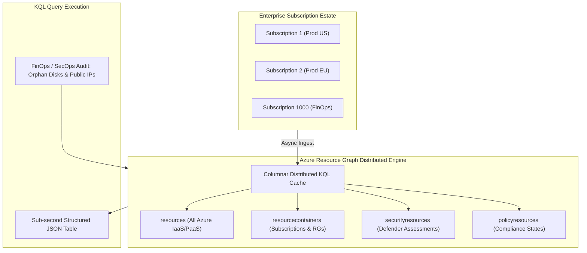

# Azure Resource Graph (ARG) Architecture & Governance Querying 📊🔍

**Azure Resource Graph (ARG)** is Azure's high-speed, distributed search and query engine. It allows platform engineers, cloud architects, and security auditors to explore, query, and analyze complex enterprise estates spanning thousands of subscriptions and management groups in sub-second response times using **Kusto Query Language (KQL)**.

---

## Architecture & Mental Model

### 1. Pre-Indexed In-Memory Cache vs. Direct ARM Calls

Under traditional ARM REST APIs, discovering all unattached public IPs across 200 subscriptions required making thousands of paginated HTTP calls, inevitably hitting ARM control-plane throttling.
**Azure Resource Graph** decouples querying from live resource endpoints:

```
┌────────────────────────────────────────────────────────┐
│             Azure Resource Providers (Compute, Net, DB) │
└──────────────────────────┬─────────────────────────────┘
                           │ Asynchronous Event Notification
┌──────────────────────────▼─────────────────────────────┐
│             Azure Resource Graph Ingestion Engine      │
│  - Continuously caches ARM resource property JSONs     │
│  - Maintains distributed, columnar KQL index           │
└──────────────────────────┬─────────────────────────────┘
                           │ Sub-second KQL Evaluation
┌──────────────────────────▼─────────────────────────────┐
│                 Engineer / SRE / CI/CD Pipeline        │
│          az graph query -q "Resources | summarize ..." │
└────────────────────────────────────────────────────────┘
```



### 2. Core Schema Table Taxonomy

ARG organizes cloud metadata into distinct, queryable relational tables:

| Schema Table             | Description                                                              | Common Query Scenario                                                   |
| :----------------------- | :----------------------------------------------------------------------- | :---------------------------------------------------------------------- |
| **`resources`**          | Every deployed resource (VMs, VNets, Disks, Databases, Key Vaults).      | Finding unattached disks, legacy TLS endpoints, untagged resources.     |
| **`resourcecontainers`** | Management Groups, Subscriptions, and Resource Groups.                   | Auditing subscription tags, lifecycle boundaries, regional groupings.   |
| **`securityresources`**  | Microsoft Defender for Cloud security findings and recommendations.      | Reporting unpatched CVEs, open management ports, insecure storage.      |
| **`policyresources`**    | Azure Policy compliance states and assignment evaluations.               | Detecting non-compliant resource counts across management groups.       |
| **`resourcechanges`**    | Historic record of resource updates, creations, and deletions (14 days). | Incident triage: _Who changed this NSG rule 2 hours before the outage?_ |

---

## Core Concepts & Operations

### 1. Complex KQL Syntax & Operations

ARG queries use standard Kusto Query Language (KQL) pipeline operators (`|`):

- `where`: Filters rows based on boolean logic or string patterns.
- `project`: Selects, renames, and transforms columns.
- `summarize`: Groups data and calculates aggregations (`count()`, `sum()`, `make_list()`).
- `mv-expand`: Unrolls dynamic JSON arrays (such as IP configurations or subnet lists) into separate rows.
- `join`: Combines tables (e.g., joining `resources` to `resourcecontainers` to enrich VMs with Subscription names).

---

## Production `az` CLI Commands

### 1. Auditing Orphaned (Unattached) Managed Disks for FinOps

```bash
# Query all unattached disks across all subscriptions incurring idle storage fees
az graph query -q "
Resources
| where type =~ 'microsoft.compute/disks'
| where managedBy == ''
| project id, name, resourceGroup, subscriptionId, location, properties.diskSizeBytes, sku.name
" --output table
```

### 2. Identifying Dangerous Open Management Ports (RDP/SSH)

```bash
# Discover Network Security Groups permitting inbound 22 or 3389 from the public internet
az graph query -q "
Resources
| where type =~ 'microsoft.network/networksecuritygroups'
| mvexpand securityRules = properties.securityRules
| where securityRules.properties.direction =~ 'Inbound'
    and securityRules.properties.access =~ 'Allow'
    and securityRules.properties.protocol in~ ('TCP', '*')
    and (securityRules.properties.destinationPortRange in ('22', '3389', '*') or securityRules.properties.destinationPortRanges has '22' or securityRules.properties.destinationPortRanges has '3389')
    and (securityRules.properties.sourceAddressPrefix in ('*', 'Internet', '0.0.0.0/0') or securityRules.properties.sourceAddressPrefixes has '*')
| project name, resourceGroup, ruleName = securityRules.name, port = securityRules.properties.destinationPortRange
" --output table
```

### 3. Paging Large Result Sets via Skip Tokens

```bash
# Query the first 1,000 resources and retrieve the continuation token for pagination
az graph query -q "Resources | project id, name, type" --first 1000
```

---

## Quotas & Limits

| Constraint                      | Limit                              | Architectural Workaround / Rule                                                     |
| :------------------------------ | :--------------------------------- | :---------------------------------------------------------------------------------- |
| **User Request Rate Limit**     | **15 queries per 5-second window** | Inspect response header `x-ms-user-quota-resets-after` and implement backoff.       |
| **Default Query Page Size**     | **1,000 records**                  | Explicitly set `--first 5000` (max per page) and loop using `--skip-token`.         |
| **Max Subscriptions per Query** | **10,000 subscriptions**           | Split massive multi-tenant estates into batches of 1,000 subscriptions.             |
| **Data Ingestion Sync Latency** | **15 to 30 seconds**               | Changes made in ARM take ~30s to reflect in ARG query results.                      |
| **Historic Change Tracking**    | **14 days**                        | Stream ARG change logs to Azure Event Hubs / Log Analytics for long-term retention. |

---

## References & Documentation

- [Azure Resource Graph Documentation](https://learn.microsoft.com/en-us/azure/governance/resource-graph/)
- [Starter KQL Queries for Azure Resource Graph](https://learn.microsoft.com/en-us/azure/governance/resource-graph/samples/starter)
- [Advanced KQL Queries for Resource Graph](https://learn.microsoft.com/en-us/azure/governance/resource-graph/samples/advanced)
- [Handle Throttling and Quotas in Resource Graph](https://learn.microsoft.com/en-us/azure/governance/resource-graph/concepts/guidance-for-throttled-requests)
- [Explore Resource Changes over Time](https://learn.microsoft.com/en-us/azure/governance/resource-graph/how-to/get-resource-changes)

---

## Realistic Pricing Scenarios

### Scenario A: Enterprise FinOps & Governance Audits (500 Subscriptions)

- **Direct Resource Graph Cost**: **$0.00** (Azure Resource Graph is a free platform control plane utility).
- **Query Volume**: 50,000 automated governance queries/month executed by CI/CD compliance scanners.
- **Total Monthly Cost**: **$0.00/month** (In contrast, maintaining a self-hosted inventory database would cost ~$800/month in compute and storage).

### Scenario B: Continuous Change Auditing via Event Hubs Streaming

- **Deployment**: Streaming all ARG resource change notifications to an Azure Event Hubs instance for SIEM auditing.
- **Event Hubs**: Standard Tier (1 Throughput Unit) = **$22.00/month**.
- **Log Analytics Retention**: 10 GB/month change history = **$23.00/month**.
- **Total Monthly Cost**: **~$45.00/month**.

---

## Battle-Tested Nuggets & Gotchas

1. **The 30-Second Ingestion Lag**: Azure Resource Graph is an asynchronous read-model cache, **not a synchronous live transactional view**. If a CI/CD script provisions a new VM and immediately calls `az graph query` 2 seconds later to fetch its private IP, the query will return zero results. In programmatic automation, introduce a 30-second delay or query the resource directly via `az resource show`.
2. **KQL Property Bag Case Sensitivity**: While KQL operators (like `where` or `project`) are case-insensitive, properties accessed inside the dynamic JSON `properties` column are strictly **case-sensitive** in many schemas. Accessing `properties.diskSizeGb` instead of `properties.diskSizeBytes` will return null values without warning. Always test JSON path navigation in the Azure Portal Resource Graph Explorer first.
3. **Paging Truncation Without `$skipToken`**: By default, ARG truncates query responses at 1,000 records. If an enterprise has 15,000 resources and runs `Resources | count`, it returns 15,000. But if it runs `Resources | project id`, it silently returns only the first 1,000 records. Always inspect the returned `$skipToken` and loop until the token is empty.
4. **The Left-Side Table Limit on Joins**: In ARG KQL joins (`Resources | join kind=leftouter (...)`), the table on the left side of the join is limited to a maximum of 5,000 rows. Attempting to join a left-side table containing 20,000 resources will result in an execution failure. Structure your queries to filter heavily before invoking `join`.
5. **Cross-Tenant Queries Require Azure Lighthouse**: You cannot query across multiple Microsoft Entra ID tenants using standard credentials. To execute centralized cross-tenant Resource Graph queries (common for Managed Service Providers), customer subscriptions must be onboarded to **Azure Lighthouse**.
