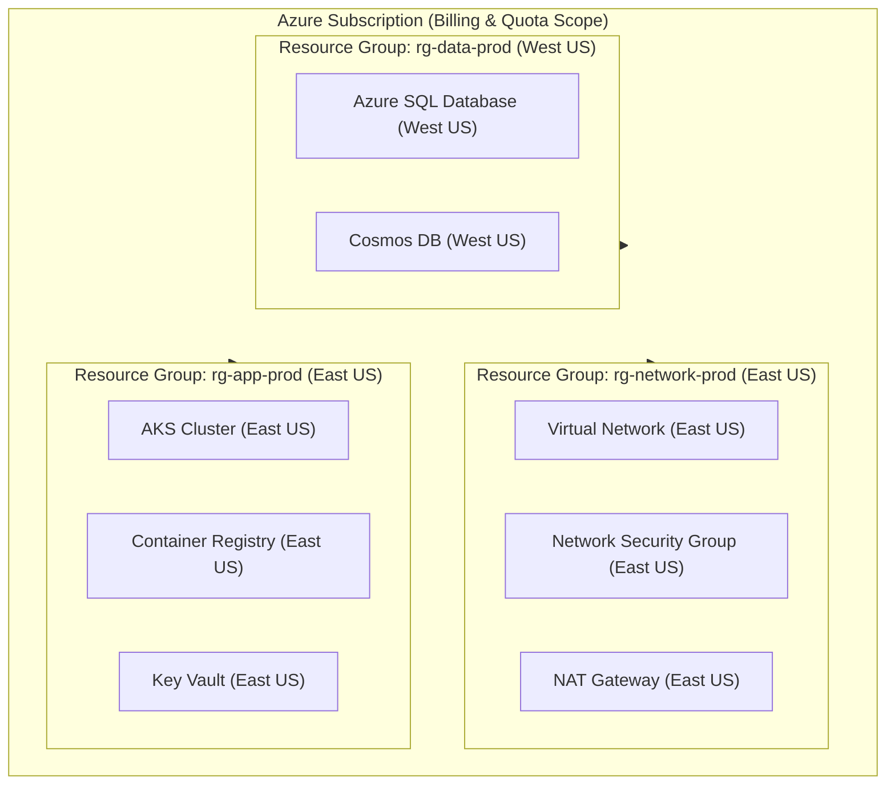

# Azure Resource Groups & ARM Lifecycle Architecture 🏗️📂

An **Azure Resource Group (RG)** is a fundamental logical container that serves as the lifecycle, access control, and deployment boundary for cloud infrastructure deployed through the **Azure Resource Manager (ARM)** control plane. Every Azure resource must belong to exactly one resource group.

---

## Architecture & Mental Model

### 1. Hierarchy & Control Plane Scope

Azure resources exist within an inherited administrative hierarchy. Resource Groups sit directly beneath Subscriptions and encapsulate individual services:

```
┌────────────────────────────────────────────────────────┐
│               Root Management Group                    │
└──────────────────────────┬─────────────────────────────┘
                           │
┌──────────────────────────▼─────────────────────────────┐
│           Subscriptions (Quota & Billing Boundary)      │
└──────────────────────────┬─────────────────────────────┘
                           │
┌──────────────────────────▼─────────────────────────────┐
│      Resource Groups (Lifecycle & ARM Boundary)         │
│  - Regional Metadata Store                             │
│  - Deployment History (Max 800)                        │
│  - RBAC & Lock Inheritance Scope                       │
└───────┬───────────────────────────────┬────────────────┘
        │                               │
┌───────▼────────────────┐      ┌───────▼────────────────┐
│ Resource (e.g. VNet)   │      │ Resource (e.g. AKS)    │
│ Region: East US        │      │ Region: East US        │
└────────────────────────┘      └────────────────────────┘
```



### 2. The Regional Metadata Paradox

When creating a Resource Group, you must specify a region (e.g., `eastus`). **This region dictates where the metadata and management state of the resource group reside, NOT where resources must physically run**:

- A resource group located in `eastus` can hold resources deployed in `westeurope` or `centralus`.
- **The Failure Mode**: If `eastus` suffers a catastrophic control plane outage, existing resources running in `westeurope` continue data-plane operations without disruption. However, **you cannot update, reconfigure, scale, or delete those resources** because ARM cannot read or write the Resource Group metadata located in `eastus`.

---

## Core Concepts & Operations

### 1. Resource Group Lifecycle & Grouping Strategies

| Strategy                      | Description                                                                     | Best For                                                           | Typical Naming            |
| :---------------------------- | :------------------------------------------------------------------------------ | :----------------------------------------------------------------- | :------------------------ |
| **By Application Lifecycle**  | Resources sharing identical CI/CD release cycles and decommissioning schedules. | Microservices, ephemeral staging environments, tenant stacks.      | `rg-payments-prod-eastus` |
| **By Shared Function / Tier** | Core foundational infrastructure managed by centralized platform teams.         | Hub networking, shared logging workspaces, identity hubs.          | `rg-hub-network-prod`     |
| **By Environment**            | Strict separation of Dev, Test, Staging, and Production for RBAC isolation.     | Regulatory compliance, billing isolation,blast radius containment. | `rg-core-dev-eastus`      |

### 2. ARM Deployment Modes: Incremental vs. Complete

Deployments targeted at a resource group execute in one of two modes:

```
Incremental Mode (Default):
Existing: [VM1, Storage1, VNet1]
Template: [Storage1 (updated), Database1]
Result:   [VM1 (untouched), Storage1 (updated), VNet1 (untouched), Database1 (created)]

Complete Mode:
Existing: [VM1, Storage1, VNet1]
Template: [Storage1 (updated), Database1]
Result:   [Storage1 (updated), Database1 (created)] -> VM1 and VNet1 are DELETED!
```

> [!CAUTION]
> **Complete Mode Deletions**: In `Complete` mode, ARM evaluates all resources in the resource group that are **not** declared in the template and immediately deletes them. Always execute an ARM `what-if` operation before running complete mode deployments.

### 3. Resource Movement Across Groups and Subscriptions

Resources can be migrated across resource groups or subscriptions without downtime for supported resource types.

- **Prerequisites**:
  - `Microsoft.Resources/subscriptions/resourceGroups/moveResources/action` on the source group.
  - `Microsoft.Resources/subscriptions/resourceGroups/write` on the target group.
- **Constraints**:
  - Source and destination subscriptions must belong to the same Microsoft Entra ID tenant.
  - Resource locks on source resources must be explicitly removed prior to initiating the move.
  - Dependent resources (e.g., NICs and VMs, Subnets and VNets) must move together in a single batch.

---

## Production `az` CLI Commands

### 1. Resource Group Provisioning & Querying

```bash
# 1. Create a production resource group with mandatory metadata tags
az group create \
  --name rg-workload-prod-eastus \
  --location eastus \
  --tags Environment=Production CostCenter=Finance Owner=platform-team@contoso.com

# 2. Query all resource groups missing mandatory compliance tags using JMESPath
az group list \
  --query "[?!tags.Environment || !tags.CostCenter].[name, location, tags]" \
  --output table

# 3. Export full ARM template representation of an existing resource group
az group export \
  --name rg-workload-prod-eastus \
  --include-comments \
  --output json > exported-workload.json
```

### 2. Resource Locking & Governance

```bash
# Apply a CanNotDelete lock at the Resource Group scope
az lock create \
  --name lock-prevent-accidental-deletion \
  --resource-group rg-workload-prod-eastus \
  --lock-type CanNotDelete \
  --notes "Enforced by Platform SecOps to prevent deletion of production data"

# Inspect active locks across all resources in the group
az lock list \
  --resource-group rg-workload-prod-eastus \
  --output table

# Delete lock (requires Owner or User Access Administrator role)
az lock delete \
  --name lock-prevent-accidental-deletion \
  --resource-group rg-workload-prod-eastus
```

### 3. Cross-Group Resource Migration

```bash
# Validate whether resources can be migrated before executing
SOURCE_IDS=$(az resource list --resource-group rg-workload-staging --query "[].id" -o tsv)

az resource move \
  --destination-group rg-workload-prod-eastus \
  --ids $SOURCE_IDS
```

---

## Quotas & Limits

| Constraint                           | Limit                  | Architectural Impact                                                                                                                                                                        |
| :----------------------------------- | :--------------------- | :------------------------------------------------------------------------------------------------------------------------------------------------------------------------------------------ |
| **Resource Groups per Subscription** | **980**                | Once reached, new resource groups cannot be provisioned. Organizations with hundreds of microservices must scale across multiple subscriptions.                                             |
| **Resources per Resource Group**     | **800** per type       | Certain resource types have limits of 800 instances per resource group. Total aggregate resources per RG can reach several thousand if types differ.                                        |
| **Deployments per Resource Group**   | **800** in history     | Deployment records in ARM history cap at 800. Automated CI/CD pipelines deploying multiple times daily can fill history; ARM automatically prunes oldest deployments once limit is reached. |
| **Resource Group Name Length**       | **1 to 90** characters | Alphanumeric, underscores, hyphens, periods, and parentheses. Cannot end with a period.                                                                                                     |
| **Tags per Resource Group**          | **50** tags            | Tag keys limited to 512 characters, tag values limited to 256 characters. Stored as plain text.                                                                                             |
| **ARM Template Size**                | **4 MB**               | Expanded ARM templates sent to a resource group cannot exceed 4 MB. Use Bicep modules or linked templates.                                                                                  |

---

## References & Documentation

- [Azure Resource Manager Overview (Microsoft Learn)](https://learn.microsoft.com/en-us/azure/azure-resource-manager/management/overview)
- [Manage Azure Resource Groups with Azure CLI](https://learn.microsoft.com/en-us/azure/azure-resource-manager/management/manage-resource-groups-cli)
- [Azure Subscription and Service Limits, Quotas, and Constraints](https://learn.microsoft.com/en-us/azure/azure-resource-manager/management/azure-subscription-service-limits)
- [Move Azure Resources to a New Resource Group or Subscription](https://learn.microsoft.com/en-us/azure/azure-resource-manager/management/move-resource-group-and-subscription)
- [Lock Resources to Prevent Unexpected Changes](https://learn.microsoft.com/en-us/azure/azure-resource-manager/management/lock-resources)

---

## Realistic Pricing Scenarios

### Scenario A: Enterprise Platform Infrastructure (50 Resource Groups)

- **Direct Resource Group Cost**: **$0.00** (Azure Resource Groups are free management constructs).
- **Metadata Storage Cost**: **$0.00** (ARM control plane metadata operations incur no direct API or storage fees).
- **Associated Incurred Costs**:
  - 50 Azure Key Vaults placed inside RGs: $0.03 per 10,000 operations (~$15.00/month).
  - Centralized Log Analytics Workspace ingestion for ARM Activity Logs: Ingesting 20 GB/month at $2.30/GB = **$46.00/month**.
- **Total Monthly Governance Cost**: **~$61.00/month**.

### Scenario B: Multi-Region Distributed Application (Primary East US, DR West US)

- **Resource Placement**: 2 Resource Groups (`rg-core-eastus` in East US, `rg-core-westus` in West US).
- **Egress Costs**:
  - Replicating storage and database snapshots between the two resource groups across regions: 5 TB of inter-region data transfer at $0.02/GB = **$100.00/month**.
- **Total Monthly RG Management Cost**: **$0.00** direct / **$100.00** in inter-region networking.

---

## Battle-Tested Nuggets & Gotchas

1. **The Regional Control-Plane Blackout**: If your Resource Group is deployed in `eastus` but holds virtual machines in `westus2`, a regional management plane outage in `eastus` will block all start, stop, scale, and redeploy operations on your `westus2` VMs, even though those VMs are physically running and reachable. **Rule**: Always deploy the Resource Group in the same primary region as its contained workloads.
2. **Resource Locks Override Subscription Owner Rights**: A `CanNotDelete` lock on a resource group stops _everyone_, including Entra Global Admins and Subscription `Owner` role holders. You cannot delete an underlying VM, NIC, or disk until the lock itself is explicitly removed by someone with `Microsoft.Authorization/locks/delete` permissions.
3. **Tags Do Not Automatically Inherit Downward**: Tagging a Resource Group with `CostCenter=Finance` does **NOT** propagate that tag to virtual machines or storage accounts inside that group. Cost allocation reports querying resource-level tags will report them as untagged. You must deploy an Azure Policy with the `modify` or `append` effect to enforce tag inheritance.
4. **Complete Mode Wipeout in CI/CD**: Running an ARM template or Bicep deployment in `Complete` mode against a shared resource group will silently destroy any unmanaged resources (such as manually deployed test VMs or certificates). Always default to `Incremental` mode unless orchestrating completely ephemeral environments.
5. **Cross-Subscription Move Duration**: Moving an AKS cluster, large storage accounts, or interconnected virtual networks between resource groups locks both the source and target resource groups for the duration of the migration (which can take between 30 minutes and 4 hours). Any automated CI/CD deployments attempting to update resources in either group during this window will fail with a `ResourceMoveInProgress` error.
6. **Deployments History Limit (800)**: While Azure now automatically purges old deployment records when the 800-deployment limit is reached, heavily automated GitOps pipelines can experience intermittent deployment throttling if hundreds of concurrent template runs occur against a single resource group within minutes.
