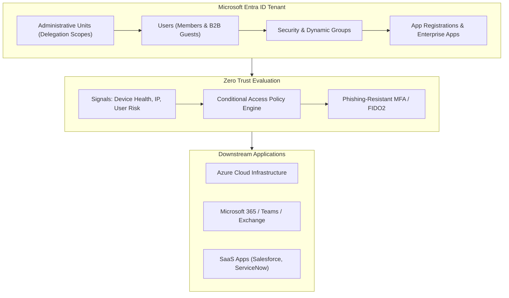

# Microsoft Entra ID Architecture & Administration 🔐☁️

**Microsoft Entra ID** (formerly Azure Active Directory) is Microsoft's multi-tenant, cloud-based identity and access management service. It functions as the central identity provider (IdP) for Azure, Microsoft 365, SaaS applications, and enterprise on-premises resources, communicating over modern protocols (**OIDC, OAuth 2.0, and SAML 2.0**).

---

## Architecture & Mental Model

### 1. Modern Cloud Identity Provider (IdP)

Unlike legacy Windows Server Active Directory (which uses Kerberos, NTLM, and LDAP tied to on-premises domain controllers), Entra ID operates as an internet-native identity authority:

```
┌────────────────────────────────────────────────────────┐
│             Microsoft Entra ID Cloud Tenant            │
│                 (tenant.onmicrosoft.com)               │
│                                                        │
│  - Modern Authentication: OIDC, OAuth 2.0, SAML 2.0    │
│  - Zero Trust Engine: Conditional Access Policies      │
│  - Single Sign-On (SSO) & Cryptographic Token Issuer   │
└──────────────┬──────────────────────────┬──────────────┘
               │                          │
        Cloud Identity            Hybrid Synchronization
               ▼                          ▼
┌──────────────────────────────┐ ┌──────────────────────────────┐
│ Cloud Native Applications    │ │ Microsoft Entra Connect Sync │
│ - Azure Resource Manager     │ │ - Password Hash Sync (PHS)   │
│ - SaaS Applications          │ │ - Pass-Through Auth (PTA)    │
│ - Modern Web & Mobile Clients│ │ - On-Premises Active Direct. │
└──────────────────────────────┘ └──────────────────────────────┘
```



---

## Core Concepts & Operations

### 1. Identity Types & Group Management

- **Users**:
  - **Member Users**: Employees created directly in the cloud or synchronized from on-premises AD.
  - **Guest Users (B2B)**: External partners, vendors, and contractors invited to collaborate using their home tenant or social identity.
- **Groups**:
  - **Security Groups**: Manage access to resources, applications, and licensing. Support nesting (unless role-assignable or dynamic).
  - **Dynamic Membership Groups**: Automated group membership populated by real-time attribute queries (e.g., `user.department -eq "DevOps" and user.jobTitle -startsWith "Senior"`).
  - **Role-Assignable Groups**: Groups with `isRoleAssignable=true` allowing Entra Directory roles to be granted to the group rather than individual users.

### 2. Delegated Administration via Administrative Units (AUs)

To implement least-privilege administration without granting global directory roles:

- An **Administrative Unit (AU)** is a logical container for a subset of users, groups, or devices (e.g., _Regional Branch - London_).
- An administrator is assigned a role (such as _User Administrator_) scoped exclusively to that AU, preventing them from modifying accounts outside their organizational domain.

### 3. Custom Directory Roles & Licensing

- **Built-In Roles**: Pre-configured directory roles (e.g., _Global Administrator_, _Security Administrator_, _Application Administrator_).
- **Custom Directory Roles**: Organizations requiring granular permissions (e.g., allow registering app credentials but disallow reading secrets) can author custom roles. Custom roles require a **Microsoft Entra ID P1 or P2** license.

---

## Production Management

### 1. Creating a Dynamic Security Group

Dynamic groups eliminate manual user provisioning by automatically updating memberships based on Entra ID attributes:

```bash
# Query members of a dynamic engineering group using Azure CLI
az ad group show \
  --group "grp-engineering-cloud-ops" \
  --query "[displayName, membershipRule, membershipRuleProcessingState]" \
  --output table
```

### 2. Hybrid Identity Synchronization Options

For hybrid enterprise environments:

- **Password Hash Synchronization (PHS)**: Replicates one-way cryptographic hashes of on-premises passwords to Entra ID. Recommended by Microsoft for disaster recovery resilience.
- **Pass-through Authentication (PTA)**: Validates login credentials directly against on-premises Active Directory domain controllers via outbound lightweight agents.
- **Federation (AD FS)**: Hands off authentication tokens to on-premises Active Directory Federation Services.

---

## Across the wiki

- [[Azure/identity/README|Microsoft Entra ID & Azure RBAC Hub]] — Master directory comparing Directory Roles to Resource RBAC.
- [[Azure/identity/workload-identity|Azure Workload Identity & Federated Credentials]] — Keyless authentication for AKS and CI/CD pipelines.
- [[AWS/security/iam/README|AWS IAM]] — Cloud identity and access governance (AWS).
- [[GCP/identity/README|GCP Cloud Identity & IAM]] — Cloud identity and access governance (GCP).
- [[Architecture/solution-architecture-concepts/authentication/README|Identity & Authentication — OIDC, JWT, OAuth, SAML]] — Foundational identity protocol architectures.
