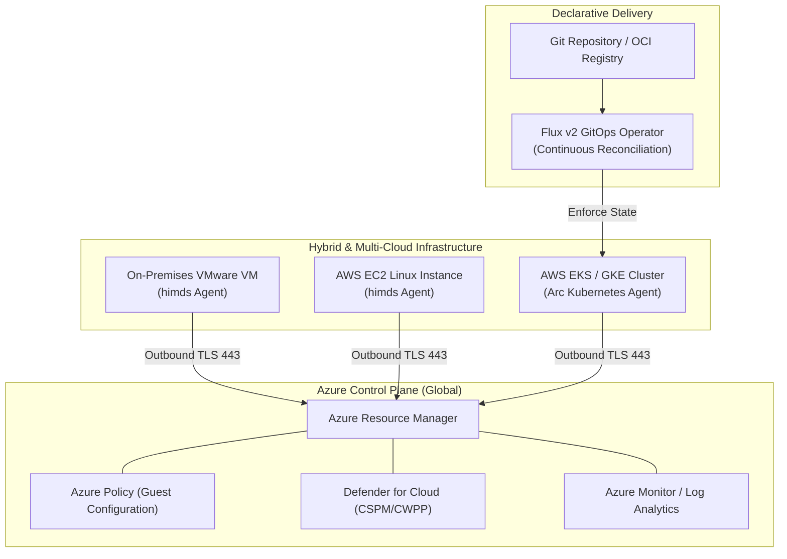

# Azure Arc Architecture & Hybrid Multi-Cloud Governance 🌐🌉

**Azure Arc** is Microsoft's defining hybrid and multi-cloud control plane platform. It extends the **Azure Resource Manager (ARM)** management plane beyond native Azure datacenters, allowing platform teams to project, govern, secure, and operate physical on-premises servers, edge devices, and third-party cloud Kubernetes clusters (AWS EKS, Google GKE) as native Azure resources.

---

## Architecture & Mental Model

### 1. Projecting External Infrastructure into ARM

Azure Arc operates by installing lightweight management agents on external infrastructure. These agents establish secure, outbound-only connections to Azure over TLS 443, registering an official **Azure Resource ID**:

```
┌────────────────────────────────────────────────────────────────────────┐
│                   Azure Resource Manager (ARM Control Plane)           │
│         Azure Policy, Defender for Cloud, Azure Monitor, RBAC          │
└───────────────────────────────────┬────────────────────────────────────┘
                                    │ Outbound Encrypted WebSocket (TLS 443)
            ┌───────────────────────┼───────────────────────┐
            ▼                       ▼                       ▼
┌───────────────────────┐┌──────────────────────┐┌───────────────────────┐
│ On-Premises VMware /  ││ AWS / GCP Multi-Cloud││ Edge Kubernetes / K3s │
│ Bare-Metal Servers    ││ Compute Instances    ││ (Retail & Factories)  │
│ (Connected Machine)   ││ (Connected Machine)  ││ (Connected Kubernetes)│
└───────────────────────┘└──────────────────────┘└───────────────────────┘
```



### 2. Arc Capabilities Spectrum

| Domain                 | **Arc-enabled Servers**                                  | **Arc-enabled Kubernetes**                                 | **Arc-enabled Data Services**                           |
| :--------------------- | :------------------------------------------------------- | :--------------------------------------------------------- | :------------------------------------------------------ |
| **Underlying Asset**   | Physical servers, VMware, Hyper-V, AWS EC2, GCP Compute  | Any CNCF-certified K8s (EKS, GKE, Rancher, OpenShift, k3s) | Azure SQL Managed Instance & PostgreSQL running on K8s  |
| **Agent / Mechanism**  | Azure Connected Machine Agent (`himds`, `gcad`)          | Azure Arc Kubernetes Agents (Helm / Extension)             | Custom Resource Definitions (CRDs) & Data Controller    |
| **Primary Governance** | Azure Policy Guest Configuration, Windows/Linux Patching | **Flux v2 GitOps**, Azure Policy Gatekeeper constraints    | Evergreen database updates, elastic on-premises scaling |
| **Remote Access**      | Native **SSH / Windows Admin Center** without public IP  | Cluster Connect (Zero-inbound Kubernetes API proxy)        | Private cluster endpoints                               |

---

## Core Concepts & Operations

### 1. Declarative Fleet Management via Flux v2 GitOps

Arc-enabled Kubernetes installs an Azure-managed **Flux v2** cluster extension:

- Platform teams declare baseline security manifests, namespaces, and network policies in a central Git repository.
- Flux operators pull configurations from Git and continuously reconcile cluster state across hundreds of distributed edge clusters.
- If an on-premises administrator manually alters or deletes a cluster constraint, Flux immediately detects the drift and re-applies the Git source of truth.

### 2. Zero-Public-IP Remote Access (Arc SSH)

Traditionally, administering on-premises servers from outside the corporate LAN required establishing VPNs or opening inbound firewall ports (TCP 22/3389).

- Arc provides **Azure Arc SSH**: The local machine connects to the Azure relay endpoint using Entra ID credentials (`az ssh --resource-type Microsoft.HybridCompute/machines`).
- The Arc agent establishes an outbound reverse proxy tunnel to Azure, allowing administrators to SSH directly into private on-premises machines from any location without a VPN.

---

## Production `az` CLI Commands

### 1. Connecting a CNCF Kubernetes Cluster to Azure Arc

```bash
# 1. Connect a local or multi-cloud cluster to Azure Arc
az connectedk8s connect \
  --resource-group rg-migration-prod \
  --name k8s-onprem-datacenter \
  --location eastus \
  --tags Environment=Production Location=Datacenter-Chicago

# 2. Deploy Azure-managed Flux v2 GitOps configuration
az k8s-configuration flux create \
  --resource-group rg-migration-prod \
  --cluster-name k8s-onprem-datacenter \
  --cluster-type connectedClusters \
  --name flux-cluster-baseline \
  --namespace flux-system \
  --scope cluster \
  --url "https://github.com/contoso/fleet-gitops-manifests" \
  --branch main \
  --kustomization name=baseline path=./clusters/production prune=true
```

### 2. Connecting to an On-Premises Server via Arc SSH

```bash
# SSH directly into a private hybrid server using Entra ID authentication
az ssh \
  --resource-type Microsoft.HybridCompute/machines \
  --resource-group rg-migration-prod \
  --name srv-chicago-db01 \
  --local-user localadmin
```

---

## Quotas & Limits

| Constraint                          | Limit                       | Architectural Workaround / Rule                                               |
| :---------------------------------- | :-------------------------- | :---------------------------------------------------------------------------- |
| **Arc Servers per Resource Group**  | Up to **5,000** machines    | Scale across dedicated regional resource groups.                              |
| **Flux Configurations per Cluster** | Up to **20** configurations | Consolidate multi-repo manifests using Kustomize overlays.                    |
| **Agent Heartbeat Frequency**       | Once every **5 minutes**    | If missed for 15 minutes, machine status transitions to `Disconnected`.       |
| **Outbound Firewall Requirements**  | Strictly **TLS 443**        | All Arc communication is outbound; no inbound firewall ports are ever opened. |
| **Supported OS Architectures**      | x86_64, ARM64               | Windows Server 2012 R2+, RHEL 7+, Ubuntu 18.04+, Debian, SUSE, Oracle Linux.  |

---

## References & Documentation

- [Azure Arc Overview (Microsoft Learn)](https://learn.microsoft.com/en-us/azure/azure-arc/overview)
- [Azure Arc-enabled Servers Architecture](https://learn.microsoft.com/en-us/azure/azure-arc/servers/overview)
- [Azure Arc-enabled Kubernetes Overview](https://learn.microsoft.com/en-us/azure/azure-arc/kubernetes/overview)
- [Conceptual Architecture for Azure Arc GitOps](https://learn.microsoft.com/en-us/azure/azure-arc/kubernetes/conceptual-gitops-flux2)
- [SSH Access to Arc-enabled Servers](https://learn.microsoft.com/en-us/azure/azure-arc/servers/ssh-arc-overview)

---

## Realistic Pricing Scenarios

### Scenario A: Enterprise Hybrid Fleet Governance (100 On-Premises Servers)

- **Base Arc Registration**: **$0.00** (Inventory, Resource Graph querying, and tagging are free).
- **Azure Policy Guest Configuration**: $6.00/server/month:
  - 100 servers × $6.00 = **$600.00/month**.
- **Arc Windows Server Extended Security Updates (ESU)**: Hourly pay-as-you-go patching for legacy Windows Server 2012/R2 workloads (~$400.00/month).
- **Total Monthly Cost**: **~$1,000.00/month** (Enterprise compliance and patch management across 100 hybrid machines without upgrading hardware).

### Scenario B: Multi-Cloud Kubernetes Fleet (5 AWS EKS Clusters via GitOps)

- **Base Arc Cluster Connection**: **$0.00** (Free).
- **Azure Policy for Kubernetes (Gatekeeper)**: Included free.
- **GitOps Flux v2 Extension**: Free up to first 6 vCPUs/cluster, then $2.00/vCPU/month:
  - 5 clusters × 16 vCPUs = 50 billable vCPUs × $2.00 = **$100.00/month**.
- **Total Monthly Cost**: **$100.00/month** (Automated GitOps configuration delivery across 5 AWS clusters).

---

## Battle-Tested Nuggets & Gotchas

1. **The Corporate HTTP Proxy Deadlock**: In corporate datacenters, servers cannot access the public internet directly and must route through an authenticating HTTP proxy. The Azure Connected Machine Agent supports proxy routing, but engineers often configure the proxy only in user environment variables (`http_proxy`). You must configure the agent service explicitly: `azcmagent config set proxy.url "http://proxy.corp.internal:8080"`, or the agent service will crash on reboot.
2. **Heartbeat Disconnect Alarms**: The Arc agent transmits a telemetry heartbeat every 5 minutes. If an on-premises server is temporarily powered down for hardware upgrades or network maintenance, its ARM state transitions to `Disconnected` after 15 minutes. Ensure monitoring alert rules do not mistake scheduled maintenance for system failures.
3. **Flux v2 Private Git PAT Token Expiration**: When binding an Arc-enabled Kubernetes cluster to a private GitHub or GitLab repository via Flux, the configuration requires a Personal Access Token (PAT) or deploy key. If the PAT expires, Flux silently stops pulling updates while existing pods remain running. Always use GitHub App tokens or deploy keys with long-term rotations.
4. **Arc SSH RBAC Assignment Requirement**: To use `az ssh` into an Arc-enabled machine, an engineer must possess the `Azure Connected Machine Resource Administrator` role. Possessing standard `Reader` or `Contributor` permissions is insufficient and will return an unauthorized `AccessDenied` error during the SSH key exchange.
5. **Arc-Enabled Extended Security Updates (ESU) Cost Advantage**: For organizations running legacy Windows Server 2012 or SQL Server 2012 on-premises, Microsoft offers ESUs billed monthly via Azure Arc. Unlike traditional annual prepaid volume licensing agreements, Arc ESUs can be canceled at any time the moment a workload is decommissioned or migrated to Azure.
