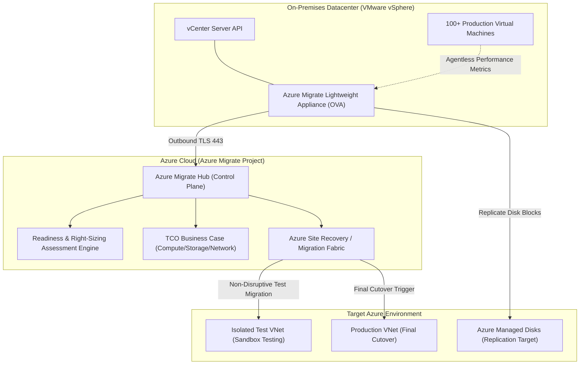

# Azure Migrate Architecture & Datacenter Modernization 🚚🏢

**Azure Migrate** is Microsoft's central hub for discovering, assessing, right-sizing, and executing enterprise datacenter migrations to Azure. It provides end-to-end tooling for migrating heterogeneous workloads, including physical bare-metal servers, VMware vSphere and Hyper-V virtual machines, Amazon EC2 and Google Cloud instances, enterprise SQL Server databases, and web applications.

---

## Architecture & Mental Model

### 1. The Migration Lifecycle Pipeline

Enterprise cloud migration progresses through four tightly coupled phases orchestrated by Azure Migrate:

```
┌────────────────────────────────────────────────────────────────────────┐
│                        Azure Migrate Hub Architecture                  │
└───────────────────────────────────┬────────────────────────────────────┘
                                    │
    1. DISCOVER                     2. ASSESS                       3. REPLICATE & MIGRATE
┌────────────────────────┐      ┌────────────────────────┐      ┌────────────────────────┐
│  Discovery Appliance   │      │ Business Case Engine   │      │ Replication Appliance  │
│  - VMware OVA / Hyper-V├─────►│ - Performance Sizing   ├─────►│ - Continuous delta sync│
│  - Agentless scan      │      │ - Dependency Mapping   │      │ - Non-disruptive test  │
│  - vCenter API metrics │      │ - TCO Cost Model & AVS │      │ - Final cutover window │
└────────────────────────┘      └────────────────────────┘      └────────────────────────┘
```



### 2. Sizing Strategies: As-On-Premises vs. Performance-Based

A frequent cause of cloud migration budget overruns is 1:1 lift-and-shift sizing (e.g., allocating a 16-vCPU Azure VM simply because the on-premises VMware VM had 16 vCPUs allocated):

- **As-on-premises**: Replicates identical core counts and RAM allocations regardless of actual usage. Leads to massive overprovisioning.
- **Performance-based (Recommended)**: Analyzes real-time CPU, memory, disk IOPS, and network throughput collected by the appliance over a 7- to 30-day monitoring window. Azure Migrate sizes VMs to the lowest-cost SKU meeting the 95th percentile peak utilization, reducing compute costs by 30%–60%.

---

## Core Concepts & Operations

### 1. Agentless Discovery Appliance

The Azure Migrate appliance is a pre-configured virtual machine (deployed via OVA template for VMware or VHD for Hyper-V) that runs inside the customer datacenter:

- Communicates directly with vCenter Server APIs over TCP port 443 using read-only credentials.
- Collects machine configurations, active disk sizes, and utilization performance counters without installing any agents on individual guest operating systems.

### 2. Dependency Analysis (Agentless vs. Agent-Based)

- **Agentless Dependency Mapping**: Gathers active TCP connections and listening ports directly from hypervisor network stack counters. Essential for identifying which servers communicate with which databases before organizing migration waves.
- **Agent-Based Dependency Mapping**: Deploys the Log Analytics and Dependency agent on guest OS machines for deep process-level network inspection.

---

## Production `az` CLI Commands

### 1. Provisioning an Azure Migrate Project

```bash
# 1. Create a migration project resource group
az group create --name rg-migration-prod --location eastus

# 2. Deploy Azure Migrate Project resource
az migrate project create \
  --resource-group rg-migration-prod \
  --project-name proj-datacenter-migration \
  --location eastus
```

### 2. Querying Discovered Servers and Readiness

```bash
# Inspect discovered servers and Azure readiness status via CLI
az migrate server-discovery list \
  --resource-group rg-migration-prod \
  --project-name proj-datacenter-migration \
  --query "[].[displayName, operatingSystem, ipAddresses[0], readinessStatus]" \
  --output table
```

---

## Quotas & Limits

| Constraint                             | Limit                            | Architectural Workaround / Rule                                           |
| :------------------------------------- | :------------------------------- | :------------------------------------------------------------------------ |
| **Servers per Discovery Appliance**    | Up to **35,000** VMs             | Deploy additional appliances for multi-vCenter mega-estates.              |
| **Appliances per Migration Project**   | Up to **10** appliances          | Consolidate cross-datacenter discoveries into a unified project.          |
| **Concurrent Server Replications**     | Up to **500** simultaneous disks | Stagger migration into waves of 20–50 VMs per weekend cutover window.     |
| **Performance Data Collection Window** | **1 day to 30 days**             | Collect at least 7 days of data to capture weekly business cycle peaks.   |
| **Target Disk Size Support**           | Up to **32 TiB** per disk        | Large disks supported across Standard HDD, Standard SSD, and Premium SSD. |

---

## References & Documentation

- [Azure Migrate Overview (Microsoft Learn)](https://learn.microsoft.com/en-us/azure/migrate/migrate-services-overview)
- [How Does Azure Migrate Work? (Appliance Architecture)](https://learn.microsoft.com/en-us/azure/migrate/migrate-appliance)
- [Create and Manage Assessments in Azure Migrate](https://learn.microsoft.com/en-us/azure/migrate/how-to-create-assessment)
- [Agentless VMware Migration Architecture](https://learn.microsoft.com/en-us/azure/migrate/concepts-vmware-agentless)
- [Azure Migrate Business Case Capabilities](https://learn.microsoft.com/en-us/azure/migrate/how-to-build-a-business-case)

---

## Realistic Pricing Scenarios

### Scenario A: Enterprise Datacenter Migration (100 VMware VMs to Azure IaaS)

- **Azure Migrate Discovery & Assessment Tooling**: **$0.00** (Azure Migrate discovery, assessment, and business case tooling is completely free of charge).
- **Migration Data Replication (First 180 Days)**: **$0.00** (Azure Site Recovery / Migrate replication is free for the first 180 days per migrated machine).
- **Target Storage Incurred During Replication**:
  - 100 VMs holding 20 TB total disk storage replicated to Azure Managed Disks (Standard SSD) = **$1,500.00/month**.
- **Total Migration Tooling Cost**: **$0.00 direct / ~$1,500.00 in staging storage**.

### Scenario B: Database Re-Platforming Assessment (20 SQL Servers)

- **Workload**: Assessing 20 on-premises SQL Server instances for migration to Azure SQL Managed Instance vs Azure SQL Database.
- **Assessment Tooling**: Azure Migrate Database Assessment (Free).
- **Business Case Analysis**: Generates exact TCO comparison factoring in Azure Hybrid Benefit (AHB) for existing on-premises SQL Server core licenses.
- **Total Tooling Cost**: **$0.00**.

---

## Battle-Tested Nuggets & Gotchas

1. **The 7-Day Sizing Window Golden Rule**: Generating an assessment based on only 2 hours of data will size virtual machines based on whatever minimal idle traffic was observed, leading to undersized production VMs that crash under Monday morning peak traffic. **Rule**: Always let the discovery appliance run for at least **7 full consecutive days** (and preferably through month-end financial reporting) before finalizing VM SKU sizing.
2. **Non-Disruptive Test Migrations in Isolated VNets**: Azure Migrate allows you to test-boot migrated VMs in Azure **without stopping ongoing replication and without touching the on-premises production server**. Always connect test migrations to an isolated sandbox VNet that has **zero routing or peering to the production network** to avoid IP collisions and duplicate Active Directory domain controller sync conflicts.
3. **VMware Snapshot Consolidation Freezes**: During initial replication, Azure Migrate uses VMware Changed Block Tracking (CBT) and VM snapshots. If an on-premises VM has massive write activity (e.g., high-IOPS database) and poor underlying SAN storage, releasing the snapshot during delta synchronization can cause a brief VM I/O stun. Schedule initial disk replications during off-peak windows.
4. **Target Subnet IP Address Planning**: During cutover, Azure assigns private IP addresses to newly created VMs within the target subnet. If your on-premises machines had hardcoded static IP configurations, you must either configure Azure NIC IP reservations matching the old schema (if using identical stretched CIDRs) or automate DNS updates post-cutover.
5. **Azure Hybrid Benefit (AHB) Savings**: Enabling Azure Hybrid Benefit during the assessment phase allows you to bring existing on-premises Windows Server and SQL Server Software Assurance licenses to Azure, reducing VM and SQL compute costs by up to 40%–55%. Failing to flag AHB during initial migration setup forces instances to default to pay-as-you-go software licensing.
