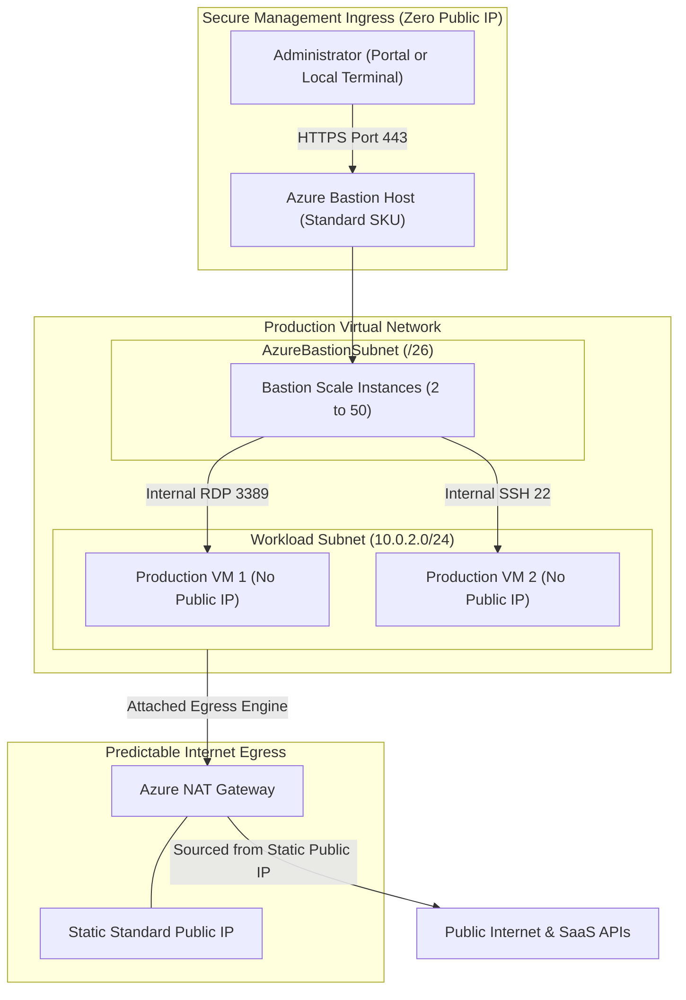

# Azure Bastion & NAT Gateway Architecture 🛡️🚪

Secure ingress administration and reliable outbound internet connectivity in Microsoft Azure rely on two specialized perimeter services: **Azure Bastion** (fully managed, browser- and CLI-based RDP/SSH access eliminating public IP addresses on virtual machines) and **Azure NAT Gateway** (highly resilient, fully managed outbound SNAT service eliminating port exhaustion).

---

## Architecture & Mental Model

### 1. Ingress Security & Egress Isolation

```
                         INBOUND SECURE ACCESS
            ┌──────────────────────────────────────────────┐
            │       Developer / SRE Workstation            │
            └──────────────────────┬───────────────────────┘
                                   │ TLS 443 (HTML5 or CLI)
            ┌──────────────────────▼───────────────────────┐
            │               Azure Bastion                  │
            │   - Dedicated AzureBastionSubnet (/26)       │
            │   - No Public IP on target Virtual Machine   │
            └──────────────────────┬───────────────────────┘
                                   │ Internal RDP (3389) / SSH (22)
                                   ▼
            ┌──────────────────────────────────────────────┐
            │            Target Virtual Machine            │
            │               (Private Subnet)               │
            └──────────────────────┬───────────────────────┘
                                   │ Outbound Web Traffic
                         OUTBOUND INTERNET EGRESS
                                   │
            ┌──────────────────────▼───────────────────────┐
            │              Azure NAT Gateway               │
            │   - 64,512 SNAT Ports per Public IP          │
            │   - Eliminates SNAT Port Exhaustion Drops    │
            └──────────────────────┬───────────────────────┘
                                   │ Predictable Outbound Public IP
                                   ▼
            ┌──────────────────────────────────────────────┐
            │          External SaaS / 3rd-Party APIs      │
            └──────────────────────────────────────────────┘
```



---

## Azure Bastion SKU Comparison

| Capability                  | **Developer (Preview)**                | **Basic**                 | **Standard**                                    | **Premium**                           |
| :-------------------------- | :------------------------------------- | :------------------------ | :---------------------------------------------- | :------------------------------------ |
| **Cost Profile**            | **Free base charge**                   | Hourly base rate          | Hourly base rate                                | Hourly base rate                      |
| **Dedicated Subnet**        | No (`AzureBastionSubnet` not required) | **Yes** (`/26` or larger) | **Yes** (`/26` or larger)                       | **Yes** (`/26` or larger)             |
| **Public IP Required**      | No                                     | **Yes** (Standard static) | **Yes** (Standard static)                       | **Yes** (Standard static)             |
| **Max Concurrent Sessions** | **1 active session**                   | Up to 10–20 sessions      | **Up to 50 scale units (hundreds of sessions)** | Enterprise scale                      |
| **VNet Peering Transit**    | ❌ No (same VNet only)                 | ❌ No                     | **✅ Yes (Hub-and-spoke transit)**              | **✅ Yes**                            |
| **Native Client Support**   | ❌ No (Portal HTML5 only)              | ❌ No                     | **✅ Yes (`az network bastion ssh/rdp`)**       | **✅ Yes**                            |
| **Session Recording**       | ❌ No                                  | ❌ No                     | ❌ No                                           | **✅ Yes (Recorded to Blob Storage)** |

---

## Azure NAT Gateway: Solving SNAT Exhaustion

When private virtual machines access the internet through default Azure outbound access or standard Load Balancer rules, Azure allocates a fixed pool of Source Network Address Translation (SNAT) ports (typically only 128 to 1,024 ports per VM):

- **The Problem**: High-concurrency applications, microservices, or scraping jobs executing hundreds of outbound HTTP calls exhaust their allocated ports. Azure silently drops subsequent outbound connections (`SYN` timeouts).
- **The Solution**: Attaching an Azure NAT Gateway to a subnet dynamically pools SNAT ports on-demand across all VMs in that subnet.
- **Capacity**: Each attached Public IP provides **64,512 SNAT ports**. A single NAT Gateway can bind up to 16 static Public IPs, providing over **1,000,000 concurrent outbound connections**.

---

## Production `az` CLI Commands

### 1. Provisioning Azure Bastion (Standard SKU with Peering Support)

```bash
# 1. Create a dedicated AzureBastionSubnet (strictly named, minimum /26)
az network vnet subnet create \
  --resource-group rg-network-prod \
  --vnet-name vnet-hub-eastus \
  --name AzureBastionSubnet \
  --address-prefixes 10.100.250.0/26

# 2. Create static Standard Public IP for Bastion
az network public-ip create \
  --resource-group rg-network-prod \
  --name pip-bastion-hub \
  --sku Standard \
  --zone 1 2 3

# 3. Deploy Azure Bastion Standard with native client support enabled
az network bastion create \
  --resource-group rg-network-prod \
  --name bastion-hub-prod \
  --vnet-name vnet-hub-eastus \
  --public-ip-address pip-bastion-hub \
  --sku Standard \
  --enable-tunneling true \
  --enable-ip-connect true
```

### 2. Native CLI SSH Connection via Bastion

```bash
# Connect directly to a private VM using local SSH keys without exposing public IP
az network bastion ssh \
  --name bastion-hub-prod \
  --resource-group rg-network-prod \
  --target-resource-id /subscriptions/{subId}/resourceGroups/rg-compute-prod/providers/Microsoft.Compute/virtualMachines/vm-app-prod-01 \
  --auth-type ssh-key \
  --username azureuser \
  --ssh-key ~/.ssh/id_rsa
```

### 3. Provisioning Azure NAT Gateway

```bash
# 1. Create Static Public IP prefix (/30 provides 4 static IPs)
az network public-ip create \
  --resource-group rg-network-prod \
  --name pip-natgw-01 \
  --sku Standard \
  --zone 1 2 3

# 2. Create NAT Gateway with 4-minute idle timeout
az network nat gateway create \
  --resource-group rg-network-prod \
  --name natgw-workload-eastus \
  --location eastus \
  --public-ip-addresses pip-natgw-01 \
  --idle-timeout 4

# 3. Associate NAT Gateway with workload subnet
az network vnet subnet update \
  --resource-group rg-network-prod \
  --vnet-name vnet-spoke-workload \
  --name snet-apps \
  --nat-gateway natgw-workload-eastus
```

---

## Quotas & Limits

| Constraint                         | Limit                    | Architectural Workaround / Rule                                                    |
| :--------------------------------- | :----------------------- | :--------------------------------------------------------------------------------- |
| **`AzureBastionSubnet` Sizing**    | Minimum **/26** (64 IPs) | Sizing smaller than `/26` will cause deployment failure during scale-out.          |
| **Bastion Scale Units (Standard)** | **2 to 50** instances    | Each instance adds ~20 concurrent RDP and ~40 concurrent SSH sessions.             |
| **Public IPs per NAT Gateway**     | **16** Public IPs        | Maximum aggregate pool of 1,032,192 SNAT ports per NAT Gateway.                    |
| **NAT Gateway Throughput**         | Up to **100 Gbps**       | Line-rate SDN fabric scaling. Split subnets across multiple gateways if exceeding. |
| **NAT Gateway Idle Timeout**       | **4 to 120 minutes**     | Default is 4 minutes. Increase for long-lived keepalive TCP streams.               |

---

## References & Documentation

- [Azure Bastion Documentation](https://learn.microsoft.com/en-us/azure/bastion/)
- [Azure Bastion SKUs & Comparison](https://learn.microsoft.com/en-us/azure/bastion/bastion-overview#sku)
- [Connect to a VM Using Native Client and Azure Bastion](https://learn.microsoft.com/en-us/azure/bastion/bastion-connect-native-client)
- [Azure NAT Gateway Documentation](https://learn.microsoft.com/en-us/azure/nat-gateway/)
- [Design Virtual Networks with NAT Gateway](https://learn.microsoft.com/en-us/azure/nat-gateway/nat-gateway-resource)

---

## Realistic Pricing Scenarios

### Scenario A: Enterprise Bastion Hub (Standard Tier with Peering)

- **Deployment**: Standard SKU deployed in Hub VNet managing 100 VMs across 5 peered spoke VNets.
- **Base Hourly Charge**: $0.29/hour = **$211.70/month**.
- **Scale Units**: Scaled to 4 host instances during business hours = ~$80.00/month.
- **Outbound Data Transfer**: 50 GB RDP/SSH session transfer at $0.087/GB = **$4.35/month**.
- **Standard Public IP**: 1 Static IP at $0.005/hour = **$3.65/month**.
- **Total Monthly Cost**: **~$299.70/month** (Complete elimination of jump boxes, bastion VMs, and public IPs).

### Scenario B: Resilient Outbound NAT Gateway for High-Traffic Workloads

- **Workload**: Kubernetes cluster making 500 outbound API calls/second to third-party payment gateways.
- **NAT Gateway Resource**: $0.045/hour = **$32.85/month**.
- **Data Processed**: 10 TB outbound internet data processed at $0.045/GB = **$450.00/month**.
- **Public IP**: 1 Standard Static Public IP = **$3.65/month**.
- **Total Monthly Cost**: **$486.50/month** (Zero SNAT drops and guaranteed static egress IP for whitelisting).

---

## Battle-Tested Nuggets & Gotchas

1. **Strict NSG Rules on `AzureBastionSubnet`**: The `AzureBastionSubnet` has mandatory NSG requirements. If you apply a restrictive NSG that blocks inbound HTTPS (443) from `Internet`, inbound `GatewayManager` traffic, or outbound `AzureCloud` traffic, Azure Bastion will enter an unrecoverable `Failed` provisioning state.
2. **NAT Gateway Overrides Default Routes**: Once a NAT Gateway is attached to a subnet, it **takes absolute precedence** for all outbound internet-destined traffic (0.0.0.0/0). Any existing default outbound rules on Azure Load Balancers or VM public IPs on that subnet are silently deactivated for egress.
3. **Developer SKU Bastion Isolation**: The free Bastion Developer SKU **does not support VNet Peering**. If you deploy it in a Hub VNet, you cannot reach VMs in Spoke VNets. Furthermore, it only allows 1 active session at any given moment; a second user logging in will be rejected.
4. **NAT Gateway Incompatibility with UDRs**: If a subnet has a User Defined Route (UDR) pointing `0.0.0.0/0` to a Virtual Appliance (e.g., Azure Firewall), internet traffic follows the UDR to the firewall and ignores the NAT Gateway. NAT Gateway only handles direct internet egress.
5. **Bastion Port Forwarding with Local CLI**: With the Standard SKU, developers can establish native SSH tunneling to private databases or internal web servers without opening firewalls: `az network bastion tunnel --target-resource-id <id> --resource-port 5432 --port 5432`. This binds PostgreSQL port 5432 locally on `localhost`.
