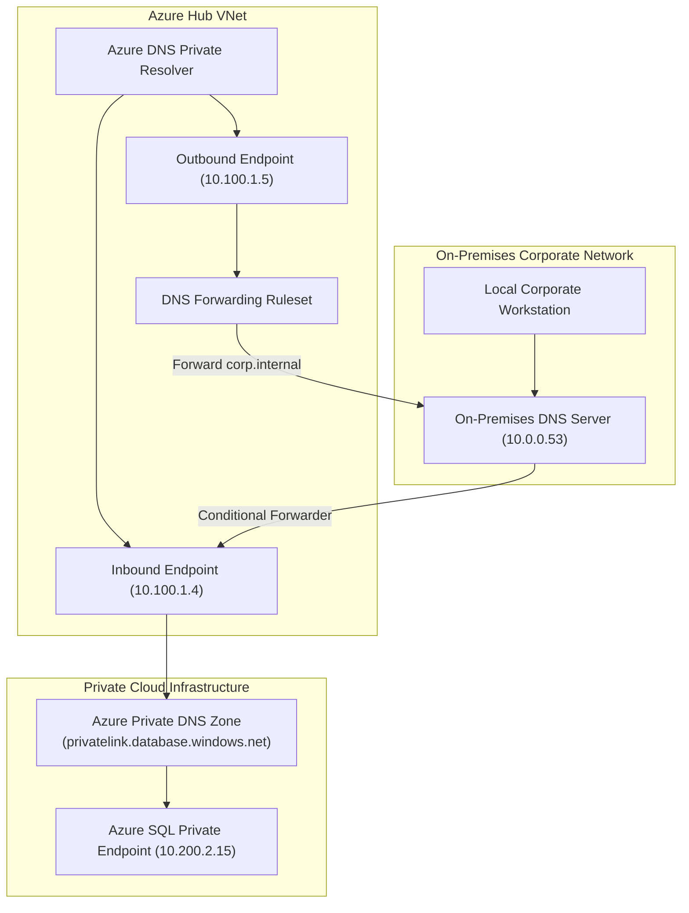

# Azure DNS & Traffic Manager Architecture 🌐🔀

Name resolution in Microsoft Azure is powered by two specialized control planes: **Azure DNS** (authoritative public and private DNS zone hosting, plus Azure DNS Private Resolver for hybrid resolution) and **Azure Traffic Manager** (a global DNS-based traffic load balancer routing client requests to geographically distributed endpoints).

---

## Architecture & Mental Model

### 1. The Azure DNS Ecosystem

```
┌────────────────────────────────────────────────────────┐
│             Public Clients / Internet Users            │
└──────────────────────────┬─────────────────────────────┘
                           │ Query (UDP/TCP 53)
┌──────────────────────────▼─────────────────────────────┐
│                 Azure Public DNS Zones                 │
│         - Anycast Global Name Server Network           │
│         - Ultra-low latency edge resolution            │
└────────────────────────────────────────────────────────┘

┌────────────────────────────────────────────────────────┐
│                 Azure Traffic Manager                  │
│   - Global DNS-based routing (Not a proxy / Not CDN)   │
│   - Returns optimal IP based on 6 routing algorithms   │
└──────────────────────────┬─────────────────────────────┘
                           │ Resolves to Regional Endpoints
              ┌────────────┴────────────┐
              ▼                         ▼
    ┌──────────────────┐      ┌──────────────────┐
    │  East US Region  │      │ West Europe Reg. │
    │  (App Gateway)   │      │  (App Gateway)   │
    └──────────────────┘      └──────────────────┘
```



### 2. Azure Traffic Manager Routing Methods

Traffic Manager intercepts DNS lookups for a vanity CNAME (e.g., `app.contoso.com`) and resolves the optimal endpoint using one of six mathematical profiles:

| Routing Method  | Algorithm Behavior                                                                                   | Primary Use Case                                                   |
| :-------------- | :--------------------------------------------------------------------------------------------------- | :----------------------------------------------------------------- |
| **Priority**    | Primary-Active / Secondary-Passive failover. Sends all traffic to highest priority healthy endpoint. | Active/Passive disaster recovery architectures.                    |
| **Weighted**    | Distributes traffic based on assigned integer weights (1–1000).                                      | Blue/green deployments, canary testing, staged migration.          |
| **Performance** | Resolves the client to the Azure datacenter exhibiting the lowest network latency.                   | Global multi-region web applications seeking lowest response time. |
| **Geographic**  | Directs users to specific endpoints based on geographic source IP (Country/Region/State).            | Data residency compliance, regional content localization.          |
| **Multivalue**  | Returns multiple healthy A/AAAA records in a single DNS response for client-side round-robin.        | Fault-tolerant client-side load balancing without proxy hops.      |
| **Subnet**      | Maps specific client end-user IP CIDR blocks to designated endpoints.                                | Corporate intranet routing, VIP client prioritization.             |

---

## Azure DNS Private Resolver (Hybrid Resolution)

Historically, resolving Azure Private DNS zones from on-premises required deploying and patching self-managed IaaS VM forwarders (BIND, Windows Server). **Azure DNS Private Resolver** provides a 100% managed, PaaS-native hybrid DNS bridge:

- **Inbound Endpoints**: Expose private IP addresses inside your VNet that on-premises DNS servers target with conditional forwarders.
- **Outbound Endpoints & Forwarding Rulesets**: Allow Azure VMs to conditionally forward queries for internal on-premises domains (e.g., `corp.contoso.local`) back to corporate DNS servers over ExpressRoute or VPN.

---

## Production `az` CLI Commands

### 1. Private DNS Zone & VNet Link Provisioning

```bash
# 1. Create a Private DNS Zone for Private Link resolution
az network private-dns zone create \
  --resource-group rg-network-prod \
  --name privatelink.database.windows.net

# 2. Link the Private DNS Zone to the production VNet with auto-registration disabled
az network private-dns link vnet create \
  --resource-group rg-network-prod \
  --zone-name privatelink.database.windows.net \
  --name link-vnet-prod-eastus \
  --virtual-network /subscriptions/{subId}/resourceGroups/rg-network-prod/providers/Microsoft.Network/virtualNetworks/vnet-eastus-prod \
  --registration-enabled false

# 3. Create an A record mapping a private endpoint IP
az network private-dns record-set a add-record \
  --resource-group rg-network-prod \
  --zone-name privatelink.database.windows.net \
  --record-set-name sql-prod-server \
  --ipv4-address 10.100.2.50
```

### 2. Azure Traffic Manager Configuration

```bash
# 1. Create a Performance-based Traffic Manager Profile
az network traffic-manager profile create \
  --resource-group rg-network-prod \
  --name tm-ecommerce-global \
  --routing-method Performance \
  --unique-dns-name contoso-ecommerce-tm \
  --ttl 30 \
  --protocol HTTPS \
  --port 443 \
  --path /healthz

# 2. Add East US primary endpoint (Application Gateway Public IP)
az network traffic-manager endpoint create \
  --resource-group rg-network-prod \
  --profile-name tm-ecommerce-global \
  --name ep-eastus-appgw \
  --type azureEndpoints \
  --target-resource-id /subscriptions/{subId}/resourceGroups/rg-network-prod/providers/Microsoft.Network/publicIPAddresses/pip-appgw-eastus \
  --endpoint-status Enabled \
  --weight 1
```

---

## Quotas & Limits

| Constraint                                    | Limit                                         | Architectural Workaround / Rule                                                                |
| :-------------------------------------------- | :-------------------------------------------- | :--------------------------------------------------------------------------------------------- |
| **Virtual Network Links per Private Zone**    | **1,000**                                     | Cross-region hub-and-spoke networks link spokes directly to centralized private zones.         |
| **Links with Auto-Registration per Zone**     | **100**                                       | Only enable auto-registration on ephemeral VM subnets, never on production Private Link zones. |
| **Traffic Manager Profiles per Subscription** | **200**                                       | Profiles can nest (child profiles) for complex multi-tier routing logic.                       |
| **Endpoints per Traffic Manager Profile**     | **200**                                       | Aggregate across Azure, External, and Nested endpoint types.                                   |
| **Traffic Manager Minimum DNS TTL**           | **0 seconds** (Default 300s, Recommended 30s) | Set TTL to 30s for rapid disaster recovery failover.                                           |

---

## References & Documentation

- [Azure DNS Documentation](https://learn.microsoft.com/en-us/azure/dns/)
- [Azure DNS Private Resolver Overview](https://learn.microsoft.com/en-us/azure/dns/dns-private-resolver-overview)
- [Azure Traffic Manager Documentation](https://learn.microsoft.com/en-us/azure/traffic-manager/)
- [Private Endpoint DNS Integration Scenarios](https://learn.microsoft.com/en-us/azure/private-link/private-endpoint-dns)
- [Traffic Manager Routing Methods](https://learn.microsoft.com/en-us/azure/traffic-manager/traffic-manager-routing-methods)

---

## Realistic Pricing Scenarios

### Scenario A: Global E-Commerce Routing (Azure Traffic Manager)

- **Workload**: 50 million DNS queries per month routed across 4 regional application gateways.
- **Base Profile Cost**:
  - First 1 billion queries: $0.54 per million queries.
  - 50 million × $0.54 = **$27.00/month**.
- **Health Checks**: 4 Azure endpoints monitored over HTTPS at 30s intervals:
  - 4 endpoints × $0.36/endpoint/month = **$1.44/month**.
- **Total Monthly Cost**: **$28.44/month** (Global high-availability routing for 50M requests).

### Scenario B: Enterprise Hybrid DNS (Azure DNS Private Resolver)

- **Workload**: Hub VNet connecting on-premises datacenters to 20 Azure Private DNS zones.
- **Base Resolver Cost**: $0.40/hour per resolver instance = **$292.00/month**.
- **Inbound Endpoint**: 1 dedicated endpoint ($0.15/hour) = **$109.50/month**.
- **Outbound Endpoint**: 1 dedicated endpoint ($0.15/hour) = **$109.50/month**.
- **DNS Queries**: 10 million queries processed at $0.40/million = **$4.00/month**.
- **Total Monthly Cost**: **$515.00/month** (Fully managed zero-maintenance hybrid DNS bridge).

---

## Battle-Tested Nuggets & Gotchas

1. **Traffic Manager is NOT a Reverse Proxy**: Traffic Manager never touches or proxies HTTP/HTTPS packets. It solely returns an IP address during DNS resolution. Consequently, Traffic Manager cannot inspect headers, terminate TLS, rewrite URLs, or provide WAF protection. If Layer 7 HTTP reverse proxying and Anycast SSL termination are required, use **Azure Front Door**.
2. **The 30-Second DNS Caching Failover Delay**: Even if Traffic Manager detects an endpoint failure within 10 seconds, client devices, ISP recursive resolvers, and local operating systems cache DNS responses according to the configured TTL. Setting TTL to 30 seconds ensures clients fail over quickly, but setting it below 5 seconds causes query volume surges and costs.
3. **Auto-Registration Subnet Leaks**: Enabling `--registration-enabled true` on a Private DNS link automatically creates A records for every VM and NIC spun up in that VNet. If an AKS cluster with Azure CNI is deployed in that VNet, thousands of dynamic pod NICs can attempt auto-registration, instantly hitting the 100-link or record limits and crashing DNS registration. Keep auto-registration strictly disabled for Private Link zones.
4. **Subnet Delegation Constraints for Private Resolver**: The Azure DNS Private Resolver requires **two distinct, dedicated subnets**: one delegated to `Microsoft.Network/dnsResolvers` for Inbound Endpoints, and another for Outbound Endpoints. Neither subnet can contain VMs, NSGs with custom deny rules that block UDP/TCP port 53, or User Defined Routes (UDRs) that hijack DNS traffic.
5. **Split-Horizon DNS Hijacking**: If you create a private DNS zone named `contoso.com` instead of a subdomain like `azure.contoso.com`, any DNS record not explicitly registered in the private zone (e.g., `mail.contoso.com` or `www.contoso.com`) will return `NXDOMAIN` to your Azure VMs, breaking internet access to corporate public services. Always use a dedicated subdomain or configure forwarders carefully.
