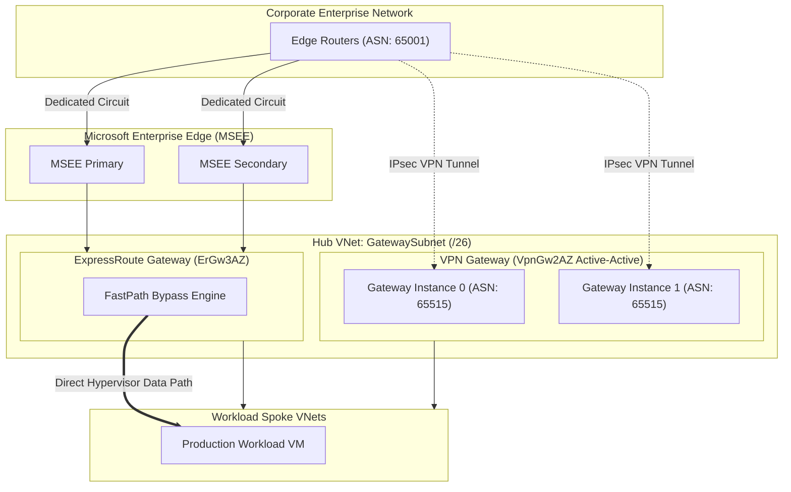

# Azure ExpressRoute & VPN Gateway Hybrid Architecture 🚇🔐

Connecting on-premises datacenters, corporate branch offices, and colocation facilities to Microsoft Azure relies on two primary hybrid networking technologies: **Azure ExpressRoute** (private, dedicated, unencrypted Layer 3 circuits bypassing the public internet) and **Azure VPN Gateway** (encrypted IPsec/IKE tunnels over the public internet).

---

## Architecture & Mental Model

### 1. Hybrid Connectivity Architecture & Coexistence

```
┌────────────────────────────────────────────────────────┐
│             On-Premises Corporate Datacenter           │
│           Enterprise Core Edge Routers (eBGP)          │
└──────────────┬──────────────────────────┬──────────────┘
               │                          │
    Dedicated Layer 3 Circuit             │ Encrypted IPsec / IKE
    (Telco / Equinix / Direct)            │ (Public Internet)
               │                          │
┌──────────────▼──────────────────────────▼──────────────┐
│                    Azure Edge (MSEE)                   │
│          Microsoft Enterprise Edge Routers             │
└──────────────┬──────────────────────────┬──────────────┘
               │ Private Peering          │ Dual Tunnel Active-Active
┌──────────────▼──────────────────────────▼──────────────┐
│        Azure Hub Virtual Network (GatewaySubnet /27)   │
│  ┌─────────────────────────┐  ┌─────────────────────┐  │
│  │ ExpressRoute Gateway    │  │  VPN Gateway        │  │
│  │ (BGP Peering & FastPath)│  │  (Active-Active BGP)│  │
│  └───────────┬─────────────┘  └──────────┬──────────┘  │
└──────────────┼───────────────────────────┼─────────────┘
               │ Gateway Transit           │ Backup Path
┌──────────────▼───────────────────────────▼─────────────┐
│                 Spoke Virtual Networks                 │
│      Workload VMs / Managed AKS / Database Subnets     │
└────────────────────────────────────────────────────────┘
```



### 2. ExpressRoute FastPath: Bypassing Gateway Bottlenecks

Under default ExpressRoute routing, all data packets flow through the Virtual Network Gateway CPU, which introduces latency and caps throughput at gateway bandwidth limits (e.g., 10 Gbps for `ErGw3AZ`):

- **FastPath Architecture**: When enabled on supported SKUs (`UltraPerformance`, `ErGw3AZ`, `ErGwScale`), FastPath programs Azure's physical SDN directly into the network interface cards (NICs) of backend VMs.
- **The Data Path**: Data packets bypass the gateway entirely and flow directly between the MSEE edge and the target VM NIC at wire speed (up to 100 Gbps).
- **Control Plane**: The Virtual Network Gateway is still strictly required to negotiate BGP routes, exchange prefixes, and maintain health state.

---

## Peering Models & Routing Dynamics

### 1. Peering Comparison

| Peering Type              | Routing Target                                             | Public/Private       | Key Capabilities                                                                     |
| :------------------------ | :--------------------------------------------------------- | :------------------- | :----------------------------------------------------------------------------------- |
| **Azure Private Peering** | Virtual Networks, Spoke VNets, Private Endpoints           | RFC 1918 Private IPs | Direct bi-directional communication between on-prem and Azure VNets.                 |
| **Microsoft Peering**     | Microsoft 365, Dynamics 365, Public Azure PaaS (Blob, SQL) | Public Routable IPs  | Enterprise routing to public Microsoft cloud services bypassing public ISP networks. |

### 2. Coexistence: ExpressRoute with S2S VPN Backup

To prevent network outages if a physical fiber line is cut, organizations deploy both ExpressRoute and a Site-to-Site VPN to the same VNet:

- **Default Path**: Azure automatically prefers ExpressRoute over VPN Gateway because ExpressRoute routes have a shorter path length and higher weight within Azure routing tables.
- **BGP Requirement**: Both gateways must run BGP with Azure ASN set to **65515**.
- **Failover**: If the ExpressRoute circuit drops BGP keepalives, traffic automatically fails over to the IPsec VPN tunnels within 30–60 seconds.

---

## Production `az` CLI Commands

### 1. Active-Active VPN Gateway Provisioning

```bash
# 1. Create two Public IP addresses for the active-active gateway instances
az network public-ip create -g rg-network-prod -n pip-vpngw-01 --sku Standard --zone 1 2 3
az network public-ip create -g rg-network-prod -n pip-vpngw-02 --sku Standard --zone 1 2 3

# 2. Provision Active-Active Zone-Redundant VPN Gateway with BGP enabled
az network vnet-gateway create \
  --resource-group rg-network-prod \
  --name vpngw-hub-eastus \
  --vnet vnet-hub-eastus \
  --public-ip-addresses pip-vpngw-01 pip-vpngw-02 \
  --gateway-type Vpn \
  --vpn-type RouteBased \
  --sku VpnGw2AZ \
  --asn 65515 \
  --enable-active-active true
```

### 2. ExpressRoute Gateway with FastPath Enabled

```bash
# 1. Provision an ErGw3AZ Ultra Gateway in the GatewaySubnet
az network vnet-gateway create \
  --resource-group rg-network-prod \
  --name ergw-hub-eastus \
  --vnet vnet-hub-eastus \
  --public-ip-address pip-ergw \
  --gateway-type ExpressRoute \
  --sku ErGw3AZ

# 2. Connect ExpressRoute Gateway to Circuit with FastPath enabled
az network vpn-connection create \
  --resource-group rg-network-prod \
  --name conn-er-to-onprem \
  --vnet-gateway1 ergw-hub-eastus \
  --express-route-circuit2 /subscriptions/{subId}/resourceGroups/rg-network-prod/providers/Microsoft.Network/expressRouteCircuits/er-circuit-prod \
  --enable-fast-path true
```

---

## Quotas & Limits

| Constraint                             | Limit                                             | Architectural Workaround / Rule                                                       |
| :------------------------------------- | :------------------------------------------------ | :------------------------------------------------------------------------------------ |
| **GatewaySubnet CIDR Size**            | Minimum **/27** (Recommended **/26**)             | Cannot be resized once created. Sizing smaller than `/27` blocks coexisting gateways. |
| **Advertised IPv4 Prefixes (Private)** | **1,000** (Standard circuit), **4,000** (Premium) | Exceeding 1,000 prefixes will tear down BGP peering and drop traffic entirely.        |
| **Max VPN Gateway Bandwidth**          | **10 Gbps** (`VpnGw5AZ` SKU)                      | For bandwidth exceeding 10 Gbps, deploy ExpressRoute or Virtual WAN.                  |
| **FastPath Supported SKUs**            | `UltraPerformance`, `ErGw3AZ`, `ErGwScale`        | Standard and HighPerformance SKUs cannot enable FastPath.                             |
| **BGP ASN for Azure VPN**              | Strictly **65515**                                | Reserved by Azure for virtual network gateway routing.                                |

---

## References & Documentation

- [Azure ExpressRoute Overview (Microsoft Learn)](https://learn.microsoft.com/en-us/azure/expressroute/expressroute-introduction)
- [About ExpressRoute FastPath](https://learn.microsoft.com/en-us/azure/expressroute/about-fastpath)
- [Configure ExpressRoute and Site-to-Site VPN Coexistence](https://learn.microsoft.com/en-us/azure/expressroute/expressroute-howto-coexist-resource-manager)
- [Azure VPN Gateway Design & Active-Active](https://learn.microsoft.com/en-us/azure/vpn-gateway/vpn-gateway-activeactive-rm-powershell)
- [BGP and Azure VPN Gateways](https://learn.microsoft.com/en-us/azure/vpn-gateway/vpn-gateway-bgp-overview)

---

## Realistic Pricing Scenarios

### Scenario A: Enterprise 1 Gbps ExpressRoute Circuit (Dedicated)

- **Circuit Bandwidth**: 1 Gbps ExpressRoute Circuit (Equinix Ashburn to East US).
- **Circuit Port Fee**: 1 Gbps Metred standard circuit = **$410.00/month**.
- **Outbound Data Transfer**: 20 TB egress at $0.025/GB = **$500.00/month**.
- **ExpressRoute Gateway**: `ErGw2AZ` Zone-redundant gateway = $0.38/hour = **$277.40/month**.
- **Telco Cross-Connect**: Paid directly to colocation provider (~$300.00/month).
- **Total Monthly Cost**: **~$1,487.40/month** (Enterprise-grade private fiber with guaranteed SLA and < 5 ms latency).

### Scenario B: Resilient Branch Office (Active-Active S2S VPN)

- **Workload**: Dual IPsec tunnels over redundant ISPs connecting corporate HQ to Azure Hub.
- **Gateway**: `VpnGw2AZ` (Zone-redundant, up to 1.25 Gbps) at $0.57/hour = **$416.10/month**.
- **Public IPs**: 2 Standard Static Public IPs (Zone-Redundant) = $0.005/hour × 2 = **$7.30/month**.
- **Egress Transfer**: 5 TB outbound internet transfer = **$435.00/month**.
- **Total Monthly Cost**: **~$858.40/month** (Active-active dual-tunnel branch failover).

---

## Battle-Tested Nuggets & Gotchas

1. **The GatewaySubnet `/28` Trap**: Early Azure deployments often provisioned a `/28` subnet (16 IPs, only 11 usable after Azure reservations). If you later attempt to add an ExpressRoute Gateway to an existing VPN Gateway for coexistence, the deployment fails because there are insufficient IP addresses. You **cannot resize** a subnet while a gateway is attached; you must delete the gateway, recreate the subnet as `/26`, and redeploy.
2. **The 1,000 Prefix BGP Poison Pill**: In ExpressRoute Private Peering, on-premises routers must not advertise more than 1,000 IPv4 prefixes to Azure (4,000 with ExpressRoute Premium). If route redistribution leaks 1,001 prefixes into BGP, the MSEE edge **immediately terminates the BGP session**, dropping all private traffic until routes are summarized. Always configure strict prefix filters and route summarization on edge hardware.
3. **BGP ASN 65515 Conflict**: Azure assigns ASN 65515 to its VPN gateways and Route Server. If your on-premises edge router is already configured to use ASN 65515, BGP will reject the peering connection due to loop detection (`AS_PATH` containing its own ASN). Use private ASNs like 65001–65500 for on-premises edge devices.
4. **FastPath UDR Incompatibility**: When FastPath is enabled, traffic completely bypasses the virtual network gateway and flows directly to VM NICs. Consequently, User Defined Routes (UDRs) applied on the `GatewaySubnet` that attempt to redirect incoming on-premises traffic through an Azure Firewall or NVA **are bypassed** for FastPath traffic.
5. **Route Weight Asymmetry in Coexistence**: If both ExpressRoute and VPN Gateway learn the same subnet prefix via BGP, Azure always sends outbound traffic via ExpressRoute. However, on-premises firewalls may send return traffic over the VPN tunnel if BGP metrics (`MED`, `Local Preference`, `AS-Path Prepending`) are not strictly aligned, creating asymmetric routing that triggers stateful firewall packet drops.
