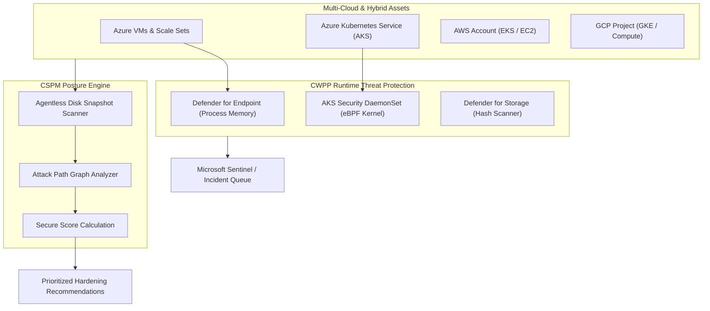

# Microsoft Defender for Cloud Architecture & CNAPP 🛡️☁️

**Microsoft Defender for Cloud** is an enterprise **Cloud Native Application Protection Platform (CNAPP)**. It unifies **Cloud Security Posture Management (CSPM)** (identifying misconfigurations, compliance gaps, and exploitable attack paths) with **Cloud Workload Protection Platform (CWPP)** (real-time threat detection and active attack mitigation) across Azure, AWS, Google Cloud Platform, and on-premises environments via Azure Arc.

---

## Architecture & Mental Model

### 1. The Dual-Pillar CNAPP Framework

Defender for Cloud evaluates cloud assets across two complementary operational horizons:

```
┌────────────────────────────────────────────────────────────────────────┐
│                      Microsoft Defender for Cloud                      │
└───────────────────┬────────────────────────────────┬───────────────────┘
                    │                                │
    PROACTIVE DEFENSE (Posture)      REACTIVE DEFENSE (Workload Protection)
                    ▼                                ▼
┌──────────────────────────────────────┐ ┌───────────────────────────────┐
│ Cloud Security Posture Mgmt (CSPM)   │ │ Cloud Workload Protection (CWPP)│
│ - Continuous Asset Inventory         │ │ - Defender for Servers (MDE)  │
│ - Secure Score (0–100%)              │ │ - Defender for Containers (AKS│
│ - Attack Path Analysis & Risk Graphs │ │ - Defender for Storage / SQL  │
│ - Regulatory Compliance Benchmarks   │ │ - Real-Time Anomaly Detection │
└───────────────────┬──────────────────┘ └───────────────┬───────────────┘
                    │                                    │
                    ▼                                    ▼
       Security Recommendations                  Security Alerts (XDR)
     (Hardening & Auto-Remediation)            (SOAR & Sentinel Playbooks)
```



### 2. CSPM Tiers: Foundational vs. Defender CSPM

| Capability                       | **Foundational CSPM (Free)**              | **Defender CSPM (Paid)**                                                             |
| :------------------------------- | :---------------------------------------- | :----------------------------------------------------------------------------------- |
| **Asset Inventory & Discovery**  | Multi-cloud resource inventory            | Real-time continuous discovery                                                       |
| **Secure Score**                 | Included (Evaluated daily)                | **Included with contextual risk weighting**                                          |
| **Regulatory Compliance**        | Microsoft Cloud Security Benchmark (MCSB) | **50+ frameworks (PCI-DSS 4.0, HIPAA, SOC 2, ISO 27001, CIS)**                       |
| **Attack Path Analysis**         | ❌ No                                     | **✅ Yes (Graph database cross-correlating vulnerabilities + network reachability)** |
| **Agentless Machine Scanning**   | ❌ No                                     | **✅ Yes (Scans VM disk snapshots for CVEs, secrets, and malware without CPU load)** |
| **Data Security Posture (DSPM)** | ❌ No                                     | **✅ Yes (Sensitive data discovery across Blob, SQL, and AWS S3)**                   |

---

## Core Concepts & Operations

### 1. Secure Score Calculation Mechanics

Secure Score represents overall security hygiene on a 0–100% scale:

- Recommendations are grouped into **Security Controls** (e.g., _Enable MFA_, _Remediate Vulnerabilities_, _Restrict Unauthorized Network Access_).
- Each Security Control carries a fixed weight of points. Points for a control are awarded **proportionally** based on the fraction of compliant resources. If 8 out of 10 VMs have disk encryption enabled, you earn 80% of the points allocated to that control.
- Maximizing Secure Score directly cuts attack surfaces by systematically eliminating low-hanging configuration exposures.

### 2. Defender for Containers: Complete Lifecycle Defense

Defender for Containers secures containerized workloads across 4 distinct phases:

1. **Build & CI/CD**: Scans container images for vulnerabilities, plaintext credentials, and malware in Azure Container Registry (ACR).
2. **Admission Control**: Enforces Kubernetes admission guardrails via OPA Gatekeeper and Azure Policy (e.g., blocking privileged containers or unsigned images).
3. **Runtime eBPF Inspection**: DaemonSet deployed on AKS nodes monitors kernel-level system calls to detect container escapes, reverse shells, and cryptomining.
4. **Agentless Cluster Posture (KSPM)**: Assesses RBAC configurations, API server exposure, and network security policies.

---

## Production `az` CLI Commands

### 1. Enabling Defender for Servers and Containers on a Subscription

```bash
# 1. Enable Defender for Servers Plan 2 (includes MDE and vulnerability management)
az security pricing create \
  --name "VirtualMachines" \
  --tier "Standard" \
  --sub-plan "P2"

# 2. Enable Defender for Containers (covers AKS clusters and ACR registries)
az security pricing create \
  --name "Containers" \
  --tier "Standard"

# 3. Enable Agentless VM Scanning extension
az security pricing update \
  --name "VirtualMachines" \
  --tier "Standard" \
  --extensions '[{"name":"AgentlessVmScanning","isEnabled":"True"}]'
```

### 2. Querying Active High-Severity Security Alerts

```bash
# Inspect active high-severity threat detection alerts across the environment
az security alert list \
  --filter "Status eq 'Active' and Severity eq 'High'" \
  --query "[].[alertDisplayName, reportedSeverity, compromisedEntity, remediationSteps]" \
  --output table
```

---

## Quotas & Limits

| Constraint                        | Limit                                       | Architectural Workaround / Rule                                               |
| :-------------------------------- | :------------------------------------------ | :---------------------------------------------------------------------------- |
| **Agentless Scan Frequency**      | Once every **24 hours** per VM              | For real-time zero-day file scanning, deploy the active MDE sensor agent.     |
| **Alert Ingestion Latency**       | **Real-time to 15 minutes**                 | Critical runtime threats trigger instant alerts in Microsoft Defender Portal. |
| **Custom Compliance Frameworks**  | Up to **30** custom initiatives             | Map enterprise audit requirements using Azure Policy initiatives.             |
| **Defender for Storage Scanning** | Files up to **2 GB** (Malware scan)         | Files exceeding 2 GB are bypassed by automatic in-line hash scanners.         |
| **Multi-Cloud Connector Scale**   | Up to **1,000** AWS accounts / GCP projects | Connect at the AWS Management Account or GCP Organization root scope.         |

---

## References & Documentation

- [Microsoft Defender for Cloud Overview](https://learn.microsoft.com/en-us/azure/defender-for-cloud/defender-for-cloud-introduction)
- [Understand the Secure Score in Defender for Cloud](https://learn.microsoft.com/en-us/azure/defender-for-cloud/secure-score-security-controls)
- [Defender for Servers Overview & Plans](https://learn.microsoft.com/en-us/azure/defender-for-cloud/defender-for-servers-introduction)
- [Defender for Containers Architecture](https://learn.microsoft.com/en-us/azure/defender-for-cloud/defender-for-containers-introduction)
- [Attack Path Analysis in Defender for Cloud](https://learn.microsoft.com/en-us/azure/defender-for-cloud/concept-attack-path)

---

## Realistic Pricing Scenarios

### Scenario A: Production Enterprise Workload Defense (Servers + Containers)

- **Estate**: 20 Virtual Machines + 3 AKS Clusters (15 worker nodes total).
- **Defender for Servers Plan 2**:
  - 20 VMs × $15.00/server/month = **$300.00/month** (Includes Microsoft Defender for Endpoint, vulnerability management, and 500 MB/day Log Analytics ingestion allowance).
- **Defender for Containers**:
  - 15 AKS nodes × $7.00/node/month = **$105.00/month**.
  - ACR image scanning: 200 images scanned/month = ~$5.00/month.
- **Defender CSPM Add-on**: 35 billable compute cores × $5.00/month = **$175.00/month**.
- **Total Monthly Cost**: **~$585.00/month** (End-to-end CNAPP defense protecting production VMs, Kubernetes clusters, and container registries).

### Scenario B: Cloud Hygiene Baseline (Foundational Free Tier)

- **Estate**: 50 Azure Virtual Machines and 10 Storage Accounts.
- **CSPM Posture**: Foundational Free Tier (Secure Score, Microsoft Cloud Security Benchmark compliance).
- **Total Monthly Cost**: **$0.00/month** (Proactive posture recommendations and compliance auditing without licensing overhead).

---

## Battle-Tested Nuggets & Gotchas

1. **Agentless Scanning Does Not Block Runtime Attacks**: Agentless scanning periodically snapshots VM OS disks out-of-band to discover installed software vulnerabilities and plain-text secrets. Because it is out-of-band, it **cannot terminate running malware, block command injection, or sever reverse shells**. For active runtime protection, you must deploy the Microsoft Defender for Endpoint (MDE) sensor.
2. **Defender for Storage Near-Real-Time Malware Scan Surcharges**: When enabling Defender for Storage with On-Upload Malware Scanning, Azure charges per gigabyte of content scanned ($0.15/GB scanned). If an application uploads terabytes of benign video or log archives daily, malware scanning costs can unexpectedly soar to thousands of dollars. Use tag-based exclusion filters to scan only high-risk customer-uploaded file types (PDF, EXE, DOCX).
3. **The Secure Score Proportion Trap**: If a security control (such as _Enable MFA for privileged accounts_) is assigned 10 points, and your organization has 50 privileged accounts where only 49 have MFA enabled, **you lose points on that entire control**. A single non-compliant break-glass account can hold down your enterprise score. Configure explicit exemption rules with documented governance justifications for authorized break-glass accounts.
4. **Log Analytics Ingestion Allowance on Servers Plan 2**: Defender for Servers Plan 2 includes a credit of **500 MB of free security data ingestion per server per day** into your Log Analytics workspace. If configured correctly, this covers all Windows Security Event logs and Linux audit logs, saving significant monitoring costs that would otherwise be incurred by Azure Monitor.
5. **Multi-Cloud Connector Auto-Provisioning Overreach**: When connecting an AWS organization or GCP project to Defender for Cloud with auto-provisioning enabled, Defender will automatically deploy CloudFormation stacks and agents across every child account. Coordinate with AWS/GCP cloud platform teams beforehand to prevent conflicting CloudTrail and GuardDuty configurations.
