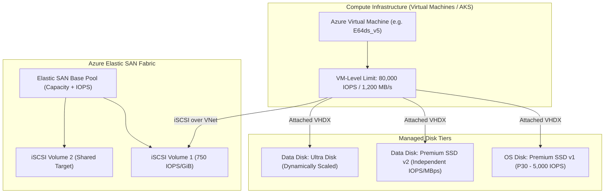

# Azure Managed Disks & Elastic SAN Architecture 💽🧱

Azure provides two primary block storage architectures for virtual machines, container nodes, and specialized clusters: **Azure Managed Disks** (hypervisor-attached virtual hard disks) and **Azure Elastic SAN** (a fully managed cloud storage area network accessible over iSCSI).

---

## Architecture & Mental Model

### 1. The Block Storage Continuum

```
                                Block Storage Options
                                          │
            ┌─────────────────────────────┴─────────────────────────────┐
            ▼                                                           ▼
    Managed Disks (VHD / Local Attach)                           Networked Block (iSCSI)
            │                                                           │
    ┌───────┴──────────────────────────┐                        Azure Elastic SAN
    ▼                                  ▼                        - Multi-compute iSCSI
General Purpose                  Extreme Scale                  - VMware / AVS / AKS
- Standard HDD (E/S series)      - Premium SSD v2               - Centralized Pool
- Standard SSD (Web tiers)         (Decoupled IOPS/MBps)        - Up to 2,000,000 IOPS
- Premium SSD v1 (Prod default)  - Ultra Disk (<1ms, 400k IOPS)
```



### 2. Dual-Layer Throttling: VM vs. Disk Limits

A frequent architectural failure is attaching an Ultra Disk capable of 100,000 IOPS to a VM SKU that caps uncached disk traffic at 20,000 IOPS:

- **Disk Cap**: Maximum throughput and IOPS guaranteed by the disk tier.
- **VM Cap**: Maximum I/O throughput enforceable by the VM host hypervisor bus.
- **Result**: The effective performance is always `MIN(VM_Limit, Disk_Limit)`.

---

## Managed Disk Tiers Comparison

| Metric                 | **Standard HDD** | **Standard SSD** | **Premium SSD (v1)** | **Premium SSD v2**            | **Ultra Disk**                      |
| :--------------------- | :--------------- | :--------------- | :------------------- | :---------------------------- | :---------------------------------- |
| **Max Capacity**       | 32 TiB           | 32 TiB           | 32 TiB               | **64 TiB**                    | **64 TiB**                          |
| **Max IOPS**           | 2,000            | 6,000            | 20,000               | **80,000**                    | **400,000**                         |
| **Max Throughput**     | 500 MB/s         | 750 MB/s         | 900 MB/s             | **2,000 MB/s**                | **10,000 MB/s**                     |
| **Latency**            | ~10–20 ms        | Single-digit ms  | ~2–5 ms              | **Sub-millisecond (~1 ms)**   | **Sub-millisecond (< 1 ms)**        |
| **OS Disk Support**    | Yes              | Yes              | Yes                  | **No (Data only)**            | **No (Data only)**                  |
| **Performance Tuning** | Tied to size     | Tied to size     | Tied to size         | **Independently provisioned** | **Dynamically adjusted on-the-fly** |

---

## Azure Elastic SAN Architecture

**Azure Elastic SAN** addresses the problem of overprovisioning managed disks across sprawling VM fleets. Instead of assigning individual high-performance disks to 50 separate VMs, organizations provision a shared **Capacity and Performance Pool** that serves virtual volumes over **iSCSI**:

- **Clustering & Shared Storage**: Supports **SCSI-3 Persistent Reservations (PR)**, allowing clustering applications (SQL Server Failover Cluster Instances, SAP ASCS) to run in Azure without complex software-defined storage overlays.
- **Azure VMware Solution (AVS)**: Directly serves as external VMFS datastores for AVS, dramatically reducing VMware hosting costs.
- **Performance**: Scales up to **2,000,000 aggregate IOPS** and **80,000 MB/s** throughput per SAN resource.

---

## Production `az` CLI Commands

### 1. Provisioning a Premium SSD v2 Disk

```bash
# 1. Create a 1 TiB Premium SSD v2 disk with custom 20,000 IOPS and 500 MB/s
az disk create \
  --resource-group rg-storage-prod \
  --name disk-db-data-01 \
  --location eastus \
  --zone 1 \
  --sku PremiumV2_LRS \
  --size-gb 1024 \
  --disk-iops-read-write 20000 \
  --disk-mbps-read-write 500

# 2. Attach the disk to an existing production VM without caching (caching unsupported on v2)
az vm disk attach \
  --resource-group rg-compute-prod \
  --vm-name vm-sql-prod-01 \
  --name disk-db-data-01 \
  --caching None
```

### 2. Dynamically Resizing Ultra Disk Performance

```bash
# Ultra Disks allow updating IOPS and throughput on a live VM without detachment or reboot
az disk update \
  --resource-group rg-storage-prod \
  --name disk-db-ultra-01 \
  --disk-iops-read-write 50000 \
  --disk-mbps-read-write 1000
```

### 3. Provisioning Azure Elastic SAN

```bash
# 1. Create Elastic SAN with 10 TiB base capacity and Zone-Redundant Storage (ZRS)
az elastic-san create \
  --resource-group rg-storage-prod \
  --name san-cluster-prod \
  --location eastus \
  --base-size-tib 10 \
  --sku Premium_ZRS

# 2. Create a volume group with private network access
az elastic-san volume-group create \
  --resource-group rg-storage-prod \
  --elastic-san san-cluster-prod \
  --name vg-sql-failover \
  --protocol-type iSCSI

# 3. Provision a 2 TiB volume within the volume group
az elastic-san volume create \
  --resource-group rg-storage-prod \
  --elastic-san san-cluster-prod \
  --volume-group vg-sql-failover \
  --name vol-shared-db \
  --size-gib 2048
```

---

## Quotas & Limits

| Constraint                    | Limit                                           | Architectural Workaround / Rule                                                                     |
| :---------------------------- | :---------------------------------------------- | :-------------------------------------------------------------------------------------------------- |
| **Max Managed Disk Size**     | **65,536 GiB (64 TiB)**                         | Standard/Premium/Ultra disk maximum. Use Elastic SAN or storage spaces for multi-terabyte datasets. |
| **Disks per Subscription**    | **50,000** managed disks                        | Soft limit, adjustable via support ticket.                                                          |
| **Elastic SAN Max Volumes**   | **1,000 volumes** per SAN                       | Organize volumes into volume groups (max 200 per SAN).                                              |
| **Shared Disk Max Mounts**    | **Max 5 VMs** (Premium), **Max 15 VMs** (Ultra) | Governing concurrent SCSI-3 PR attachments across VMs.                                              |
| **Host Caching (Read/Write)** | Max **4,096 GiB** disk size                     | Disks larger than 4 TiB cannot enable ReadOnly or ReadWrite host caching.                           |

---

## References & Documentation

- [Azure Managed Disks Overview (Microsoft Learn)](https://learn.microsoft.com/en-us/azure/virtual-machines/managed-disks-overview)
- [Premium SSD v2 Architecture & Deployment](https://learn.microsoft.com/en-us/azure/virtual-machines/disks-deploy-premium-v2)
- [Ultra Disks Overview](https://learn.microsoft.com/en-us/azure/virtual-machines/disks-enable-ultra)
- [Azure Elastic SAN Documentation](https://learn.microsoft.com/en-us/azure/virtual-machines/elastic-san-overview)
- [Share an Azure Managed Disk (Clustering)](https://learn.microsoft.com/en-us/azure/virtual-machines/disks-shared)

---

## Realistic Pricing Scenarios

### Scenario A: Enterprise SQL Server on Premium SSD v2

- **Workload**: Mission-critical transactional database requiring 2 TiB storage, 30,000 IOPS, and 600 MB/s throughput in East US.
- **Capacity**: 2,048 GiB × $0.0808/GiB = **$165.48/month**.
- **IOPS**:
  - Baseline included free: 3,000 IOPS.
  - Billable IOPS: 27,000 IOPS × $0.0051/IOPS = **$137.70/month**.
- **Throughput**:
  - Baseline included free: 125 MB/s.
  - Billable Throughput: 475 MB/s × $0.0614/MB/s = **$29.17/month**.
- **Total Monthly Cost**: **$332.35/month** (In contrast, getting 30,000 IOPS on legacy Premium v1 would require a 16 TiB P80 disk costing **$2,168.00/month**).

### Scenario B: Consolidated VM Fleet on Azure Elastic SAN

- **Workload**: 20 application servers sharing a central Elastic SAN pool totaling 15 TiB capacity in Locally Redundant Storage (LRS).
- **Base Capacity**: 10 TiB base package (includes 50,000 IOPS and 800 MB/s) at $0.088/GiB/month = **$901.12/month**.
- **Additional Capacity**: 5 TiB expansion × $0.088/GiB = **$450.56/month**.
- **Total Monthly Cost**: **$1,351.68/month** for a resilient 15 TiB SAN serving 20 compute hosts over iSCSI.

---

## Battle-Tested Nuggets & Gotchas

1. **Premium SSD v2 Cannot Boot an OS**: Premium SSD v2 and Ultra Disks **cannot be used as OS disks**. If you attempt to deploy an Azure VM with an OS disk SKU set to `PremiumV2_LRS`, deployment fails immediately with an `InvalidParameter` error. OS disks must remain on Standard HDD, Standard SSD, or Premium SSD v1.
2. **Host Caching is Unsupported on Modern Disks**: While Premium SSD v1 allows enabling `ReadOnly` or `ReadWrite` host RAM caching (which provides sub-millisecond read bursts), **host caching is strictly unsupported and disabled** on Premium SSD v2 and Ultra Disks. The disk caching parameter must always be set to `None`.
3. **The Silent VM Throttling Bottleneck**: Attaching a disk capable of 80,000 IOPS to a `Standard_D4s_v5` VM (which has an uncached disk ceiling of 6,400 IOPS) results in 92% of your disk's potential throughput being dropped by hypervisor rate limiting. Always consult the VM SKU's `MaxUncachedDiskIOPS` metric before provisioning high-tier storage.
4. **Availability Zone Pinning**: Ultra Disks and Premium SSD v2 must be created in the exact same Availability Zone (e.g., Zone 1) as the target VM. They cannot be attached across zones, nor can they be dynamically migrated across zones without taking an asynchronous snapshot and rebuilding the disk in the target zone.
5. **Disk Detachment Lease Locking**: If a VM shuts down unexpectedly or an automation script detaches a disk while active I/O is pending, the storage blob lease may remain stuck in a `Leased` state for several minutes. Reattaching that disk to another VM will fail with `DiskInUse`. Force-breaking the lease via CLI or waiting for lease expiration (typically 60 seconds) is required.
