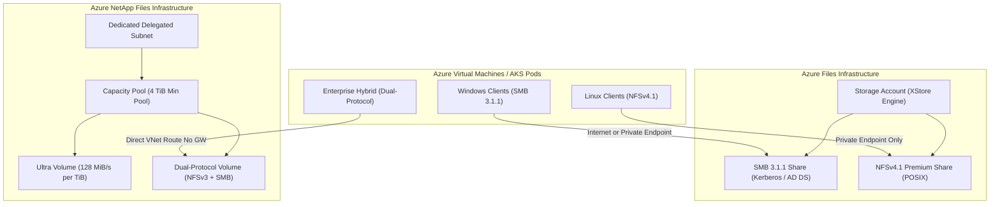

# Azure Files & Azure NetApp Files Architecture 📂⚡

Azure provides two primary managed enterprise file storage services: **Azure Files** (cloud-native shared storage on standard Azure storage hardware) and **Azure NetApp Files (ANF)** (bare-metal NetApp ONTAP hardware integrated directly into Microsoft datacenters).

---

## Architecture & Mental Model

### 1. Underlying Subsystem Comparison

Understanding the physical architecture is essential for selecting between Azure Files and ANF:

```
┌────────────────────────────────────────────────────────┐
│            Azure Files (Cloud-Native Multi-Tenant)     │
│   - Built on Azure Storage Cluster Fabric (XStore)     │
│   - Shared infrastructure with Azure Blob Storage      │
│   - Standard (HDD) & Premium (SSD)                     │
│   - SMB 3.1.1 & NFSv4.1                                │
│   - Latency: Single-digit milliseconds (3–8 ms)        │
└────────────────────────────────────────────────────────┘

┌────────────────────────────────────────────────────────┐
│         Azure NetApp Files (Bare-Metal Enterprise NAS) │
│   - Dedicated NetApp AFF/ONTAP controllers in Azure DC │
│   - Direct injection into customer VNet (Delegated)    │
│   - Standard, Premium, Ultra service levels            │
│   - SMB 3.x, NFSv3, NFSv4.1, Dual-Protocol Access      │
│   - Latency: Sub-millisecond (< 1 ms consistently)     │
└────────────────────────────────────────────────────────┘
```



### 2. Architectural Decision Matrix

| Dimension            | **Azure Files (Standard)**                | **Azure Files (Premium)**                | **Azure NetApp Files (ANF)**                        |
| :------------------- | :---------------------------------------- | :--------------------------------------- | :-------------------------------------------------- |
| **Primary Protocol** | SMB 3.1.1                                 | SMB 3.1.1 / NFSv4.1                      | NFSv3, NFSv4.1, SMB 3.x, **Dual-Protocol**          |
| **Max Capacity**     | 100 TiB (Large File Shares)               | 100 TiB                                  | 100 TiB per volume (540 TiB pools)                  |
| **Max Throughput**   | Up to 300 MB/s                            | Up to 10,340 MB/s                        | Multi-GB/s (Ultra tier bare-metal speed)            |
| **Max IOPS**         | Up to 20,000 IOPS                         | Up to 100,000 IOPS (v2 model)            | 400,000+ IOPS (pool dependent)                      |
| **Latency**          | 10–20 ms                                  | 2–5 ms                                   | **< 1 ms (Sub-millisecond)**                        |
| **VNet Integration** | Public IP or Private Endpoint             | Private Endpoint required for NFS        | **Dedicated Delegated Subnet** (VNet native)        |
| **Best Fit**         | General file shares, backups, web content | AKS persistent volumes, FSLogix profiles | SAP HANA, Oracle, EDA, HPC, extreme low-latency NAS |

---

## Core Concepts & Operations

### 1. Azure Files Provisioning Models (v1 vs. v2)

Azure Files Premium supports two billing and performance allocation models:

1. **Provisioned v1**: IOPS and throughput scale linearly and inflexibly with provisioned disk gigabytes (1 baseline IOPS per GiB + burst).
2. **Provisioned v2**: Capacity, IOPS, and throughput are **independently decoupled**. Workloads needing 50,000 IOPS on only 1 TiB of storage no longer require overprovisioning 50 TiB of unused disk space.

### 2. Azure NetApp Files Capacity Pools & Service Levels

ANF uses a hierarchical structure: `NetApp Account` $\rightarrow$ `Capacity Pool` $\rightarrow$ `Volume`.
Pool throughput scales proportionally per allocated terabyte:

- **Standard**: 16 MiB/s per 1 TiB provisioned.
- **Premium**: 64 MiB/s per 1 TiB provisioned.
- **Ultra**: 128 MiB/s per 1 TiB provisioned.

---

## Production `az` CLI Commands

### 1. Azure Files Premium Provisioning

```bash
# 1. Create a FileStorage (Premium SSD) storage account
az storage account create \
  --name stfilespremiumprod \
  --resource-group rg-storage-prod \
  --location eastus \
  --sku Premium_LRS \
  --kind FileStorage \
  --enable-large-file-share

# 2. Create an enterprise SMB share with 2,048 GiB quota
az storage share-rm create \
  --storage-account stfilespremiumprod \
  --name share-fslogix-profiles \
  --quota 2048 \
  --enabled-protocols SMB

# 3. Enable Active Directory Domain Services (AD DS) authentication
az storage account update \
  --name stfilespremiumprod \
  --resource-group rg-storage-prod \
  --enable-files-aadds true
```

### 2. Azure NetApp Files Provisioning

```bash
# 1. Create NetApp Account
az netappfiles account create \
  --resource-group rg-storage-prod \
  --location eastus \
  --account-name anf-account-prod

# 2. Create an Ultra tier capacity pool (Minimum size 4 TiB)
az netappfiles pool create \
  --resource-group rg-storage-prod \
  --account-name anf-account-prod \
  --pool-name pool-sap-ultra \
  --location eastus \
  --service-level Ultra \
  --size 4

# 3. Create a high-performance NFSv4.1 volume in delegated subnet
az netappfiles volume create \
  --resource-group rg-storage-prod \
  --account-name anf-account-prod \
  --pool-name pool-sap-ultra \
  --name vol-sap-data \
  --location eastus \
  --service-level Ultra \
  --vnet /subscriptions/{subId}/resourceGroups/rg-network-prod/providers/Microsoft.Network/virtualNetworks/vnet-eastus-prod \
  --subnet snet-anf-delegated \
  --usage-threshold 1024 \
  --file-path sapdata01 \
  --protocol-types NFSv4.1
```

---

## Quotas & Limits

| Constraint                        | Azure Files Limit             | Azure NetApp Files Limit                                    |
| :-------------------------------- | :---------------------------- | :---------------------------------------------------------- |
| **Max Capacity per Share/Volume** | **100 TiB** (102,400 GiB)     | **100 TiB** (Large Volume: up to 1 PiB preview)             |
| **Minimum Provisioned Size**      | 100 GiB (Premium)             | **4 TiB** (Minimum Capacity Pool size)                      |
| **Max IOPS per Share/Volume**     | **100,000 IOPS**              | **450,000+ IOPS**                                           |
| **Max Throughput**                | Up to **10,340 MB/s**         | Up to **4,500 MB/s** per volume                             |
| **Snapshots per Volume**          | 200 share snapshots           | **255** directory/volume snapshots                          |
| **Network Injection**             | Private Endpoint / Shared NIC | **Mandatory Delegated Subnet** (`Microsoft.NetApp/volumes`) |

---

## References & Documentation

- [Azure Files Documentation](https://learn.microsoft.com/en-us/azure/storage/files/)
- [Azure NetApp Files Documentation](https://learn.microsoft.com/en-us/azure/azure-netapp-files/)
- [Understand Azure Files Performance (Provisioned v1 vs v2)](https://learn.microsoft.com/en-us/azure/storage/files/understanding-billing)
- [Performance Benchmarks for Azure NetApp Files](https://learn.microsoft.com/en-us/azure/azure-netapp-files/azure-netapp-files-performance-benchmarks)
- [Compare Azure Files and Azure NetApp Files](https://learn.microsoft.com/en-us/azure/storage/common/storage-file-comparison)

---

## Realistic Pricing Scenarios

### Scenario A: Enterprise Windows Virtual Desktop (FSLogix on Azure Files Premium)

- **Workload**: 1,000 concurrent VDI users storing FSLogix user profile containers on Azure Files Premium.
- **Provisioning**: 5 TiB (5,120 GiB) Premium Provisioned v1, Zone-Redundant Storage (ZRS).
- **Storage Cost**:
  - 5,120 GiB × $0.24/GiB/month (ZRS Premium) = **$1,228.80/month**.
  - Includes baseline 5,120 IOPS + bursting up to 100,000 IOPS during morning login storms.
- **Metadata / Backup**: Azure Backup for Files retention: ~$150.00/month.
- **Total Monthly Cost**: **~$1,378.80/month** (~$1.38/user/month for enterprise VDI profiles).

### Scenario B: Mission-Critical SAP HANA Database (Azure NetApp Files Ultra)

- **Workload**: Enterprise SAP HANA database requiring sub-millisecond I/O write latencies and 512 MB/s guaranteed write throughput.
- **Provisioning**: 4 TiB Capacity Pool in Ultra Tier ($0.3807/GiB/month).
- **Throughput Calculation**: 4 TiB × 128 MiB/s/TiB = 512 MiB/s aggregate pool throughput.
- **Pool Cost**: 4,096 GiB × $0.3807/GiB = **$1,559.35/month**.
- **Snapshots**: 1 TiB space-efficient pointer-based snapshots = ~$380.00/month.
- **Total Monthly Cost**: **~$1,939.35/month** (Enterprise bare-metal performance with zero infrastructure management).

---

## Battle-Tested Nuggets & Gotchas

1. **Port 445 ISP Blockade on SMB**: Many residential, commercial, and mobile ISPs block outbound TCP port 445 due to historical SMB vulnerabilities (WannaCry). When users attempt to mount an Azure Files SMB share directly over the public internet, mounts hang indefinitely. **Solution**: Use Azure VPN Gateway, ExpressRoute, Private Endpoints, or deploy **SMB over QUIC** (UDP port 443) using Windows Server 2022+ Azure Edition.
2. **NFSv4.1 Requires Private Endpoints in Azure Files**: Unlike SMB shares which can expose public endpoints secured by Kerberos/Entra, Azure Files NFSv4.1 shares **cannot** be mounted over the public internet or standard firewall IP rules. They strictly require a Private Endpoint within your VNet and disable storage account public access.
3. **The ANF 4 TiB Minimum Pool Tax**: You cannot buy 200 GB of Azure NetApp Files. The absolute minimum capacity pool size is **4 TiB**, which means the baseline monthly spend for an ANF deployment starts at ~$600 to ~$1,500/month regardless of actual data volume. Do not deploy ANF for small non-critical utility shares.
4. **Delegated Subnet Exclusivity for ANF**: Azure NetApp Files requires a dedicated subnet delegated exclusively to `Microsoft.NetApp/volumes`. You **cannot** place virtual machines, load balancers, application gateways, or private endpoints inside an ANF delegated subnet.
5. **Dual-Protocol UID/GID Synchronization**: In ANF Dual-Protocol (NFS + SMB) volumes, Windows Active Directory users must map accurately to Linux POSIX attributes (UID and GID). If Active Directory does not have UNIX attributes configured or if LDAP synchronization fails, Linux clients will see file ownership as `nobody:nogroup`, causing unexpected permission denied errors.
6. **Instant Snapshot Reverts in ANF**: Because ANF utilizes NetApp WAFL (Write Anywhere File Layout), taking a snapshot or reverting a 50 TB SAP database volume to a snapshot takes less than 2 seconds without data duplication. In contrast, restoring a 50 TB Azure Files share requires block-level file copy operations that can take hours.
