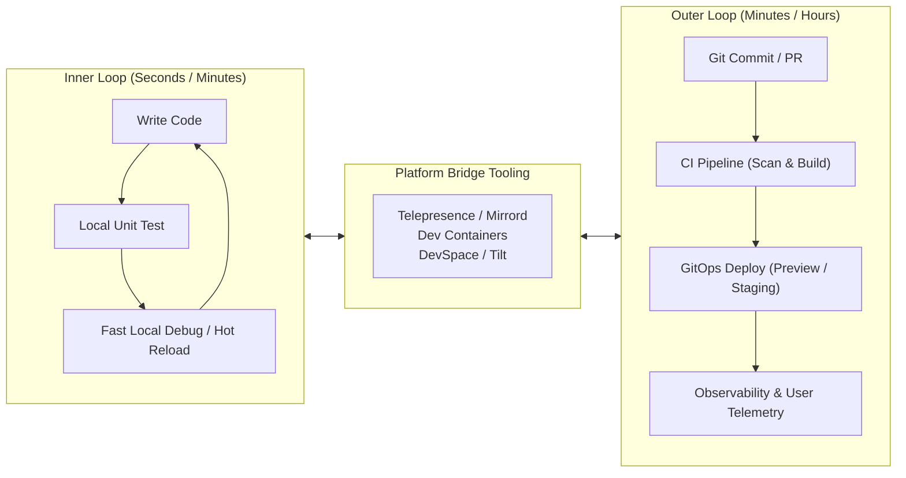

# Developer Experience (DevEx) & Inner-Loop Engineering 💻

In cloud-native architectures, engineering friction rarely stems from writing application logic. It stems from the tools, environments, and feedback loops surrounding the code.

When microservices depend on distributed databases, message queues, cloud IAM, and service meshes, running the entire stack locally on a developer workstation becomes impossible. If developers must commit code to Git, wait 15 minutes for a CI build, and deploy to a remote staging cluster just to test a single line of code, **developer velocity collapses**.

**Developer Experience (DevEx) engineering** focuses on optimizing the friction points across the developer lifecycle, specifically accelerating the **inner loop** and quantitatively measuring productivity without reducing developers to crude ticket velocity metrics.



---

## 1. Inner Loop vs Outer Loop

| Stage          | Scope                                       | Cycle Time Goal           | Key Activities                                                                                                      |
| :------------- | :------------------------------------------ | :------------------------ | :------------------------------------------------------------------------------------------------------------------ |
| **Inner Loop** | Developer workstation & local IDE           | **Seconds to < 1 minute** | Writing code, running unit tests, local compilation, step-through debugging, hot reloading.                         |
| **Outer Loop** | Central Git, CI/CD, and remote environments | **Minutes to < 1 hour**   | Code reviews, integration tests, container security scanning, artifact signing, GitOps deployment, canary rollouts. |

The primary mission of platform engineering in the inner loop is: **enable developers to test changes against real cloud dependencies without waiting for the outer loop.**

---

## 2. Remote Cluster Interception & Development Tools

Rather than forcing developers to run Minikube with 30 mock microservices on their laptops (which exhausts CPU and RAM), modern platforms use **traffic interception and bridging tools**:

### 1. `mirrord` (eBPF / Traffic Mirroring)

[mirrord](https://mirrord.dev/) runs a local process inside the context of a remote Kubernetes pod:

- Hooks into system calls using a local library and injects an eBPF/proxy agent into the target Kubernetes pod.
- **Traffic Stealing or Mirroring:** Allows developers to duplicate production or staging HTTP requests down to their local debugger without interrupting other traffic.
- **Remote Context:** File operations, environment variables, and DNS queries resolve as if the process were running inside the Kubernetes cluster.

```bash
# Debug a local Go service using the remote staging cluster context
mirrord exec --target pod/payment-api-7b89-xq2 -- go run main.go
```

### 2. Telepresence

[Telepresence](https://www.telepresence.io/) (CNCF Incubating) swaps a remote container in a Kubernetes pod with a two-way proxy:

- Routes traffic intended for the remote service to the developer's workstation.
- Allows the local process to access cluster-internal DNS names (e.g., `http://orders-db.payments.svc.cluster.local`) directly.
- Supports **personal intercept headers** (e.g., `x-developer: alice`) so only Alice's test requests route to her local machine, while all other team traffic continues to the existing pod.

### 3. Local-to-Remote Live Sync: DevSpace & Tilt

For workflows where code must run inside containers (e.g., compiled Go or Rust microservices):

- Tools like [DevSpace](https://www.devspace.sh/) and [Tilt](https://tilt.dev/) watch local source files.
- Instead of rebuilding a complete Docker image and pushing to a registry, they sync modified source files directly into the active remote container and trigger in-pod hot-reloading in seconds.

### 4. Standardized Toolchains: Dev Containers (`devcontainer.json`)

To eliminate the _"works on my machine"_ dilemma during onboarding, platform teams provide standardized development environments using the [Development Containers specification](https://containers.dev/):

```json
// .devcontainer/devcontainer.json
{
  "name": "Platform Go Microservice",
  "image": "mcr.microsoft.com/devcontainers/go:1.22",
  "features": {
    "ghcr.io/devcontainers/features/docker-in-docker:2": {},
    "ghcr.io/devcontainers/features/kubectl-helm-minikube:1": {}
  },
  "customizations": {
    "vscode": {
      "extensions": [
        "golang.go",
        "redhat.vscode-yaml",
        "ms-kubernetes-tools.vscode-kubernetes-tools"
      ]
    }
  }
}
```

A newly hired engineer clones the repository, opens it in VS Code or GitHub Codespaces, and immediately possesses the exact compiler, linters, CLI tools, and debugger configurations without manually configuring their host laptop.

---

## 3. Measuring DevEx Beyond DORA

While [[DevOps/ci-cd/dora-metrics|DORA metrics]] evaluate organizational delivery throughput (Deployment Frequency, Lead Time, MTTR, Change Failure Rate), they ignore developer cognitive load and day-to-day friction. Modern platform teams pair DORA with the **SPACE** and **DevEx** frameworks.

### The SPACE Framework (GitHub & Microsoft Research)

The SPACE framework evaluates productivity across five balanced dimensions:

```
┌────────────────────────────────────────────────────────┐
│                        S.P.A.C.E                       │
├────────────────────────────────────────────────────────┤
│ S - Satisfaction & Well-Being (Burnout, tool happiness)│
│ P - Performance (Outcome quality, customer impact)     │
│ A - Activity (PR volume, commits - NEVER used in silo!)│
│ C - Communication & Collaboration (PR review speed)    │
│ E - Efficiency & Flow (Uninterrupted focus time)       │
└────────────────────────────────────────────────────────┘
```

_Crucial Rule:_ Never measure **Activity** (such as number of commits or lines of code) in isolation. It incentivizes gaming and correlates poorly with real value.

### The DevEx Framework (Nygren, Greiler, Storey)

The DevEx framework isolates three universal dimensions of developer experience:

| Core Dimension             | What It Measures                                 | Platform Team Intervention                                                                                                                                   |
| :------------------------- | :----------------------------------------------- | :----------------------------------------------------------------------------------------------------------------------------------------------------------- |
| **1. Fast Feedback Loops** | Time required to verify if a code change worked. | Fast CI pipelines, inner-loop interception (mirrord), instant unit tests.                                                                                    |
| **2. Low Cognitive Load**  | Mental effort required to complete a task.       | [[DevOps/platform-engineering/golden-paths\|Golden Paths]], [[DevOps/platform-engineering/workload-specifications\|workload specs]], standardized templates. |
| **3. Flow State**          | Unbroken periods of deep, creative focus.        | Reducing build breaks, flaky tests, and meeting fragmentation.                                                                                               |

---

## 4. Operationalizing DevEx: Friction Logs & Developer NPS

To prioritize platform engineering backlogs, high-performing teams implement continuous feedback loops:

1. **Developer Friction Logs:** Platform engineers periodically shadow product developers during common journeys (e.g., creating a new service, onboarding a new hire, debugging an incident) and log every moment of confusion, waiting, or manual toil.
2. **Developer Net Promoter Score (Dev-NPS):** Short quarterly surveys asking:
   - _"How satisfied are you with our internal deployment tools and golden paths?"_
   - _"What tool or process wastes the most of your time each week?"_
3. **Time to First Commit / PR:** Measuring the exact calendar days from a new engineer joining the organization to their first production deployment without assistance. High-performing platforms reduce this from weeks to under 48 hours.

---

## Related Notes & Deep Dives

- 🛣️ **[[DevOps/platform-engineering/golden-paths|Golden Paths]]** — Designing paved paths to minimize cognitive load
- ⚖️ **[[DevOps/platform-engineering/platform-vs-devops-vs-sre|Platform Engineering vs DevOps vs SRE]]** — Team topologies and cognitive load reduction
- ⏱️ **[[DevOps/platform-engineering/ephemeral-environments|Ephemeral Environments & EaaS]]** — Disposable preview environments for faster feedback
- 📊 **[[DevOps/ci-cd/dora-metrics|DORA Metrics]]** — Measuring delivery velocity and stability
