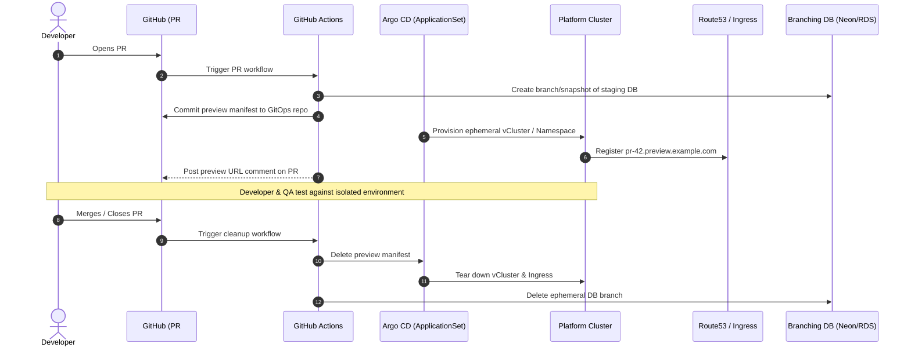
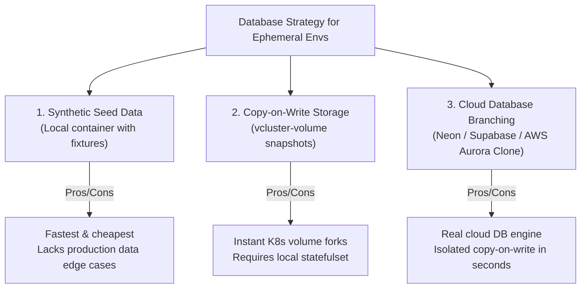

# Ephemeral Environments & Environment-as-a-Service (EaaS) ⏱️

In traditional cloud operations, non-production environments are permanent, static, and shared (e.g., `dev`, `qa`, `staging`). Shared environments inevitably degrade: teams overwrite each other's configurations, test data becomes corrupt, integration queues form before releases, and idle cloud resources burn capital 24/7.

**Environment-as-a-Service (EaaS)** solves this by treating entire application runtime topologies as ephemeral, disposable software artifacts. An isolated preview environment is automatically spun up on demand for every pull request, validated with automated end-to-end tests, shared with stakeholders for review, and destroyed automatically when the PR merges or times out.



---

## 1. Tenancy Models: Namespaces vs Virtual Clusters

Platform teams generally implement ephemeral environments using one of two Kubernetes tenancy models:

| Dimension             | Namespace-Based Tenancy                              | Virtual Cluster (`vCluster`)                                   |
| :-------------------- | :--------------------------------------------------- | :------------------------------------------------------------- |
| **Isolation Level**   | Soft multi-tenancy (NetworkPolicies, ResourceQuotas) | Hard multi-tenancy (separate API server & control plane)       |
| **Control Plane**     | Shared host API server                               | Dedicated virtual `k3s`/`k8s` API server running in a host pod |
| **CRD Support**       | Shared cluster CRDs; conflicts if PR modifies a CRD  | Fully isolated; each vCluster can install custom CRDs          |
| **RBAC Isolation**    | Tenant gets scoped namespace role                    | Tenant can be granted `cluster-admin` inside their vCluster    |
| **Startup Latency**   | Very fast (1–5 seconds)                              | Fast (15–45 seconds)                                           |
| **Resource Overhead** | Near-zero (Kubernetes metadata only)                 | ~1 pod (~100MB RAM, 0.1 CPU for control plane)                 |
| **Best Used For**     | Standard stateless microservices, web apps           | Multi-tenant Helm charts, operator testing, CRD changes        |

### Model A: Namespaces with Hierarchical Namespace Controller (HNC)

For simple web services, a dedicated namespace per PR is sufficient:

```yaml
apiVersion: v1
kind: Namespace
metadata:
  name: preview-pr-42
  labels:
    environment: preview
    pr-number: "42"
    ttl: "48h"
---
apiVersion: networking.k8s.io/v1
kind: NetworkPolicy
metadata:
  name: isolate-preview
  namespace: preview-pr-42
spec:
  podSelector: {}
  policyTypes: [Ingress]
  ingress:
    - from:
        - namespaceSelector:
            matchLabels:
              kubernetes.io/metadata.name: ingress-nginx
```

### Model B: Virtual Clusters with `vCluster`

When teams test complex applications that require custom operators, Helm releases with cluster-scoped resources, or elevated privileges, [vCluster](https://www.vcluster.com/) runs an isolated control plane inside a namespace on the underlying host cluster:

```yaml
# vcluster.yaml configuration
apiVersion: v1
kind: Namespace
metadata:
  name: vcluster-pr-42
---
# Installed via Helm or vcluster CLI
# vcluster create pr-42 -n vcluster-pr-42 -f vcluster.yaml
sync:
  nodes:
    enabled: true
    syncAllNodes: false # Only sync mock nodes to save resources
  ingresses:
    enabled: true
  services:
    enabled: true
isolation:
  enabled: true
  podSecurityStandard: baseline
```

Workloads inside the virtual cluster are synchronized to the underlying host cluster's worker nodes by the vCluster syncer, sharing physical compute while maintaining logical API separation.

---

## 2. Dynamic GitOps Orchestration via Argo CD ApplicationSets

Manual deployment of preview environments defeats their purpose. The standard architecture uses an [[Kubernetes/guides/delivery/gitops/argo-cd/README|Argo CD]] **ApplicationSet** configured with a **Pull Request Generator** targeting GitHub or GitLab:

```yaml
apiVersion: argoproj.io/v1alpha1
kind: ApplicationSet
metadata:
  name: preview-environments
  namespace: argocd
spec:
  generators:
    - pullRequest:
        github:
          owner: example-org
          repo: core-application
          labels: [preview] # Only open PRs labeled "preview"
        requeueAfterSeconds: 60
  template:
    metadata:
      name: "preview-pr-{{number}}"
    spec:
      project: default
      source:
        repoURL: https://github.com/example-org/core-application.git
        targetRevision: "{{head_sha}}"
        path: deploy/kustomize/overlays/preview
        kustomize:
          namePrefix: "pr-{{number}}-"
          commonLabels:
            preview-pr: "{{number}}"
      destination:
        server: https://kubernetes.default.svc
        namespace: "preview-pr-{{number}}"
      syncPolicy:
        automated:
          prune: true
          selfHeal: true
        syncOptions:
          - CreateNamespace=true
```

When a developer attaches the label `preview` to PR #42, Argo CD automatically detects the branch, creates the `preview-pr-42` namespace, and deploys the application.

---

## 3. Data Isolation and Database Branching

Deploying stateless containers into ephemeral environments is straightforward; handling stateful databases is the primary engineering challenge. Three strategies exist:



### Modern Database Branching

Modern cloud-native platforms integrate database branching APIs:

1. **Serverless Postgres Branching (Neon / Supabase):** The CI pipeline issues an API call creating a point-in-time copy-on-write branch from the staging database in ~1.5 seconds. The ephemeral branch shares base pages with the parent, consuming zero storage until changes are written.
2. **AWS Aurora Database Cloning:** Uses copy-on-write storage cloning to spin up a fully isolated Aurora PostgreSQL cluster in 2–3 minutes without replicating underlying storage volumes.
3. **Anonymized Seed Data:** For compliance (SOC2/GDPR), staging and ephemeral databases must use automated masking pipelines (e.g., using tools like Neosync or PostgreSQL anonymizer) to strip PII before developer access.

---

## 4. Automated Cleanup & TTL Strategies

Unmanaged preview environments cause rapid infrastructure cost inflation. Platforms enforce strict lifecycle controls:

```yaml
# Kubernetes CronJob running hourly to prune expired preview namespaces
apiVersion: batch/v1
kind: CronJob
metadata:
  name: preview-ttl-pruner
  namespace: platform-system
spec:
  schedule: "0 * * * *"
  jobTemplate:
    spec:
      template:
        spec:
          serviceAccountName: preview-pruner-sa
          restartPolicy: OnFailure
          containers:
            - name: pruner
              image: bitnami/kubectl:latest
              command:
                - /bin/bash
                - -c
                - |
                  # Delete any preview namespace older than 48 hours or where PR is closed
                  for ns in $(kubectl get ns -l environment=preview -o jsonpath='{.items[*].metadata.name}'); do
                    CREATED=$(kubectl get ns $ns -o jsonpath='{.metadata.creationTimestamp}')
                    AGE=$(( ($(date +%s) - $(date -d "$CREATED" +%s)) / 3600 ))
                    if [ $AGE -gt 48 ]; then
                      echo "Pruning expired preview namespace: $ns (Age: ${AGE}h)"
                      kubectl delete ns $ns
                    fi
                  done
```

### Nightly Non-Production Downscaling

To eliminate idle waste, non-production nodes and preview pods are scaled to zero outside working hours (e.g., 8:00 PM to 7:00 AM) using tools like `kube-downscaler` or custom KEDA schedule triggers.

---

## Related Notes & Deep Dives

- 🏗️ **[[DevOps/platform-engineering/internal-developer-platforms|Internal Developer Platforms]]** — Architectural planes and self-service capabilities
- 🛣️ **[[DevOps/platform-engineering/golden-paths|Golden Paths]]** — Embedding preview environment workflows into service templates
- ☸️ **[[Kubernetes/guides/delivery/gitops/argo-cd/README|Argo CD & GitOps]]** — ApplicationSet controllers and multi-tenant delivery
- 💰 **[[DevOps/platform-engineering/finops-and-cost-allocation|FinOps & Cost Allocation for Platforms]]** — Managing ephemeral environment budgets
