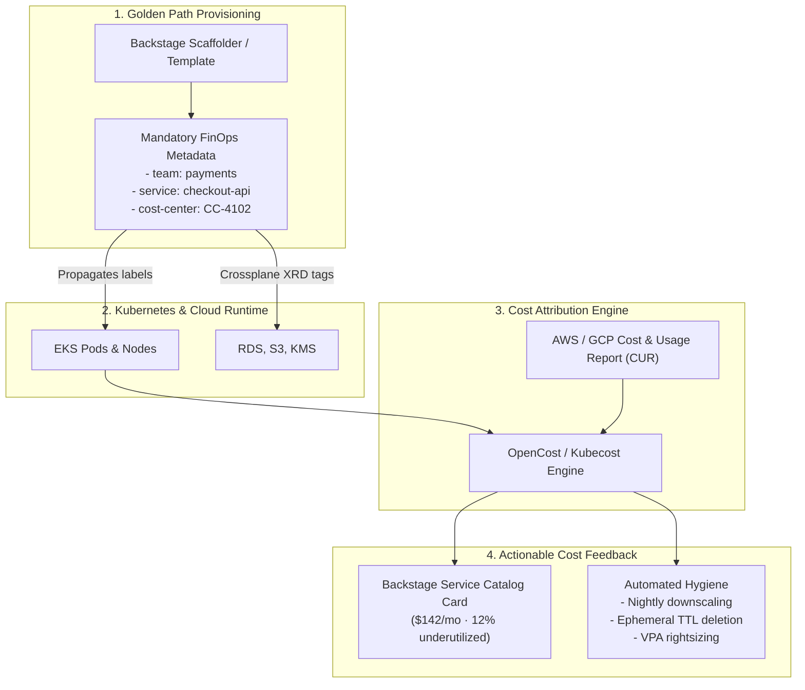

# FinOps & Cost Allocation for Platforms 💰

The central promise of platform engineering is developer self-service: eliminating ticket gates so teams can provision compute, storage, and databases on demand.

However, self-service introduces the **Platform FinOps Paradox**: when engineers can provision cloud infrastructure with zero operational friction, unmonitored resource consumption can lead to rapid cloud budget overruns. Developers deploy Multi-AZ databases for small test spikes, allocate excessive CPU requests "just to be safe," and leave orphaned preview environments running indefinitely.

Platform FinOps embeds financial accountability, cost visibility, and automated resource hygiene directly into the platform's paved paths ([[DevOps/platform-engineering/golden-paths|Golden Paths]]).



---

## 1. Multi-Tenant Kubernetes Cost Attribution

Attributing cloud costs in a shared Kubernetes cluster is notoriously challenging because the AWS/GCP cloud bill only shows the total cost of virtual machine worker nodes (EC2 instances) and block storage, not the granular containers running on top of them.

### The Allocation Problem

A cluster node costs $300/month. How do you divide that bill among five teams running pods on that node?

```
┌────────────────────────────────────────────────────────┐
│               Worker Node ($300 / month)               │
├────────────────────┬────────────────────┬──────────────┤
│ Team A (Pod 1 & 2) │ Team B (Pod 3)     │ Idle / Waste │
│ 40% CPU Request    │ 25% CPU Request    │ 35% Capacity │
└────────────────────┴────────────────────┴──────────────┘
```

Platform teams resolve this using **[OpenCost](https://www.opencost.io/)** (a CNCF Sandbox project and the open-source core of Kubecost):

1. **Request-Based vs Usage-Based Allocation:** Cloud bills are determined by capacity reserved, not actual CPU consumed. Therefore, pods are billed based on `resources.requests`, incentivizing developers to avoid inflated CPU/memory reservations.
2. **Idle Capacity Distribution:** The 35% unallocated capacity on worker nodes is either allocated proportionally across all tenant namespaces or attributed to a shared "Platform Overhead" budget.
3. **Network Egress & Storage Allocation:** OpenCost tracks inter-zone egress and persistent volume claims (PVCs), attributing data transfer fees directly to the initiating pod.

---

## 2. Automated Label & Tag Governance via Golden Paths

Accurate cost allocation depends entirely on consistent metadata. Attempting to enforce tagging manually or via post-incident audits fails at scale.

Platform engineering embeds cost tagging into the **Resource Orchestration Plane**:

### 1. In-Cluster Kubernetes Labels

The service template automatically injects immutable labels into every generated Kubernetes Deployment:

```yaml
apiVersion: apps/v1
kind: Deployment
metadata:
  name: checkout-api
  namespace: payments
  labels:
    app.kubernetes.io/name: checkout-api
    platform.example.com/team: payments
    platform.example.com/cost-center: "4102"
    platform.example.com/environment: production
```

### 2. Cloud Tag Inheritance via Crossplane

When a developer requests a cloud resource (e.g., an RDS database or S3 bucket) using a Crossplane Composite Resource (XRD), the platform's Composition automatically inherits the caller's namespace metadata and propagates it to the cloud provider:

```yaml
# Inside the Crossplane Composition
apiVersion: rds.aws.m.upbound.io/v1beta1
kind: Instance
metadata:
  name: {{ $name }}-instance
spec:
  forProvider:
    tags:
      Team: {{ $xr.metadata.labels.team }}
      CostCenter: {{ $xr.metadata.labels.costCenter }}
      Service: {{ $xr.metadata.name }}
      ManagedBy: crossplane
```

This guarantees that every dollar spent in the AWS Cost and Usage Report (CUR) maps 1:1 to an identified engineering team and service owner in [[DevOps/platform-engineering/backstage|Backstage]].

---

## 3. Showback vs Chargeback

| Model          | How It Works                                                                                                            | Organizational Fit                                                       | Pros & Cons                                                                                                                       |
| :------------- | :---------------------------------------------------------------------------------------------------------------------- | :----------------------------------------------------------------------- | :-------------------------------------------------------------------------------------------------------------------------------- |
| **Showback**   | Teams receive reports and dashboards showing what their services cost, but no real money transfers between departments. | Most engineering organizations; early to intermediate platform maturity. | **Pros:** Cultivates cost awareness without billing politics.<br/>**Cons:** Can be ignored if leadership does not review metrics. |
| **Chargeback** | The cloud bill is cross-charged directly against each department's real financial P&L ledger each month.                | Large enterprises, heavily financial or regulated organizations.         | **Pros:** Direct financial accountability.<br/>**Cons:** High administrative friction, disputes over shared cluster overhead.     |

### Bringing Cost to the Developer

Cost data must be visible where engineers actually make architectural decisions:

1. **Backstage Service Catalog:** Display monthly run-rate directly on the service's catalog card alongside deployment status and error budgets.
2. **Pull Request Cost Estimates:** Integrate tools like [Infracost](https://www.infracost.io/) into the CI pipeline to comment on pull requests when an engineer increases container requests or modifies a database tier:
   > 💰 **Infracost estimate:** Monthly infrastructure cost will increase by **+USD 48.50/mo** (db.t4g.medium → db.r7g.large).

---

## 4. Automated Resource Hygiene & Rightsizing

Platform teams achieve the largest cost savings through automated background hygiene:

### 1. Nightly Non-Production Downscaling

Development and preview clusters sit idle for ~128 hours out of a 168-hour week (nights and weekends). Platform teams install controllers such as `kube-downscaler` to automatically scale down non-production deployments to zero:

```yaml
# Downscaling non-prod workloads between 7 PM and 7 AM and all weekend
apiVersion: apps/v1
kind: Deployment
metadata:
  name: staging-payment-api
  annotations:
    downscaler/uptime: "Mon-Fri 07:00-19:00 Europe/London"
```

_Financial Impact:_ Reduces non-production compute costs by **~65%** without affecting business hours development.

### 2. Ephemeral Environment TTLs

Automated [[DevOps/platform-engineering/ephemeral-environments|ephemeral environments]] must have a strict, non-negotiable Time-To-Live (TTL). PR preview namespaces that are not actively used are automatically destroyed after 48 hours.

### 3. Container Rightsizing with Vertical Pod Autoscaler (VPA)

Developers frequently over-provision CPU and memory requests by 300–500% to avoid OOMKills. Platform teams deploy VPA in recommendation mode (or tools like Fairwinds Goldilocks) to continuously analyze actual 99th percentile resource consumption and suggest optimized requests to service owners.

---

## Related Notes & Deep Dives

- 🏗️ **[[DevOps/platform-engineering/internal-developer-platforms|Internal Developer Platforms]]** — Reference architecture and capabilities
- 🛣️ **[[DevOps/platform-engineering/golden-paths|Golden Paths]]** — Enforcing FinOps metadata standards by default
- ⏱️ **[[DevOps/platform-engineering/ephemeral-environments|Ephemeral Environments & EaaS]]** — Lifecycle cleanup and preview environments
- ☸️ **[[DevOps/platform-engineering/crossplane|Crossplane for Platform APIs]]** — Automated tag propagation to cloud infrastructure
