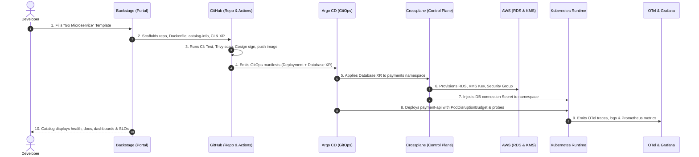

# Golden Paths

A golden path is the **supported, opinionated, well-lit way** to accomplish a common task in your organisation: creating a service, adding a database, shipping to production. It bundles the organisation's best current answer — the tools, the configuration, the security controls, the documentation — so that a team following it gets a production-ready result without having to make or even understand every decision.

The term comes from Spotify; Netflix calls the same thing a **paved road**. It is the core product of an [[DevOps/platform-engineering/internal-developer-platforms|internal developer platform]].

## The idea

Without golden paths, every team answers the same questions independently: which CI system, how to structure the Dockerfile, how to configure health checks, how to get credentials, how to expose metrics. The answers differ, some are wrong, and each takes days. The organisation ends up with as many ways to deploy a service as it has teams, and nobody can move between them.

A golden path makes the right thing the easy thing:

> Following the path should be faster and less effort than doing anything else.

That sentence is the design constraint. If the path is slower or more awkward than a team's own approach, they will rationally avoid it.

## Paved, not fenced

A golden path is a **recommendation with strong support**, not a mandate.

|                         | Golden path               | Off the path                                             |
| :---------------------- | :------------------------ | :------------------------------------------------------- |
| Allowed?                | Yes, and encouraged       | Yes                                                      |
| Who supports it         | The platform team         | The team that chose it                                   |
| Security and compliance | Built in and pre-approved | The team must demonstrate it meets the same requirements |
| Upgrades                | Largely automated         | The team's responsibility                                |

Teams with unusual needs — a machine-learning workload, a latency-critical service, an acquired codebase — may leave the path. They take on the work the path would have done for them. That trade keeps the platform honest: if many teams leave, the path is not good enough, and that is worth knowing. A mandate hides the signal.

What **is** mandatory are the outcomes: security baselines, compliance controls, cost tagging. The path is simply the cheapest way to meet them.

## What a golden path contains

A path is more than a template. For "a new HTTP service in production" it would include:

| Element                  | Example                                                                                                                                |
| :----------------------- | :------------------------------------------------------------------------------------------------------------------------------------- |
| **Scaffolding**          | A template that creates the repository with a working skeleton service                                                                 |
| **Build**                | A minimal, secure Dockerfile — [[Containers/dockerfile-best-practices\|Dockerfile best practices]]                                     |
| **Pipeline**             | A reusable workflow: test, scan, build, sign, deploy — [[DevOps/ci-cd/pipeline-design\|pipeline design]]                               |
| **Deployment**           | A manifest or a high-level workload resource; GitOps wiring                                                                            |
| **Runtime defaults**     | Resource requests, probes, autoscaling, disruption budgets, security context                                                           |
| **Identity and secrets** | A workload identity and a way to request secrets, with no static credentials                                                           |
| **Observability**        | Standard metrics, structured logs, tracing, a starter dashboard and alerts — [[Observability/prometheus/instrumenting\|instrumenting]] |
| **Catalogue entry**      | Ownership, links to docs and runbooks                                                                                                  |
| **Documentation**        | A tutorial that works on the first try, and an explanation of _why_ each choice was made                                               |
| **Support**              | A channel, an owner and a published support level                                                                                      |

The test of completeness: an engineer can take a new service from concept to verified production deployment, wired to monitoring, identity, and runbooks, entirely via self-service without filing tickets or awaiting manual approvals. Completeness is evaluated by comparing delivery velocity, error rates, and support ticket volume against the organization's prior baseline (e.g., transforming weeks of manual ops handoffs into an automated self-service pipeline), validated through developer sentiment surveys and frictionless onboarding.

## A Worked Golden Path: The End-to-End Developer Journey

To see how the platform planes connect in practice, follow a single real-world request: an engineer on the payments team shipping `payment-api`, a Go service requiring an encrypted PostgreSQL database, automated CI/CD, and production observability.



### Phase 1: Self-Service Scaffolding (Developer Interface Plane)

1. The developer navigates to [[DevOps/platform-engineering/backstage|Backstage]] and selects the **Go Web Service** template.
2. The form asks for essential intent:
   - Service Name: `payment-api`
   - Owning Group: `group:payments`
   - Database: `PostgreSQL` (Tier: `production`, Size: `small`)
3. The Backstage Scaffolder executes its pipeline:
   - Generates a new GitHub repository (`github.com/example/payment-api`).
   - Injects standard skeleton code with an embedded health check endpoint (`/healthz`).
   - Adds a multi-stage, non-root [[Containers/dockerfile-best-practices|Dockerfile]].
   - Configures a `.github/workflows/ci.yaml` referencing the platform's reusable CI workflow.
   - Adds a `catalog-info.yaml` registering ownership, TechDocs, and API specifications.
   - Emits a declarative `Database` composite resource claim and Kubernetes `Deployment` into the team's GitOps repository.

### Phase 2: Infrastructure on Demand (Resource Orchestration Plane)

The generated GitOps repository contains the declarative database request:

```yaml
# gitops/apps/payments/payment-api-db.yaml
apiVersion: platform.example.com/v1alpha1
kind: Database
metadata:
  name: payment-db
  namespace: payments
spec:
  size: small
  tier: production
  engineVersion: "16"
```

1. [[Kubernetes/guides/delivery/gitops/argo-cd/README|Argo CD]] detects the manifest in Git and synchronizes it to the platform cluster.
2. [[DevOps/platform-engineering/crossplane|Crossplane]] reconciles the `Database` resource through its composition pipeline:
   - Creates a dedicated customer-managed AWS KMS encryption key.
   - Allocates private DB subnets and creates an ingress security group restricted to the `payments` namespace.
   - Provisions an AWS RDS PostgreSQL 16 Multi-AZ instance with automated backups and deletion protection.
   - Automatically writes the database endpoint, port, and auto-generated master password into a Kubernetes Secret named `payment-db-conn` inside the `payments` namespace.

### Phase 3: Automated Pipeline & Build (Integration & Delivery Plane)

The developer pushes application logic to their feature branch:

1. GitHub Actions triggers the shared pipeline from [[DevOps/ci-cd/pipeline-design|pipeline design]]:
   - Runs unit tests and static analysis with SonarQube/golangci-lint.
   - Runs container security scanning via Trivy for CVEs ([[DevOps/devsecops/stage2-build/09-container-image-scanning|container image scanning]]).
   - Generates an SPDX SBOM ([[DevOps/devsecops/stage1-code/08-sbom-generation|SBOM generation]]).
   - Builds the container image and signs it using Cosign with keyless GitHub Actions OIDC identity ([[DevOps/devsecops/stage3-deploy/13-artifact-signing|artifact signing]]).
2. On merge to `main`, the pipeline tags the immutable image (e.g., `v1.0.4-sha-7a1b4c`) and submits a pull request updating the image tag in the GitOps deployment repository.

### Phase 4: Runtime & Progressive Deployment (Runtime Plane)

1. Argo CD picks up the updated image tag in the GitOps repository.
2. The platform's golden manifest deploys the service onto Kubernetes:
   - References `payment-db-conn` to inject database credentials as environment variables without exposing plain-text secrets in Git.
   - Attaches AWS IAM Pod Identity / IRSA for least-privilege cloud access without static credentials.
   - Enforces runtime guardrails: `securityContext.runAsNonRoot: true`, `readinessProbe`, `livenessProbe`, a `PodDisruptionBudget` (minimum 1 available replica), and a `HorizontalPodAutoscaler`.
3. If configured for progressive delivery, [[DevOps/ci-cd/deployment-strategies|Argo Rollouts]] routes 10% of production traffic to the canary replica, verifies HTTP error rates and latency, and automatically promotes to 100%.

### Phase 5: Observability, Governance & Support (Day-Two Plane)

1. **Automatic Telemetry:** The application's pre-configured OpenTelemetry SDK exports structured JSON logs and distributed traces to the platform OpenTelemetry Collector, mapping latency directly to database query traces.
2. **Unified Portal View:** The Backstage catalog card for `payment-api` automatically updates with:
   - Direct links to Grafana starter dashboards for HTTP 5xx rates and P99 latency.
   - Current deployment health and active sync status from Argo CD.
   - PagerDuty on-call rotation for `group:payments`.
   - Security scorecard status verifying zero critical CVEs and active secret rotation.
3. **Seamless Upgrades:** When the platform engineering team tightens PostgreSQL security standards (e.g., mandating TLS 1.3), they update the central Crossplane Composition. Every database instance, including `payment-db`, reconciles to the new standard without application developers changing a single line of YAML.

## Design principles

1. **Start from a real journey**, end to end. Pave "idea to production" for one service type before starting a second path.
2. **Opinionated defaults, few options.** Every choice exposed is a decision pushed onto the developer. Expose what legitimately varies — name, size, language — and decide the rest.
3. **Secure and compliant by default.** The path should produce a non-root container, least-privilege identity, encrypted storage and scanned images without anyone asking. Then security review becomes "are you on the path?".
4. **Explain the choices.** People accept defaults they understand. Document why, and what would be a valid reason to deviate.
5. **Transparent, not magic.** Developers can see the generated configuration and the pipeline steps. When something fails, they can find out why.
6. **Escape hatches.** Provide documented extension points for the 20% of cases the default does not fit, so teams need not abandon the whole path for one difference.
7. **Co-create it.** Build each path with one or two product teams and adopt their feedback. Paths designed in isolation miss real constraints.

## Guardrails over gates

| Gate                                                 | Guardrail                                                                |
| :--------------------------------------------------- | :----------------------------------------------------------------------- |
| A person reviews and approves before you may proceed | An automated check tells you immediately what is wrong and how to fix it |
| Slows everyone, every time                           | Invisible when you are doing the right thing                             |
| Scales with headcount                                | Scales with automation                                                   |

Implement policy as code that runs where developers work: in the editor, in the pull request, and at admission to the cluster. A blocked deployment should come with a message that says exactly what to change. See [[Kubernetes/eks/security/policy-management|policy management]] and [[Architecture/solution-architecture-concepts/security/shift-left|shift left]].

## The day-two problem

Scaffolding is the easy part. A template generates a repository once; a year later the organisation's standards have moved and three hundred services are frozen at whatever the template produced on the day they were created.

Design so that the path can evolve **after** services are created:

| Technique                            | How it keeps services current                                                                                                                                                                        |
| :----------------------------------- | :--------------------------------------------------------------------------------------------------------------------------------------------------------------------------------------------------- |
| **Reference, do not copy**           | Services call a versioned shared pipeline, base image, Helm chart or module rather than containing a copy                                                                                            |
| **Platform APIs**                    | Services declare intent in a small resource; the platform changes what it expands to — [[DevOps/platform-engineering/crossplane\|Crossplane]], [[Kubernetes/eks/automation/control-planes/kro\|kro]] |
| **Automated update pull requests**   | Bots propose version bumps for shared components across all repositories                                                                                                                             |
| **Scorecards**                       | The catalogue shows which services lag behind current standards                                                                                                                                      |
| **Versioned paths with deprecation** | Old versions are supported for a published period, with a migration guide                                                                                                                            |

The rule of thumb: anything likely to change should be **referenced**, and only what genuinely belongs to the service should be generated into its repository.

## How many paths

Few. Each path is a product with maintenance cost. Typical organisations need a handful:

- an HTTP or gRPC service,
- an asynchronous worker or event consumer,
- a scheduled job,
- a static or frontend web application,
- perhaps a data pipeline or a machine-learning service.

Per language, support the two or three that most teams use. A request for a new path should be met with "how many teams need this?".

## Is the path working?

| Signal                                                   | Meaning                                             |
| :------------------------------------------------------- | :-------------------------------------------------- |
| Time from "new service" to first production deployment   | The headline number; aim for hours, not weeks       |
| Share of new services created through the path           | Whether it is the easy option                       |
| Share of existing services on a current version          | Whether day-two works                               |
| Reasons teams leave the path                             | Your backlog                                        |
| Support requests per service                             | Whether the documentation and defaults are adequate |
| Developer satisfaction                                   | Whether people would choose it                      |
| Security and compliance findings, on versus off the path | Whether "secure by default" is real                 |

Review these with the product teams regularly. They feed the platform metrics in [[DevOps/platform-engineering/internal-developer-platforms|internal developer platforms]] and ultimately the [[DevOps/ci-cd/dora-metrics|DORA metrics]].

## Anti-patterns

| Anti-pattern                            | Result                                          |
| :-------------------------------------- | :---------------------------------------------- |
| The golden cage: no way off the path    | Shadow infrastructure, resentment, lost signal  |
| A template with fifty parameters        | The decisions were not actually made            |
| Scaffold once, never update             | Hundreds of services drifting from the standard |
| A path nobody on the platform team uses | It breaks in ways only real users find          |
| Documentation that is out of date       | The first experience fails, and trust is gone   |
| Paving a road nobody travels            | Effort spent on a rare use case                 |
| Hiding everything                       | Undebuggable failures                           |

## Related

- [[DevOps/platform-engineering/README|Platform engineering overview]]
- [[DevOps/platform-engineering/backstage|Backstage]] — software templates and scorecards
- [[DevOps/ci-cd/github-actions|GitHub Actions]] — reusable workflows as a shared pipeline
- [[DevOps/infrastructure-as-code/terraform|Terraform]] — modules as paved infrastructure
- [[DevOps/sre/README|SRE]] — golden paths are a primary tool for removing toil
