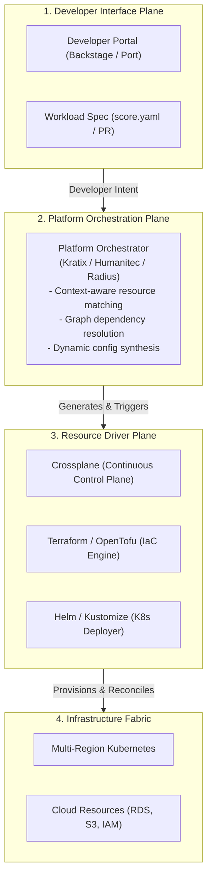
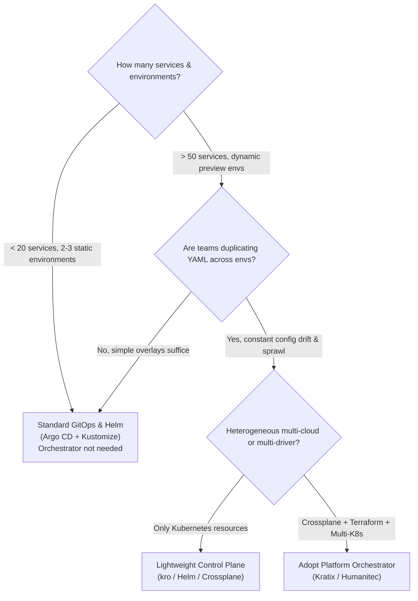

# Platform Orchestrators & Dynamic Configuration ⚙️

In small organizations, deploying a service via GitOps is straightforward: an engineer commits a Helm values file to a Git repository, and Argo CD applies it.

At enterprise scale, this **static configuration approach** breaks down. When an engineering organization scales to hundreds of microservices across dozens of ephemeral, staging, and multi-region production clusters, managing static YAML files leads to massive configuration duplication, out-of-sync environments, and fragile copy-paste workflows.

A **Platform Orchestrator** sits between developer interfaces (portals, CLIs, Git) and low-level infrastructure drivers (Crossplane, Terraform, Helm), dynamically generating environment-specific configuration based on high-level developer intent and contextual platform rules.



---

## 1. Deconstructing the Platform Stack: Portal vs Orchestrator vs Driver

A frequent architectural anti-pattern is attempting to make a developer portal perform infrastructure orchestration or expecting a Terraform pipeline to handle dynamic application environments.

| Layer                     | Primary Role                    | Examples                                                                            | What It Does NOT Do                                                      |
| :------------------------ | :------------------------------ | :---------------------------------------------------------------------------------- | :----------------------------------------------------------------------- |
| **Developer Portal**      | UI / Discovery / Front Door     | [[DevOps/platform-engineering/backstage\|Backstage]], Port, Cortex                  | Does not provision cloud resources or resolve runtime dependencies.      |
| **Platform Orchestrator** | Brain / Dynamic Resolution      | [Kratix](https://kratix.io/), Humanitec, Microsoft Radius                           | Does not execute cloud API calls directly; delegates to drivers.         |
| **Resource Driver**       | Execution / Provisioning Engine | [[DevOps/platform-engineering/crossplane\|Crossplane]], Terraform, OpenTofu, Pulumi | Does not decide _which_ environment topology or compliance rule applies. |

---

## 2. Static GitOps vs Dynamic Platform Orchestration

```
Static GitOps (YAML Sprawl):
[ App Repo ] ──► [ 10x Env Folders: /dev, /qa, /stage, /prod-us, /prod-eu ] ──► Argo CD
Problem: 80% duplicate YAML. Updating an ingress annotation requires editing 50 files.

Dynamic Orchestration:
[ score.yaml ] ──► [ Platform Orchestrator + Context Rules ] ──► Emits Ephemeral Manifests
Advantage: Intent is declared once; context (environment, region, secrets) is injected dynamically.
```

### Context-Aware Resolution

When a developer submits a request declaring `"needs: postgres"`, a platform orchestrator inspects the runtime context:

- **Context = `environment: dev`** → Resolves to an in-cluster containerized PostgreSQL instance or an ephemeral [[DevOps/platform-engineering/ephemeral-environments|vCluster]] database branch.
- **Context = `environment: production, region: eu-central-1`** → Resolves to an AWS Multi-AZ RDS instance in Frankfurt with KMS encryption, automated failover, and restricted VPC security groups.
- **Context = `environment: production, compliance: pci-dss`** → Automatically attaches strict audit logging, egress restrictions, and automated backup replication policies.

---

## 3. Open-Source Control Plane: Kratix (CNCF Sandbox)

[Kratix](https://kratix.io/) is an open-source framework developed by Syntasso that enables platform teams to co-locate and manage multi-cloud platforms using Kubernetes-native patterns.

Kratix introduces three core concepts:

```
┌────────────────────────────────────────────────────────┐
│                        Promise                         │
│  (Defines the API, dependencies, and delivery logic)   │
└───────────┬────────────────────────────────┬───────────┘
            ▼                                ▼
┌───────────────────────┐        ┌───────────────────────┐
│       Workflows       │        │     Destinations      │
│ (Container pipelines  │        │ (Worker clusters and  │
│  that transform state)│        │  cloud environments)  │
└───────────────────────┘        └───────────────────────┘
```

### Anatomy of a Kratix Promise

A platform team authors a **Promise** that bundles a Kubernetes CRD with Dockerized pipeline workflows:

```yaml
# kratix-postgres-promise.yaml
apiVersion: platform.kratix.io/v1alpha1
kind: Promise
metadata:
  name: postgresql
spec:
  api:
    apiVersion: apiextensions.k8s.io/v1
    kind: CustomResourceDefinition
    metadata:
      name: postgresqls.marketplace.example.com
    spec:
      group: marketplace.example.com
      names:
        kind: PostgreSQL
        plural: postgresqls
      scope: Namespaced
      versions:
        - name: v1alpha1
          served: true
          storage: true
          schema:
            openAPIV3Schema:
              type: object
              properties:
                spec:
                  type: object
                  properties:
                    size: { type: string, enum: [small, medium, large] }
  workflows:
    resource:
      configure:
        - apiVersion: platform.kratix.io/v1alpha1
          kind: Pipeline
          spec:
            containers:
              - image: ghcr.io/example-org/postgres-promise-pipeline:v1.0.0
                name: postgres-synthesizer
```

When a developer creates a `PostgreSQL` resource, Kratix runs the pipeline container, which can generate Crossplane claims, invoke Terraform, or configure GitOps manifests, scheduling the resulting workloads onto designated worker clusters (**Destinations**).

---

## 4. Alternative Orchestrators

### 1. Humanitec Platform Orchestrator

A commercial engine designed around the _Dynamic Configuration Management (DCM)_ model:

- Works with the [[DevOps/platform-engineering/workload-specifications|Score specification]] (`score.yaml`).
- Matches requested resource types against a central Resource Graph.
- Injects generated connection strings, credentials, and endpoints into container environment variables at deployment time.

### 2. Microsoft Radius

An open-source, cloud-native application platform that integrates application structures across Kubernetes, Azure, and AWS:

- Defines an application-first graph (Recipe model).
- Enables developers to write declarative Bicep files declaring dependencies on resources (e.g., Redis, Dapr, Mongo), which the platform operators map to concrete cloud services using infrastructure recipes.

---

## 5. Decision Framework: When Do You Need an Orchestrator?

Organizations should not introduce a platform orchestrator prematurely. Use the following decision criteria:



- **Stick with GitOps + Crossplane if:** You operate a moderate number of standard Kubernetes clusters and environments, and parameter variations between staging and production are easily managed via Kustomize overlays.
- **Adopt a Platform Orchestrator if:** You manage dozens of dynamic ephemeral environments, multi-region compliance tiers (e.g., EU vs US data isolation), or heterogeneous driver backends where single-source developer intent must dynamically synthesize multi-system configurations.

---

## Related Notes & Deep Dives

- 🏗️ **[[DevOps/platform-engineering/internal-developer-platforms|Internal Developer Platforms]]** — Overview of platform architecture and planes
- 📜 **[[DevOps/platform-engineering/workload-specifications|Workload Specifications & Score]]** — Developer-facing abstraction specifications
- ⏱️ **[[DevOps/platform-engineering/ephemeral-environments|Ephemeral Environments & EaaS]]** — Dynamic environment lifecycle management
- ☸️ **[[DevOps/platform-engineering/crossplane|Crossplane for Platform APIs]]** — Infrastructure resource drivers
