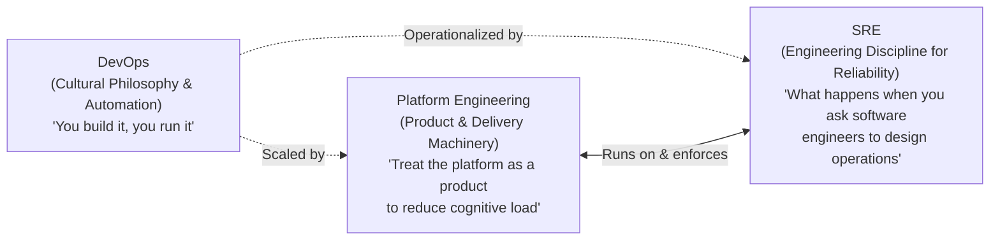

# Platform Engineering vs DevOps vs SRE ⚖️

Organizations adopting cloud-native architectures frequently conflate **DevOps**, **Site Reliability Engineering (SRE)**, and **Platform Engineering**. While all three disciplines share the overarching goal of shipping resilient software quickly, they address different structural bottlenecks, serve different internal customers, and employ distinct operating models.



---

## 1. The Core Paradigm Shift

The original promise of DevOps — _"You build it, you run it"_ — broke down at enterprise scale. Asking product developers to write business logic while simultaneously authoring Kubernetes manifests, IAM policies, Terraform modules, Prometheus alert rules, and container scanning workflows overwhelmed engineering teams with **excessive cognitive load**.

This led to "Shadow DevOps": organizations hired dedicated ops engineers into product squads or created siloed "DevOps teams" that became manual ticket-handling bottlenecks.

Platform Engineering resolves this tension by applying **product management** to internal tools and infrastructure:

- **DevOps** defines the _culture and automation philosophy_ (breaking silos, continuous delivery, rapid feedback loops).
- **SRE** provides the _engineering principles for reliability_ (treating operations as a software problem, defining SLOs, managing error budgets).
- **Platform Engineering** builds the _machinery and paved paths_ ([[DevOps/platform-engineering/golden-paths|Golden Paths]]) that allow developers to practice DevOps and SRE self-service without requiring deep infrastructure expertise.

---

## 2. Multi-Dimensional Comparison Matrix

| Dimension                 | DevOps                                                                                                  | Site Reliability Engineering (SRE)                                                                   | Platform Engineering                                                                                                                                             |
| :------------------------ | :------------------------------------------------------------------------------------------------------ | :--------------------------------------------------------------------------------------------------- | :--------------------------------------------------------------------------------------------------------------------------------------------------------------- |
| **Primary Philosophy**    | Cultural movement promoting shared ownership between Dev and Ops                                        | Applying software engineering principles to operations and production systems                        | Treating internal developer tooling and infrastructure as an internal product                                                                                    |
| **Primary Customer**      | The delivery stream / organization as a whole                                                           | End users of the production application                                                              | Product developers and application engineering squads                                                                                                            |
| **Core Interface**        | Automated CI/CD pipelines and version control                                                           | Service Level Objectives (SLOs), error budgets, incident dashboards                                  | Internal Developer Platform (IDP), portals ([[DevOps/platform-engineering/backstage\|Backstage]]), APIs ([[DevOps/platform-engineering/crossplane\|Crossplane]]) |
| **Delivery Model**        | Decentralized practices across feature teams                                                            | Embedded or consulting reliability engineers; on-call rotations                                      | **X-as-a-Service**: declarative self-service without human ticket handoffs                                                                                       |
| **Key Metrics**           | [[DevOps/ci-cd/dora-metrics\|DORA metrics]]: Deployment Frequency, Lead Time, MTTR, Change Failure Rate | [[DevOps/sre/slos-and-error-budgets\|SLOs & Error Budgets]]: Availability, Latency, Error Rate, MTBF | Onboarding time, self-service adoption, DevEx / Net Promoter Score (NPS), toil removed                                                                           |
| **Role During Incidents** | Shared triage between product engineers and operators                                                   | Incident Commander, reliability specialist, blameless postmortem facilitator                         | Upstream infrastructure provider; on-call for platform control-plane outages                                                                                     |
| **Core Artifacts**        | Build/test automation scripts, trunk-based Git workflows                                                | SLIs/SLOs, runbooks, chaos engineering experiments, postmortems                                      | Golden Paths, service catalogs, composable infrastructure APIs, scaffolds                                                                                        |

---

## 3. Team Topologies Interaction Framework

In the _Team Topologies_ model (Skelton and Pais), successful platform adoption depends on strictly defined team types and interaction modes:

```
┌────────────────────────────────────────────────────────┐
│               Stream-Aligned Teams                     │
│   (Payment Squad, Search Squad, Mobile Squad)          │
└───────────▲───────────────────────────────▲────────────┘
            │                               │
            │ Facilitating                  │ X-as-a-Service
            │                               │
┌───────────┴──────────────┐   ┌────────────┴────────────┐
│      Enabling Team       │   │      Platform Team      │
│ (Cloud Migration Squad,  │   │ (Internal Developer     │
│  Security Champions)     │   │  Platform, APIs, Infra) │
└──────────────────────────┘   └─────────────────────────┘
```

### Team Archetypes

1. **Stream-Aligned Teams:** The continuous value stream. Cross-functional squads delivering business functionality directly to end users.
2. **Platform Teams:** Provide underlying capabilities that enable stream-aligned teams to deliver autonomously without directly owning underlying infrastructure.
3. **Enabling Teams:** Specialists who investigate new tools and practices, pair with stream-aligned teams to help them adopt a new capability (e.g., container migration or automated canary releases), and then step away.
4. **Complicated-Subsystem Teams:** Specialized domain engineers (e.g., mathematical optimization engines, bespoke video transcoding, telecommunications codecs) requiring rare domain expertise.

### Interaction Modes

- **X-as-a-Service:** The platform team's primary mode. Stream-aligned teams consume platform APIs, templates, and clusters self-service without filing tickets or scheduling sync meetings.
- **Collaboration:** Two teams work closely together for a brief, bounded period (e.g., 2–4 weeks) to discover and co-design a new platform API or golden path.
- **Facilitating:** An enabling team coaches a stream-aligned team to adopt modern practices, resolving knowledge gaps and fostering autonomy.

---

## 4. Responsibility Boundaries (RACI Matrix)

Clarifying who is **Responsible**, **Accountable**, **Consulted**, and **Informed** prevents operational drift:

| Responsibility Area                                     | Application Developer |        SRE         | Platform Engineer | Security Team  |
| :------------------------------------------------------ | :-------------------: | :----------------: | :---------------: | :------------: |
| **Authoring Application Code & Business Logic**         |       **A / R**       |         I          |         I         |       C        |
| **Designing & Maintaining Golden Paths / Scaffolder**   |           C           |         C          |     **A / R**     |       C        |
| **Defining Service-Level Objectives (SLOs)**            |         **R**         |       **A**        |         C         |       I        |
| **Provisioning Production Cloud Resources (RDS, VPC)**  |      Intent (R)       |         I          |  **A (via API)**  |  C (Policies)  |
| **Triage for Application Production Outages**           |         **R**         | **A / Facilitate** |         I         |       I        |
| **Control-Plane Health (Argo CD, Crossplane, K8s API)** |           I           |         C          |     **A / R**     |       I        |
| **Container & Dependency CVE Remediation in Services**  |       **A / R**       |         I          |     C (Tools)     | C (Compliance) |
| **Base Image Hardening & Signing Pipeline**             |           I           |         I          |       **R**       |     **A**      |

---

## 5. Organizational Evolution Path

Organizations typically evolve across three distinct stages:

```
Stage 1: Traditional Siloed Ops
[ Developers ]  -- (Jira Ticket: "Please spin up VM & DB") -->  [ Operations / Sysadmins ]

Stage 2: The "DevOps Team" Anti-Pattern
[ Developers ]  -- (Code thrown over wall) -->  [ "DevOps Team" (Writes YAML/CI) ]  -->  Cloud

Stage 3: Scaled Platform Engineering + Decentralized SRE
[ Stream-Aligned Teams ] ──► [ Self-Service IDP (Backstage/Crossplane) ] ──► Multi-Cloud Fabric
             ▲
             │ (SLO Guidance & Chaos Engineering)
   [ SRE / Enabling Team ]
```

1. **Stage 1 (Traditional Silos):** Developers write code; operations engineers manually provision servers, databases, and network configs via ticketing systems. High lead times (weeks to months) and frequent handoff friction.
2. **Stage 2 (The "DevOps Team" Trap):** The company hires engineers with "DevOps" titles to manage CI/CD, Helm charts, and cloud resources. This simply rebrands operations into a modern silo, leaving developers reliant on ticket queues.
3. **Stage 3 (Platform as a Product + SRE):** The organization creates a dedicated platform product team that builds self-service capabilities. Stream-aligned teams own their services in production, supported by SREs who define reliability standards and error budgets.

---

## 6. Organizational Anti-Patterns and Traps

| Anti-Pattern                    | Warning Signs                                                                                                                                      | Remediation                                                                                                                                                                       |
| :------------------------------ | :------------------------------------------------------------------------------------------------------------------------------------------------- | :-------------------------------------------------------------------------------------------------------------------------------------------------------------------------------- |
| **The "Platform in Name Only"** | The infrastructure team changes its Slack channel name to `#platform-engineering` but continues resolving Jira tickets manually.                   | Adopt product management: hire an internal Platform PM, track developer NPS, and mandate X-as-a-service self-service.                                                             |
| **The Golden Cage**             | The platform enforces rigid paths with zero escape hatches. Teams with specialized requirements (e.g., GPU/ML training) are blocked from delivery. | Pave the road, don't build a fence. Allow teams to step off the path as long as they meet security and compliance guardrails.                                                     |
| **The Ivory Tower Platform**    | The platform team spends 12 months building an elaborate abstraction layer without consulting product developers, only for nobody to adopt it.     | Use the [[DevOps/platform-engineering/internal-developer-platforms#thinnest-viable-platform\|Thinnest Viable Platform (TVP)]] approach: co-create with 1–2 friendly pilot squads. |
| **The "Zero Ops" Fallacy**      | Leadership assumes that building an IDP eliminates the need for operational expertise among product engineers.                                     | The platform reduces _cognitive load_, not _ownership_. Developers must still understand basic application health, debugging, and business logic reliability.                     |

---

## Related Notes & Deep Dives

- 🏗️ **[[DevOps/platform-engineering/README|Platform Engineering Overview]]** — Reference architecture and the 5 operational planes
- 🚀 **[[DevOps/platform-engineering/internal-developer-platforms|Internal Developer Platforms]]** — Platform as a product, team topologies, and failure modes
- 🛣️ **[[DevOps/platform-engineering/golden-paths|Golden Paths]]** — Designing paved roads and an end-to-end worked developer journey
- 🎯 **[[DevOps/sre/README|Site Reliability Engineering]]** — Reliability engineering, error budgets, and incident management
- 📊 **[[DevOps/ci-cd/dora-metrics|DORA Metrics]]** — Measuring deployment frequency and lead time for changes
