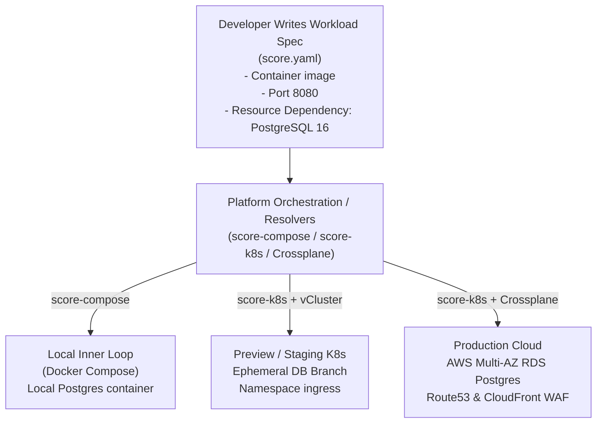

# Workload Specifications & Developer Abstractions 📜

Modern Kubernetes deployments commonly require hundreds of lines of YAML per microservice: `Deployment`, `Service`, `Ingress`, `HorizontalPodAutoscaler`, `PodDisruptionBudget`, `ServiceAccount`, and cloud provider annotations.

When developers are forced to write and maintain raw Kubernetes manifests or deeply nested Helm charts, two failure modes occur:

1. **High Cognitive Load:** Application developers must become Kubernetes and cloud networking experts just to deploy a web API.
2. **Configuration Drift & Coupling:** Infrastructure specifics (such as cloud VPC subnet IDs, certificate manager annotations, or storage classes) become hardcoded into the application's source repository, making migrations between cloud providers or local Docker environments difficult.

**Workload Specifications** solve this by strictly separating **workload intent** (what the application needs to run) from **environmental context** (how the platform fulfills those needs in a given environment).



---

## 1. The Score Specification (`score.yaml`)

[Score](https://score.dev/) is an open-source, CNCF Sandbox specification that provides a developer-centric, environment-agnostic definition for containerized workloads.

Instead of writing a Kubernetes Deployment or Helm values file, the developer writes a single `score.yaml` in the service repository:

```yaml
# score.yaml
apiVersion: score.dev/v1b1
metadata:
  name: payment-api

containers:
  payment-api:
    image: .
    command: ["/app/server"]
    variables:
      PORT: "8080"
      DB_HOST: "${resources.db.host}"
      DB_PORT: "${resources.db.port}"
      DB_USER: "${resources.db.username}"
      DB_PASSWORD: "${resources.db.password}"
      DB_NAME: "${resources.db.name}"
    resources:
      requests:
        cpu: "250m"
        memory: "256Mi"
      limits:
        cpu: "1000m"
        memory: "512Mi"

resources:
  db:
    type: postgres
    params:
      version: "16"
  dns:
    type: dns
  route:
    type: route
    params:
      port: 8080
      path: /api/v1/payments
```

### Key Properties of `score.yaml`

1. **Intent-Driven:** The developer declares that `payment-api` needs a `postgres` database with version 16. They do **not** declare whether it runs as a local container, an in-cluster Bitnami StatefulSet, or an AWS Multi-AZ RDS instance.
2. **Environment Variable Injection:** Variables reference dynamic resource outputs using standard placeholders (e.g., `${resources.db.host}`).
3. **No Infrastructure Leakage:** Zero AWS ARNs, Kubernetes namespace names, or cloud VPC IDs appear in the file.

---

## 2. Resolving Intent Across Environments

The platform team provides environment-specific **Score Implementation CLIs** or orchestrators:

| Environment              | Tool                                                                           | Resolution Output                                                                                            |
| :----------------------- | :----------------------------------------------------------------------------- | :----------------------------------------------------------------------------------------------------------- |
| **Local Development**    | `score-compose`                                                                | Translates `score.yaml` into a `docker-compose.yaml` with a local PostgreSQL container and mapped ports.     |
| **Ephemeral PR Preview** | `score-k8s` + [[DevOps/platform-engineering/ephemeral-environments\|vCluster]] | Synthesizes a Kubernetes Deployment and injects credentials from an ephemeral database branch.               |
| **Production EKS**       | `score-k8s` + [[DevOps/platform-engineering/crossplane\|Crossplane]]           | Generates a Kubernetes Deployment, a Crossplane `Database` Composite Resource (XRD), and ingress networking. |

### Worked Example: From `score.yaml` to Local Compose vs Production K8s

#### Local Development Command:

```bash
score-compose init
score-compose generate score.yaml
docker compose up -d
```

_Result:_ Developers run the full microservice topology locally without writing custom mock containers or Docker Compose network definitions.

#### Production GitOps Pipeline Command:

```bash
score-k8s generate score.yaml --overrides=environments/production.yaml -o k8s-manifests.yaml
```

_Result:_ The platform CLI generates the hardened production Kubernetes Deployment with liveness probes, secret references, and the associated Crossplane infrastructure claim.

---

## 3. Alternative: Open Application Model (OAM) & KubeVela

Before Score, the CNCF and Open Web Foundation explored the **Open Application Model (OAM)**, realized primarily through [KubeVela](https://kubevela.io/).

OAM splits application architecture into three explicit roles:

```
┌────────────────────────────────────────────────────────┐
│               Application Configuration                │
│ (Developer declares components and applies traits)     │
└───────────┬────────────────────────────────┬───────────┘
            ▼                                ▼
┌───────────────────────┐        ┌───────────────────────┐
│       Component       │        │         Trait         │
│ (The container logic) │        │ (Operational behavior:│
│                       │        │  autoscaling, ingress)│
└───────────────────────┘        └───────────────────────┘
```

```yaml
# KubeVela Application definition
apiVersion: core.oam.dev/v1beta1
kind: Application
metadata:
  name: payment-app
spec:
  components:
    - name: payment-frontend
      type: webservice
      properties:
        image: payment-service:v1.2.0
        ports:
          - port: 8080
            expose: true
      traits:
        - type: scaler
          properties:
            replicas: 3
        - type: gateway
          properties:
            domain: payments.example.com
            routes:
              - path: /
                targetPort: 8080
```

### Score vs OAM / KubeVela Comparison

| Feature                | Score (`score.yaml`)                                | KubeVela (OAM)                                      |
| :--------------------- | :-------------------------------------------------- | :-------------------------------------------------- |
| **Philosophy**         | Lightweight, spec-only, engine-agnostic             | Full control plane operator installed in Kubernetes |
| **Runtime Dependency** | Zero. Compiles offline to Compose, Helm, or raw K8s | Requires KubeVela controller running in Kubernetes  |
| **Local Inner Loop**   | Native support via `score-compose`                  | Requires local Minikube/Kind running KubeVela       |
| **Extensibility**      | Uses platform orchestrators (Kratix/Humanitec)      | Custom Trait and Component definitions via CUE      |

---

## 4. Best Practices for Platform Teams

1. **Avoid the "Universal Abstraction" Trap:** Do not attempt to build an abstraction that hides 100% of Kubernetes capabilities. Expose the 80% common use cases (ports, storage, env vars, basic scaling) while maintaining an escape hatch for specialized workloads (e.g. DaemonSets, GPU node affinities).
2. **Automate in CI/CD:** Generate concrete Kubernetes manifests from workload specifications inside automated CI pipelines rather than expecting developers to run manual transformation CLI commands.
3. **Reference Golden Paths:** Pair `score.yaml` with service scaffolding in [[DevOps/platform-engineering/backstage|Backstage]]. When a developer creates a new service from a template, the generated repository includes a tested `score.yaml` by default.

---

## Related Notes & Deep Dives

- 🏗️ **[[DevOps/platform-engineering/internal-developer-platforms|Internal Developer Platforms]]** — Reference architecture and the orchestration plane
- ⚙️ **[[DevOps/platform-engineering/platform-orchestrators|Platform Orchestrators & Dynamic Configuration]]** — Resolving workload specs into cloud resources
- 🛣️ **[[DevOps/platform-engineering/golden-paths|Golden Paths]]** — Designing paved paths for common services
- ☸️ **[[DevOps/platform-engineering/crossplane|Crossplane for Platform APIs]]** — Declarative infrastructure backends
