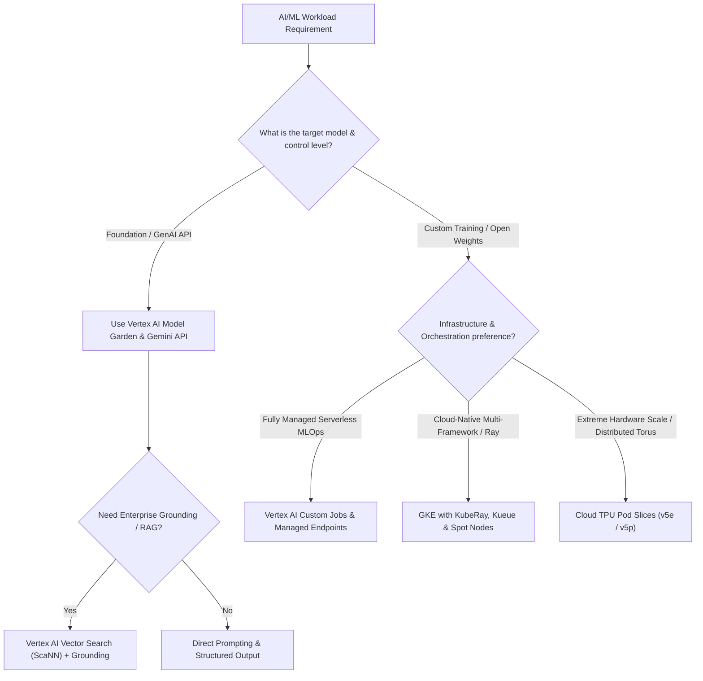

# GCP AI & Machine Learning Hub 🤖

Google Cloud provides an integrated end-to-end artificial intelligence and machine learning portfolio spanning managed generative AI platforms, custom training and serving infrastructure, and hardware accelerators. This hub organizes Google Cloud's AI services across foundational models, enterprise retrieval, ML lifecycle operations (MLOps), and high-performance computing clusters.

---

## Service Catalog & Architecture Map

| Service                     | Category             | Core Architecture & Primary Use Case                                                                                                                                       | Reference Guide                                                        |
| :-------------------------- | :------------------- | :------------------------------------------------------------------------------------------------------------------------------------------------------------------------- | :--------------------------------------------------------------------- |
| **Vertex AI**               | Managed AI Platform  | Unified platform spanning Model Garden (Gemini 1.5/2.0), Vertex Studio, custom training, managed endpoints, Feature Store, and Vector Search.                              | [[GCP/ai/vertex-ai\|Vertex AI Deep Dive]]                              |
| **Cloud TPU**               | Hardware Accelerator | Custom Application-Specific Integrated Circuits (ASICs) featuring Matrix Multiply Units (MXUs), 2D/3D Torus Inter-Chip Interconnect (ICI), and Pod slicing (v4, v5e, v5p). | [[GCP/ai/cloud-tpu\|Cloud TPU Architecture]]                           |
| **GKE AI/ML Orchestration** | Containerized ML     | GPU/TPU orchestration on Kubernetes with Ray on GKE (KubeRay), Kueue job scheduling, and Dynamic Workload Scheduler.                                                       | [[GCP/compute/gke/gpu-tpu-orchestration\|GKE GPU & TPU Orchestration]] |
| **GKE Batch & Kueue**       | Batch Scheduling     | Multi-tenant queueing, fair-share preemption, and high-throughput batch processing for training jobs.                                                                      | [[GCP/compute/gke/batch-workloads-kueue\|GKE Batch Workloads & Kueue]] |
| **Cloud Storage FUSE CSI**  | Data Streaming       | High-throughput POSIX streaming of training datasets from GCS directly into container memory with local NVMe caching.                                                      | [[GCP/compute/gke/cloud-storage-fuse\|GKE Cloud Storage FUSE CSI]]     |

---

## Architectural Decision Framework

### 1. Generative AI vs Custom Model Training

- **Vertex AI Model Garden & Studio:** For organizations consuming pre-trained foundational models (Gemini 1.5 Pro, Gemini 1.5 Flash, Imagen, Claude via Vertex, and open-weight models like Llama 3 and Gemma). It eliminates infrastructure management while providing safety guardrails, grounding with Google Search or enterprise datastores, and tuned model registries.
- **Custom Training Pipeline:** For organizations developing proprietary architectures using PyTorch, JAX, or TensorFlow. Vertex AI Custom Training handles automated worker provisioning, GCS staging, and artifact logging.

### 2. Accelerator Selection Matrix

| Workload Profile                              | Recommended Hardware                        | Interconnect & Networking                   | Typical Cost Baseline           |
| :-------------------------------------------- | :------------------------------------------ | :------------------------------------------ | :------------------------------ |
| **Lightweight Inference / Small Fine-Tuning** | NVIDIA L4 GPU / TPU v5e (`v5litepod-4`)     | PCIe Gen4 / 400 Gbps 2D Torus               | Low (~$0.56–$1.20/chip-hr)      |
| **High-Throughput LLM Serving (vLLM / TGI)**  | NVIDIA A100 (80GB) / TPU v5e Pods           | NVLink 3.0 / 800 GiB/s ICI                  | Moderate (~$1.20–$3.67/hr)      |
| **Ultra-Scale Foundation Model Pre-Training** | Cloud TPU v5p / NVIDIA H100 (80GB SXM5)     | 4,800 Gbps 3D Torus ICI / GPUDirect RDMA    | Premium (~$4.20–$10.00/chip-hr) |
| **Cost-Sensitive Batch Inference**            | Spot VMs + Dynamic Workload Scheduler (DWS) | Preemptible node allocation with Flex start | 60–70% discount off on-demand   |

---

## Enterprise MLOps Architectural Blueprint

A production GCP MLOps pipeline connects the following system boundaries:

1. **Feature Engineering & Ingestion:** Raw feature data ingested via [[GCP/databases/bigquery\|BigQuery]] or [[GCP/storage/gcs\|Cloud Storage (GCS)]], indexed into **Vertex AI Feature Store** for dual-mode serving (low-latency online key-value retrieval and point-in-time correct offline historical batch extraction).
2. **Orchestrated Pipelines:** Automated training workflows orchestrated via **Vertex AI Pipelines** (Kubeflow Pipelines / TFX engine), executing serverless container steps with complete lineage tracking in Vertex ML Metadata.
3. **Model Governance & Registry:** Evaluated weights registered in **Vertex AI Model Registry**, versioned with cryptographic container digests, evaluation metrics, and integration with [[GCP/compute/gke/binary-authorization\|Binary Authorization]] for cryptographically signed deploy-time provenance.
4. **Serving & Observability:** Real-time low-latency inference deployed across **Vertex AI Endpoints** (supporting traffic splitting, auto-rollback, and private VPC Service Controls) or scaled on [[GCP/compute/gke\|GKE]] using Datapath V2 and Envoy Gateway, monitored via Vertex Explainable AI and Vertex Model Monitoring for data drift.

---

## Related Knowledge Hubs

- [[GCP]] — Master Google Cloud Platform architectural catalog
- [[GCP/compute/gce|GCP Compute Engine]] — Virtual machines, containers, and serverless compute
- [[GCP/storage/gcs|Google Cloud Storage (GCS)]] — High-throughput object store for AI/ML weights and datasets
- [[Azure/compute/aks/gpu-orchestration-ai|AKS GPU Orchestration]] — Comparison with Azure accelerated computing
