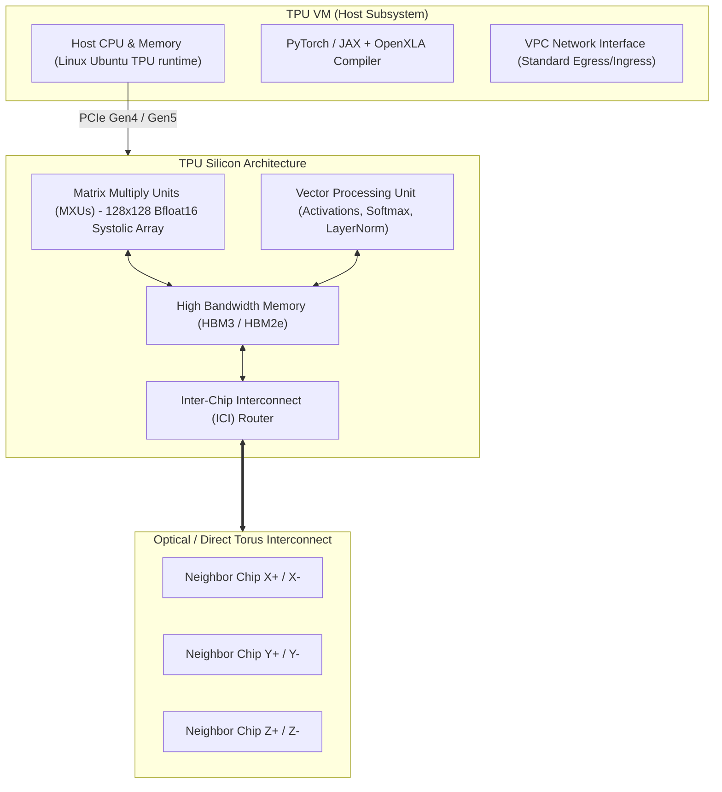

# Cloud TPU Architecture & Pod Supercomputing ⚡

Google Cloud Tensor Processing Units (TPUs) are custom-designed Application-Specific Integrated Circuits (ASICs) engineered from the silicon up to accelerate linear algebra and matrix multiplication operations that form the mathematical foundation of deep neural networks (LLMs, vision models, diffusion architectures).

---

## Architecture & Mental Model



### 1. The Systolic Array & Matrix Multiply Unit (MXU)

Unlike standard CPUs or GPUs that repeatedly fetch operands from registers and cache hierarchies for every multiply-accumulate instruction, a TPU MXU uses a **systolic array**. Data flows continuously across a two-dimensional grid of arithmetic processing elements without returning intermediate results to registers. This dramatically reduces memory bus contention and optimizes power efficiency for matrix multiplication operations ($\mathbf{C} = \mathbf{A} \times \mathbf{B}$).

### 2. TPU VM Architecture vs Legacy TPU Node

- **Legacy Architecture (TPU Node):** The user ran an independent Compute Engine VM that transmitted gRPC tensors over a standard VPC network to an isolated, Google-managed TPU slice. This created severe network serialization bottlenecks.
- **Modern Architecture (TPU VM):** Introduced with TPU v4 and v5, workloads execute directly on the physical host machine to which the TPU hardware is attached. Developers have root SSH access, can mount [[GCP/storage/persistent-disk\|Persistent Disks]], mount [[GCP/compute/gke/cloud-storage-fuse\|GCS via FUSE]], and eliminate remote gRPC serialization overhead.

---

## Hardware Generations Comparison

| Specification                     | TPU v4                            | TPU v5e (Lite / Cost-Optimized)               | TPU v5p (Performance / Flagship)           |
| :-------------------------------- | :-------------------------------- | :-------------------------------------------- | :----------------------------------------- |
| **Primary Target**                | Large-scale LLM pre-training      | Cost-efficient inference & mid-scale training | Ultra-scale Foundation Models (1T+ params) |
| **Memory per Chip**               | 32 GB HBM2e                       | 16 GB HBM2e                                   | **95 GB HBM3**                             |
| **Memory Bandwidth**              | 1,200 GB/s                        | 800 GiB/s                                     | **2,765 GB/s**                             |
| **Peak Compute (BF16)**           | 275 TFLOPS                        | 197 TFLOPS                                    | **459 TFLOPS**                             |
| **Inter-Chip Interconnect (ICI)** | 450 GB/s (Optical Circuit Switch) | 400 Gbps (Copper direct-attach)               | **4,800 Gbps (1.2 TB/s)**                  |
| **Network Topology**              | 3D Torus                          | 2D Torus                                      | **3D Torus**                               |
| **Max Pod Slicing Capacity**      | 4,096 chips                       | 256 chips                                     | **8,960 chips (Multislice scalable)**      |
| **On-Demand Baseline Price**      | ~$3.22 / chip-hour                | ~$1.20 / chip-hour                            | ~$4.20 / chip-hour                         |

---

## Deep Core Concepts & Distributed Topology

### 1. Inter-Chip Interconnect (ICI) & Torus Geometry

TPUs connect to each other across a dedicated, low-latency private interconnect network (**ICI**) completely independent of the Google Cloud VPC:

- **2D Torus (v5e):** Chips arranged in planar rings along $X$ and $Y$ dimensions. Topologies are specified as $A \times B$ (e.g., $2 \times 4$ for an 8-chip slice, $16 \times 16$ for 256 chips).
- **3D Torus (v4 and v5p):** Chips arranged in three-dimensional geometric cubes along $X$, $Y$, and $Z$ axes with wraparound boundary links (e.g., $2 \times 2 \times 1$, $4 \times 4 \times 4$). Optical Circuit Switches (OCS) dynamically reconfigure optical fiber paths to route around faulty hardware without taking down the entire cluster.

### 2. Queued Resources API vs Immediate Provisioning

Large TPU slices (e.g., 64 to 4,096 chips) require contiguous physical geometry in a single datacenter hall. The **Queued Resources API** allows training teams to submit an asynchronous reservation request. Google Cloud queues the request and automatically provisions the atomic cluster when the contiguous physical block becomes available, preventing partial allocations.

### 3. Dynamic Workload Scheduler (DWS)

For fault-tolerant batch training jobs, Google provides **Dynamic Workload Scheduler (Flex-start)**:

- Grants access to TPU capacity with guaranteed execution windows (e.g., 7 days max per run) at substantial cost discounts (~30–50% off on-demand).
- If node failure occurs, the Queued Resource manager automatically provisions a replacement slice.

---

## Production `gcloud` CLI Operations

### 1. Provisioning a Single-Host TPU v5e Slice

```bash
# Provision a single-host TPU v5e instance with 8 chips (v5litepod-8)
gcloud compute tpus tpu-vm create tpu-v5e-dev-01 \
  --zone=us-central1-a \
  --accelerator-type=v5litepod-8 \
  --version=tpu-ubuntu2204-base \
  --project=my-ml-prod-project

# Verify status and retrieve internal IP
gcloud compute tpus tpu-vm describe tpu-v5e-dev-01 \
  --zone=us-central1-a \
  --format="yaml(state,ipAddress,acceleratorType)"
```

### 2. Provisioning Multi-Host Pod Slices via Queued Resources API

```bash
# Request a contiguous 64-chip TPU v4 slice using a 4x4x4 3D Torus topology
gcloud alpha compute tpus queued-resources create tpu-v4-prod-slice-64 \
  --zone=us-central2-b \
  --node-id=tpu-v4-worker \
  --type=v4 \
  --topology=4x4x4 \
  --version=tpu-ubuntu2204-base \
  --project=my-ml-prod-project

# Monitor allocation status of the queued resource
gcloud alpha compute tpus queued-resources describe tpu-v4-prod-slice-64 \
  --zone=us-central2-b \
  --format="value(state.state)"
```

### 3. Executing Distributed Commands across All TPU VM Hosts

```bash
# Run a setup command across all physical host VMs in a multi-node TPU slice
gcloud compute tpus tpu-vm ssh tpu-v5e-dev-01 \
  --zone=us-central1-a \
  --worker=all \
  --command="python3 -c 'import torch_xla.core.xla_model as xm; print(xm.xla_device())'"
```

---

## Quotas, Performance, and Configuration Limits

| Dimension                     | Quota / Architectural Limit                               | Operational Guidance                                                                                                                                         |
| :---------------------------- | :-------------------------------------------------------- | :----------------------------------------------------------------------------------------------------------------------------------------------------------- |
| **Regional TPU Quotas**       | Strict 0-chip default on new projects                     | Submit quota requests via Google Cloud Console under `Cloud TPU API` for specific regions (`us-central1` for v5e, `us-east5` for v5p, `us-central2` for v4). |
| **Max Single Pod Slice**      | 8,960 chips (v5p), 4,096 chips (v4), 256 chips (v5e)      | For jobs requiring >8,960 chips, utilize Google Cloud **Multislice** technology linking multiple pods via high-speed DCN (Datacenter Network).               |
| **Root Disk Capacity**        | 100 GB default per TPU VM                                 | Attach secondary [[GCP/storage/persistent-disk\|Persistent Disks (pd-ssd)]] or stream via [[GCP/compute/gke/cloud-storage-fuse\|GCS FUSE]].                  |
| **Minimum Topology Geometry** | Topologies must form complete Torus rings or valid slices | Cannot provision arbitrary chip counts (e.g., 7 chips or 13 chips); must adhere to binary or cube geometric multiples ($1, 4, 8, 16, 32, 64, \dots$).        |

---

## Official References & Documentation

- [Google Cloud TPU System Architecture](https://cloud.google.com/tpu/docs/system-architecture-tpu-vm)
- [TPU v5e Hardware Guide](https://cloud.google.com/tpu/docs/v5e-overview)
- [TPU v5p Hardware Guide](https://cloud.google.com/tpu/docs/v5p-overview)
- [Queued Resources API Reference](https://cloud.google.com/tpu/docs/queued-resources)
- [JAX on Cloud TPU Guide](https://cloud.google.com/tpu/docs/jax-quickstart-tpu-vm)

---

## Realistic Pricing Scenarios

### Scenario 1: Fine-Tuning a 70B Parameter LLM on TPU v5e

- **Workload:** 32-chip TPU v5e slice (`v5litepod-32`) running distributed fine-tuning for 72 continuous hours.
- **Cost Calculation:**
  - 32 chips $\times \$1.20 / \text{chip-hour} = \mathbf{\$38.40 / \text{hour}}$
  - Total Training Runtime: 72 hours $\times \$38.40 = \mathbf{\$2,764.80}$
  - Staging Cloud Storage bucket & egress: $\mathbf{\$35.00}$
  - **Total Cost:** **~$2,799.80** (comparable 4x 8-H100 GPU cluster would cost ~$10,000+ for the same run).

### Scenario 2: High-Performance Pre-Training on TPU v5p Pod Slice

- **Workload:** 128-chip TPU v5p slice (Topology `4x4x8`) running for 30 days under a 1-year Committed Use Discount (CUD, ~30% discount).
- **Cost Calculation:**
  - On-Demand Baseline: 128 chips $\times \$4.20 / \text{chip-hour} = \$537.60 / \text{hour}$
  - Discounted CUD Hourly Rate: $\$537.60 \times 0.70 = \mathbf{\$376.32 / \text{hour}}$
  - Monthly Runtime: 730 hours $\times \$376.32 = \mathbf{\$274,713.60}$
  - Persistent Disks (16 TB Extreme SSD storage) & Monitoring: $\mathbf{\$2,150.00}$
  - **Total Monthly Spend:** **~$276,863.60 / month**

---

## Battle-Tested Nuggets & Production Gotchas

1. **The Multi-Host SSH `worker=all` Trap:**
   When provisioning a multi-host TPU slice (e.g. `v5litepod-16` or `v4-64`), the slice is comprised of multiple distinct Linux VM hosts running in parallel. Installing Python packages, CUDA/XLA wheels, or dataset dependencies on worker 0 alone will cause the distributed training script to hang indefinitely or crash with `DEADLINE_EXCEEDED`. You must append `--worker=all` to all `gcloud compute tpus tpu-vm ssh` commands or configure automated startup scripts.
2. **XLA Compilation Overhead & Static Shape Requirements:**
   OpenXLA compiles JAX/PyTorch computational graphs into fused TPU machine code. **XLA requires static tensor shapes.** If your training batch sizes or sequence lengths vary from iteration to iteration, XLA will recompile the computational graph on every step, causing training throughput to drop to near zero while host CPUs peg at 100%. Always pad batches to uniform sequence lengths.
3. **Bfloat16 vs Float32 Numerical Precision:**
   TPU Matrix Multiply Units natively execute in **Bfloat16** (Brain Floating Point, which retains the 8-bit exponent range of Float32 with a truncated 7-bit fraction). Code that forces raw `torch.float32` will trigger software emulation or massive memory transfers, reducing throughput by 3x–5x. Always leverage automatic mixed precision (`bfloat16`) to exploit the full systolic array speed.
4. **ICI Link Failures & Checkpoint Hygiene:**
   Because all chips in a TPU Pod slice communicate across a synchronous Torus network, the failure of a single physical chip or optical fiber link immediately halts execution across all participating hosts. Implement automated checkpoint saves to [[GCP/storage/gcs\|Cloud Storage]] every 30 to 60 minutes. Use asynchronous checkpointing libraries (e.g., Orbax for JAX) to avoid blocking TPU compute while writing to storage.
5. **Zone-Specific Hardware Siloing:**
   TPU generations are deployed only in select Google Cloud zones. For example, TPU v4 is heavily concentrated in `us-central2-b`, TPU v5p in `us-east5-a/c`, and TPU v5e in `us-central1-a/b/c`. Hardcoding zone values in Infrastructure-as-Code templates without verifying regional quota will lead to immediate provisioning rejections (`ZONE_RESOURCE_POOL_EXHAUSTED`).

---

## Across the wiki

- [[GCP/ai/README|GCP AI & Machine Learning Hub]] — Architectural overview of Google Cloud AI services
- [[GCP/ai/vertex-ai|Vertex AI Architecture]] — Managed enterprise platform for foundation models and endpoints
- [[GCP/compute/gke/gpu-tpu-orchestration|GKE GPU & TPU Orchestration]] — Deploying TPU workloads within Kubernetes clusters
- [[GCP/storage/gcs|Google Cloud Storage (GCS)]] — High-bandwidth storage backend for TPU training checkpoints
- [[AWS/machine-learning/sagemaker/README|AWS SageMaker & Trainium Comparison]] — Comparison with AWS Trainium and Inferentia architectures
