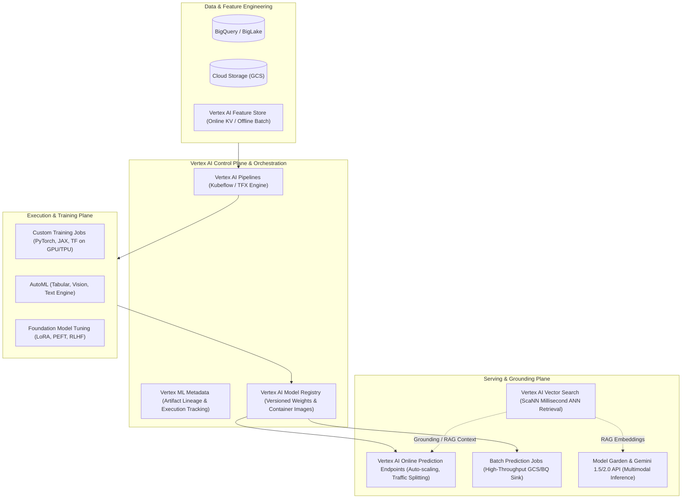

# Vertex AI Architecture & MLOps Deep Dive 🧠

Vertex AI is Google Cloud's unified, enterprise-grade artificial intelligence and machine learning platform. It unifies foundational generative AI models (Gemini family, Imagen, Codey, Claude, open-weight models), custom distributed model training, low-latency prediction endpoints, feature stores, and vector search engines under a managed control plane and metadata lineage graph.

---

## Architecture & Mental Model



Vertex AI separates the **control plane** (metadata, artifact lineage, pipeline orchestration, model registry) from the **data plane** (worker nodes, accelerator slices, inference containers). All operations emit cryptographic execution metadata to Vertex ML Metadata (MLMD), enabling auditability, reproducibility, and enterprise governance.

---

## Deep Core Concepts & Platform Subsystems

### 1. Model Garden & Foundation Model APIs

- **First-Party Foundation Models:** Exposes Google's flagship **Gemini** series (Gemini 1.5 Pro with up to 2M token context window, Gemini 1.5 Flash for high-frequency low-latency tasks), Imagen 3 for generative imagery, and Chirp for multilingual speech.
- **Model Garden Ecosystem:** Catalogs 150+ foundational, task-specific, and open-source models (including Anthropic Claude 3.5 Sonnet, Meta Llama 3.1, Mistral, and Google Gemma).
- **Grounding with Enterprise Data:** Foundation models connect natively to Google Search or proprietary datastores via Vertex AI Search and Vector Search, injecting authoritative context into prompt windows to eliminate hallucinations.

### 2. Vertex AI Vector Search (formerly Matching Engine)

- **ScaNN Algorithm:** Powered by Google's proprietary **Scalable Nearest Neighbors (ScaNN)** vector quantization algorithm, delivering sub-10 millisecond recall at 99%+ accuracy across billions of high-dimensional vectors.
- **Index vs Index Endpoint:** Vector indexes (embeddings compiled into tree-AH or brute-force structures) are compiled from GCS and deployed to scalable, distributed **Index Endpoints**.
- **Dual VPC Peering & Private Service Connect (PSC):** Exposes vector search endpoints via internal IP addresses without crossing public networks, meeting stringent Zero Trust compliance standards.

### 3. Vertex AI Feature Store

- **Dual Serving Topology:** Eliminates train-serve skew by providing a unified feature definition:
  - **Online Store:** Backed by Bigtable or BigQuery high-speed cache, returning single-digit millisecond latency lookups for real-time inference via `ReadFeatureValues`.
  - **Offline Store:** Backed by BigQuery, executing point-in-time "time-travel" joins to extract historical feature states without data leakage into training sets.

### 4. Custom Training & Managed Prediction Endpoints

- **Custom Jobs & Hyperparameter Tuning:** Spawns ephemeral compute clusters (CPUs, NVIDIA L4/A100/H100 GPUs, Cloud TPUs) executing arbitrary containerized training scripts. Output models are registered directly into the **Model Registry**.
- **Model Endpoints:** Hosts one or more deployed models behind a single Anycast HTTPS/gRPC endpoint. Supports blue-green canary routing (e.g., 90% traffic to `v1`, 10% to `v2`), zero-downtime rollbacks, and autoscaling from 0 to $N$ instances based on CPU/accelerator saturation.

---

## Production `gcloud` CLI Operations

### 1. Creating and Deploying a Model to an Online Prediction Endpoint

```bash
# 1. Create a dedicated Vertex AI Endpoint in the regional control plane
gcloud ai endpoints create \
  --region=us-central1 \
  --display-name="prod-recsys-endpoint" \
  --project=my-ml-prod-project

# 2. Upload and register a model container in Vertex AI Model Registry
gcloud ai models upload \
  --region=us-central1 \
  --display-name="recsys-transformer-v2" \
  --container-image-uri="us-docker.pkg.dev/my-ml-prod-project/ml-containers/recsys:v2.1.0" \
  --container-predict-route="/predict" \
  --container-health-route="/health" \
  --project=my-ml-prod-project

# 3. Deploy the registered model to the endpoint with auto-scaling and GPU acceleration
gcloud ai endpoints deploy-model $(gcloud ai endpoints list --region=us-central1 --filter="displayName:prod-recsys-endpoint" --format="value(name)") \
  --region=us-central1 \
  --model=$(gcloud ai models list --region=us-central1 --filter="displayName:recsys-transformer-v2" --format="value(name)") \
  --display-name="recsys-v2-prod-deployment" \
  --machine-type="g2-standard-8" \
  --accelerator="type=nvidia-l4,count=1" \
  --min-replica-count=2 \
  --max-replica-count=8 \
  --traffic-split="0=100"
```

### 2. Creating and Deploying a Vector Search Index

```bash
# 1. Create a Vector Search Index from embeddings in Cloud Storage
gcloud ai indexes create \
  --region=us-central1 \
  --display-name="enterprise-kb-embeddings" \
  --metadata-file="gs://my-ml-artifacts/vector_search/index_metadata.json" \
  --project=my-ml-prod-project

# 2. Create an Index Endpoint
gcloud ai index-endpoints create \
  --region=us-central1 \
  --display-name="enterprise-kb-index-endpoint" \
  --network="projects/1234567890/global/networks/vpc-prod" \
  --project=my-ml-prod-project

# 3. Deploy the index to the private VPC endpoint
gcloud ai index-endpoints deploy-index $(gcloud ai index-endpoints list --region=us-central1 --filter="displayName:enterprise-kb-index-endpoint" --format="value(name)") \
  --region=us-central1 \
  --index=$(gcloud ai indexes list --region=us-central1 --filter="displayName:enterprise-kb-embeddings" --format="value(name)") \
  --deployed-index-id="kb_index_v1" \
  --display-name="kb-index-deployment" \
  --min-replica-count=2 \
  --max-replica-count=4
```

### 3. Launching a Custom Multi-Node Distributed Training Job

```bash
# Submit custom training job running PyTorch distributed across 2 nodes with 8 A100 GPUs
gcloud ai custom-jobs create \
  --region=us-central1 \
  --display-name="llama3-lora-finetuning" \
  --worker-pool-spec="machine-type=a2-highgpu-4g,accelerator-type=nvidia-tesla-a100,accelerator-count=4,replica-count=2,container-image-uri=us-docker.pkg.dev/my-ml-prod-project/ml-containers/train-pytorch:latest" \
  --args="--epochs=5,--batch-size=64,--output-dir=gs://my-ml-artifacts/weights/run-42" \
  --project=my-ml-prod-project
```

---

## Quotas, Performance, and Configuration Limits

| Resource / Parameter                   | Default Quota / Architectural Limit                     | Mitigation & Scaling Strategy                                                                           |
| :------------------------------------- | :------------------------------------------------------ | :------------------------------------------------------------------------------------------------------ |
| **Online Prediction Payload Size**     | **1.5 MB** per REST/gRPC request                        | Store large payloads (images/audio) in [[GCP/storage/gcs\|GCS]]; pass object URIs in inference request. |
| **Online Prediction Request Timeout**  | **60 seconds** (Strict platform hard cap)               | For inference pipelines requiring >60s, dispatch asynchronously via Vertex AI Batch Prediction.         |
| **Max Deployed Models per Endpoint**   | **10 models** per single Endpoint                       | Consolidate or separate into dedicated regional Endpoints per team domain.                              |
| **Vector Search Max Dimensions**       | **10,000 dimensions** per vector                        | Standardize on 768 to 1536 dimensions (OpenAI / Gecko embeddings) to maximize ScaNN cache hits.         |
| **Gemini Token Limits (TPM / RPM)**    | Regional tiers (e.g., 360 RPM, 4M TPM on Pay-as-you-go) | Purchase Provisioned Throughput units (PTUs) for guaranteed zero-throttle SLA capacity.                 |
| **Max Custom Training Execution Time** | **30 days** per training job                            | Implement automated checkpointing to Cloud Storage every epoch to withstand preemption.                 |

---

## Official References & Documentation

- [Google Cloud Vertex AI Official Documentation](https://cloud.google.com/vertex-ai/docs)
- [Vertex AI Vector Search Architecture & ScaNN Paper](https://cloud.google.com/vertex-ai/docs/vector-search/overview)
- [Vertex AI Feature Store Documentation](https://cloud.google.com/vertex-ai/docs/featurestore/overview)
- [Google Cloud Generative AI on Vertex AI API Reference](https://cloud.google.com/vertex-ai/generative-ai/docs)

---

## Realistic Pricing Scenarios

### Scenario 1: Enterprise Generative AI Agent with Vector Search Grounding

- **Workload:** High-throughput customer support agent processing 5,000,000 queries/month.
  - Average prompt: 1,500 input tokens; average response: 400 output tokens using **Gemini 1.5 Flash**.
  - Vector search grounding against 2,000,000 knowledge base document chunks (768 dimensions), 2 deployed endpoint replicas for 99.99% availability.
- **Cost Calculation:**
  - Gemini 1.5 Flash Input: $5,000,000 \times 1,500 = 7.5\text{ Billion tokens} \times \$0.075 / 1\text{M} = \mathbf{\$562.50}$
  - Gemini 1.5 Flash Output: $5,000,000 \times 400 = 2.0\text{ Billion tokens} \times \$0.30 / 1\text{M} = \mathbf{\$600.00}$
  - Vector Search Serving Nodes: 2 replicas $\times$ `e2-standard-4` ($0.134/hr) $\times 730\text{ hrs} = \mathbf{\$195.64}$
  - Vector Index Storage & GCS hosting: $\mathbf{\$25.00}$
  - **Total Estimated Monthly Spend:** **~$1,383.14 / month**

### Scenario 2: Real-Time Machine Learning Serving on Dedicated GPU Endpoints

- **Workload:** Real-time fraud detection and recommendation inference serving 500 requests/sec.
  - 4 active replicas of `g2-standard-8` (32 GB RAM, 8 vCPUs) each equipped with 1 NVIDIA L4 GPU (24 GB VRAM) running continuously.
- **Cost Calculation:**
  - Machine Type `g2-standard-8`: $4 \times \$0.3924 / \text{hr} \times 730\text{ hrs} = \mathbf{\$1,145.81}$
  - NVIDIA L4 GPU: $4 \times \$0.56 / \text{hr} \times 730\text{ hrs} = \mathbf{\$1,635.20}$
  - Vertex AI Prediction Surcharge: ~$0.05/node-hr $\times 4 \times 730 = \mathbf{\$146.00}$
  - Cloud Logging & Monitoring telemetry: $\mathbf{\$45.00}$
  - **Total Estimated Monthly Spend:** **~$2,972.01 / month** (reduced by ~35% to ~$1,930/mo with a 1-year Committed Use Discount).

---

## Battle-Tested Nuggets & Production Gotchas

1. **The Endpoint Idle-Billing Trap:**
   Deploying a model to a Vertex AI Endpoint immediately provisions the underlying GCE instances. **You are billed 24/7 for the provisioned vCPUs and GPUs even if 0 requests are received**, because `min-replica-count` defaults to 1 unless configured. For internal staging or dev environments, undeploy models when inactive using a nightly Cloud Scheduler job triggering `gcloud ai endpoints undeploy-model`.
2. **Payload Size 1.5 MB Hard Ceiling:**
   Unlike Cloud Run (32 MB) or Compute Engine, Vertex AI online prediction endpoints reject any payload exceeding 1.5 MB with `413 Request Entity Too Large`. For image classification or audio processing, client applications must never send raw multipart binary files; instead, push the raw payload to [[GCP/storage/gcs\|GCS]] and pass the signed object URI in the JSON request body.
3. **Cold Start Latency on Scale-Up:**
   When scaling an endpoint from 1 to $N$ replicas during sudden traffic surges, downloading large model weights (e.g. 15–30 GB transformer checkpoints) from GCS into the container takes 60 to 180 seconds. Prevent 504 gateway timeouts by configuring `min-replica-count` to absorb peak baseline load, and configure proactive metric scaling triggers based on `aiplatform.googleapis.com/prediction/online/latency`.
4. **Vector Search VPC Network Peering Immutability:**
   When creating a private `IndexEndpoint`, the target VPC network cannot be changed once initialized. Furthermore, IP CIDR ranges allocated to the Google services peering connection must not overlap with internal subnet ranges, or index deployment will fail silently with `INTERNAL: Network peering failed to allocate route`.
5. **Model Registry vs Container Image Tagging:**
   Vertex AI Model Registry records the exact container image URI. If your deployment uses a mutable tag like `:latest`, updating the container image in [[GCP/developer-tools/artifact-registry\|Artifact Registry]] will not update running endpoint pods. Always deploy immutable SHA256 image digests (e.g., `image@sha256:...`) to guarantee deterministic rollback and compliance auditing.

---

## Across the wiki

- [[GCP/ai/README|GCP AI & Machine Learning Hub]] — Overview of AI/ML architectures on Google Cloud
- [[GCP/ai/cloud-tpu|Cloud TPU Architecture]] — Hardware acceleration using Google's matrix processing supercomputers
- [[GCP/compute/gke/gpu-tpu-orchestration|GKE GPU & TPU Orchestration]] — Kubernetes-native alternative for running open-source model inference
- [[GCP/storage/gcs|Google Cloud Storage (GCS)]] — High-throughput staging bucket for model weights and training datasets
- [[AWS/machine-learning/sagemaker/README|AWS SageMaker Comparison]] — Architectural comparison with AWS's flagship ML platform
